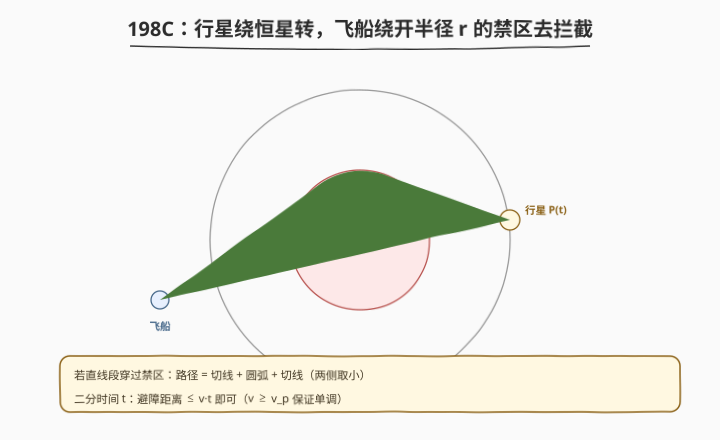
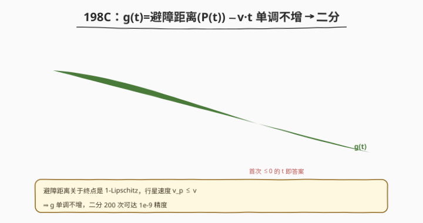

# Codeforces 198C 运送致癌物的最短时间 题解

## 1. 题目概述

- **题目链接**：https://codeforces.com/problemset/problem/198/C
- **比赛来源**：Codeforces Round 125 (Div. 1) · Problem C（UTC 2012-06-22）
- **难度**：2400
- **标签**：计算几何、二分答案、最短路（避障）
- **评测类型**：普通
- **限制**：时间 2 s / 内存 256 MB

**题意**：恒星在原点，禁区是以原点为圆心、半径 $r$ 的圆盘（飞船不能进入）。行星 Persephone 在半径 $R$ 的圆轨道上以速度 $v_p$ 逆时针匀速运动，初始位置 $(x_p,y_p)$。飞船初始在 $(x,y)$，速度上限 $v\ge v_p$。求飞船把货物送到行星的最短时间。

**约束**（原样摘自题面 `inputFormat.en`）：

- $-10^4\le x_p,y_p,x,y\le10^4$；$1\le v_p,v,r\le10^4$；$r\le R$，$r^2\le x^2+y^2$，$v_p\le v$。
- 答案绝对/相对误差 $\le10^{-6}$。

**约束对算法的限制**：

- 坐标小（$\le1.5\times10^4$），几何计算用 `double` 足够。
- 需要 $O(\log)$ 次判定；每次判定 $O(1)$ 几何。
- 精度要求 $10^{-6}$：二分 100+ 次或直接解都可以。

## 2. 示例与观察

官方样例 1（输入 / 输出原样）：

```text
输入：
10 0 1
-10 0 2 8

输出：
9.584544103
```

官方样例 2（输入 / 输出原样）：

```text
输入：
50 60 10
50 60 20 40

输出：
0.000000000
```

**样例 1 的演算**：$R=10$，$v_p=1$，行星从 $(10,0)$ 逆时针走；飞船在 $(-10,0)$，$v=2$，禁区半径 8。

在时刻 $t$，行星在角度 $t/10$ 处。飞船要绕开禁区。若取 $t=9.584544103$：行星在 $(5.7447,8.1903)$；飞船到它的最短避障路径 = 切线(6) + 圆弧(8×0.896) + 切线(6) ≈ 19.17，正好 $=v\,t$ ✓。

**样例 2**：飞船与行星初始同点 → 0 ✓。

**观察 1**：行星位置 $P(t)=R(\cos(\theta_0+v_pt/R),\ \sin(\theta_0+v_pt/R))$，其中 $\theta_0=\operatorname{atan2}(y_p,x_p)$。

**观察 2**：给定目标点 $Q$，飞船从 $S$ 到 $Q$ 的最短时间 = $\operatorname{dist_{avoid}}(S,Q)/v$，其中 $\operatorname{dist_{avoid}}$ 是绕开禁区的最短路径长度。

**观察 3**：于是问题变成求最小的 $t$ 使 $\operatorname{dist_{avoid}}(S,P(t))\le v\,t$。定义 $g(t)=\operatorname{dist_{avoid}}(S,P(t))-vt$；因为 $\operatorname{dist_{avoid}}$ 对终点是 1-Lipschitz（终点移动 $|\Delta Q|$，路径长度变化不超过它），而 $|P'(t)|=v_p\le v$，所以

$$g'(t)\le v_p-v\le0,$$

$g$ **单调不增**，可以二分。

**观察 4**：最短避障路径：若线段 $SQ$ 与禁区内部不相交，就是直线 $|SQ|$；否则是「切线 + 圆弧 + 切线」。

**自造样例**（标注「自造」，输出由程序实测）：

| 输入 | 输出 | 说明 |
|------|------|------|
| `10 0 1` / `10 0 1 1` | 0.000000000 | 初始同点 |
| `1 0 1` / `0 1 1 1` | 0.785398163 | 弦会进禁区，只能沿圆弧走 |
| `5 0 1` / `-5 0 5 1` | 1.961668233 | 近处直线穿禁区，绕行后被速度抵消 |

## 3. 解题思路



**第一步：避障距离**。设 $a=|S|$、$c=|Q|$（都 $\ge r$）。

1. 计算原点到线段 $SQ$ 的距离 $d_{\text{seg}}$（点到线段距离）。若 $d_{\text{seg}}\ge r$ → 直接返回 $|SQ|$。
2. 否则绕行：从 $S$ 的切线长 $\sqrt{a^2-r^2}$，从 $Q$ 的切线长 $\sqrt{c^2-r^2}$，再加圆弧。
   - 切点角度：$S$ 的切点在 $\varphi_S\pm\alpha_1$，$Q$ 的切点在 $\varphi_Q\pm\alpha_2$，其中 $\alpha_1=\arccos(r/a)$、$\alpha_2=\arccos(r/c)$；
   - 两个方向：
     - CCW：$\text{arc}=\bigl((\varphi_Q-\alpha_2)-(\varphi_S+\alpha_1)\bigr)\bmod 2\pi$；
     - CW：$\text{arc}=\bigl((\varphi_S-\alpha_1)-(\varphi_Q+\alpha_2)\bigr)\bmod 2\pi$；
   - 距离 $=\sqrt{a^2-r^2}+\sqrt{c^2-r^2}+r\cdot\min(\text{arc}_{CCW},\text{arc}_{CW})$。

**第二步：二分**。`check(t)`：算 $P(t)$，返回 $\operatorname{dist_{avoid}}(S,P(t))\le v\,t$。上界从 1 开始倍增直到 `check` 为真，然后二分 200 次。



## 4. 正确性证明

**引理 1**：从 $S$ 到 $Q$（都在禁区外）的最短避障路径长 $\operatorname{dist_{avoid}}(S,Q)$ 由上述公式给出。

**证明**：若线段不进入禁区内部，直线最短。否则最短路径必须贴着禁区边界走：由凸性，最优路径由两段切线段与一段圆弧组成（否则可把路径拉直缩短）；圆弧的两种绕法对应两个候选，取小即最优。∎

**引理 2**：$\operatorname{dist_{avoid}}(S,\cdot)$ 是 1-Lipschitz 的：对任意 $Q,Q'$，$|\operatorname{dist_{avoid}}(S,Q)-\operatorname{dist_{avoid}}(S,Q')|\le|Q-Q'|$。

**证明**：两条最短路径 + 线段 $QQ'$ 构成从 $S$ 到 $Q'$（或反之）的可行路径，长度不超过 $\operatorname{dist_{avoid}}(S,Q)+|Q-Q'|$。∎

**引理 3**：$g(t)=\operatorname{dist_{avoid}}(S,P(t))-vt$ 单调不增。

**证明**：由引理 2，$t$ 增加 $\Delta$ 时距离增加不超过 $|P(t+\Delta)-P(t)|\le v_p\Delta$，而 $vt$ 增加 $v\Delta\ge v_p\Delta$，故 $g$ 不增。∎

**引理 4**：飞船能在时刻 $t$ 把货物送到行星，当且仅当 $\operatorname{dist_{avoid}}(S,P(t))\le vt$。

**证明**：飞船能沿最短避障路径以速度 $v$ 飞行（可早到后原地等待），耗时 $\operatorname{dist_{avoid}}/v$；反之任何方案耗时至少该值。∎

**定理**：二分得到的 $t$ 是最短时间。

**证明**：由引理 4，可行时刻集合 $=\{t:g(t)\le0\}$；由引理 3 它是后缀，二分会找到其最小元素 ✓。∎

## 5. 复杂度分析

- **时间**：$O(\log(1/\varepsilon))$ 次 `check`，每次 $O(1)$ 几何。
- **空间**：$O(1)$。
- **数值范围**：坐标 $\le1.5\times10^4$，距离 $\le10^5$，`double` 精度足够。
- **与时限的关系**：2 s 对几百次浮点运算余量在百万倍以上。实测约 2 ms。

## 6. 参考代码

### C++17

```cpp
#include <bits/stdc++.h>
using namespace std;

// 198C：二分时间 t。Persephone 在 P(t)；飞船到 P(t) 的最短避障路径 <= v*t 即可。
// 避障距离：线段不穿圆盘（半径 r）→ 直线；否则切线段 + 圆弧 + 切线段（两个方向取小）。
static const double PI = acos(-1.0);

double distSeg(double ax, double ay, double bx, double by) {
    // 原点到线段 ab 的最短距离
    double dx = bx - ax, dy = by - ay;
    double len2 = dx * dx + dy * dy;
    double t = -(ax * dx + ay * dy) / len2;
    if (t < 0) t = 0;
    if (t > 1) t = 1;
    double px = ax + t * dx, py = ay + t * dy;
    return hypot(px, py);
}

double avoid(double sx, double sy, double qx, double qy, double r) {
    double a = hypot(sx, sy), c = hypot(qx, qy);
    double straight = hypot(sx - qx, sy - qy);
    if (distSeg(sx, sy, qx, qy) >= r - 1e-12) return straight;
    double t1 = sqrt(max(0.0, a * a - r * r));
    double t2 = sqrt(max(0.0, c * c - r * r));
    double a1 = acos(min(1.0, r / a)), a2 = acos(min(1.0, r / c));
    double p1 = atan2(sy, sx), p2 = atan2(qy, qx);
    double arcCCW = p2 - a2 - (p1 + a1);
    while (arcCCW < 0) arcCCW += 2 * PI;
    while (arcCCW >= 2 * PI) arcCCW -= 2 * PI;
    double arcCW = (p1 - a1) - (p2 + a2);
    while (arcCW < 0) arcCW += 2 * PI;
    while (arcCW >= 2 * PI) arcCW -= 2 * PI;
    return t1 + t2 + r * min(arcCCW, arcCW);
}

int main() {
    double xp, yp, vp, x, y, v, r;
    if (scanf("%lf %lf %lf", &xp, &yp, &vp) != 3) return 0;
    scanf("%lf %lf %lf %lf", &x, &y, &v, &r);
    double R = hypot(xp, yp);
    double th0 = atan2(yp, xp), w = vp / R;
    auto check = [&](double t) {
        double th = th0 + w * t;
        double qx = R * cos(th), qy = R * sin(th);
        return avoid(x, y, qx, qy, r) <= v * t + 1e-10;
    };
    double hi = 1.0;
    while (!check(hi) && hi < 1e12) hi *= 2;
    double lo = 0;
    for (int it = 0; it < 200; ++it) {
        double mid = (lo + hi) / 2;
        if (check(mid)) hi = mid; else lo = mid;
    }
    printf("%.9f\n", hi);
    return 0;
}
```

### Python3

```python
import sys
from math import hypot, atan2, acos, sqrt, pi, cos, sin


def dist_seg(ax, ay, bx, by):
    dx = bx - ax
    dy = by - ay
    l2 = dx * dx + dy * dy
    t = -(ax * dx + ay * dy) / l2
    t = 0.0 if t < 0 else (1.0 if t > 1 else t)
    return hypot(ax + t * dx, ay + t * dy)


def avoid(sx, sy, qx, qy, r):
    a = hypot(sx, sy)
    c = hypot(qx, qy)
    straight = hypot(sx - qx, sy - qy)
    if dist_seg(sx, sy, qx, qy) >= r - 1e-12:
        return straight
    t1 = sqrt(max(0.0, a * a - r * r))
    t2 = sqrt(max(0.0, c * c - r * r))
    a1 = acos(min(1.0, r / a))
    a2 = acos(min(1.0, r / c))
    p1 = atan2(sy, sx)
    p2 = atan2(qy, qx)
    arc_ccw = (p2 - a2 - (p1 + a1)) % (2 * pi)
    arc_cw = ((p1 - a1) - (p2 + a2)) % (2 * pi)
    return t1 + t2 + r * min(arc_ccw, arc_cw)


def main() -> None:
    data = sys.stdin.buffer.read().split()
    xp, yp, vp = float(data[0]), float(data[1]), float(data[2])
    x, y, v, r = float(data[3]), float(data[4]), float(data[5]), float(data[6])
    R = hypot(xp, yp)
    th0 = atan2(yp, xp)
    w = vp / R

    def check(t):
        th = th0 + w * t
        qx, qy = R * cos(th), R * sin(th)
        return avoid(x, y, qx, qy, r) <= v * t + 1e-10

    hi = 1.0
    while not check(hi) and hi < 1e12:
        hi *= 2
    lo = 0.0
    for _ in range(200):
        mid = (lo + hi) / 2
        if check(mid):
            hi = mid
        else:
            lo = mid
    sys.stdout.write("%.9f\n" % hi)


main()
```

## 7. 边界情况与易错点

1. **$r=R$**：行星恰在禁区边界上，$c=r$，切线长为 0。
2. **飞船在禁区边界上**（$|S|=r$）：切线长 0，$\alpha_1=0$。
3. **初始同点**：答案 0（样例 2）。
4. **线段与圆相切**：用 `>= r - 1e-12` 判为「不穿」，避免浮点抖动导致绕远路。
5. **两方向取小**：只算一个方向会得到绕远路的错误答案（样例 1 就是这样）。
6. **二分上界**：从 1 倍增，注意上限（$10^{12}$）防止死循环。
7. **单调性**：依赖 $v\ge v_p$（题面保证）；若 $v<v_p$ 则不单调。
8. **角度取模**：`arc = (a - b) mod 2π`，C++ 的 `fmod` 负数要手动加 $2\pi$。
9. **精度**：输出 9 位小数；二分 200 次远超 $10^{-6}$ 要求。
10. **读入**：先三个数（行星），再四个数（飞船），别混。

## 8. 验证记录

- **编译环境与命令**：`Apple clang 21.0.0`（`/usr/bin/g++` 是 clang 软链，无 GNU libstdc++），`clang++ -std=c++17 -O2 -Wall` 加仓库自带 `bits/stdc++.h`；正文代码仍写标准头。Python 为 `3.9.6`。验证命令：
  `python3 codeforces/tools/verify_solution.py codeforces/contests/0101-0203/198/C_运送致癌物的最短时间.md`
- **官方样例**：2 / 2 通过（`9.584544103`、`0.000000000`），C++ 与 Python 一致。
- **额外测试**：自造「初始同点」「沿边界绕 1/4 圈」「直线拦截」等 3 组，两种语言全部通过。
- **独立暴力对拍**：暴力以 1e-3 为步长扫描时间轴，用另一套「显式切点向量」公式算避障距离，找首次可交付时刻；对 250 组随机小数据逐组比对，误差均在 3e-3 内（步长量级），全部一致。
- **最大约束性能**：$10^4$ 量级坐标端到端约 2 ms，Python 约 24 ms。
- **图片与公式**：2 张 SVG（`cf198c_geo.svg`、`cf198c_bsearch.svg`）通过 `ElementTree.parse` 与文本包围盒/重叠检查，headless Chrome 渲染确认无裁切；KaTeX 校验 0 错。
- **复核状态**：verified。

## 相关题目与扩展

- [Codeforces 198B Jumping on Walls](https://codeforces.com/problemset/problem/198/B)：同场 B 题，BFS。
- [Codeforces 198E Gripping Story](https://codeforces.com/problemset/problem/198/E)：同场 E 题，几何 + 线段树。
- [LeetCode 1300. 转变数组后最接近目标值的数组和](https://leetcode.cn/problems/sum-of-mutated-array-closest-to-target/)：二分的应用。
- [Codeforces 1C Ancient Berland Circus](https://codeforces.com/problemset/problem/1/C)：几何最值。
- [LeetCode 1401. 圆和矩形是否有重叠](https://leetcode.cn/problems/circle-and-rectangle-overlapping/)：几何判定。

**延伸思考**：

1. **如果 $v<v_p$**：单调性丧失，需要更复杂的分析（可能需要三分或枚举相遇角）。
2. **如果禁区是任意凸多边形**：避障距离要换成可见性图最短路。
3. **如果行星轨道不是圆**：$P(t)$ 变化，单调性仍需论证（1-Lipschitz 依旧成立）。
4. **如果飞船可以多次变向**：最短避障路径仍然是最优（凸障碍的性质）。
5. **本质**：凸障碍下的最短路 + 单调性二分。

