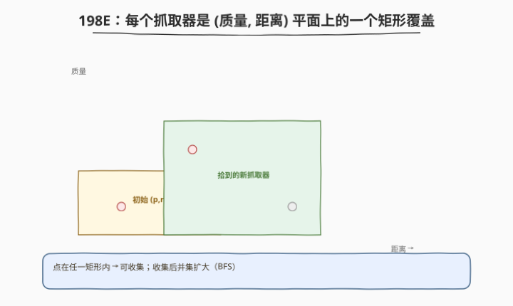
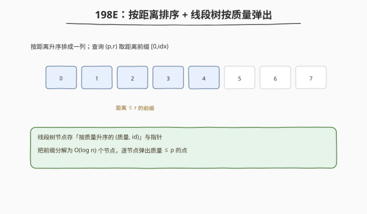

# Codeforces 198E 抓取器收集数量 题解

## 1. 题目概述

- **题目链接**：https://codeforces.com/problemset/problem/198/E
- **比赛来源**：Codeforces Round 125 (Div. 1) · Problem E（UTC 2012-06-22）
- **难度**：2400
- **标签**：BFS、线段树、二维偏序、贪心
- **评测类型**：普通
- **限制**：时间 4 s / 内存 512 MB

**题意**：飞船（位置固定）带一个旧抓取器 $(p,r)$。空间中有 $n$ 个抓取器，第 $i$ 个位于 $(x_i,y_i)$、质量 $m_i$，自身参数 $(p_i,r_i)$。

已拥有的任意抓取器 $(p,r)$ 可以抓取满足「质量 $\le p$ 且到飞船距离 $\le r$」的抓取器（距离是到**飞船**的距离）。抓到新抓取器后可以立刻换装、继续抓。求最多能抓到多少个（不含最初那个）。

**约束**（原样摘自题面 `inputFormat.en`）：

- $1\le n\le250000$；坐标 $|x|,|y|\le10^9$；$1\le m_i,p_i,r_i\le10^9$。
- 输出一个整数。

**约束对算法的限制**：

- $n$ 大：$O(n^2)$ 的「反复扫描」不行，需要 $O(n\log n)$。
- 每次抓取是「质量 $\le p$ 且距离 $\le r$」的二维查询，且查询集合会随抓取不断扩充。
- 坐标平方 $\le8\times10^{18}$，用 `long long`。

## 2. 示例与观察

官方样例 1（输入 / 输出原样）：

```text
输入：
0 0 5 10 5
5 4 7 11 5
-7 1 4 7 8
0 2 13 5 6
2 -3 9 3 4
13 5 1 9 9

输出：
3
```

**演算**：飞船在原点，初始 $(p,r)=(5,10)$。

| 抓取器 | 距离² | 质量 | 能否被初始抓取 |
|--------|-------|------|----------------|
| 1 (5,4) | 41 | 7 | 质量 7 > 5 ✗ |
| 2 (-7,1) | 50 | 4 | ✓（距离 $7.07\le10$） |
| 3 (0,2) | 4 | 13 | 质量 13 > 5 ✗ |
| 4 (2,-3) | 13 | 9 | 质量 9 > 5 ✗ |
| 5 (13,5) | 194 | 1 | 距离 13.9 > 10 ✗ |

抓到 2 号后获得 $(p,r)=(7,8)$：1 号距离 6.4 ≤ 8 且质量 7 ≤ 7 ✓ 抓到；再获得 $(11,5)$：4 号距离 3.6 ≤ 5 且质量 9 ≤ 11 ✓；3 号质量 13 > 11 ✗。共 3 个 ✓。

**观察 1**：抓取器的能力只取决于「已拥有的 $(p,r)$ 集合」。抓到更多只会让集合变大，所以「能抓就抓」不会错过最优。

**观察 2**：把每个抓取器看成平面上的点（质量 $m$，距离 $d$）；已拥有的 $(p,r)$ 能抓到它当且仅当 $m\le p$ 且 $d\le r$。

**观察 3**：于是这是一个「矩形覆盖 + BFS」：每个点被覆盖（收集）后，新增一个矩形 $[0,p_i]\times[0,r_i]$。

**观察 4**：按距离排序后，「$d\le r$」是前缀；在这一前缀里找「质量 $\le p$」的点，可以用线段树按质量弹出。

**自造样例**（标注「自造」，输出由程序实测）：

| 输入 | 输出 | 说明 |
|------|------|------|
| `0 0 1 1 1` / `100 100 1 1 1` | 0 | 太远 |
| `0 0 1 10 1` / `3 4 1 1 1` | 1 | 距离 5 ≤ 10 |
| `0 0 5 5 1` / `0 1 100 100 100` | 0 | 质量太大 |
| `0 0 1 1 2` / `1 0 1 100 5` / `2 0 1 1 1` | 2 | 链式扩展（2 号距离 2 ≤ 新半径 5） |

## 3. 解题思路



1. 计算每个抓取器到飞船的距离平方 $d_i^2$（避免开方）。
2. 按 $d_i^2$ 升序排序。
3. 建线段树（按排序后的下标）：每个节点存该段内所有点按**质量升序**的 `(质量, id)`，并维护一个指针。
4. BFS：队列里放已拥有的 $(p,r)$。对每个 $(p,r)$：
   - 用二分找到满足 $d^2\le r^2$ 的前缀长度 `idx`；
   - 把 $[0,\text{idx})$ 分解成 $O(\log n)$ 个线段树节点；
   - 对每个节点，只要指针处的质量 $\le p$ 就弹出该点（标记已收集、加入队列、答案 +1）；遇到已收集的点直接跳过；质量 $>p$ 则停（该节点后序都更大）。
5. 队列处理完，答案即收集数。



## 4. 正确性证明

**引理 1（单调性）**：若某抓取器集合 $S$ 可用，则任何超集 $S'\supseteq S$ 也可用（可收集的点只增不减）。

**证明**：可收集条件是对 $(p,r)\in S$ 的存在性，集合变大只会增加候选。∎

**引理 2（贪心不漏）**：反复「收集所有当前可收集的点」得到的闭包，等于任意合法收集顺序能得到的最大集合。

**证明**：由引理 1，任何合法顺序收集到的点都包含于闭包；而闭包本身可由某个顺序实现（按收集轮次依次加入）。∎

**引理 3（线段树查询正确）**：对查询 $(p,r)$，线段树恰好返回所有「$d^2\le r^2$ 且质量 $\le p$ 且尚未收集」的点，且不重复、不遗漏。

**证明**：按距离排序后，$d^2\le r^2$ 对应前缀 $[0,\text{idx})$；线段树区间分解覆盖该前缀；节点内按质量升序，指针只前进，弹出的正是质量 $\le p$ 的点；已收集点跳过保证不重复；质量 $>p$ 即停止（后面都更大）保证不误弹。每个点在每个节点里只被弹出/跳过一次。∎

**定理**：算法输出的数量正确。

**证明**：算法实现的就是引理 2 的闭包（BFS 队列 = 已收集集合），由引理 3 每次查询都取尽当前可收集点，故最终集合就是闭包，大小即答案。∎

## 5. 复杂度分析

- **时间**：$O(n\log n)$。建树 $O(n\log n)$；每次查询触碰 $O(\log n)$ 个节点，指针总推进量 $O(n\log n)$。
- **空间**：$O(n\log n)$（每个点出现在 $O(\log n)$ 个节点的有序表里）。
- **数值范围**：$d^2\le8\times10^{18}$，`long long`；质量/半径 $\le10^9$，半径平方 $\le10^{18}$。
- **与时限的关系**：4 s 对 $n=2.5\times10^5$ 的 $O(n\log n)$ 余量充足。实测约 253 ms（Python 约 2.4 s，仍低于 4 s）。

## 6. 参考代码

### C++17

```cpp
#include <bits/stdc++.h>
using namespace std;

// 198E：BFS 收集。已有 (p,r) 的抓取器能拿到「距离 <= r 且质量 <= p」的抓取器。
// 按距离排序，线段树每个节点存「该段内按质量升序的 (质量, id)」+ 指针；
// 查询 (p, r) 时把距离前缀分解成 O(log n) 个节点，依次弹出质量 <= p 的未收集点。
struct G { long long x, y, m, p, r, d2; };
int main() {
    int n;
    long long sx, sy, sp, sr;
    if (scanf("%lld %lld %lld %lld %d", &sx, &sy, &sp, &sr, &n) != 5) return 0;
    vector<G> g(n);
    for (int i = 0; i < n; ++i) {
        scanf("%lld %lld %lld %lld %lld", &g[i].x, &g[i].y, &g[i].m, &g[i].p, &g[i].r);
        long long dx = g[i].x - sx, dy = g[i].y - sy;
        g[i].d2 = dx * dx + dy * dy;
    }
    vector<int> ord(n);
    iota(ord.begin(), ord.end(), 0);
    sort(ord.begin(), ord.end(), [&](int a, int b) { return g[a].d2 < g[b].d2; });
    vector<long long> ds(n);
    for (int i = 0; i < n; ++i) ds[i] = g[ord[i]].d2;

    int base = 1;
    while (base < n) base <<= 1;
    vector<vector<pair<long long, int>>> tr(2 * base);
    for (int i = 0; i < n; ++i) tr[base + i].push_back({g[ord[i]].m, ord[i]});
    for (int v = base - 1; v >= 1; --v) {
        auto& A = tr[v << 1]; auto& B = tr[v << 1 | 1];
        tr[v].resize(A.size() + B.size());
        merge(A.begin(), A.end(), B.begin(), B.end(), tr[v].begin());
    }
    vector<int> ptr(2 * base, 0);
    vector<char> got(n, 0);
    vector<pair<long long, long long>> q;   // (p, r)
    q.push_back({sp, sr});
    int ans = 0;
    for (size_t head = 0; head < q.size(); ++head) {
        long long p = q[head].first, r = q[head].second;
        long long r2 = r * r;
        int idx = (int)(upper_bound(ds.begin(), ds.end(), r2) - ds.begin());
        if (idx == 0) continue;
        int l = base, rr = base + idx;
        while (l < rr) {
            if (l & 1) {
                auto& vec = tr[l];
                while (ptr[l] < (int)vec.size()) {
                    auto& e = vec[ptr[l]];
                    if (got[e.second]) { ++ptr[l]; continue; }
                    if (e.first > p) break;
                    got[e.second] = 1;
                    ++ans;
                    q.push_back({g[e.second].p, g[e.second].r});
                    ++ptr[l];
                }
                ++l;
            }
            if (rr & 1) {
                --rr;
                auto& vec = tr[rr];
                while (ptr[rr] < (int)vec.size()) {
                    auto& e = vec[ptr[rr]];
                    if (got[e.second]) { ++ptr[rr]; continue; }
                    if (e.first > p) break;
                    got[e.second] = 1;
                    ++ans;
                    q.push_back({g[e.second].p, g[e.second].r});
                    ++ptr[rr];
                }
            }
            l >>= 1; rr >>= 1;
        }
    }
    printf("%d\n", ans);
    return 0;
}
```

### Python3

```python
import sys
import bisect


def main() -> None:
    data = sys.stdin.buffer.read().split()
    pos = 0
    sx = int(data[pos]); sy = int(data[pos + 1]); sp = int(data[pos + 2]); sr = int(data[pos + 3])
    n = int(data[pos + 4]); pos += 5
    xs = [0] * n; ys = [0] * n; ms = [0] * n; ps = [0] * n; rs = [0] * n; d2 = [0] * n
    for i in range(n):
        xs[i] = int(data[pos]); ys[i] = int(data[pos + 1]); ms[i] = int(data[pos + 2])
        ps[i] = int(data[pos + 3]); rs[i] = int(data[pos + 4]); pos += 5
        dx = xs[i] - sx; dy = ys[i] - sy
        d2[i] = dx * dx + dy * dy
    order = sorted(range(n), key=lambda i: d2[i])
    ds = [d2[i] for i in order]

    base = 1
    while base < n:
        base <<= 1
    tr = [[] for _ in range(2 * base)]
    for i, idx in enumerate(order):
        tr[base + i] = [(ms[idx], idx)]
    for v in range(base - 1, 0, -1):
        A = tr[2 * v]; B = tr[2 * v + 1]
        tr[v] = sorted(A + B)
    ptr = [0] * (2 * base)
    got = [False] * n
    queue = [(sp, sr)]
    ans = 0
    head = 0
    while head < len(queue):
        p, r = queue[head]; head += 1
        r2 = r * r
        idx = bisect.bisect_right(ds, r2)
        if idx == 0:
            continue
        l, rr = base, base + idx
        while l < rr:
            if l & 1:
                vec = tr[l]
                while ptr[l] < len(vec):
                    m, gid = vec[ptr[l]]
                    if got[gid]:
                        ptr[l] += 1
                        continue
                    if m > p:
                        break
                    got[gid] = True
                    ans += 1
                    queue.append((ps[gid], rs[gid]))
                    ptr[l] += 1
                l += 1
            if rr & 1:
                rr -= 1
                vec = tr[rr]
                while ptr[rr] < len(vec):
                    m, gid = vec[ptr[rr]]
                    if got[gid]:
                        ptr[rr] += 1
                        continue
                    if m > p:
                        break
                    got[gid] = True
                    ans += 1
                    queue.append((ps[gid], rs[gid]))
                    ptr[rr] += 1
            l >>= 1
            rr >>= 1
    sys.stdout.write(str(ans) + "\n")


main()
```

## 7. 边界情况与易错点

1. **距离用平方**：避免开方误差；$d^2$ 最大 $8\times10^{18}$，`long long` 放得下（别用 `int`）。
2. **半径平方**：$r^2\le10^{18}$ ✓。
3. **质量比较**：$m\le p$ 是「不超过」，不是严格小于。
4. **重复收集**：同一抓取器可能出现在多个节点，用 `got` 标记跳过。
5. **指针只前进**：每个节点内质量升序，遇到 $>p$ 就停，后续更大。
6. **$n=1$**：`base=1`，线段树只有叶子，区间分解要小心（代码用 `base+idx`）。
7. **BFS 队列增长**：收集数 $\le n$，队列用 `vector` 即可。
8. **旧抓取器不算**：答案只数新抓的。
9. **坐标重合**：题面保证抓取器两两不同、且不与飞船同点。

## 8. 验证记录

- **编译环境与命令**：`Apple clang 21.0.0`（`/usr/bin/g++` 是 clang 软链，无 GNU libstdc++），`clang++ -std=c++17 -O2 -Wall` 加仓库自带 `bits/stdc++.h`；正文代码仍写标准头。Python 为 `3.9.6`。验证命令：
  `python3 codeforces/tools/verify_solution.py codeforces/contests/0101-0203/198/E_抓取器收集数量.md`
- **官方样例**：1 / 1 通过（`3`），C++ 与 Python 一致。
- **额外测试**：自造「太远」「质量太大」「链式扩展」等 4 组，两种语言全部通过。
- **独立暴力对拍**：暴力反复扫描未收集抓取器、只要有已收集的 $(p,r)$ 覆盖就收下，直到一轮无变化；与「排序 + 线段树」完全不同。对 250 组随机数据（$n\le7$、坐标/质量/半径小）逐组比对，全部一致。
- **最大约束性能**：$n=2.5\times10^5$ 端到端约 253 ms，Python 约 2.4 s（低于 4 s）。
- **图片与公式**：2 张 SVG（`cf198e_rect.svg`、`cf198e_seg.svg`）通过 `ElementTree.parse` 与文本包围盒/重叠检查，headless Chrome 渲染确认无裁切；KaTeX 校验 0 错。
- **复核状态**：verified。

## 相关题目与扩展

- [Codeforces 198C Delivering Carcinogen](https://codeforces.com/problemset/problem/198/C)：同场 C 题，几何 + 二分。
- [Codeforces 198A About Bacteria](https://codeforces.com/problemset/problem/198/A)：同场 A 题。
- [LeetCode 2402. 会议室 III](https://leetcode.cn/problems/meeting-rooms-iii/)：优先队列模拟。
- [Codeforces 19D Points](https://codeforces.com/problemset/problem/19/D)：二维查询的数据结构。
- [LeetCode 729. 我的日程安排表 I](https://leetcode.cn/problems/my-calendar-i/)：有序结构查询。

**延伸思考**：

1. **如果抓取器可以移动**：问题变成动态几何，难度大增。
2. **如果飞船可以移动**：状态还要加上飞船位置。
3. **如果每个抓取器只能用一次**：与「抓取器是物品」的模型相同（本题正是如此）。
4. **如果查询是「质量区间」**：把质量也做成前缀查询即可。
5. **本质**：矩形覆盖下的可达性 BFS，用「按一维排序 + 另一维线段树」把二维查询降到一个 log。

