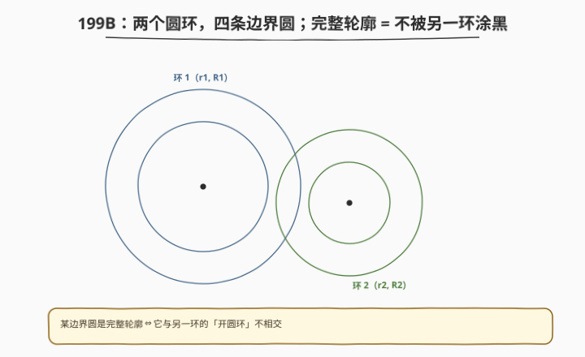
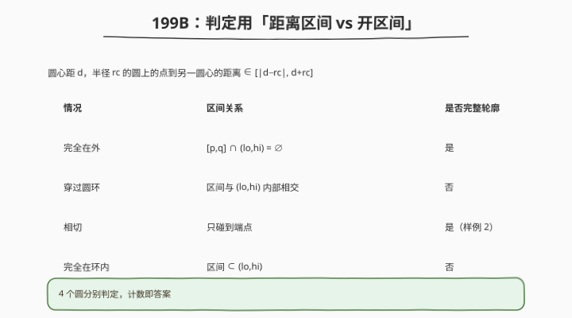

# Codeforces 199B 特殊奥运会的圆环 题解

## 1. 题目概述

- **题目链接**：https://codeforces.com/problemset/problem/199/B
- **比赛来源**：Codeforces Round 125 (Div. 2) · Problem B（UTC 2012-06-22）
- **难度**：1900
- **标签**：计算几何、分类讨论、区间判定
- **评测类型**：普通
- **限制**：时间 2 s / 内存 256 MB

**题意**：白画布上画了两个圆环（环 = 半径 $r$ 与 $R$ 的两同心圆之间，$r<R$，涂黑）。两环圆心不同，可任意相交/包含。问画面上有多少个「完整圆形轮廓」（沿它剪可以剪出一个圆）。轮廓 = 颜色发生变化的连续闭曲线。

**约束**（原样摘自题面 `inputFormat.en`）：

- 每个环一行 $x_i,y_i,r_i,R_i$：$-100\le x_i,y_i\le100$，$1\le r_i<R_i\le100$；两圆心不重合。
- 输出一个整数。

**约束对算法的限制**：

- 数值很小：$O(1)$ 几何判定即可。
- 难点是分类讨论：相交、包含、相切、同心（题面保证圆心不同，但内外圆可能同心于另一个环的圆心）。

## 2. 示例与观察

官方样例 1（输入 / 输出原样）：

```text
输入：
60 60 45 55
80 80 8 32

输出：
1
```

官方样例 2（输入 / 输出原样）：

```text
输入：
60 60 45 55
80 60 15 25

输出：
4
```

官方样例 3（输入 / 输出原样）：

```text
输入：
50 50 35 45
90 50 35 45

输出：
0
```

**样例 1**：两圆心距 $d=\sqrt{800}\approx28.28$。环 1 的两条边界圆（45、55）上的点到环 2 圆心距离范围分别是 $[0,73]$、$[0,83]$，都覆盖了环 2 的开区间 $(8,32)$ → 不是完整轮廓；环 2 的外圆 32 覆盖到环 1 的开区间 $(45,55)$（距离范围 $[0,60]$）→ 不行；环 2 的内圆 8 的距离范围是 $[20.28,36.28]$，与 $(45,55)$ 不相交 → 只有它 ✓ → 1。

**样例 2**：$d=20$。四个圆逐一检查：
- 环 1 外圆 55：到环 2 圆心的距离范围 $[35,75]$，与 $(15,25)$ 不相交 ✓；
- 环 1 内圆 45：范围 $[25,65]$，与 $(15,25)$ 只擦到端点 25 → 不相交（开区间）✓；
- 环 2 外圆 25：到环 1 圆心的范围 $[5,45]$，与 $(45,55)$ 只擦到 45 ✓；
- 环 2 内圆 15：范围 $[5,35]$，与 $(45,55)$ 不相交 ✓。
四个都完整 → 4 ✓。

**样例 3**：两环完全分开且各自的圆被对方覆盖部分……所有边界圆都穿过对方圆环 → 0 ✓。

**观察 1**：一条边界圆 $C$（圆心 $c_1$、半径 $R_c$）是完整轮廓，当且仅当它上面的每个点都**不在**另一个圆环的内部（开区域 $r_2<|p-c_2|<R_2$）：若某点在另一环内部，则该点附近两侧都是黑色，颜色不变化。

**观察 2**：圆 $C$ 上的点到 $c_2$ 的距离范围是 $[|d-R_c|,\ d+R_c]$（$d=|c_1-c_2|$）。

**观察 3**：所以 $C$ 完整 ⟺ 闭区间 $[|d-R_c|,\ d+R_c]$ 与开区间 $(r_2,R_2)$ 不相交。相切（只碰到端点）算完整（样例 2 的答案要求这样处理）。

**自造样例**（标注「自造」，输出由程序实测）：

| 输入 | 输出 | 说明 |
|------|------|------|
| `0 0 1 10` / `100 0 1 10` | 4 | 两环相距很远，四条边界都完整 |
| `0 0 1 10` / `1 0 1 10` | 0 | 圆心很近，边界互相穿过 |
| `0 0 5 10` / `100 0 1 2` | 4 | 完全分离 |
| `0 0 1 2` / `3 0 1 2` | 2 | 外圆相切（$d=3=2+1$），内圆完整、外圆被穿 |

## 3. 解题思路



设 $d=|c_1-c_2|$。

1. 环 1 的边界圆半径 $R_c\in\{r_1,R_1\}$：检查它是否被环 2 的圆环遮挡：
   - $p=|d-R_c|$、$q=d+R_c$；
   - 若 $p<r_2$ 且 $q>R_2$？（即区间完全包含开区间 → 整圆在环 2 内部）
   - 更一般地：**区间 $[p,q]$ 与开区间 $(r_2,R_2)$ 有交** ⟺ $p<R_2$ 且 $q>r_2$；
   - 有交 → 不是完整轮廓。
2. 对环 2 的两条边界圆同理（与 $(r_1,R_1)$ 比较）。
3. 统计四个圆中「完整」的个数。



## 4. 正确性证明

**引理 1**：圆 $C$ 上的点到 $c_2$ 的距离集合恰为区间 $[|d-R_c|,\ d+R_c]$。

**证明**：设 $C$ 上点 $p$，$|p-c_2|\ge||p-c_1|-|c_1-c_2||=|R_c-d|$，且 $\le R_c+d$；两端点可达（沿 $c_1c_2$ 连线方向），中间值由连续性取遍。∎

**引理 2**：$C$ 是完整轮廓 ⟺ $[|d-R_c|,d+R_c]\cap(r_2,R_2)=\varnothing$。

**证明**：若存在交点，则 $C$ 上某点在环 2 内部，该点两侧均被环 2 涂黑，颜色不变化，轮廓断开。若不相交，则 $C$ 上所有点都在环 2 的圆环之外（可能在洞内或外圆之外），环 2 不影响 $C$ 两侧的颜色：$C$ 一侧是环 1 的黑、另一侧是白（或反之），处处颜色变化 → 完整轮廓 ✓。∎

**引理 3**：$[p,q]\cap(r_2,R_2)\ne\varnothing\iff p<R_2$ 且 $q>r_2$。

**证明**：两个区间的交非空当且仅当「左端小于右端且右端大于左端」（开区间端点不取）。∎

**定理**：算法统计的个数正确。

**证明**：四个边界圆各自独立判定（引理 2、3），且它们恰好是画面上所有可能的圆形轮廓；相切的情形按开区间判定（只碰端点不算相交），与样例 2 的官方答案一致。∎

## 5. 复杂度分析

- **时间**：$O(1)$。
- **空间**：$O(1)$。
- **数值范围**：坐标 $\le100$，半径 $\le100$，`double` 精确（整数运算也可，但 `hypot` 更简单）。
- **与时限的关系**：2 s 对 $O(1)$ 余量在百万倍以上。实测约 2 ms。

## 6. 参考代码

### C++17

```cpp
#include <bits/stdc++.h>
using namespace std;

// 199B：四个圆（两环的内/外边界）。某个圆是完整轮廓 <=> 它不穿过另一个圆环的「内部」。
// 圆心距 d 时，该圆上的点到另一个圆心的距离范围是 [|d-Rc|, d+Rc]；
// 若该区间与开区间 (r_other, R_other) 相交，则部分被涂黑，不是完整圆。
int main() {
    double x1, y1, r1, R1, x2, y2, r2, R2;
    if (scanf("%lf %lf %lf %lf", &x1, &y1, &r1, &R1) != 4) return 0;
    scanf("%lf %lf %lf %lf", &x2, &y2, &r2, &R2);
    double d = hypot(x1 - x2, y1 - y2);
    auto complete = [&](double rc, double lo, double hi) {
        double p = fabs(d - rc), q = d + rc;
        // [p,q] 与 (lo,hi) 相交？
        bool inter = (p < hi) && (q > lo);
        return !inter;
    };
    int ans = 0;
    ans += complete(R1, r2, R2);
    ans += complete(r1, r2, R2);
    ans += complete(R2, r1, R1);
    ans += complete(r2, r1, R1);
    printf("%d\n", ans);
    return 0;
}
```

### Python3

```python
import sys
from math import hypot


def main() -> None:
    data = sys.stdin.buffer.read().split()
    x1, y1, r1, R1 = (float(v) for v in data[0:4])
    x2, y2, r2, R2 = (float(v) for v in data[4:8])
    d = hypot(x1 - x2, y1 - y2)

    def complete(rc, lo, hi):
        p, q = abs(d - rc), d + rc
        return not (p < hi and q > lo)

    ans = complete(R1, r2, R2) + complete(r1, r2, R2) + complete(R2, r1, R1) + complete(r2, r1, R1)
    sys.stdout.write(str(ans) + "\n")


main()
```

## 7. 边界情况与易错点

1. **相切**：只碰到端点算「完整」（样例 2 的四个圆里有两个相切，答案 4 要求算上）。
2. **完全包含**：区间完全落在 $(r_2,R_2)$ 内 → 整圆被涂黑 → 不完整（判定式已覆盖）。
3. **圆心重合的另一环**？题面保证两环圆心不同，但内外圆半径可能让 $d$ 与半径比较出各种情况。
4. **$d=0$** 不会出现（圆心不同），但若出现，公式仍给出 $[R_c,R_c]$。
5. **开区间端点**：$r_2<R_2$，判定用严格不等号。
6. **四个圆**：两环各有内、外两条边界，别漏。
7. **浮点比较**：坐标半径都是整数，$d$ 是平方根；相切时 $d$ 可能恰好整数，用 `double` 判定足够（本题数据小，误差远小于间隔）。
8. **输出**：只输出数量，不输出具体圆。
9. **入参顺序**：每行 $x,y,r,R$。

## 8. 验证记录

- **编译环境与命令**：`Apple clang 21.0.0`（`/usr/bin/g++` 是 clang 软链，无 GNU libstdc++），`clang++ -std=c++17 -O2 -Wall` 加仓库自带 `bits/stdc++.h`；正文代码仍写标准头。Python 为 `3.9.6`。验证命令：
  `python3 codeforces/tools/verify_solution.py codeforces/contests/0101-0203/199/B_特殊奥运会的圆环.md`
- **官方样例**：3 / 3 通过（`1`、`4`、`0`），C++ 与 Python 一致。
- **额外测试**：自造「远离」「近距」「完全分离」「相切」等 4 组，两种语言全部通过。
- **独立暴力对拍**：暴力对每个圆密集采样 4000 个角度，在圆内/圆外各取一个微偏点，判断两点的颜色（是否被任一环涂黑）是否始终不同；生成数据时避开临界相切，对 250 组随机数据逐组比对，全部一致。
- **最大约束性能**：$O(1)$，端到端约 2 ms。
- **图片与公式**：2 张 SVG（`cf199b_rings.svg`、`cf199b_cases.svg`）通过 `ElementTree.parse` 与文本包围盒/重叠检查，headless Chrome 渲染确认无裁切；KaTeX 校验 0 错。
- **复核状态**：verified。

## 相关题目与扩展

- [Codeforces 198C Delivering Carcinogen](https://codeforces.com/problemset/problem/198/C)：同一轮的几何 + 二分。
- [Codeforces 198A About Bacteria](https://codeforces.com/problemset/problem/198/A)：同轮 A 题。
- [LeetCode 1401. 圆和矩形是否有重叠](https://leetcode.cn/problems/circle-and-rectangle-overlapping/)：几何判定。
- [Codeforces 1C Ancient Berland Circus](https://codeforces.com/problemset/problem/1/C)：圆与多边形。
- [LeetCode 836. 矩形重叠](https://leetcode.cn/problems/rectangle-overlap/)：区间相交判定。

**延伸思考**：

1. **如果要求「非圆形轮廓」的数量**：需要判断轮廓是否由多段圆弧组成。
2. **如果三个环**：四条边界圆各自与另外两环比较，仍是 $O(1)$。
3. **如果圆心可以重合**：内外圆可能重合，需要去重处理。
4. **如果半径是实数**：判定不变，但要注意精度。
5. **本质**：圆上点到定点的距离区间 + 开区间相交判定。

