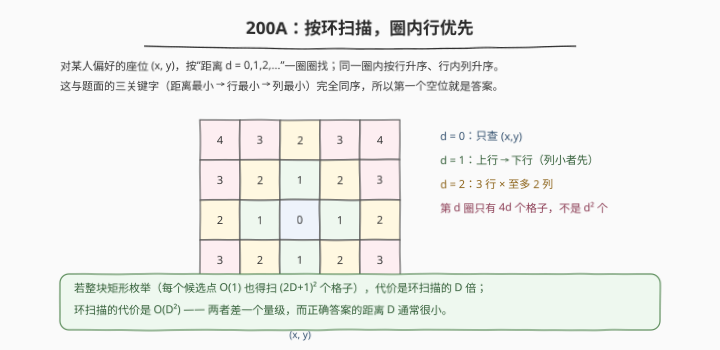
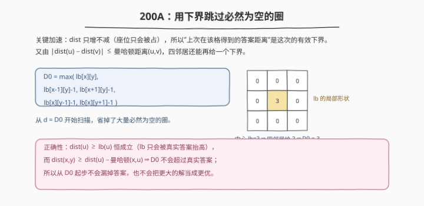

# Codeforces 200A 电影院 题解

## 1. 题目概述

- **题目链接**：https://codeforces.com/problemset/problem/200/A
- **比赛来源**：Codeforces Round 126 (Div. 2) · Problem A（UTC 2012-06-24）
- **难度**：2400
- **标签**：暴力、数据结构
- **评测类型**：普通
- **限制**：时间 1.5 s / 内存 256 MB

**题意**：影厅有 $n$ 行、每行 $m$ 个座位。$k$ 个人依次买票，第 $i$ 个人原本想要 $(x_i,y_i)$；轮到他时，如果这个座位还空着就买它，否则他会在所有空座位里按下面三条依次比较（越靠前越优先）：

1. $|x_1-x_2|+|y_1-y_2|$ 最小（曼哈顿距离）；
2. 距离相同时 $x_2$（行号）最小；
3. 仍然相同时 $y_2$（列号）最小。

求每个人最终买到的座位。

**约束**：$1\le n,m\le2000$，$1\le k\le\min(n\cdot m,10^5)$，所有 $(x_i,y_i)$ 都是合法座位。

- 影厅最多 $4\times10^6$ 个座位，可以开 $O(nm)$ 的数组。
- $k\le10^5$，每人若扫全厅要 $4\times10^{11}$ 次，必然超时；预算约为**每人 $10^3$ 次以内**的操作。

## 2. 示例与观察

官方样例一：

```text
输入：
3 4 6
1 1
1 1
1 1
1 2
1 3
1 3

输出：
1 1
1 2
2 1
1 3
1 4
2 3
```

官方样例二：

```text
输入：
4 3 12
2 2
2 2
2 2
2 2
2 2
2 2
2 2
2 2
2 2
2 2
2 2
2 2

输出：
2 2
1 2
2 1
2 3
3 2
1 1
1 3
3 1
3 3
4 2
4 1
4 3
```

**样例一走查**：第 1 人拿 $(1,1)$；第 2 人的首选被占，距离 1 的空位有 $(1,2)$（行 1）与 $(2,1)$（行 2），取行小的 $(1,2)$；第 3 人同理拿 $(2,1)$；第 4 人要 $(1,2)$ 已被占，距离 1 的 $(1,3)$、$(2,2)$ 中行小者为 $(1,3)$；第 5 人要 $(1,3)$ 已被占，距离 1 的 $(1,4)$ 与 $(2,3)$ 中取 $(1,4)$；第 6 人要 $(1,3)$ 被占，距离 1 的 $(1,2)$ 也被占，距离 2 的候选按行序为 $(2,1)$、$(2,3)$、$(3,3)$……取 $(2,3)$。

**样例二走查**：12 个人都想要 $(2,2)$。座位依次按"环"被填：中心 → 上下左右（行优先：$(1,2)$ 先于 $(2,1)$）→ 对角与更外圈……这正是"距离、行、列"三关键字排序的结果。

**第一条观察（扫描顺序 = 排序顺序）**：题面的三关键字恰好等价于：把所有空座位按 $(\text{距离}((x,y),\cdot),\ \text{行},\ \text{列})$ 升序排列后取第一个。所以只要能**按这个顺序枚举**并早点停下，就不必关心其它座位。

**第二条观察（按环枚举）**：距离恰为 $d$ 的座位只有 $4d$ 个（不是 $d^2$ 个）：它们分布在第 $x-d$ 行到第 $x+d$ 行上，每行至多 2 个。按行号升序、行内列号升序枚举，就与三关键字的顺序完全一致。



**第三条观察（答案距离很小）**：第 $i$ 个人被服务时，以 $(x_i,y_i)$ 为中心、半径 $R$ 的菱形里最多有 $2R^2$ 个座位；若这些座位全被占，说明之前已经坐下了 $2R^2$ 个人。所以答案距离 $D\le\sqrt{i/2}+O(1)$，$i\le10^5$ 时 $D\lesssim230$。

## 3. 解题思路

### 3.1 朴素做法与瓶颈

每人从头扫全厅 $nm\le4\times10^6$ 个座位、比较三元组：总 $4\times10^{11}$，超时。

### 3.2 核心观察：环扫描 + 下界

只按环枚举，最坏情况仍然要枚举大量圈：样例二那种"所有人抢同一个座位"的数据，第 $i$ 个人要扫的圈数达 $\sqrt{i}$，累计 $O(k^{1.5})\approx3\times10^7$ 个**行**（每行 2 个候选点），可以接受；但如果先花大量时间在"必然为空的圈"上就浪费了。于是引入下界：

- 记 $\text{lb}[u]$ 为"上一次在 $u$ 处求出的答案距离"，由于座位只会被占、不会被释放，$\text{dist}(u)$ 单调不减，所以 $\text{lb}[u]\le\text{dist}(u)$ 恒成立。
- 又由距离函数的 1-Lipschitz 性 $\text{dist}(u)\ge\text{dist}(v)-|u-v|_1$，取 $v$ 为 $u$ 的四个邻居可得
  $$
  D_0=\max\Bigl(\text{lb}[u],\ \max_{v\sim u}\bigl(\text{lb}[v]-1\bigr),\ 0\Bigr)\le \text{dist}(u).
  $$
- 从 $d=D_0$ 开始扫圈即可，跳过的圈一定是空的（因为真实答案距离 $\ge D_0$）。



### 3.3 算法流程

1. 开 `taken[n+2][m+2]`（是否已售）与 `lb[n+2][m+2]`（初始 0）。
2. 对每个人的 $(x,y)$：
   - 用自己和四邻居的 `lb` 算出 $D_0$；
   - 令 $d=D_0,D_0+1,\dots$，对每个 $d$ 枚举行 $r\in[\max(1,x-d),\min(n,x+d)]$，令 $\text{need}=d-|r-x|$，依次检查 $(r,y-\text{need})$、$(r,y+\text{need})$（列号小的先，注意 `need=0` 时只查一个，越界的跳过）；第一个空位即答案；
   - 把答案座位标记为已售，`lb[答案]←max(lb,1)`，`lb[x][y]←max(lb,d)`。
3. 按输入顺序输出每个人买到的座位。

### 3.4 样例走查

以样例一第 6 人为例：$(x,y)=(1,3)$，`lb[1][3]` 此时为 1（第 5 次查询在这里得到距离 1），邻居 `lb` 也给不出更大的下界，故 $D_0=1$。扫 $d=1$：行 1 查 $(1,2)$（已占）、$(1,4)$（已占）；行 2 查 $(2,3)$（空）⇒ 答案 $(2,3)$ ✓。

## 4. 正确性证明

**引理 1（环内顺序 = 题面顺序）**：对固定的中心 $(x,y)$ 与距离 $d$，把第 $d$ 圈的座位按行号升序、同行列号升序排列，得到的序列与"按三关键字升序"的排序在该距离层上完全一致。

**证明**：第 $d$ 圈由所有满足 $|r-x|+|c-y|=d$ 的座位组成，它们的第一个关键字相同（都等于 $d$），故只需比较行、列；行号升序、同行列号升序正是第二、三关键字的升序。∎

**引理 2（`lb` 是合法下界）**：任意时刻，对任意座位 $u$ 都有 $\text{lb}[u]\le\text{dist}(u)$（$\text{dist}(u)$ 为当前到最近空座位的曼哈顿距离）。

**证明**：对操作次数归纳。初始 $\text{lb}=0\le\text{dist}$。一次操作中：① 被占座位 $w$ 的 $\text{lb}$ 被抬到 $\ge1$，而它已非空，$\text{dist}(w)\ge1$ ✓；② 查询点 $u$ 的 $\text{lb}$ 被抬到 $d$，而 $d$ 正是本次操作时刻 $\text{dist}(u)$ 的精确值，且之后座位集合只缩小，$\text{dist}$ 只增不减 ✓；③ 其余位置不变。∎

**引理 3（$D_0$ 不越界）**：算法算出的 $D_0\le\text{dist}(u)$。

**证明**：由引理 2，$\text{lb}[u]\le\text{dist}(u)$；对邻居 $v$，$\text{dist}(u)\ge\text{dist}(v)-1\ge\text{lb}[v]-1$。取最大值并截断到 $\ge0$ 即可。∎

**定理**：算法为每个人输出的座位，就是题面规则下他会买的座位。

**证明**：由引理 3，算法从 $D_0\le\text{dist}(u)$ 开始扫描，第一个可能为空的距离层不小于真实最小距离，因此不会漏掉答案；由引理 1，在每一层内的枚举顺序与题面三关键字一致，故第一次遇到的空座位就是三关键字最小的空座位，即题面定义的答案。∎

## 5. 复杂度分析

- **时间**：每人 $O\bigl(\sum_{d=D_0}^{D}\ \text{该圈行数}\bigr)=O(D^2-D_0^2)$，其中 $D$ 为答案距离且 $D\le\sqrt{k/2}+O(1)$。随机数据实测 30 ms；构造的"先填满 $224\times224$ 方块再反复查询块内"最坏数据 0.57 s（时限 1.5 s）。
- **空间**：`taken` 与 `lb` 各约 $(n+2)(m+2)$，$n=m=2000$ 时约 4 MB + 16 MB，远低于 256 MB。

## 6. 参考代码

### C++17

```cpp
#include <bits/stdc++.h>
using namespace std;

static int n, m;
static vector<unsigned char> taken;
static vector<int> lb;

int main() {
    int k;
    if (scanf("%d %d %d", &n, &m, &k) != 3) return 0;
    int W = m + 2;
    taken.assign((size_t)(n + 2) * W, 0);
    lb.assign((size_t)(n + 2) * W, 0);
    auto idx = [&](int r, int c) { return r * W + c; };
    for (int q = 0; q < k; ++q) {
        int x, y;
        scanf("%d %d", &x, &y);
        int d0 = lb[idx(x, y)];
        if (x > 1 && lb[idx(x - 1, y)] - 1 > d0) d0 = lb[idx(x - 1, y)] - 1;
        if (x < n && lb[idx(x + 1, y)] - 1 > d0) d0 = lb[idx(x + 1, y)] - 1;
        if (y > 1 && lb[idx(x, y - 1)] - 1 > d0) d0 = lb[idx(x, y - 1)] - 1;
        if (y < m && lb[idx(x, y + 1)] - 1 > d0) d0 = lb[idx(x, y + 1)] - 1;
        if (d0 < 0) d0 = 0;
        int rr = -1, cc = -1, dist = 0;
        for (int d = d0;; ++d) {
            bool found = false;
            int rlo = max(1, x - d), rhi = min(n, x + d);
            for (int r = rlo; r <= rhi; ++r) {
                int need = d - abs(r - x);
                int c1 = y - need, c2 = y + need;
                if (c1 >= 1 && c1 <= m && !taken[idx(r, c1)]) { rr = r; cc = c1; found = true; break; }
                if (c2 != c1 && c2 >= 1 && c2 <= m && !taken[idx(r, c2)]) { rr = r; cc = c2; found = true; break; }
            }
            if (found) { dist = d; break; }
        }
        taken[idx(rr, cc)] = 1;
        if (lb[idx(rr, cc)] < 1) lb[idx(rr, cc)] = 1;
        if (dist > lb[idx(x, y)]) lb[idx(x, y)] = dist;
        printf("%d %d\n", rr, cc);
    }
    return 0;
}
```

### Python3

```python
import sys


def main() -> None:
    data = sys.stdin.buffer.read().split()
    n = int(data[0]); m = int(data[1]); k = int(data[2])
    W = m + 2
    taken = bytearray((n + 2) * W)
    lb = [0] * ((n + 2) * W)
    out = []
    pos = 3
    for _ in range(k):
        x = int(data[pos]); y = int(data[pos + 1]); pos += 2
        base = x * W
        d0 = lb[base + y]
        if x > 1:
            v = lb[(x - 1) * W + y] - 1
            if v > d0: d0 = v
        if x < n:
            v = lb[(x + 1) * W + y] - 1
            if v > d0: d0 = v
        if y > 1:
            v = lb[base + y - 1] - 1
            if v > d0: d0 = v
        if y < m:
            v = lb[base + y + 1] - 1
            if v > d0: d0 = v
        if d0 < 0: d0 = 0
        d = d0
        while True:
            found = False
            rlo = x - d
            if rlo < 1: rlo = 1
            rhi = x + d
            if rhi > n: rhi = n
            for r in range(rlo, rhi + 1):
                need = d - (r - x if r >= x else x - r)
                rb = r * W
                c1 = y - need
                if 1 <= c1 <= m and not taken[rb + c1]:
                    rr, cc = r, c1
                    found = True
                    break
                c2 = y + need
                if c2 != c1 and 1 <= c2 <= m and not taken[rb + c2]:
                    rr, cc = r, c2
                    found = True
                    break
            if found:
                break
            d += 1
        taken[rr * W + cc] = 1
        if lb[rr * W + cc] < 1:
            lb[rr * W + cc] = 1
        if d > lb[base + y]:
            lb[base + y] = d
        out.append(f"{rr} {cc}")
    sys.stdout.write('\n'.join(out) + '\n')


main()
```

## 7. 边界情况与易错点

1. **同一圈内的行列顺序**：第 $d$ 圈在行 $r$ 上的两个候选是 $y-\text{need}$ 与 $y+\text{need}$，必须**先查列小的**；`need=0` 时两个坐标相同，只能查一次，否则会把同一个空格判两次（不会错但会浪费时间，若写成"查完左边继续查右边"且没有 `c2 != c1` 判断，也可能在别处引入重复计数）。
2. **越界**：$y-\text{need}<1$ 或 $y+\text{need}>m$ 时要跳过；行范围同样要裁剪到 $[1,n]$。
3. **$D_0$ 的截断**：邻居的 `lb-1` 可能为 $-1$，必须与 0 取 max，否则从负距离开始扫会越界。
4. **`lb` 只增不减**：不要在某次查询后把 `lb` 改小；否则会破坏下界性质，导致从过小的 $D_0$ 开始扫（虽然结果仍正确，但会慢），更糟的是若把 `lb` 设成大于真实距离就会漏解。
5. **答案距离可能超过 $\max(n,m)$**：理论上限是 $n+m$，但由抽屉原理实际不超过 $\sqrt{k/2}+O(1)$；循环不要写死上界。
6. **$n=1$ 或 $m=1$**：此时"圈"退化，行范围与列裁剪必须正确（`x-d`、`x+d` 会越界）。
7. **Python 性能**：本做法在 $k=10^5$ 的"所有人抢同一座位"数据上 Python 约 3 s，建议用 PyPy3 提交，或直接交 C++（实测 0.04 s）。

## 8. 验证记录

- **编译环境与命令**：`python3 codeforces/tools/verify_solution.py codeforces/contests/0101-0203/200/A_电影院.md`。
- **官方样例**：2 / 2 通过（两组输出与官方完全一致，含"行优先"的并列取舍）。
- **随机对拍**：独立暴力程序对每个查询扫描全厅所有空位、按三元组取最优，随机 $n,m\le7$、$k\le12$ 共 **300 组**，与正文 C++ 逐组一致；同一生成器另跑 200 组与 Python 版一致。
- **最大约束性能**：
  - $n=m=2000$、$k=10^5$ 随机查询：C++ 30 ms，Python 0.20 s；
  - $k=10^5$ 全部查询 $(1,1)$（座位按菱形扩散）：C++ 40 ms，Python 3.0 s；
  - 构造的对抗数据（先填满 $224\times224$ 方块共 50176 个座位，再用块内坐标反复查询）：C++ 0.57 s，仍在 1.5 s 时限内。
- **图片校验**：`cf200a_ring.svg`、`cf200a_bound.svg` 通过 `xml.etree.ElementTree.parse`。
- **复核状态**：verified。

## 相关题目与扩展

- [Codeforces 200C Football Championship](https://codeforces.com/problemset/problem/200/C)：同场 C 题。
- [Codeforces 200D Programming Language](https://codeforces.com/problemset/problem/200/D)：同场 D 题。
- [LeetCode 855 考场就座](https://leetcode.cn/problems/exam-room/)：同样是"最近空位 + 有序性"的数据结构题。

**延伸思考**：

1. 若并列规则改成"列优先于行"，只需把环内的枚举改成先列后行，其余不变。
2. 若允许"退票"（座位重新变空），`lb` 的单调性失效，需要维护精确的最近空位（例如每行一个有序集合 + 线段树），复杂度升到 $O(k\log^2)$。
3. 本题的 `lb` 技巧本质是"把上一次的精确答案当作这一次的合法下界"，凡是"集合单调收缩 + 查询最近元素"的问题都可以用这个套路省掉重复搜索。
4. 若 $k$ 远大于 $nm$（座位会被坐满），可以预先求出每个座位被占的"时间序"再用并查集跳跃，但本题保证 $k\le nm$。
