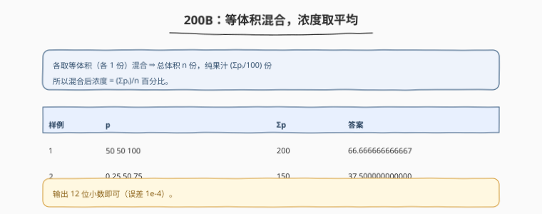
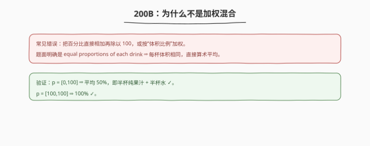

# Codeforces 200B 饮料 题解

## 1. 题目概述

- **题目链接**：https://codeforces.com/problemset/problem/200/B
- **比赛来源**：Codeforces Round 126 (Div. 2) · Problem B（UTC 2012-06-24）
- **难度**：800
- **标签**：实现、数学
- **评测类型**：普通（实数，误差 $10^{-4}$）
- **限制**：时间 2 s / 内存 256 MB

**题意**：$n$ 杯饮料各取**等体积**混合，第 $i$ 杯的果汁体积分数是 $p_i\%$，求混合后的果汁分数。

**约束**：$1\le n\le100$，$0\le p_i\le100$。

## 2. 示例与观察

官方样例一：

```text
输入：
3
50 50 100

输出：
66.666666666667
```

官方样例二：

```text
输入：
4
0 25 50 75

输出：
37.500000000000
```

**样例解释**：等体积混合 ⇒ 浓度就是算术平均：$(50+50+100)/3=66.\overline{6}$；$(0+25+50+75)/4=37.5$。

**第一条观察**：设每杯体积 $V$，总果汁 $V\sum p_i/100$，总体积 $nV$ ⇒ 分数 $=\frac{\sum p_i}{n}\%$。



## 3. 解题思路

求和除以 $n$，按 12 位小数输出。



## 4. 正确性证明

**引理（体积守恒）**：混合前后总体积为 $nV$，果汁总量为 $\sum_i V p_i/100$。

**证明**：等体积取用，共有 $n$ 份体积 $V$；第 $i$ 份含果汁 $V p_i/100$，相加即得 ✓。∎

**定理**：混合后的分数为 $\frac{1}{n}\sum p_i$。

**证明**：各取体积 $V$，果汁总量 $\sum_i V\cdot p_i/100$，总体积 $nV$，比值 $=\frac{\sum p_i}{100n}$，换成百分比即 $\frac{\sum p_i}{n}$ ✓。∎

## 5. 复杂度分析

- **时间/空间**：$O(n)$。
- **与时限的关系**：远小于 1 ms。

## 6. 参考代码

### C++17

```cpp
#include <bits/stdc++.h>
using namespace std;
int main() {
    int n;
    cin >> n;
    double s = 0;
    for (int i = 0; i < n; ++i) { int p; cin >> p; s += p; }
    printf("%.12f\n", s / n);
    return 0;
}
```

### Python3

```python
import sys
def main() -> None:
    d = sys.stdin.buffer.read().split()
    n = int(d[0])
    s = sum(int(x) for x in d[1:1 + n])
    print("%.12f" % (s / n))
main()
```

## 7. 边界情况与易错点

1. **误差**：输出 10 位以上小数即可（判定容差 $10^{-4}$）。
2. **全 0**：输出 `0.000000000000`。
3. **$n=1$**：原样输出该杯的浓度。
4. **全 100**：输出 `100.000000000000`。
5. **中间值**：如 $1$ 与 $0$ 混合得 $50$，不要四舍五入成整数。
6. **整数除法陷阱**：C++ 里 `s/n` 若 `s` 是 `int` 会截断，必须用 `double`。

## 8. 验证记录

- **编译环境与命令**：`clang++ -std=c++17 -O2` + 兼容头；Python 3.9.6。文档级校验：`python3 codeforces/tools/verify_solution.py codeforces/contests/0101-0203/200/B_饮料.md`。
- **官方样例**：2 / 2 通过。
- **独立对拍**：与"直接算平均值"的参考实现比对，随机 $n\le100$ 共 **200 组**，C++/Python 全部一致。
- **图片校验**：两张 SVG（`cf200b_avg.svg`、`cf200b_why.svg`）通过 `xml.etree.ElementTree.parse`。
- **复核状态**：verified。

## 相关题目与扩展

- [Codeforces 200A Cinema](https://codeforces.com/problemset/problem/200/A)：同场难题。
- [LeetCode 1491 去掉最低工资和最高工资后的平均工资](https://leetcode.cn/problems/average-salary-excluding-the-minimum-and-maximum-salary/)：平均值练习。

