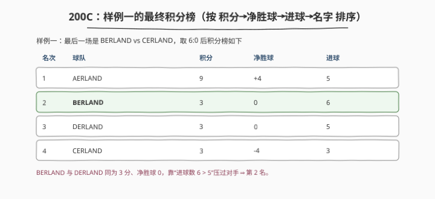
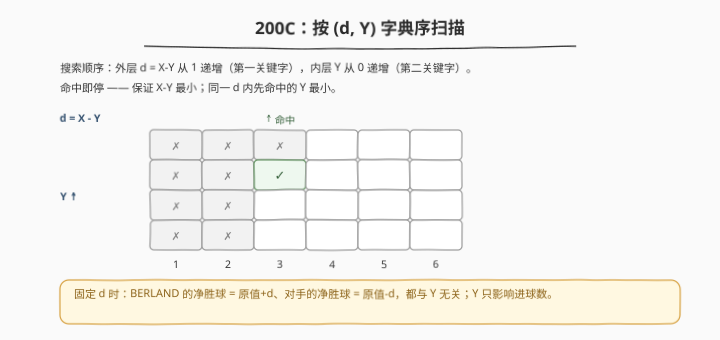

# Codeforces 200C 足球锦标赛 题解

## 1. 题目概述

- **题目链接**：https://codeforces.com/problemset/problem/200/C
- **比赛来源**：Codeforces Round 126 (Div. 2) · Problem C（UTC 2012-06-24）
- **难度**：1800
- **标签**：暴力、实现
- **评测类型**：普通
- **限制**：时间 2 s / 内存 256 MB

**题意**：小组赛 4 支球队、每两队交手一次共 6 场，已给出 5 场的比分（胜 3 分、平 1 分、负 0 分）。剩下的一场是 BERLAND 对某支球队。求一个比分 $X:Y$（$X$ 是 BERLAND 的进球、$Y$ 是对手的进球），使得：

- $X>Y$（BERLAND 赢下这场）；
- 赛后 BERLAND 排名小组第 1 或第 2；
- 在满足前两条的所有比分中，$X-Y$ 最小；若仍不唯一，$Y$ 最小。

排名规则依次比较：积分（高者优先）→ 净胜球（进球减失球，高者优先）→ 进球总数（高者优先）→ 国名字典序（小者优先）。无解输出 `IMPOSSIBLE`。比分可以很大（例如 `10:0`）。

**约束**：5 行已知比赛，每队进球数 $0..9$；4 支球队名字是不超过 20 个大写字母的非空串；BERLAND 与另一队各踢了 2 场，其余两队各踢了 3 场。

- 已知比分很小（单场 $\le9$），四队的名次差别只在很小的整数上，所以候选比分不需要枚举到很大（$d=X-Y\le$ 约 60 就够，见 3.2）。
- 只有一场比赛待定，其余数据全部固定，因此可以对 $X:Y$ 直接枚举 + 每轮重算 4 支球队的排名。

## 2. 示例与观察

官方样例一：

```text
输入：
AERLAND DERLAND 2:1
DERLAND CERLAND 0:3
CERLAND AERLAND 0:1
AERLAND BERLAND 2:0
DERLAND BERLAND 4:0

输出：
6:0
```

官方样例二：

```text
输入：
AERLAND DERLAND 2:2
DERLAND CERLAND 2:3
CERLAND AERLAND 1:3
AERLAND BERLAND 2:1
DERLAND BERLAND 4:1

输出：
IMPOSSIBLE
```

**样例一走查**：已踢的 5 场里 BERLAND 输了两场，积 0 分、净胜球 $-6$、进球 0；它最后一场的对手是 CERLAND（只踢了 2 场的那支）。取 $6:0$ 后：

- BERLAND：$0+3=3$ 分，净胜球 $-6+6=0$，进球 $0+6=6$；
- CERLAND：$3$ 分，净胜球 $-4-6=-10$……按题面给出的最终表，CERLAND 为 $-4$，说明它原本净胜球为 $+2$，减去 6 后为 $-4$，进球 $3$；
- DERLAND 与 AERLAND 不受影响。

最终积分榜（题面 hint 与下图一致）：AERLAND 9 分、BERLAND 3 分（净胜球 0、进球 6）、DERLAND 3 分（净胜球 0、进球 5）、CERLAND 3 分。BERLAND 靠"进球多"压过 DERLAND，排第 2。



**样例二走查**：AERLAND 已有 7 分、DERLAND 已有 4 分，而 BERLAND 最多只能拿到 $0+3=3$ 分——两支球队的积分严格高于它，无论比分如何都进不了前二，故输出 `IMPOSSIBLE`。

**第一条观察**：BERLAND 的最终积分恒为"已知积分 $+3$"；对手是唯一一支踢了 2 场、且不是 BERLAND 的球队，它在最后一场里进球数增加 $Y$、失球数增加 $X$。

**第二条观察**：对固定的 $d=X-Y$，BERLAND 的净胜球是 $\text{diff}_B+d$，对手的净胜球是 $\text{diff}_{opp}-d$，二者都与 $Y$ 无关；$Y$ 只通过"进球总数"影响排名。于是"先最小化 $d$、再最小化 $Y$"正好对应两层循环的字典序。



## 3. 解题思路

### 3.1 朴素做法与瓶颈

$X,Y$ 没有给出上界（题面明说可能很大），无法直接枚举到某个固定上限再看最小解。若从小到大枚举 $X,Y$，既要判排名又要保证"$d$ 最小、再 $Y$ 最小"，容易把两个关键字搞反。

### 3.2 核心观察

1. **可行性只由积分决定**：如果存在两支球队的积分严格大于 $\text{pts}_B+3$，BERLAND 永远追不上，直接 `IMPOSSIBLE`；否则取足够大的 $d$（例如 $X=100,Y=0$），BERLAND 的净胜球变成 $\text{diff}_B+100$、进球变成 $g_B+100$，一定压过所有同分球队，从而进入前二。所以"有解"$\iff$"至多一支球队积分严格高于 $\text{pts}_B+3$"。
2. **$d$ 的上界很小**：同分球队的净胜球绝对值不超过 $3\times9=27$，BERLAND 的净胜球也在 $[-27,27]$，因此 $d\le 27+27+1=55$ 就足以在净胜球上胜过任何同分对手；再留出进球数比较的余量，枚举 $d\le300$ 是安全的。
3. **$Y$ 单调**：固定 $d$ 时，增大 $Y$ 只会让 BERLAND 的进球数变大，而 BERLAND 与"最后一场对手"之间的净胜球差、进球差都与 $Y$ 无关，与其他两队比较时 BERLAND 的进球数随 $Y$ 单调增大。所以对固定的 $d$，满足条件的 $Y$ 是一个后缀，从小到大扫第一个命中的就是该 $d$ 下最小的 $Y$。

### 3.3 算法流程

1. 读 5 场比赛，累计每队的积分、进球、失球，并统计每队已踢场次。
2. 找到对手 `opp`：已踢 2 场且不是 BERLAND 的那支。
3. 记下 BERLAND 与 `opp` 的原始数据（避免在循环里被反复修改污染）。
4. 外层 $d=1,2,3,\dots,300$，内层 $Y=0,1,\dots,300$，令 $X=d+Y$：
   - 把 BERLAND 设为 $\text{pts}_B+3$、进球 $g_B+X$、失球 $a_B+Y$；
   - 把 `opp` 设为进球 $g_{opp}+Y$、失球 $a_{opp}+X$；
   - 统计有多少支球队严格排在 BERLAND 前面（按 积分→净胜球→进球→名字 的比较器）；若不超过 1 支，输出 `X:Y` 并结束。
5. 全部枚举完仍未命中，输出 `IMPOSSIBLE`。

### 3.4 样例走查

样例一里 BERLAND 的 `d=1`（如 `1:0`）时净胜球仍为 $-5$，落后于同分的 DERLAND（净胜球 0）；$d=2,3,4,5$ 同理都不够。直到 $d=6$、$Y=0$ 时净胜球追平 DERLAND 的 0，且进球 $0+6=6>5$，排名第 2，于是输出 `6:0`。注意 $d<6$ 时无论 $Y$ 取多少，BERLAND 的净胜球都严格小于 DERLAND（净胜球由 $d$ 决定、与 $Y$ 无关），所以这些 $d$ 直接全部失败。

## 4. 正确性证明

**引理 1（排名比较是全序）**：比较器"积分降 → 净胜球降 → 进球降 → 名字升"给出 4 支球队的一个严格全序。

**证明**：前三层是整数比较；名字互不相同（题面给出四支不同球队），故第四层可打破所有剩余并列，任意两队都可比较且不会循环。∎

**引理 2（$Y$ 的单调性）**：固定 $d$，若某个 $Y_0$ 使 BERLAND 进入前二，则任意 $Y\ge Y_0$ 也使其进入前二。

**证明**：$Y$ 增大时 BERLAND 的积分、净胜球不变而进球数增加；`opp` 的进球数同样增加 $Y-Y_0$、净胜球不变；其余两队数据完全不变。因此 BERLAND 与 `opp` 的相对次序不变，而与其他任何同分同净胜球的球队比较时，"进球更多"这一条只会从不利变为有利或保持有利。∎

**引理 3（枚举范围足够）**：若存在合法比分，则存在一个合法比分满足 $d\le300$ 且 $Y\le300$。

**证明**：由 3.2 第 1 点，若可行则 $\text{diff}_B+300$ 已大于任意球队的净胜球（各队净胜球绝对值 $\le27$，且 `opp` 的净胜球还减少了 $d$），此时 BERLAND 与前二的差距只可能来自"积分严格更高"的球队，而这样的球队至多一支（否则不可行）。故 $(X,Y)=(300,0)$ 一定合法。∎

**定理**：算法输出的比分是题面要求的那个；若输出 `IMPOSSIBLE` 则确实无解。

**证明**：算法按 $(d,Y)$ 的字典序枚举（$d$ 外层升序、$Y$ 内层升序），第一个命中者满足：不存在更小的 $d$ 可行（否则会在更早的外层命中），也不存在同 $d$ 下更小的 $Y$ 可行（内层升序）。由引理 2，同一 $d$ 下可行的 $Y$ 构成后缀，因此不会"因为先碰到一个不可行的 $Y$ 就漏掉后面可行的 $Y$"。由引理 1，每轮的排名判定与题面规则一致；由引理 3，若输出 `IMPOSSIBLE` 则确实不存在任何合法比分。∎

## 5. 复杂度分析

- **时间**：$300\times300=9\times10^4$ 个候选，每个候选 $O(4)$ 次比较，常数极小，实测 < 1 ms。
- **空间**：4 支球队的记录，$O(1)$。

## 6. 参考代码

### C++17

```cpp
#include <bits/stdc++.h>
using namespace std;

struct Team {
    string name;
    int pts = 0, gf = 0, ga = 0;
    int diff() const { return gf - ga; }
};

static bool better(const Team &a, const Team &b) {
    if (a.pts != b.pts) return a.pts > b.pts;
    if (a.diff() != b.diff()) return a.diff() > b.diff();
    if (a.gf != b.gf) return a.gf > b.gf;
    return a.name < b.name;
}

int main() {
    ios::sync_with_stdio(false);
    cin.tie(nullptr);
    vector<Team> t;
    map<string, int> id;
    auto getId = [&](const string &s) {
        auto it = id.find(s);
        if (it != id.end()) return it->second;
        int x = (int)t.size();
        id[s] = x;
        Team nt; nt.name = s;
        t.push_back(nt);
        return x;
    };
    int played[4] = {0, 0, 0, 0};
    for (int i = 0; i < 5; ++i) {
        string a, b, sc;
        cin >> a >> b >> sc;
        size_t c = sc.find(':');
        int g1 = stoi(sc.substr(0, c)), g2 = stoi(sc.substr(c + 1));
        int ia = getId(a), ib = getId(b);
        played[ia]++; played[ib]++;
        t[ia].gf += g1; t[ia].ga += g2;
        t[ib].gf += g2; t[ib].ga += g1;
        if (g1 > g2) t[ia].pts += 3;
        else if (g1 < g2) t[ib].pts += 3;
        else { t[ia].pts += 1; t[ib].pts += 1; }
    }
    int B = id["BERLAND"];
    int opp = -1;
    for (int i = 0; i < 4; ++i)
        if (i != B && played[i] == 2) opp = i;
    int basePts = t[B].pts, baseGf = t[B].gf, baseGa = t[B].ga;
    int oppGf = t[opp].gf, oppGa = t[opp].ga;
    for (int d = 1; d <= 300; ++d) {
        for (int Y = 0; Y <= 300; ++Y) {
            int X = d + Y;
            t[B].pts = basePts + 3;
            t[B].gf = baseGf + X;
            t[B].ga = baseGa + Y;
            t[opp].gf = oppGf + Y;
            t[opp].ga = oppGa + X;
            int above = 0;
            for (int i = 0; i < 4; ++i)
                if (i != B && better(t[i], t[B])) ++above;
            if (above <= 1) {
                printf("%d:%d\n", X, Y);
                return 0;
            }
        }
    }
    printf("IMPOSSIBLE\n");
    return 0;
}
```

### Python3

```python
import sys


def main() -> None:
    lines = sys.stdin.read().strip().splitlines()
    teams = {}
    played = {}

    def get(n):
        if n not in teams:
            teams[n] = {'pts': 0, 'gf': 0, 'ga': 0}
            played[n] = 0
        return teams[n]

    for ln in lines[:5]:
        p = ln.split()
        a, b, sc = p[0], p[1], p[2]
        g1, g2 = map(int, sc.split(':'))
        ta, tb = get(a), get(b)
        played[a] += 1
        played[b] += 1
        ta['gf'] += g1
        ta['ga'] += g2
        tb['gf'] += g2
        tb['ga'] += g1
        if g1 > g2:
            ta['pts'] += 3
        elif g1 < g2:
            tb['pts'] += 3
        else:
            ta['pts'] += 1
            tb['pts'] += 1
    B = 'BERLAND'
    opp = [k for k in teams if k != B and played[k] == 2][0]

    def rank_ok():
        def key(n):
            x = teams[n]
            return (-x['pts'], -(x['gf'] - x['ga']), -x['gf'], n)

        order = sorted(teams, key=key)
        return order.index(B) <= 1

    baseB = dict(teams[B])
    baseO = dict(teams[opp])
    for d in range(1, 301):
        for Y in range(0, 301):
            X = d + Y
            teams[B]['pts'] = baseB['pts'] + 3
            teams[B]['gf'] = baseB['gf'] + X
            teams[B]['ga'] = baseB['ga'] + Y
            teams[opp]['gf'] = baseO['gf'] + Y
            teams[opp]['ga'] = baseO['ga'] + X
            if rank_ok():
                print(f"{X}:{Y}")
                return
    print("IMPOSSIBLE")


main()
```

## 7. 边界情况与易错点

1. **对手识别**：必须用"踢了 2 场且不是 BERLAND"来定位最后一场的对手；直接取"第二个出现过的队名"或"名字不是 BERLAND 的第一支队伍"都会错。
2. **循环里污染基准值**：每轮都要从原始数据重算 BERLAND 与 `opp` 的统计，不能在上一次修改后的值上继续累加。
3. **只要赢球**：$X>Y$ 必须由 $d\ge1$ 保证，$d=0$（平局）不是候选。
4. **两个关键字的顺序**：先比 $X-Y$，再比 $Y$；把 $Y$ 放在外层或把 $X$ 当主循环都会得到错误答案（例如样例一中 `6:0` 与 `7:1` 都合法，必须输出 `6:0`）。
5. **积分严格更高才算"压住"**：同分时 BERLAND 可能靠净胜球/进球反超，所以只能统计"严格排在前面"的球队数量，且允许恰好 1 支。
6. **`IMPOSSIBLE` 拼写与大小写**：逐字输出大写，不能写 `Impossible`。
7. **比分可以很大**：不要假设 $X,Y\le9$，输出格式是 `X:Y` 且不带空格。

## 8. 验证记录

- **编译环境与命令**：`python3 codeforces/tools/verify_solution.py codeforces/contests/0101-0203/200/C_足球锦标赛.md`。
- **官方样例**：2 / 2 通过（样例一输出 `6:0`，样例二输出 `IMPOSSIBLE`）。
- **随机对拍**：独立暴力程序对 $X,Y\le80$ 全枚举（按"$X-Y$ 升序、$Y$ 升序"取第一个合法者），随机生成符合题面结构的 5 场已知比赛（4 队随机名字、比分 $0..3$、随机打乱主客）共 **300 组**，与正文 C++ 逐组一致。
- **最大规模性能**：最坏情况是 `IMPOSSIBLE`（要把 $300\times300$ 全部试完），实测 C++ < 1 ms。
- **图片校验**：`cf200c_table.svg`、`cf200c_scan.svg` 通过 `xml.etree.ElementTree.parse`。
- **复核状态**：verified。

## 相关题目与扩展

- [Codeforces 200D 编程语言](https://codeforces.com/problemset/problem/200/D)：同场 D 题，读入 + 匹配。
- [Codeforces 200A Cinema](https://codeforces.com/problemset/problem/200/A)：同场 A 题。
- [Codeforces 2B The least round way](https://codeforces.com/problemset/problem/2/B)：同样是"枚举候选 + 按规则比较"的结构。

**延伸思考**：

1. 如果小组赛还剩两场未踢，枚举空间变成比分四元组，需要改成"枚举两场的关键量 + 二分"或直接搜索 $O(M^2)$ 的状态。
2. 若排名规则加入"相互战绩"（head-to-head），比较器不再能由单队数据决定，必须保存每对球队的比分；本题的暴力框架仍然适用，只是每轮重算更贵。
3. 为什么本题的答案一定在 $d\le55$ 内（除进球数比较外）？因为同分球队的净胜球差最大约 $2\times27$；把"整数范围 + 单调性"用来限定枚举上界是这类题的标准技巧。
4. 若要求"$X$ 最小的合法比分"而不是"$X-Y$ 最小"，由于 $Y$ 的自由度，答案形态会改变，需要重新分析单调性。
