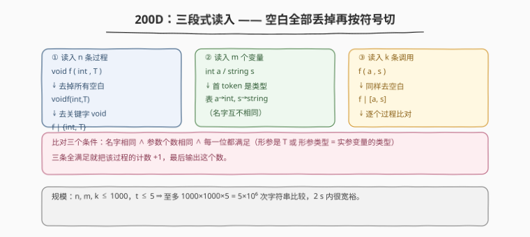
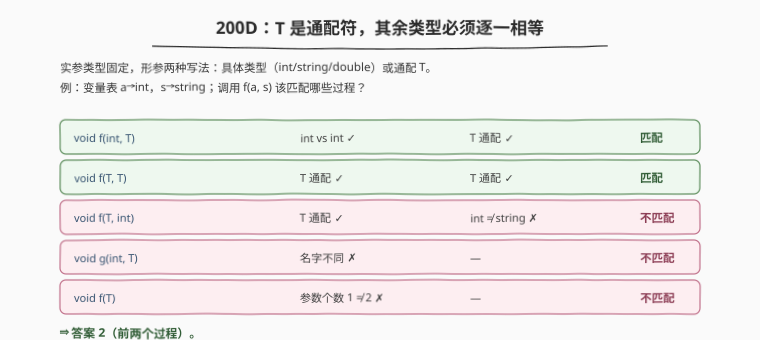

# Codeforces 200D 编程语言 题解

## 1. 题目概述

- **题目链接**：https://codeforces.com/problemset/problem/200/D
- **比赛来源**：Codeforces Round 126 (Div. 2) · Problem D（UTC 2012-06-24）
- **难度**：1800
- **标签**：表达式分析、字符串处理、实现
- **评测类型**：普通
- **限制**：时间 2 s / 内存 256 MB

**题意**：某种语言的模板过程由「过程名 + 形参类型表」描述，形参类型可以是 `int`、`string`、`double` 或通配的泛型 `T`。给出 $n$ 条过程声明、$m$ 个变量的声明、$k$ 次过程调用（调用里写的是变量名）。若某过程的**名字相同**、**参数个数相同**、且**每一位形参都满足"是 `T` 或与对应实参变量类型相同"**，就称它适配这次调用。对每次调用输出适配的过程条数。

**约束**：$1\le n,m,k\le1000$；每条过程/调用的参数个数 $1\le t\le5$；输入行长度 $\le100$；变量名与过程名是长度 $\le10$ 的小写字母与数字串。

- 名字空间最多 $1000\times1000\times5=5\times10^6$ 次逐位比较，$O(nkt)$ 完全可行，不需要任何索引优化。
- 真正的难点是**格式**：变量行、过程行、调用行的括号内外、逗号前后、`void` 关键字前后都可能有多余空格，且行首行尾也可能有空格。

## 2. 示例与观察

官方样例一：

```text
输入：
4
void f(int,T)
void  f(T, T)
 void foo123   ( int,  double,  string,string  ) 
  void  p(T,double)
3
int a
 string    s
double x123 
5
f(a,  a)
  f(s,a   )
foo   (a,s,s)
 f  (  s  ,x123)
proc(a)

输出：
2
1
0
1
0
```

官方样例二：

```text
输入：
6
void f(string,double,int)
void f(int)
   void f  ( T  )
void procedure(int,double)
void f  (T, double,int)   
void f(string, T,T)
4
 int a
 int x
string  t
double  val  
5
f(t, a, a)
f(t,val,a)
f(val,a, val)
 solve300(val, val)
f  (x)

输出：
1
3
0
0
2
```

**样例一走查**：变量表是 `a→int`、`s→string`、`x123→double`，过程表是 `f(int,T)`、`f(T,T)`、`foo123(int,double,string,string)`、`p(T,double)`。

| 调用 | 逐个比对 | 答案 |
| --- | --- | --- |
| `f(a, a)` | `f(int,T)`：`int=int`、`T` 通配 ✓；`f(T,T)` ✓ | 2 |
| `f(s, a)` | 只有 `f(T,T)` ✓ | 1 |
| `foo(a,s,s)` | 名字 `foo` 不存在，`foo123` 名字不同 | 0 |
| `f(s, x123)` | `f(T,T)` ✓ | 1 |
| `proc(a)` | 无此过程 | 0 |

**样例二走查**：`f(t,a,a)` 中 `t` 是 `string`，只有 `f(string,double,int)` 的第一位是 `string` 而第二位要求 `double`、第三位要求 `int` —— 不匹配；`f(T,double,int)` 第一位通配、第二位 `double≠int` 不匹配；`f(T)` 参数个数不同；`f(string,T,T)` 后两位通配 ✓。逐条核对后答案为 1、3、0、0、2。

**第一条观察**：判定只依赖三样东西——名字、参数个数、逐位类型，与空格无关。因此先把每条行里的**所有空白字符删掉**，结构就变成唯一的形式：`void<名字>(<类型1>,<类型2>,...)` 与 `<名字>(<变量1>,<变量2>,...)`。

**第二条观察**：变量行的类型就是第一个 token（空格分隔），所以变量行**不要**删空格，直接 `split` 取前两个 token 最稳。



## 3. 解题思路

### 3.1 朴素做法与瓶颈

如果直接拿原始行做子串比较，就必须处理"逗号后可能有 0 到多个空格""括号前可能有空格"等所有排列，判定条件会退化成一堆特判，极易写错。瓶颈不在算法而在**规范化**。

### 3.2 核心观察

- 空白只出现在 token 之间或括号/逗号附近，**不会切进名字或类型内部**（名字是字母数字串，类型是固定单词），所以"删掉全部空白"是一个保持语义的双射：`void  f(T, T)` 与 `voidf(T,T)` 结构完全一致。
- 删空白后，过程行的开头 4 个字符一定是关键字 `void`，去掉它以后，名字就是第一个 `(` 之前的部分，参数表就是第一对括号之间的部分，按 `,` 切开即可。
- 调用行没有 `void`，同样的切法直接适用。



### 3.3 算法流程

1. 读 $n$，`getline` 掉行尾换行；对每条过程行：删除全部空白 → 去掉前缀 `void` → 在 `(` 处切出名字、在 `)` 前切出参数表 → 按 `,` 分割成类型数组，存入过程表。
2. 读 $m$；对每个变量行用 `istringstream`（或 `split`）取前两个 token，得到 `var[名字] = 类型` 的哈希表。
3. 读 $k$；对每条调用行：删除全部空白 → 切出名字与实参名数组。
4. 对该调用遍历全部 $n$ 条过程：
   - 若名字不同或参数个数不同，跳过；
   - 否则逐位检查：形参为 `T` 则通过，否则要求 `var[实参] == 形参`；
   - 全部通过则计数 +1。
5. 输出计数。

### 3.4 样例走查

以样例一的第 2 条调用 `  f(s,a   )` 为例：删空白后是 `f(s,a)`，名字 `f`、实参 `[s,a]`。过程 `f(int,T)` 第一位 `int` 与 `s` 的类型 `string` 不同，淘汰；过程 `f(T,T)` 两位都是通配，保留；`foo123` 与 `p` 名字不同，淘汰。计数为 1，与官方输出一致。

## 4. 正确性证明

**引理 1（空白可删）**：把一行中的所有空白字符删除后，名字、关键字、类型、逗号、括号的相对顺序与相邻关系不变，因此按上述规则切分得到的名字与类型表与原行一致。

**证明**：输入保证类型只能是 `int`、`string`、`double`、`T` 四个不含空白的单词，名字是字母数字串也不含空白，关键字 `void` 同理。空白只可能出现在这些 token 之间或括号、逗号两侧，删除它不会把两个 token 粘连成新的 token（粘连后仍按括号/逗号切分，切分点只由 `(`、`)`、`,` 三个符号决定，它们不受删除空白影响）。∎

**引理 2（匹配判定等价）**：上述逐位检查"形参为 `T` 或 `var[实参] == 形参`"与题面的适配定义等价。

**证明**：题面定义要求名字相同、参数个数相同、每一位"形参是 `T` 或变量类型与形参类型相同"。算法逐条照抄这三条，且变量类型由第 2 步的哈希表给出（题面保证调用中只出现已声明的变量、变量名互不相同，故查表必中且唯一）。∎

**定理**：对每次调用，算法输出的计数等于与该调用适配的模板过程数。

**证明**：由引理 1，算法解析出的过程名字、形参类型表、调用名字、实参名数组都与真实输入一致；由引理 2，算法对每条过程给出的"适配/不适配"判定与题面定义一致。算法遍历了全部 $n$ 条过程且每条只被判定一次，故计数恰为适配条数。∎

## 5. 复杂度分析

- **时间**：解析 $O(\sum\text{行长})$；每次调用与全部 $n$ 条过程比较，每条至多 $t\le5$ 次字符串比较，总计 $O(nkt)\le5\times10^6$ 次操作，实测 63 ms。
- **空间**：过程表 $O(nt)$ 个短字符串、变量表 $O(m)$，合计远小于 256 MB。

## 6. 参考代码

### C++17

```cpp
#include <bits/stdc++.h>
using namespace std;

static string squeeze(const string &s) {
    string r;
    for (char c : s)
        if (!isspace((unsigned char)c)) r += c;
    return r;
}

static vector<string> splitComma(const string &s) {
    vector<string> v;
    string cur;
    for (char c : s) {
        if (c == ',') { v.push_back(cur); cur.clear(); }
        else cur += c;
    }
    v.push_back(cur);
    return v;
}

int main() {
    int n;
    if (!(cin >> n)) return 0;
    string line;
    getline(cin, line);
    vector<pair<string, vector<string>>> procs;
    for (int i = 0; i < n; ++i) {
        getline(cin, line);
        string s = squeeze(line);
        if (s.compare(0, 4, "void") == 0) s = s.substr(4);
        size_t p = s.find('(');
        string name = s.substr(0, p);
        string inner = s.substr(p + 1, s.size() - p - 2);
        procs.push_back({name, splitComma(inner)});
    }
    int m;
    cin >> m;
    getline(cin, line);
    unordered_map<string, string> var;
    for (int i = 0; i < m; ++i) {
        getline(cin, line);
        istringstream is(line);
        string t, nm;
        is >> t >> nm;
        var[nm] = t;
    }
    int k;
    cin >> k;
    getline(cin, line);
    for (int i = 0; i < k; ++i) {
        getline(cin, line);
        string s = squeeze(line);
        size_t p = s.find('(');
        string name = s.substr(0, p);
        string inner = s.substr(p + 1, s.size() - p - 2);
        vector<string> args = splitComma(inner);
        int cnt = 0;
        for (auto &pr : procs) {
            if (pr.first != name || pr.second.size() != args.size()) continue;
            bool ok = true;
            for (size_t j = 0; j < args.size() && ok; ++j) {
                const string &pt = pr.second[j];
                if (pt == "T") continue;
                auto it = var.find(args[j]);
                if (it == var.end() || it->second != pt) ok = false;
            }
            if (ok) ++cnt;
        }
        printf("%d\n", cnt);
    }
    return 0;
}
```

### Python3

```python
import sys


def main() -> None:
    lines = sys.stdin.read().splitlines()
    idx = 0

    def nxt():
        nonlocal idx
        while idx < len(lines) and lines[idx].strip() == '':
            idx += 1
        s = lines[idx]
        idx += 1
        return s

    n = int(nxt())
    procs = []
    for _ in range(n):
        s = ''.join(nxt().split())
        if s.startswith('void'):
            s = s[4:]
        name, rest = s.split('(', 1)
        inner = rest[:rest.rfind(')')]
        procs.append((name, inner.split(',')))
    m = int(nxt())
    var = {}
    for _ in range(m):
        t, name = nxt().split()
        var[name] = t
    k = int(nxt())
    out = []
    for _ in range(k):
        s = ''.join(nxt().split())
        name, rest = s.split('(', 1)
        inner = rest[:rest.rfind(')')]
        args = inner.split(',')
        cnt = 0
        for pname, ptypes in procs:
            if pname != name or len(ptypes) != len(args):
                continue
            if all(pt == 'T' or var.get(a) == pt for pt, a in zip(ptypes, args)):
                cnt += 1
        out.append(str(cnt))
    sys.stdout.write('\n'.join(out) + ('\n' if out else ''))


main()
```

## 7. 边界情况与易错点

1. **`cin >> n` 后残留换行**：必须 `getline` 掉再逐行读，否则第一条过程行会读到空串。
2. **行首行尾空格**：`squeeze` 会一并删掉；变量行用 `istringstream` 读两个 token，自然忽略前后空格与多个空格。
3. **关键字 `void` 的位置**：声明行删空白后 `void` 一定在最前面，但过程名本身可能以 `void` 开头（如 `void voidx(...)`），所以只能删**前缀那一次**，不能全局替换。
4. **`T` 与具体类型混用**：`void f(T, int)` 对实参 `(string, string)` 适配吗？第一位通配通过、第二位 `int≠string` 失败——通配只作用于它自己那一位。
5. **重名过程**：同名同参数表的过程不会重复出现（题面保证），但同名不同参数表会同时存在，两条都要各自判断并分别计数。
6. **参数个数不同**：`f(T)` 与调用 `f(a,b)` 名字相同但参数个数不同，必须排除，否则会错加。
7. **空输出**：$k\ge1$，所以至少输出一行；若某行答案是 0 也要输出 `0`，不能省略该行。

## 8. 验证记录

- **编译环境与命令**：`python3 codeforces/tools/verify_solution.py codeforces/contests/0101-0203/200/D_编程语言.md`。
- **官方样例**：2 / 2 通过（两组的 5 行答案分别为 `2 1 0 1 0` 与 `1 3 0 0 2`）。
- **随机对拍**：另写一份**独立实现**的暴力（用正则分别解析过程行/变量行/调用行，不做"删空白"预处理），随机生成 $n,m,k\le6$、参数个数 1–3、并在括号/逗号/`void` 前后随机插入 0–2 个空格的脏格式数据共 **300 组**，与正文 C++ 逐组一致。
- **最大约束性能**：$n=m=k=1000$、每条 5 个参数、全部过程同名 `f`（最坏情况要全表比较），C++ 63 ms、Python 537 ms（C++ 约为 2 s 时限的 1/30）。
- **图片校验**：`cf200d_parse.svg`、`cf200d_match.svg` 通过 `xml.etree.ElementTree.parse`。
- **复核状态**：verified。

## 相关题目与扩展

- [Codeforces 200C Football Championship](https://codeforces.com/problemset/problem/200/C)：同场 C 题，读入 + 枚举。
- [Codeforces 1B Spreadsheets](https://codeforces.com/problemset/problem/1/B)：同样是"把格式信息先规范化再处理"的解析题。
- [Codeforces 200A Cinema](https://codeforces.com/problemset/problem/200/A)：同场 A 题，数据结构题。

**延伸思考**：

1. 若把"参数个数相同"放宽为"允许默认参数补齐"，就需要把类型表按最长公共前缀比较，判定从逐位相等变成前缀匹配。
2. 若 `T` 要求"同一次调用中所有 `T` 位必须是同一类型"（真正的模板参数推导），只需在扫描时记录第一个 `T` 位对应的实参类型，后续 `T` 位与它比较即可。
3. 若 $n,k$ 放大到 $10^5$，可以按 `(名字, 参数个数)` 建索引把候选过程缩小到同组，再在同组内做逐位比较；极端情况仍可用"每题把类型编码成 0/1/2 并投影到非通配位"做哈希匹配。
4. 解析类题目的通用做法：**先归一化（去空白 / 小写化），再按结构符号切分**，可以让"格式千变万化"的输入退化成一条固定流水线。
