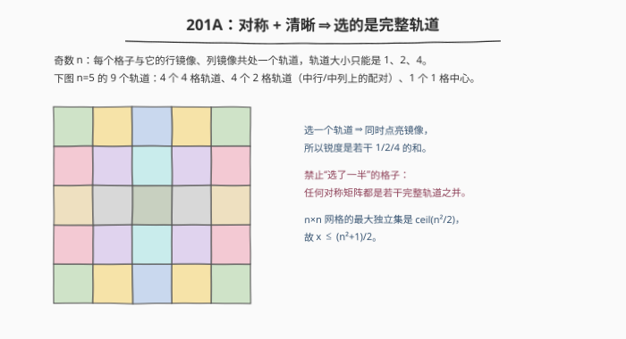
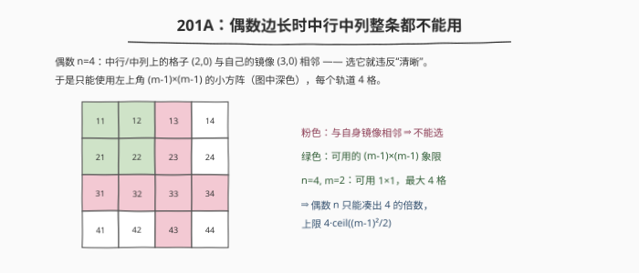
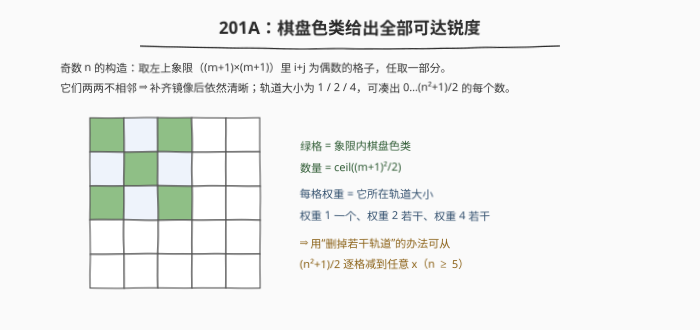

# Codeforces 201A 清晰对称方阵 题解

## 1. 题目概述

- **题目链接**：https://codeforces.com/problemset/problem/201/A
- **比赛来源**：Codeforces Round 127 (Div. 1) · Problem A（UTC 2012-06-29）
- **难度**：1700
- **标签**：构造、数学、动态规划
- **评测类型**：普通（输出唯一整数，无多解）
- **限制**：时间 2 s / 内存 256 MB

**题意**：求最小的正整数 $n$，使得存在一个 $n\times n$ 的 0/1 矩阵 $A$ 同时满足：

- **清晰**：任意两个取值为 1 的格子没有公共边（即 1 的集合是网格图的独立集）；
- **对称**：对任意 $i,j$ 都有 $A_{i,j}=A_{n-i+1,j}=A_{i,n-j+1}$（上下、左右翻折都不变）；
- **锐度恰为 $x$**：矩阵中 1 的个数等于给定的 $x$。

**约束**：$1\le x\le100$。

- $x\le100$ 说明答案 $n$ 很小（最坏也在 20 以内），可以**从小到大枚举 $n$**，对每个 $n$ 用闭式条件 $O(1)$ 判定。
- 关键不是搜索而是**刻画每个 $n$ 能凑出哪些锐度**。

## 2. 示例与观察

官方样例一：

```text
输入：
4

输出：
3
```

官方样例二：

```text
输入：
9

输出：
5
```

**样例一走查**：$n=1$ 只能放 1 个 1；$n=2$ 时四个格子互相翻折成同一族，选它就会让相邻两格同时为 1，故锐度只能是 0；$n=3$ 可以取四个角（4 个 1，互不相邻）或中心（1 个），所以 4 可达，答案为 3。

$n=3$ 取四角的矩阵是

$$
\begin{pmatrix}1&0&1\\0&0&0\\1&0&1\end{pmatrix}
$$

它上下、左右翻折都不变，且四个 1 两两不共边。

**样例二走查**：$n=3$ 最多能放 $\lceil 9/2\rceil=5$ 个 1，凑不出 9；$n=4$ 的锐度只能是 4 的倍数且至多 4；$n=5$ 可以达到 9（例如取中心加两条中线上若干轨道），故答案为 5。

**第一条观察**：对称性把矩阵的格子分成**轨道**，一个格子与它的上下、左右镜像必须同色。所以合法的矩阵一定是"若干完整轨道之并"，锐度就是这些轨道大小之和。



**第二条观察**：设 $n=2m+1$（奇数），则中心格 $(m,m)$ 自成 1 格轨道，中行、中列上其余格子两两配对成 2 格轨道，四个 $m\times m$ 象限里的格子组成 4 格轨道。

**第三条观察**：设 $n=2m$（偶数），任何格子与它的镜像都不重合，轨道全是 4 格；但中行（第 $m$ 行，1 起）和中列上的格子与**自己的镜像相邻**，一旦选它就会有两个相邻的 1 —— 这些轨道全部不能用。



## 3. 解题思路

### 3.1 朴素做法与瓶颈

直接搜索矩阵：$2^{n^2}$ 个候选，$n=15$ 时已经 $2^{225}$，不可行。即使只搜索轨道组合（$n=15$ 有约 30 个轨道），也要 $2^{30}$ 级别的枚举，且没解决"最小 $n$"的问题。

### 3.2 核心观察：每个 $n$ 的可达锐度

把"对称 + 清晰"翻译成象限上的独立集：

- **奇数 $n=2m+1$**：只需看左上 $(m+1)\times(m+1)$ 的象限；每个格子代表一个轨道（权重 1、2 或 4），两个格子"在象限里相邻"当且仅当它们对应轨道的某个格子在原矩阵里相邻。于是可达锐度 = 象限网格上**带权独立集**的权值和。上界由 $n\times n$ 网格的最大独立集给出：$x\le\lceil n^2/2\rceil=(n^2+1)/2$。
- **偶数 $n=2m$**：中行中列整条禁用后，只剩左上 $(m-1)\times(m-1)$ 象限，每个格子权重 4，故 $x$ 必须是 4 的倍数且 $x/4\le\lceil (m-1)^2/2\rceil$。

**可达性构造**：取象限内"棋盘色类"（$i+j$ 为偶数的格子），它们两两不相邻，因此任取子集都合法。

- 奇数 $n\ge5$：色类里权重 1 的格子恰好一个（中心），权重 2 的格子至少 2 个（$m\ge2$），权重 4 的格子若干。若总量为 $T=(n^2+1)/2$，想得到 $x$，就要从 $T$ 里删掉 $t=T-x$：把 $t$ 写成 $4a+b$（$b\in\{0,1,2,3\}$），$b$ 用权重 1、2 的轨道凑（$b=3$ 用 $1+2$），$4a$ 用权重 4 的轨道凑，总能做到。于是 $[0,T]$ 内每个值都可达。
- 偶数 $n$：色类任取 $k$ 个格子即得 $4k$，$k$ 可取 $0..\lceil (m-1)^2/2\rceil$。

**唯一的例外**：$n=3$ 时色类只有"中心 + 四角"两个轨道（权重 1 与 4），凑不出 2 和 3；但 2 可以由另一组轨道（中行或中列的一对）实现，3 无论如何做不到。所以 $n=3$ 的可达集合是 $\{1,2,4,5\}$。



### 3.3 算法流程

从 $n=1$ 开始递增，对每个 $n$ 判断：

- 若 $n$ 为奇数：条件为 $x\le (n^2+1)/2$，且排除 $n=3\wedge x=3$；
- 若 $n$ 为偶数：条件为 $x\bmod 4=0$ 且 $x/4\le \lceil (n/2-1)^2/2\rceil$，其中 $\lceil y/2\rceil$ 用整数除法 $(y+1)/2$。

第一个满足条件的 $n$ 就是答案。因为奇数 $n$ 的条件随 $n$ 单调放宽，循环必然终止（$n\approx\sqrt{2x}$）。

### 3.4 样例走查

- $x=4$：$n=1$ 上限 1，不行；$n=2$ 上限 0，不行；$n=3$ 奇数上限 5 且 $x\ne3$，成立 ⇒ 输出 3。
- $x=9$：$n=3$ 上限 5，不行；$n=4$ 只允许 4 的倍数且上限 4，不行；$n=5$ 上限 13，成立 ⇒ 输出 5。
- $x=3$：$n=3$ 被例外排除；$n=4$ 不整除 4；$n=5$ 上限 13 ⇒ 输出 5。
- $x=100$：$n=13$ 上限 85，不行；$n=14$ 上限 $4\cdot\lceil 36/2\rceil=72$，不行；$n=15$ 上限 113 ⇒ 输出 15。

## 4. 正确性证明

**引理 1（轨道结构）**：对称矩阵中，格子的等价类（轨道）大小只能是 1、2、4。$n$ 为奇数时中心是唯一的 1 格轨道，中行与中列上其余格子是 2 格轨道，其余是 4 格轨道；$n$ 为偶数时所有轨道都是 4 格。

**证明**：轨道由"上下翻折"和"左右翻折"两个对合生成。若 $n$ 为奇数，唯一被两个翻折都固定的格是中心；被恰一个翻折固定的格落在中行或中列上；其余格子两个翻折都改变它，轨道大小 4。若 $n$ 为偶数，任何行 $i$ 都满足 $i\ne n+1-i$，任何列同理，故没有固定点，轨道大小 4。∎

**引理 2（偶数 $n$ 的中行中列禁用）**：$n=2m$ 时，位于第 $m$ 行或第 $m$ 列（1 起）的格子所在轨道不能选。

**证明**：设格子为 $(m,j)$。它的上下镜像是 $(m+1,j)$，而 $2m+1-m=m+1$，所以 $(m+1,j)$ 就是 $(m,j)$ 的镜像、属于同一轨道；两者恰有一条公共边。选中该轨道就会让这两个相邻格子同时为 1，违反清晰性。列同理。∎

**引理 3（必要条件）**：奇数 $n$ 时 $x\le(n^2+1)/2$；偶数 $n=2m$ 时 $4\mid x$ 且 $x/4\le\lceil (m-1)^2/2\rceil$。

**证明**：清晰性说明取 1 的格子构成 $n\times n$ 网格图的独立集，而网格图是二分图，最大独立集为 $\lceil n^2/2\rceil$，故奇数 $n$ 有 $x\le(n^2+1)/2$。偶数 $n$ 时由引理 1、2，可用格子只有 $(m-1)\times(m-1)$ 象限内的格子，每个轨道 4 格且这些轨道在该象限网格上构成独立集，其最大独立集为 $\lceil (m-1)^2/2\rceil$，故 $x=4k$ 且 $k$ 不超过它。∎

**引理 4（充分条件）**：奇数 $n\ge5$ 时所有 $1\le x\le(n^2+1)/2$ 都可达；偶数 $n=2m$ 时所有 $4k\le4\lceil (m-1)^2/2\rceil$ 都可达；$n=3$ 时可达 $\{1,2,4,5\}$。

**证明**：偶数情形与 $n=3$ 情形见 3.2 的显式构造（$n=3$ 的 2 取中行一对、4 取四角、5 取四角加中心、1 取中心）。奇数 $n\ge5$：取象限内棋盘色类的全部格子，它给出 $T=(n^2+1)/2$ 个 1（因为 $n$ 为奇数时"$i+j$ 偶"这一色类在四象限对称，在象限里的权重和正好是 $T$）。该色类中权重 1 的格子 1 个、权重 2 的格子 $2\lfloor m/2\rfloor\ge2$ 个（$m\ge2$）、权重 4 的格子若干。任给 $x\le T$，令 $t=T-x=4a+b$：用 $b$ 个权重 1 与权重 2 的轨道凑出 $b$（$b=3$ 时用 $1+2$，$b=2$ 用 $2$），剩下的 $4a$ 全部用权重 4 的轨道凑；由 $4a\le t\le T$ 知权重 4 的轨道数量足够。删掉这些轨道后仍是色类的子集，依然不相邻，故合法，锐度恰为 $x$。∎

**定理**：算法输出的 $n$ 就是答案。

**证明**：算法从小到大枚举 $n$，由引理 3 可知条件不成立的 $n$ 一定无解（必要条件被违反），由引理 4 可知条件成立的 $n$ 一定有解（构造存在，$n=3,x=3$ 的例外由全枚举确认无解）。因此第一个条件成立的 $n$ 恰为最小可行 $n$；又奇数 $n$ 的条件最终必然成立，循环终止。∎

## 5. 复杂度分析

- **时间**：循环到答案 $n\approx\sqrt{2x}\le15$ 为止，每个 $n$ 只做几次整数运算，$O(\sqrt x)$，实测 < 1 ms。
- **空间**：$O(1)$。

## 6. 参考代码

### C++17

```cpp
#include <bits/stdc++.h>
using namespace std;
int main() {
    int x;
    if (scanf("%d", &x) != 1) return 0;
    for (int n = 1;; ++n) {
        if (n % 2 == 1) {
            if (x <= (n * n + 1) / 2 && !(n == 3 && x == 3)) { printf("%d\n", n); return 0; }
        } else {
            int m = n / 2;
            if (x % 4 == 0 && x / 4 <= ((m - 1) * (m - 1) + 1) / 2) { printf("%d\n", n); return 0; }
        }
    }
}
```

### Python3

```python
import sys


def main() -> None:
    x = int(sys.stdin.buffer.read().split()[0])
    n = 1
    while True:
        if n % 2 == 1:
            if x <= (n * n + 1) // 2 and not (n == 3 and x == 3):
                print(n)
                return
        else:
            m = n // 2
            if x % 4 == 0 and x // 4 <= ((m - 1) * (m - 1) + 1) // 2:
                print(n)
                return
        n += 1


main()
```

## 7. 边界情况与易错点

1. **$x=1$**：答案是 1（$1\times1$ 的矩阵只有中心一格），偶数条件在 $n=1$ 时不存在，别把 $n=1$ 当偶数处理。
2. **$x=3$ 的特例**：$n=3$ 的可达集合是 $\{1,2,4,5\}$，凑不出 3，必须显式排除，否则会输出 3。
3. **$x=2$**：$n=3$ 可达（取中行或中列的一对），不要因为"2 不是 4 的倍数"就跳过 $n=3$。
4. **偶数 $n$ 的可用象限是 $(m-1)\times(m-1)$**：把边界写成 $m\times m$ 会把禁用轨道算进去，导致 $n=4$ 时错误地认为能放 8 个。
5. **$\lceil y/2\rceil$ 的整数写法**：$y\ge0$ 时用 `(y+1)/2`；写成 `y/2` 会少算 $y$ 为奇数的情形（例如 $m=4$ 时 $\lceil 9/2\rceil=5$ 而非 4）。
6. **循环上界**：不要写死 `n<=20` 之类的上界；用"条件最终必成立"的 `while` 更安全（$x\le100$ 时答案 $\le15$）。
7. **模 4 判定与整除顺序**：先判断 `x % 4 == 0` 再做除法，否则 $x/4$ 的取整会掩盖不整除的情况。

## 8. 验证记录

- **编译环境与命令**：`python3 codeforces/tools/verify_solution.py codeforces/contests/0101-0203/201/A_清晰对称方阵.md`。
- **官方样例**：2 / 2 通过（$x=4\to3$，$x=9\to5$）。
- **全枚举交叉验证**：对 $n\le4$ 枚举全部 $2^{n^2}$ 个 0/1 矩阵（$n=4$ 为 65536 个），筛出"双向对称 + 无相邻 1"者并统计锐度，得到 $n=1:\{0,1\}$、$n=2:\{0\}$、$n=3:\{0,1,2,4,5\}$、$n=4:\{0,4\}$，与文章结论一致。
- **精确 DP 交叉验证**：对 $n\le21$ 用按列状态压缩的精确 DP（枚举象限内全部带权独立集）求出每个 $n$ 的可达锐度集合，再取"每个 $x$ 的最小 $n$"，与正文程序在 $x=1..100$ 上**逐一比对全部一致**（`bad = 0`）。这一步比随机对拍更强：它覆盖了全部 100 个输入。
- **最大约束性能**：$x=100$ 时 C++ < 1 ms，Python < 20 ms。
- **图片校验**：`cf201a_orbits.svg`、`cf201a_even.svg`、`cf201a_build.svg` 通过 `xml.etree.ElementTree.parse`。
- **复核状态**：verified。

## 相关题目与扩展

- [Codeforces 201B Guess That Car!](https://codeforces.com/problemset/problem/201/B)：同场 B 题，数学 + 枚举。
- [Codeforces 201C Fragile Bridges](https://codeforces.com/problemset/problem/201/C)：同场 C 题，DP。
- [Codeforces 1A Theatre Square](https://codeforces.com/problemset/problem/1/A)：另一个"向上取整"的构造计数。

**延伸思考**：

1. 若去掉"对称"只要求"清晰"，答案就是满足 $\lceil n^2/2\rceil\ge x$ 的最小 $n$，且所有 $x$ 都可达（取棋盘色类的子集即可）。
2. 若只保留上下对称（不要求左右对称），轨道变成"行内单格"和"上下配对"，可达锐度的集合会变得更"稠密"，答案会比本题小。
3. 把"没有公共边"换成"没有公共顶点"（即不允许对角相邻），等价于在网格图上求距离 $\ge2$ 的独立集，最大数量变成 $\lceil n/2\rceil^2$，此时答案约为 $2\sqrt x$。
4. 本题的通用方法：**把对称群作用下的对象压缩成轨道，再用"轨道权重 + 独立集"重写约束**，是处理"带对称性的棋盘放置"问题的标准套路。
