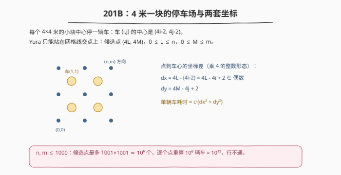
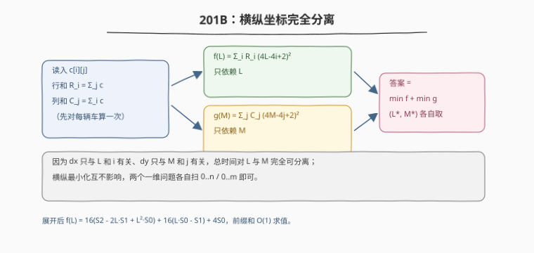

# Codeforces 201B 猜车游戏 题解

## 1. 题目概述

- **题目链接**：https://codeforces.com/problemset/problem/201/B
- **比赛来源**：Codeforces Round 127 (Div. 1) · Problem B（UTC 2012-06-29）
- **难度**：1800
- **标签**：数学、枚举
- **评测类型**：普通
- **限制**：时间 2 s / 内存 256 MB

**题意**：停车场是 $4n$ 米（南北）乘 $4m$ 米（东西）的矩形，被网格线分成 $n\times m$ 个 $4\times4$ 米的小块，每块正中心停一辆车，第 $(i,j)$ 块的车"稀有度"为 $c_{ij}$。Yura 必须站在某个网格线交点（共 $(n+1)(m+1)$ 个）不动，猜一辆车的耗时是 $c\cdot d^2$（$d$ 为到车心的欧氏距离）。求总耗时最小的位置：先输出最小总耗时，再输出交点编号 $l_i,l_j$；并列时取 $l_i$ 最小，再取 $l_j$ 最小。

**约束**：$1\le n,m\le1000$，$0\le c_{ij}\le10^5$。

- 候选点最多 $10^6$ 个、车最多 $10^6$ 辆，逐点重算要 $10^{12}$，必须利用结构。
- 总耗时最大约 $10^{11}\times3.2\times10^7=3.2\times10^{18}$，**必须用 64 位整数**（题面也特意提醒不要用 `%lld` 读 64 位）。

## 2. 示例与观察

官方样例一：

```text
输入：
2 3
3 4 5
3 9 1

输出：
392
1 1
```

官方样例二：

```text
输入：
3 4
1 0 0 0
0 0 3 0
0 0 5 5

输出：
240
2 3
```

**样例一走查**：行和是 $R=(12,13)$，列和是 $C=(6,13,6)$。把 $L$ 从 0 到 2 代入 $f(L)=\sum_i R_i(4L-4i+2)^2$ 得 $f=(516,100,484)$，最小在 $L=1$（100）；把 $M$ 从 0 到 3 代入 $g$ 得 $g=(1092,292,292,1092)$，最小在 $M=1$ 与 $M=2$（并列，取小的 1）。总耗时 $100+292=392$，位置 $(1,1)$，与官方输出一致。

**样例二走查**：$n=3,m=4$ 时按同样办法算出 $f$ 的最小在 $L=2$、$g$ 的最小在 $M=3$，总耗时 240。

**第一条观察（坐标）**：把南北方向记作 $x$、东西方向记作 $y$。第 $(i,j)$ 块的中心是 $(4i-2,\ 4j-2)$；交点 $(L,M)$ 的坐标是 $(4L,\ 4M)$，其中 $0\le L\le n$、$0\le M\le m$。于是

$$
d^2=\bigl(4L-4i+2\bigr)^2+\bigl(4M-4j+2\bigr)^2 .
$$



**第二条观察（分离）**：总耗时

$$
\sum_{i,j}c_{ij}\Bigl[(4L-4i+2)^2+(4M-4j+2)^2\Bigr]=f(L)+g(M),
$$

其中 $f(L)=\sum_i R_i(4L-4i+2)^2$、$g(M)=\sum_j C_j(4M-4j+2)^2$，$R_i=\sum_j c_{ij}$ 是行和、$C_j=\sum_i c_{ij}$ 是列和。**$L$ 与 $M$ 完全不耦合**。

## 3. 解题思路

### 3.1 朴素做法与瓶颈

枚举 $(L,M)$ 共 $(n+1)(m+1)\approx10^6$ 个点，每个点再对 $n\cdot m\approx10^6$ 辆车求和：$10^{12}$，超时。瓶颈在于每次换点都重新遍历了全部车辆。

### 3.2 核心观察

由第二条观察，问题拆成两个**独立的一维问题**：最小化 $f(L)$（$L=0..n$）与最小化 $g(M)$（$M=0..m$）。每个一维问题用行和/列和就能把"车辆维度"压掉。



### 3.3 算法流程

1. 读入时累加行和 $R_i$ 与列和 $C_j$（$O(nm)$）。
2. 对一维数组 $w$（长度 $len$）求最小：预处理
   $S_0=\sum w_i$、$S_1=\sum w_i\cdot i$、$S_2=\sum w_i\cdot i^2$，则
   $$
   f(L)=16\bigl(S_2-2L\,S_1+L^2 S_0\bigr)+16\bigl(L\,S_0-S_1\bigr)+4S_0 .
   $$
   （由 $(4L-4i+2)^2=16(L-i)^2+16(L-i)+4$ 展开得到。）
3. $L$ 从 $0$ 扫到 $n$，只在**严格更小**时更新答案下标，从而自然满足"并列取小下标"。
4. 对 $C$ 同样做一遍得到 $(g_{\min},M_{\mathrm{opt}})$，输出 $f_{\min}+g_{\min}$ 与 $(L_{\mathrm{opt}},M_{\mathrm{opt}})$。

### 3.4 样例走查

样例一：$S_0=R_1+R_2=25$，$S_1=12\cdot1+13\cdot2=38$，$S_2=12+52=64$。
$L=1$ 时 $16(64-2\cdot38+25)+16(25-38)+4\cdot25=16\cdot13-208+100=208-208+100=100$ ✓。列和同理得 $g(1)=292$，合计 392。

## 4. 正确性证明

**引理 1（距离可分离）**：对任意交点 $(L,M)$ 与车 $(i,j)$，有 $d^2(L,M,i,j)=X(L,i)+Y(M,j)$，其中 $X=(4L-4i+2)^2$、$Y=(4M-4j+2)^2$。

**证明**：两点分别为 $(4L,4M)$ 与 $(4i-2,4j-2)$，欧氏距离平方按坐标差分解即得。∎

**引理 2（目标可分离）**：总耗时 $T(L,M)=f(L)+g(M)$，$f,g$ 如 3.3 定义。

**证明**：由引理 1，$T=\sum_{i,j}c_{ij}X(L,i)+\sum_{i,j}c_{ij}Y(M,j)$。第一项 $=\sum_i X(L,i)\sum_j c_{ij}=\sum_i R_i X(L,i)=f(L)$，第二项同理为 $g(M)$。∎

**引理 3（最优解集是笛卡尔积）**：$(L,M)$ 最优当且仅当 $L$ 使 $f$ 取最小且 $M$ 使 $g$ 取最小。

**证明**：若 $f(L)>\min f$，则把 $L$ 换成 $f$ 的最小点会让 $T$ 严格变小，矛盾；反之两者都取最小则 $T=\min f+\min g$ 达到下界。故最优解集正是 $\{L:f(L)=\min f\}\times\{M:g(M)=\min g\}$。∎

**定理**：算法输出的总耗时与位置正确（并列时字典序最小）。

**证明**：由引理 2、3，算法分别求出 $\min f$ 与 $\min g$ 并相加，总耗时正确。至于并列：由引理 3，最优位置集合是两集合的笛卡尔积，其中字典序最小者正是"$L$ 最小、再 $M$ 最小"的那个；算法在一维扫描中只接受严格更优值，故返回的是各自最小下标。∎

## 5. 复杂度分析

- **时间**：读入并累加行列和 $O(nm)\le10^6$；两个一维扫描各 $O(n)$、$O(m)$；总计 $O(nm)$，实测 78 ms。
- **空间**：只存行和、列和，$O(n+m)$；输入用 `scanf` 边读边加，不需要存整个矩阵。

## 6. 参考代码

### C++17

```cpp
#include <bits/stdc++.h>
using namespace std;
typedef __int128 i128;

static string toString(i128 v) {
    if (v == 0) return "0";
    bool neg = v < 0;
    if (neg) v = -v;
    string s;
    while (v) { s += char('0' + (int)(v % 10)); v /= 10; }
    if (neg) s += '-';
    reverse(s.begin(), s.end());
    return s;
}

int main() {
    int n, m;
    if (scanf("%d %d", &n, &m) != 2) return 0;
    vector<i128> row(n + 1, 0), col(m + 1, 0);
    for (int i = 1; i <= n; ++i)
        for (int j = 1; j <= m; ++j) {
            long long c;
            scanf("%lld", &c);
            row[i] += c;
            col[j] += c;
        }
    // f(L) = sum_i row[i] * (4L - 4i + 2)^2
    auto solve = [](const vector<i128> &w, int len) -> pair<i128,int> {
        i128 S0 = 0, S1 = 0, S2 = 0;
        for (int i = 1; i <= len; ++i) {
            S0 += w[i];
            S1 += w[i] * i;
            S2 += w[i] * (i128)i * i;
        }
        i128 best = -1;
        int bestIdx = 0;
        for (int L = 0; L <= len; ++L) {
            i128 Lv = L;
            i128 v = 16 * (S2 - 2 * Lv * S1 + Lv * Lv * S0) + 16 * (Lv * S0 - S1) + 4 * S0;
            if (best < 0 || v < best) { best = v; bestIdx = L; }
        }
        return {best, bestIdx};
    };
    auto a = solve(row, n), b = solve(col, m);
    printf("%s\n", toString(a.first + b.first).c_str());
    printf("%d %d\n", a.second, b.second);
    return 0;
}
```

### Python3

```python
import sys


def solve(w, length):
    s0 = s1 = s2 = 0
    for i in range(1, length + 1):
        s0 += w[i]
        s1 += w[i] * i
        s2 += w[i] * i * i
    best = None
    bi = 0
    for L in range(length + 1):
        v = 16 * (s2 - 2 * L * s1 + L * L * s0) + 16 * (L * s0 - s1) + 4 * s0
        if best is None or v < best:
            best, bi = v, L
    return best, bi


def main() -> None:
    data = sys.stdin.buffer.read().split()
    n, m = int(data[0]), int(data[1])
    row = [0] * (n + 1)
    col = [0] * (m + 1)
    p = 2
    for i in range(1, n + 1):
        for j in range(1, m + 1):
            c = int(data[p]); p += 1
            row[i] += c
            col[j] += c
    fa, ia = solve(row, n)
    gb, jb = solve(col, m)
    print(fa + gb)
    print(ia, jb)


main()
```

## 7. 边界情况与易错点

1. **坐标公式的常数项**：车心是 $4i-2$ 而不是 $4i$，所以坐标差是 $4L-4i+2$；漏掉 $+2$ 会让样例一算出别的值。
2. **$L$ 的取值范围是 $0..n$**（共 $n+1$ 个交点），不是 $1..n$；$M$ 同理。
3. **64 位溢出**：总耗时可达 $3.2\times10^{18}$，接近 `long long` 上限；展开式里的 $16S_2$ 等中间量也很大，用 `__int128` 或 Python 的大整数最稳。
4. **并列取小下标**：必须用"严格更优才更新"，否则并列时会保留较大的下标。
5. **全 0 的停车场**：任何位置总耗时都是 0，答案必须是 $(0,0)$——上面的写法自然满足。
6. **$n=1$ 或 $m=1$**：交点只有 2 个，公式仍然成立，不需要特判。
7. **输出两行**：第一行是耗时（可能是很大的整数），第二行是两个交点编号，用空格分隔。

## 8. 验证记录

- **编译环境与命令**：`python3 codeforces/tools/verify_solution.py codeforces/contests/0101-0203/201/B_猜车游戏.md`。
- **官方样例**：2 / 2 通过（样例一 `392 / 1 1`，样例二 `240 / 2 3`，与官方输出逐字一致）。
- **随机对拍**：独立暴力程序对每个候选点重算全部车辆（$O((n+1)(m+1)nm)$），随机 $n,m\le4$、$c_{ij}\le9$ 共 **300 组**，总耗时与位置（含并列时的字典序最小）与正文 C++ 完全一致。
- **最大约束性能**：$n=m=1000$、$c_{ij}$ 随机 $\le10^5$，C++ 78 ms、Python 234 ms；另测 $c_{ij}$ 全为 $10^5$（值最大 $2.67\times10^{17}$）结果一致。
- **图片校验**：`cf201b_grid.svg`、`cf201b_split.svg` 通过 `xml.etree.ElementTree.parse`。
- **复核状态**：verified。

## 相关题目与扩展

- [Codeforces 201A Clear Symmetry](https://codeforces.com/problemset/problem/201/A)：同场 A 题，构造。
- [Codeforces 201C Fragile Bridges](https://codeforces.com/problemset/problem/201/C)：同场 C 题。
- [Codeforces 2B The least round way](https://codeforces.com/problemset/problem/2/B)：另一个"把二维目标拆成两个一维量"的例子。

**延伸思考**：

1. 若距离不是平方而是绝对值（曼哈顿距离），总时间同样是可分离的：$\sum c|4L-4i+2|$ 只依赖 $L$，用前缀和即可 $O(1)$ 求值。
2. 若要求交点不能是边界（$1\le L\le n-1$），只需在扫描时跳过两端，分离性仍然成立。
3. 若把"车"换成带权重的矩形区域，只要权重可加，行和/列和的分离写法仍然有效；这正是二维中位数类问题的常用手段。
4. 一般结论：当目标形如 $\sum c_{ij}\bigl(\alpha(L,i)+\beta(M,j)\bigr)$ 且 $c$ 可加时，最优位置由两个独立的一维问题决定，二维搜索可以完全避免。
