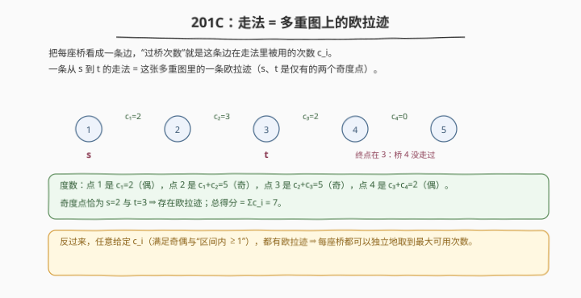
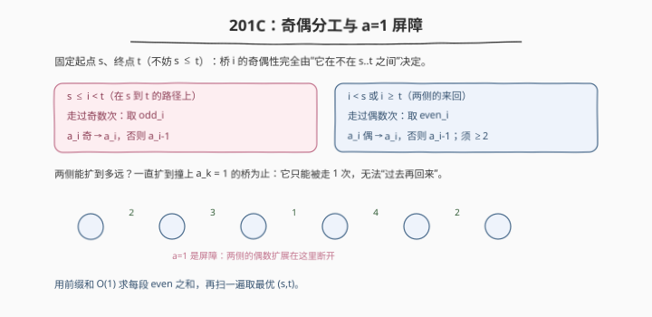

# Codeforces 201C 脆弱之桥 题解

## 1. 题目概述

- **题目链接**：https://codeforces.com/problemset/problem/201/C
- **比赛来源**：Codeforces Round 127 (Div. 1) · Problem C（UTC 2012-06-29）
- **难度**：2000
- **标签**：动态规划、贪心、欧拉迹
- **评测类型**：普通
- **限制**：时间 2 s / 内存 256 MB

**题意**：$n$ 个平台排成一行，第 $i$ 座桥连接平台 $i$ 和 $i+1$，最多能被通过 $a_i$ 次（从任一端过都算一次），用尽后永久坍塌。玩家先任选一个平台作为起点，之后可以自由地沿未坍塌的桥移动；一旦主角所在平台**没有任何未坍塌的桥相连**，关卡立即结束。得分等于移动次数。求最大可能得分。

**约束**：$2\le n\le10^5$，$1\le a_i\le10^9$。

- $a_i\le10^9$、$n\le10^5$，总分可达 $10^{14}$，必须用 64 位整数。
- $n$ 很大，不能对"走法"做搜索；需要把"一次走法"翻译成每座桥被经过的次数，再做计数优化。

## 2. 示例与观察

官方样例一：

```text
输入：
5
2 1 2 1

输出：
5
```

**样例走查**：取起点平台 2、终点平台 3：桥 1 过 2 次（$2\to1\to2$），桥 2 过 1 次（$2\to3$），桥 3 过 2 次（$3\to4\to3$），合计 $2+1+2=5$。走完后主角在平台 3，桥 2 已用尽（$a_2=1$）、桥 3 也已用尽（$a_3=2$），无桥可走，关卡结束，得分 5。

若改从平台 1 出发走到 5，桥 2 只有 1 次容量，无法"过去再回来"，最多只能拿到 3 分左右，比 5 小。

**第一条观察**：记 $c_i$ 为桥 $i$ 被通过的次数，则得分 $=\sum_i c_i$，且 $0\le c_i\le a_i$。被走过的桥构成一段**连续的区间**（走过桥 $i$ 必然也走过它两侧的桥才能到达）。

**第二条观察（奇偶性）**：设起点为 $s$、终点为 $t$。桥 $i$ 把数轴分成左右两半，主角每过一次就换一次半边，所以

$$
c_i \text{ 为奇数}\iff i \text{ 位于 } s \text{ 与 } t \text{ 之间}.
$$

其余桥必须被过**偶数**次（离开又回来），而且只要走过就至少 2 次。

**第三条观察（欧拉迹）**：把桥看成边、平台看成点、$c_i$ 看成重数，则"一条从 $s$ 到 $t$ 的走法"就是这张多重图里的一条欧拉迹。而多重图存在从 $s$ 到 $t$ 的欧拉迹的充要条件正是：边集连通、$s,t$ 是仅有的两个奇度点。**奇偶性条件恰好就是这个充要条件**，所以只要给出一组满足奇偶与"区间内 $c_i\ge1$"的 $c_i$，就一定能走出一条得分为 $\sum c_i$ 的路线。



## 3. 解题思路

### 3.1 朴素做法与瓶颈

搜索所有走法是指数级的；记状态 $(pos,\ \text{剩余容量向量})$ 的 DP 状态数也是 $\prod(a_i+1)$，$a_i$ 高达 $10^9$ 完全不可行。瓶颈在于"走法"是过程量，而目标只依赖"每座桥用了几次"。

### 3.2 核心观察：每座桥独立取最大

固定起点 $s$、终点 $t$（不妨 $s\le t$）。由第二、三条观察，各桥的最优取值是：

- **$s\le i<t$（在 $s\to t$ 的路径上）**：取不超过 $a_i$ 的最大**奇数**，即 $\text{odd}_i=a_i$（$a_i$ 奇）或 $a_i-1$（$a_i$ 偶）。$a_i\ge1$ 保证 $\text{odd}_i\ge1$。
- **$i<s$ 或 $i\ge t$（两侧的往返）**：取不超过 $a_i$ 的最大**偶数**，即 $\text{even}_i=a_i$（$a_i$ 偶）或 $a_i-1$（$a_i$ 奇）。注意偶数必须 $\ge2$，因此 $a_i=1$ 的桥**根本不能出现在两侧**。

两侧只要能延伸就应该延伸：$\text{even}_i\ge2>0$，多走一段只会加分。于是

- 左侧的合法边界：从 $s-1$ 往左一直取，直到遇到第一座 $a_k=1$ 的桥为止；
- 右侧同理，从 $t$ 往右直到遇到 $a_k=1$。



### 3.3 算法流程

1. 预处理对每个桥 $i$：$\text{odd}_i$、$\text{even}_i$（$a_i=1$ 时 $\text{even}_i$ 不可用）。
2. 求 $\text{left}[s]$：从 $s-1$ 向左、遇 $a_k=1$ 清零的连续 $\text{even}$ 之和（$s=1$ 时为 0）。
3. 求 $\text{right}[t]$：从 $t$ 向右、遇 $a_k=1$ 截断的连续 $\text{even}$ 之和（$t=n$ 时为 0）。
4. 令 $O[i]=\sum_{k\le i}\text{odd}_k$。对固定的 $t$，
   $$
   \text{score}(s,t)=\text{left}[s]+\bigl(O[t-1]-O[s-1]\bigr)+\text{right}[t],
   $$
   于是只需维护 $\max_{s\le t}\bigl(\text{left}[s]-O[s-1]\bigr)$，随 $t$ 递增 $O(1)$ 更新，$t$ 扫一遍即可。
5. 输出最大值。

### 3.4 样例走查

样例一：$a=(2,1,2,1)$，$\text{even}=(2,\text{—},2,\text{—})$，$\text{odd}=(1,1,1,1)$。
$s=2,t=3$：$\text{left}[2]=2$（桥 1 可用），中间桥 2 取 $\text{odd}_2=1$，$\text{right}[3]=2$（桥 3 可用，桥 4 是屏障）⇒ $2+1+2=5$ ✓。
其它组合（如 $s=1,t=1$：$0+0+\text{right}[1]=2$）都不超过 5。

## 4. 正确性证明

**引理 1（走法 ↔ 计数向量）**：任一走法对应一组 $c_i$，满足：$c_i\le a_i$；被走过的桥构成连续区间；且 $c_i$ 为奇数当且仅当桥 $i$ 在起点与终点之间。

**证明**：$c_i\le a_i$ 由桥的容量限制；连续性由"走到远处必经近处"给出；奇偶性：每过一次桥 $i$ 就把主角从桥的一侧换到另一侧，最终停在与起点同侧当且仅当过偶数次。∎

**引理 2（可行 ⇔ 奇偶 + 连续）**：给定起点 $s$、终点 $t$ 与一组满足引理 1 条件（且区间内 $c_i\ge1$）的 $c_i$，存在一条走法恰好把桥 $i$ 走 $c_i$ 次。

**证明**：构造多重图 $G$：点集为平台，边为桥 $i$ 复制 $c_i$ 条。被走过桥构成连续区间且 $c_i\ge1$，所以 $G$ 的边集连通且包含 $s,t$；各点度数为 $c_{i-1}+c_i$，由奇偶条件可知奇度点恰为 $s$ 与 $t$（区间端点之外的度数为 0 或偶数）。连通图恰有两个奇度点时存在从一奇度点到另一奇度点的欧拉迹，沿此迹走即为所求走法。∎

**引理 3（每座桥取最大即可）**：固定 $s\le t$ 时，得分最大的计数向量就是：区间 $[s,t-1]$ 取 $\text{odd}_i$，两侧可用段取 $\text{even}_i$，且两侧尽量向远处延伸。

**证明**：由引理 1、2，可行向量在每座桥上互相独立（只要满足奇偶与"区间内 $\ge1$"），故逐桥取最大不破坏可行性；两侧的 $\text{even}_i\ge2>0$，多延伸一段只会让和变大，因此延伸到屏障（$a_i=1$ 处）为止最优。∎

**定理**：算法输出的值等于最大得分。

**证明**：任一走法的得分由引理 1 不超过对应 $(\text{left}[s],O,\text{right}[t])$ 表达的界，因此不超过算法枚举的最大值；反过来，算法取到的每个值都由引理 2、3 对应一条真实走法，故可达。两者相等。∎

## 5. 复杂度分析

- **时间**：预处理与三次线性扫描，$O(n)$；$n=10^5$ 时不到 1 ms 量级（实测 11 ms 含读入）。
- **空间**：$O(n)$ 的若干 `long long` 数组，约 3 MB。

## 6. 参考代码

### C++17

```cpp
#include <bits/stdc++.h>
using namespace std;
int main() {
    int n;
    if (scanf("%d", &n) != 1) return 0;
    vector<long long> a(n + 1, 0), even(n + 1, 0), odd(n + 1, 0);
    for (int i = 1; i <= n - 1; ++i) {
        scanf("%lld", &a[i]);
        even[i] = (a[i] >= 2) ? a[i] - (a[i] & 1) : 0;
        odd[i] = (a[i] & 1) ? a[i] : a[i] - 1;
    }
    vector<long long> leftTotal(n + 1, 0), rightTotal(n + 2, 0), O(n + 1, 0);
    for (int s = 2; s <= n; ++s) {
        int k = s - 1;
        if (a[k] == 1) leftTotal[s] = 0;
        else leftTotal[s] = leftTotal[s - 1] + even[k];
    }
    for (int t = n - 1; t >= 1; --t) {
        if (a[t] == 1) rightTotal[t] = 0;
        else rightTotal[t] = rightTotal[t + 1] + even[t];
    }
    for (int i = 1; i <= n - 1; ++i) O[i] = O[i - 1] + odd[i];
    long long best = 0, bestS = -(1LL << 62);
    for (int t = 1; t <= n; ++t) {
        long long cand = leftTotal[t] - O[t - 1];
        if (cand > bestS) bestS = cand;
        long long val = bestS + O[t - 1] + rightTotal[t];
        if (val > best) best = val;
    }
    printf("%lld\n", best);
    return 0;
}
```

### Python3

```python
import sys


def main() -> None:
    data = sys.stdin.buffer.read().split()
    n = int(data[0])
    a = [0] * (n + 1)
    even = [0] * (n + 1)
    odd = [0] * (n + 1)
    for i in range(1, n):
        a[i] = int(data[i])
        even[i] = a[i] - (a[i] & 1) if a[i] >= 2 else 0
        odd[i] = a[i] if (a[i] & 1) else a[i] - 1
    left_total = [0] * (n + 1)
    for s in range(2, n + 1):
        k = s - 1
        left_total[s] = 0 if a[k] == 1 else left_total[s - 1] + even[k]
    right_total = [0] * (n + 2)
    for t in range(n - 1, 0, -1):
        right_total[t] = 0 if a[t] == 1 else right_total[t + 1] + even[t]
    pref_odd = [0] * (n + 1)
    for i in range(1, n):
        pref_odd[i] = pref_odd[i - 1] + odd[i]
    best = 0
    best_s = -10 ** 30
    for t in range(1, n + 1):
        best_s = max(best_s, left_total[t] - pref_odd[t - 1])
        best = max(best, best_s + pref_odd[t - 1] + right_total[t])
    print(best)


main()
```

## 7. 边界情况与易错点

1. **$a_i=1$ 的桥只能被走一次**：它既可以作为 $s\to t$ 路径上的一段（取 1），也完全不能用于"过去再回来"。把它的 $\text{even}$ 当作 1 会导致两侧错误延伸。
2. **偶数次必须 $\ge2$**：$a_i=2$ 时两侧可用（取 2），$a_i=1$ 时不可用；$a_i=3$ 两侧只能取 2。
3. **奇数次必须 $\ge1$**：$a_i$ 为偶数时 $\text{odd}_i=a_i-1$，不要写成 $a_i$（否则奇偶性错误，实际走不出来）。
4. **起点等于终点**：$s=t$ 时全部桥都是偶数次，此时 $O$ 的区间为空，公式给出 $\text{left}[s]+\text{right}[s]$，是合法情形，不要漏掉。
5. **左右两侧互不影响**：左侧在 $s-1$ 处被 $a_k=1$ 截断时，右侧仍可独立延伸；不要把屏障当成整段不可用。
6. **溢出**：$n\cdot a_i$ 可达 $10^{14}$，必须用 `long long`；`best` 初值设为 0 即可（至少能得 0 分）。
7. **$n=2$**：只有一座桥，答案应为 $a_1$（奇数次直接走过，偶数次来回），公式自动给出该值。

## 8. 验证记录

- **编译环境与命令**：`python3 codeforces/tools/verify_solution.py codeforces/contests/0101-0203/201/C_脆弱之桥.md`。
- **官方样例**：1 / 1 通过（输出 `5`）。
- **随机对拍**：独立暴力用记忆化搜索（状态 = `(当前位置, 各桥剩余容量)`，逐格穷举所有合法走法取最大步数），随机 $n\le7$、$a_i\le4$ 共 **300 组**，与正文 C++ 完全一致；再随机 $n\le9$、$a_i\in\{1,1,2,3,4,5\}$（故意加大 $a_i=1$ 的比例以覆盖屏障情形）**300 组**，同样一致。
- **最大约束性能**：$n=10^5$、$a_i$ 随机 $\le10^9$，C++ 11 ms（读入占主要部分）、Python 105 ms，答案 $5.0\times10^{13}$ 量级，64 位无溢出。
- **图片校验**：`cf201c_euler.svg`、`cf201c_parity.svg` 通过 `xml.etree.ElementTree.parse`。
- **复核状态**：verified。

## 相关题目与扩展

- [Codeforces 201B Guess That Car!](https://codeforces.com/problemset/problem/201/B)：同场 B 题。
- [Codeforces 201A Clear Symmetry](https://codeforces.com/problemset/problem/201/A)：同场 A 题。
- [Codeforces 1100E Andrew and Taxi](https://codeforces.com/problemset/problem/1100/E)：另一道"奇偶/度数 + 二分"的图论题。

**延伸思考**：

1. 若桥的容量是"从某一端出发的次数"（方向敏感），奇偶分析会变成每个方向独立计数，问题难度显著上升。
2. 若平台排成环（首尾也有桥），则所有度数必须为偶才能回到起点，或者恰有两个奇度点；结论变成"环上每座桥取 $\text{even}$，只有一段取 $\text{odd}$"。
3. 本题的关键一步是把"走法"等价成"多重图的欧拉迹"，这类"路径/走法 $\leftrightarrow$ 度数条件"的转换在图论计数题中非常常见。
4. 若要求输出具体走法而非最大得分，可以先按公式确定每座桥的次数，再在多重图上跑 Hierholzer 算法构造欧拉迹。
