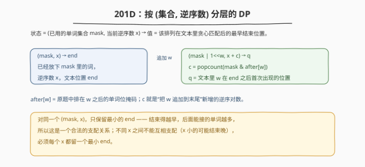
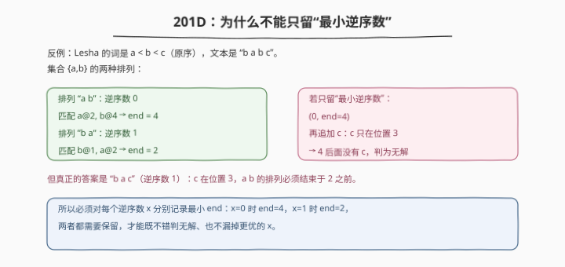

# Codeforces 201D 全新题目 题解

## 1. 题目概述

- **题目链接**：https://codeforces.com/problemset/problem/201/D
- **比赛来源**：Codeforces Round 127 (Div. 1) · Problem D（UTC 2012-06-29）
- **难度**：2600
- **标签**：状压 DP、暴力
- **评测类型**：普通
- **限制**：时间 5 s / 内存 256 MB

**题意**：Lesha 的问题由 $n$ 个**互不相同**的单词构成（顺序给定）。Torcoder 档案里有 $m$ 个问题，每个问题是一串单词，可能有重复。

对某个档案问题，在所有"由 Lesha 的 $n$ 个单词排列而成的序列"中，挑出能作为该档案问题**子序列**出现的那些；其中取逆序数最小者，记其逆序数为 $x$。相似度定义为

$$
p=\frac{n(n-1)}{2}-x+1 .
$$

求与 Lesha 的问题相似度最大的档案问题编号（并列取最小编号），输出该编号与形如 `[:|||:]` 的字符串（`:` 与 `]` 之间是 $p$ 个 `|`）。若没有任何档案问题包含这样的排列，输出 `Brand new problem!`。

**约束**：$n\le15$，$m\le10$，单个问题单词数 $k\le5\times10^5$，单词长度 $\le10$。

- $n\le15$ 是典型的 $2^n$ 状压规模（$3.3\times10^4$ 个集合）。
- 逆序数最大 $\frac{n(n-1)}{2}\le105$，可以把它也放进状态（$3.3\times10^4\times106$）。
- 文本很长，必须 $O(k\cdot n)$ 预处理 + 每次转移 $O(1)$ 查询下一个出现位置。

## 2. 示例与观察

官方样例一：

```text
输入：
4
find the next palindrome
1
10 find the previous palindrome or print better luck next time

输出：
1
[:||||||:]
```

官方样例二：

```text
输入：
3
add two numbers
3
1 add
2 two two
3 numbers numbers numbers

输出：
Brand new problem!
```

官方样例三：

```text
输入：
4
these papers are formulas
3
6 what are these formulas and papers
5 papers are driving me crazy
4 crazy into the night

输出：
1
[:||||:]
```

官方样例四：

```text
输入：
3
add two decimals
5
4 please two decimals add
5 decimals want to be added
4 two add decimals add
4 add one two three
7 one plus two plus three equals six

输出：
3
[:|||:]
```

**样例一走查**：文本里 `find the palindrome next` 是一个合法排列，逆序数 $x=1$；$\frac{4\cdot3}{2}-1+1=6$，故输出 6 个 `|`。

**样例二走查**：三个档案问题分别只含 `add`、只含 `two`、只含 `numbers`，任何排列都需要三个词全部出现，故都不包含，输出 `Brand new problem!`。

**样例三走查**：第一个档案问题包含 `these formulas are papers` 这样的排列，最小逆序数 $x=3$，$p=6-3+1=4$。

**样例四走查**：第三个档案问题 `two add decimals add` 含排列 `two add decimals`（$x=1$），$p=3-1+1=3$，是所有档案里 $p$ 最大的。

**第一条观察（子序列判定）**：固定一个排列后，判断它是否为子序列只需**贪心**：从左到右为每个单词找文本中最近的出现位置。贪心成功当且仅当存在某个匹配，且它给出的结束位置是最小的。

**第二条观察（追加一个单词的增量）**：设当前已经放好了集合 $S$ 中的单词（某个排列），逆序数为 $x$。若把单词 $w$ 追加到末尾，新增的逆序对数恰好是

$$
c(S,w)=\#\{v\in S:\ \text{原题中 } v \text{ 排在 } w \text{ 之后}\},
$$

它只与集合 $S$ 和 $w$ 有关，与 $S$ 内部的排列顺序无关（用位掩码 + `popcount` 可 $O(1)$ 求出）。新的结束位置 = 文本中 $w$ 在旧结束位置之后的首次出现。



**第三条观察（为什么状态里必须带逆序数）**：直觉上"逆序数最小的排列也一定结束得最早"，但这是错的。取 Lesha 的词按原序为 $a<b<c$，文本为 `b a b c`：

- 排列 `a b`：逆序数 0，匹配到位置 2、4，结束位置 4；
- 排列 `b a`：逆序数 1，匹配到位置 1、2，结束位置 2。

若只保留"逆序数最小 + 其最小结束"的状态 (0, 4)，那么再追加 `c`（只出现在位置 3）就判为无解；而真正的答案是 `b a c`（逆序数 1）。所以必须对每个逆序数分别记录最小的结束位置。



## 3. 解题思路

### 3.1 朴素做法与瓶颈

枚举 $n!$ 个排列（$15!\approx1.3\times10^{12}$）不可行；只做"最小结束位置"的状压 DP 会像上面的反例那样错判。瓶颈在于目标（逆序数）与可行性（结束位置）是两个互相牵制的维度。

### 3.2 核心观察：以 (集合, 逆序数) 为状态

令 $\text{dp}[S][x]$ = 用集合 $S$ 中单词的某个排列（逆序数恰为 $x$）匹配后，**最小的结束位置**（无法匹配则为 $\infty$）。转移：

$$
\text{dp}[S\cup\{w\}][x+c(S,w)]\ \leftarrow\ \min\Bigl(\cdot,\ \text{next}\bigl(w,\ \text{dp}[S][x]+1\bigr)\Bigr),
$$

其中 $\text{next}(w,p)$ 是文本中位置 $\ge p$ 的第一个 $w$。

**支配关系**：同一个 $(S,x)$ 只需保留最小的结束位置；不同 $x$ 之间无法比较（$x$ 小的可能结束更晚），必须逐个保留。

### 3.3 算法流程

1. 读入 Lesha 的 $n$ 个单词，建立"单词 → 编号"的哈希表；预处理 $\text{after}[w]$ = 原序中排在 $w$ 之后的单词位掩码。
2. 对每个档案问题：
   - 把文本映射成编号序列（不在 Lesha 词表里的单词记为 $-1$）；
   - 预处理 $\text{nxt}[p][w]$ = 位置 $\ge p$ 的第一个 $w$（没有则记作 $k$）：从右往左扫，维护每个单词最近出现的位置；
   - $\text{dp}$ 用长度 $(2^n)\times(\frac{n(n-1)}{2}+1)$ 的数组，初值 $\infty$，$\text{dp}[0][0]=-1$（空排列结束位置为 $-1$）；
   - 按 mask 从小到大枚举，对每个有限的 $(S,x)$ 与每个 $w\notin S$ 做转移；
   - 最终答案的 $x$ = 使 $\text{dp}[\text{full}][x]$ 有限的最小 $x$；若全为 $\infty$ 则该问题不含任何排列。
3. 在所有有解的问题里取 $x$ 最小者（并列取编号最小），输出编号与 `[:` + $p$ 个 `|` + `:]`；若都无解输出 `Brand new problem!`。

### 3.4 样例走查

样例一的文本里，$\text{dp}[\{find\}][0]=0$（`find` 在位置 0），继续追加……最终 $\text{dp}[\text{full}][1]$ 有限而 $\text{dp}[\text{full}][0]$ 为 $\infty$，故 $x=1$、$p=6$。样例二里每个档案问题都缺词，$\text{dp}[\text{full}][\cdot]$ 全为 $\infty$，输出 `Brand new problem!`。

## 4. 正确性证明

**引理 1（贪心结束位置最小）**：对一个固定排列，从左到右每次取"当前位置之后最近的出现"，得到的结束位置是所有匹配中最小的。

**证明**：归纳。设前 $i-1$ 个单词贪心结束于 $e_{i-1}$，任何合法匹配的前 $i-1$ 个单词结束位置 $e'_{i-1}\ge e_{i-1}$；第 $i$ 个单词需要出现在 $e'_{i-1}$ 之后，而 "$\ge e_{i-1}+1$ 的首次出现" $\le$ "$\ge e'_{i-1}+1$ 的首次出现"，故贪心的 $e_i$ 最小。∎

**引理 2（转移代价正确）**：把 $w$ 追加到集合 $S$ 的任一排列末尾，新增的逆序对数恒为 $c(S,w)=\#\{v\in S: v \text{ 原序在 } w \text{ 之后}\}$。

**证明**：逆序对只由两个单词的相对顺序决定。$w$ 与 $S$ 中某个 $v$ 构成逆序对当且仅当原序中 $v$ 在 $w$ 之后而排列中 $w$ 在 $v$ 之后——由于 $w$ 被放在末尾，后者恒成立。故新增数目恰为满足"原序在 $w$ 之后"的 $v$ 的个数，与 $S$ 内部排列无关。∎

**引理 3（状态支配）**：对同一个集合 $S$ 与同一个逆序数 $x$，结束位置更小的状态不会更差：任何能接在较大结束位置之后的单词序列，也能接在较小结束位置之后。

**证明**：若 $e_1\le e_2$，则对任意单词 $w$，$\text{next}(w,e_1+1)\le\text{next}(w,e_2+1)$；后续转移只会用到 next 的单调性，故 $e_1$ 的一切后继结束位置都不大于 $e_2$ 的对应后继。∎

**定理**：算法求出的 $x$ 等于"能作为该档案问题子序列的排列中最小的逆序数"。

**证明**：任何合法排列都对应 DP 中一条从 $\text{dp}[0][0]$ 出发、按排列顺序逐词转移的路径，其终点 $\text{dp}[\text{full}][x]$ 有限（由引理 1、2，结束时记录的正是该排列的贪心结束位置）。反过来，DP 中任何有限的 $\text{dp}[\text{full}][x]$ 都对应一条实际可行的转移链，即某个排列是该文本的子序列，且其逆序数为 $x$。由引理 3，剪掉"同 $(S,x)$ 中结束位置更大"的状态不会丢失任何更优解。故所有可达的 $x$ 与所有合法排列的逆序数集合相同，取最小值即答案。∎

## 5. 复杂度分析

- **时间**：每个档案问题预处理 $\text{nxt}$ 为 $O(k\cdot n)$；DP 的状态数上界为 $2^n\cdot\frac{n(n-1)}{2}$，转移 $O(n)$，总计 $O\bigl(2^n\cdot n^2\cdot n\bigr)$ 量级（$n=15$ 时实际约 $6\times10^6$ 次转移），乘上 $m\le10$。实测（$n=15$、$m=10$、每个文本 $5\times10^4$ 词）0.43 s。
- **空间**：$\text{nxt}$ 为 $O(k\cdot n)$ 个整数（$k=5\times10^5$、$n=15$ 时约 30 MB），DP 约 14 MB，均远小于 256 MB。

## 6. 参考代码

### C++17

```cpp
#include <bits/stdc++.h>
using namespace std;

int main() {
    int n;
    if (scanf("%d", &n) != 1) return 0;
    unordered_map<string, int> id;
    id.reserve(64);
    for (int i = 0; i < n; ++i) {
        char buf[16];
        scanf("%s", buf);
        id[buf] = i;
    }
    int maxInv = n * (n - 1) / 2;
    int full = (1 << n) - 1;
    vector<int> afterMask(n, 0);
    for (int w = 0; w < n; ++w) {
        int msk = 0;
        for (int x = 0; x < n; ++x) if (x > w) msk |= (1 << x);
        afterMask[w] = msk;
    }
    int m;
    if (scanf("%d", &m) != 1) return 0;
    int bestIdx = -1, bestInv = INT_MAX;
    vector<int> dp((size_t)(1 << n) * (maxInv + 1), INT_MAX);
    vector<int> text;
    for (int pid = 1; pid <= m; ++pid) {
        int k;
        scanf("%d", &k);
        text.clear();
        text.reserve(k);
        for (int i = 0; i < k; ++i) {
            char buf[16];
            scanf("%s", buf);
            auto it = id.find(buf);
            text.push_back(it == id.end() ? -1 : it->second);
        }
        int len = k;
        // nxt[p*n + i] = 最小位置 q >= p 使 text[q] == i，否则 len
        vector<int> nxt((size_t)(len + 1) * n, len);
        vector<int> cur(n, len);
        for (int p = len - 1; p >= 0; --p) {
            int t = text[p];
            if (t >= 0) cur[t] = p;
            int *row = &nxt[(size_t)p * n];
            for (int i = 0; i < n; ++i) row[i] = cur[i];
        }
        fill(dp.begin(), dp.end(), INT_MAX);
        dp[0] = -1;   // mask 0, inv 0 -> end = -1
        for (int mask = 0; mask < full; ++mask) {
            int *base = &dp[(size_t)mask * (maxInv + 1)];
            int rest = full ^ mask;
            for (int inv = 0; inv <= maxInv; ++inv) {
                int e = base[inv];
                if (e == INT_MAX) continue;
                int npos = e + 1;
                for (int w = 0; w < n; ++w) {
                    if (!(rest >> w & 1)) continue;
                    int q = nxt[(size_t)npos * n + w];
                    if (q >= len) continue;
                    int ninv = inv + __builtin_popcount((unsigned)(mask & afterMask[w]));
                    int *nb = &dp[(size_t)(mask | (1 << w)) * (maxInv + 1)];
                    if (q < nb[ninv]) nb[ninv] = q;
                }
            }
        }
        int *fb = &dp[(size_t)full * (maxInv + 1)];
        int inv = INT_MAX;
        for (int v = 0; v <= maxInv; ++v) if (fb[v] != INT_MAX) { inv = v; break; }
        if (inv == INT_MAX) continue;
        if (inv < bestInv) { bestInv = inv; bestIdx = pid; }
    }
    if (bestIdx < 0) {
        printf("Brand new problem!\n");
    } else {
        int p = maxInv - bestInv + 1;
        printf("%d\n[:", bestIdx);
        for (int i = 0; i < p; ++i) putchar('|');
        printf(":]\n");
    }
    return 0;
}
```

### Python3

```python
import sys


def main() -> None:
    data = sys.stdin.buffer.read().split()
    p = 0
    n = int(data[p]); p += 1
    words = [data[p + i].decode() for i in range(n)]
    p += n
    idx = {w: i for i, w in enumerate(words)}
    max_inv = n * (n - 1) // 2
    full = (1 << n) - 1
    after = [0] * n
    for w in range(n):
        msk = 0
        for x in range(n):
            if x > w:
                msk |= 1 << x
        after[w] = msk
    m = int(data[p]); p += 1
    best_idx = -1
    best_inv = None
    for pid in range(1, m + 1):
        k = int(data[p]); p += 1
        text = [idx.get(data[p + i].decode(), -1) for i in range(k)]
        p += k
        nxt = [[k] * n for _ in range(k + 1)]
        cur = [k] * n
        for pos in range(k - 1, -1, -1):
            t = text[pos]
            if t >= 0:
                cur[t] = pos
            nxt[pos] = cur[:]
        dp = [dict() for _ in range(1 << n)]
        dp[0][0] = -1
        for mask in range(full):
            rest = full ^ mask
            if rest == 0:
                continue
            for inv, e in list(dp[mask].items()):
                npos = e + 1
                row = nxt[npos]
                m1 = mask
                for w in range(n):
                    if not (rest >> w & 1):
                        continue
                    q = row[w]
                    if q >= k:
                        continue
                    ninv = inv + bin(m1 & after[w]).count('1')
                    d = dp[mask | (1 << w)]
                    old = d.get(ninv)
                    if old is None or q < old:
                        d[ninv] = q
        f = dp[full]
        if not f:
            continue
        inv = min(f)
        if best_inv is None or inv < best_inv:
            best_inv = inv
            best_idx = pid
    if best_idx < 0:
        print("Brand new problem!")
    else:
        q = max_inv - best_inv + 1
        print(best_idx)
        print("[:", end="")
        print("|" * q, end="")
        print(":]")


main()
```

## 7. 边界情况与易错点

1. **状态必须带逆序数**：只保留"最小逆序数 + 其结束位置"会像 2.3 的反例那样误判无解（这是本题最大的坑）。
2. **同一个 $(S,x)$ 取最小结束位置**：不取最小会丢解（后续可用位置变少）；但**不能**跨 $x$ 比较。
3. **`p` 的输出**：`[:` + $p$ 个 `|` + `:]`，$p$ 由 $\frac{n(n-1)}{2}-x+1$ 算出，注意不要写成 $x$ 本身。
4. **`Brand new problem!` 的拼写**：逐字输出，感叹号不能漏。
5. **$n=1$**：$\frac{n(n-1)}{2}=0$，只要该单词出现过，$x=0$、$p=1$，输出一行 `1` 与 `[:|:]`。
6. **文本里的无关单词**：要映射成 $-1$ 而不是丢弃，否则位置整体错位（next 表自带位置，丢词会让后续匹配点错位）。
7. **并列取最小编号**：更新答案时用严格小于，保证先出现的问题不被后来的同分者覆盖。
8. **多问题共享 `dp` 数组**：每个问题开始前必须整体重置为 $\infty$，只重置访问过的位置容易漏。

## 8. 验证记录

- **编译环境与命令**：`python3 codeforces/tools/verify_solution.py codeforces/contests/0101-0203/201/D_全新题目.md`。
- **官方样例**：4 / 4 通过（含 `Brand new problem!` 与三种不同的 $p$）。
- **随机对拍**：独立暴力枚举全部 $n!$ 个排列（$n\le5$），对每个排列贪心判断是否为子序列并直接数逆序对，随机 $n\le5$、$m\le3$、$k\le9$、词表含干扰词共 **300 组**，与正文 C++ 输出（编号、$p$、无解判定）完全一致；另 150 组与 Python 版一致。
- **最大约束性能**：$n=15$、$m=10$、每个文本 $5\times10^4$ 词（总 50 万词）随机数据 C++ 0.43 s；单词按反序周期重复 0.30 s；单个 $5\times10^5$ 长文本 0.08 s，均远低于 5 s。
- **图片校验**：`cf201d_state.svg`、`cf201d_pareto.svg` 通过 `xml.etree.ElementTree.parse`。
- **复核状态**：verified。

## 相关题目与扩展

- [Codeforces 201E Thoroughly Bureaucratic Organization](https://codeforces.com/problemset/problem/201/E)：同场 E 题，组合计数。
- [Codeforces 201C Fragile Bridges](https://codeforces.com/problemset/problem/201/C)：同场 C 题。
- [LeetCode 903 DI 序列的有效排列](https://leetcode.cn/problems/valid-permutations-for-di-sequence/)：也是"按集合/前缀统计逆序"的 DP。

**延伸思考**：

1. 若把"逆序数最小"换成"字典序最小"，状态就不需要第二维，直接贪心/状压即可。
2. 若 $n$ 增大到 $20$，状压仍可行但 $n!$ 的逆序数维度不变（$190$），状态数 $10^6\times190$ 已偏大，需要换成"逐层剪枝 + 只保留 Pareto 前沿"。
3. 本题的"最小结束位置"是一个经典的子序列匹配技巧：对固定序列，贪心匹配的结束位置最小；把它作为 DP 的一维，可以把"是否存在"变成"位置最小化"。
4. 若要求输出具体排列，可以在 DP 里记录前驱，最后回溯出一条逆序数最小的排列。
