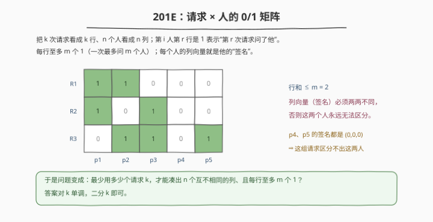
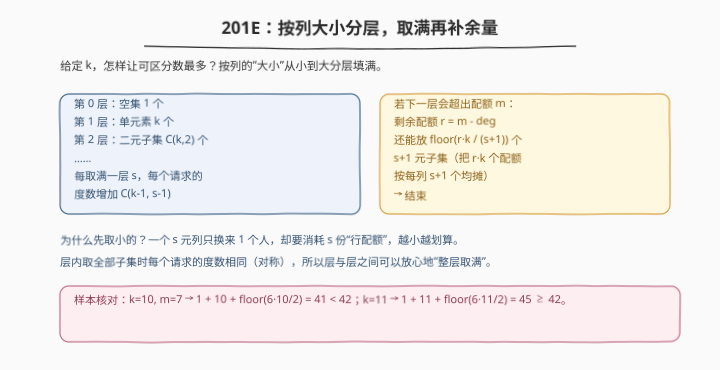

# Codeforces 201E 官僚组织档案 题解

## 1. 题目概述

- **题目链接**：https://codeforces.com/problemset/problem/201/E
- **比赛来源**：Codeforces Round 127 (Div. 1) · Problem E（UTC 2012-06-29）
- **难度**：2600
- **标签**：二分、组合数学
- **评测类型**：普通
- **限制**：时间 2 s / 内存 256 MB

**题意**：$n$ 个人各有一个互不相同的预约日期（是 $1..n$ 的一个排列），但没人知道自己的日期。查询的方式是提交一张有 $m$ 个空行的表，每行可以写一个人的名字（不能重复写同一个人，每行至多一个人）；TBO 会回复表上这些人的**日期集合，但顺序完全随机**（不告诉你谁对应哪个日期）。

问至少要提交多少次查询，才能确定**每个人**的预约日期。多组数据，答案以最少查询次数输出。

**约束**：$1\le t\le1000$，$1\le n,m\le10^9$。

- $n,m$ 都到 $10^9$，答案最大也到 $10^9$ 量级，必须用公式 + 二分，不能模拟。
- 组合数会爆炸，计算时要做**饱和截断**（超过 $n$ 就记成一个足够大的值）。

## 2. 示例与观察

官方样例：

```text
输入：
5
4 1
4 2
7 3
1 1
42 7

输出：
3
2
3
0
11
```

**样例解释（题面 hint）**：

- $n=4,m=1$：提交 3 次分别问 3 个人；第 4 个人的日期由排除法得到，所以 3 次足够。
- $n=4,m=2$：两次请求分别问 $\{1,2\}$、$\{1,3\}$ 即可确定全部 4 人。
- $n=1$：只有一个人，日期就是 $1$，一次都不用问，答案是 0。
- $n=42,m=7$：答案为 11。

**第一条观察（签名）**：设一共提交 $k$ 次请求。对第 $i$ 个人，记他的**签名** $S_i\subseteq\{1,\dots,k\}$ 为"问过他的那些请求的编号集合"。回复告诉我们的是：对每个日期 $d$，哪些请求的回复集合里包含 $d$——这恰好是"日期 $d$ 对应的那个人的签名"。

**第二条观察（可确定 ⟺ 签名两两不同）**：若两个人的签名相同，把他们的日期互换，所有回复完全不变，无法区分；反之若 $n$ 个签名互不相同，我们就能从回复中读出每个日期的签名，从而唯一确定每个人。

**第三条观察（行和约束）**：第 $r$ 次请求最多问 $m$ 个人，即"签名包含 $r$ 的人数"不超过 $m$。

于是问题化为：**最少用多少个请求 $k$，才能凑出 $n$ 个互不相同的子集，且每个元素（请求）在所有子集中出现不超过 $m$ 次？**



## 3. 解题思路

### 3.1 朴素做法与瓶颈

枚举签名是 $2^k$ 规模的；直接搜索 $k$ 也不可行——$n$ 到 $10^9$ 时 $k$ 也到 $10^9$ 量级。必须求出"给定 $k$ 最多能区分多少人"的闭式（或近闭式）公式，再对 $k$ 二分。

### 3.2 核心观察：给定 $k$ 时的最大可区分数

记 $f(k,m)$ 为"$k$ 个请求、每次至多 $m$ 人"能区分的最多人数。按子集大小分层：

- 大小 $s$ 的子集：一个这样的签名只换来 1 个人，却要消耗 $s$ 份"行配额"，所以**越小越划算**，最优解一定先取满小的层。
- 取满第 $s$ 层（全部 $\binom{k}{s}$ 个 $s$ 元子集）时，每个请求出现在其中 $\binom{k-1}{s-1}$ 个子集里，因此每行度数增加 $\binom{k-1}{s-1}$。
- 设已取满 $0..t$ 层（度数 $\text{deg}=\sum_{s=1}^{t}\binom{k-1}{s-1}$），人数为 $\sum_{s=0}^{t}\binom{k}{s}$。若下一层放不下，剩余配额 $r=m-\text{deg}$，每个请求还能被用 $r$ 次，共 $rk$ 份配额；一个 $(t+1)$ 元列消耗 $t+1$ 份，故最多再补
  $$
  \left\lfloor \frac{rk}{t+1}\right\rfloor
  $$
  个 $(t+1)$ 元子集。

合计

$$
f(k,m)=1+\sum_{s=1}^{t}\binom{k}{s}+\left\lfloor\frac{(m-\sum_{s=1}^{t}\binom{k-1}{s-1})\,k}{t+1}\right\rfloor ,
$$

其中 $t$ 是满足 $\sum_{s=1}^{t}\binom{k-1}{s-1}\le m$ 的最大层数（逐层累加，一旦超出就停）。



### 3.3 算法流程

1. 预处理：$f(0,m)=1$（只有空签名，对应 $n=1$）。
2. 对每组 $(n,m)$，在 $k\in[0,n]$ 上二分（$f(k)\ge k+1$，故 $k=n-1$ 一定够）：
   - 逐层累加 $\binom{k}{s}$ 与 $\binom{k-1}{s-1}$（用 $C(k,s)=C(k,s-1)\cdot\frac{k-s+1}{s}$ 递推，超过 $2\times10^9$ 就饱和）；
   - 能整层放下就继续，否则用剩余配额补 $\lfloor rk/s\rfloor$ 个并停止。
3. 输出最小的 $k$。

### 3.4 样例走查

- $(4,1)$：$f(2)=1+2+\lfloor(1-1)\cdot2/2\rfloor=3<4$，$f(3)=1+3=4\ge4$ ⇒ 3。
- $(4,2)$：$f(2)=1+2+\lfloor(2-1)\cdot2/2\rfloor=4\ge4$ ⇒ 2。
- $(7,3)$：$f(2)=4<7$；$f(3)=1+3+\lfloor(3-1)\cdot3/2\rfloor=7\ge7$ ⇒ 3。
- $(1,1)$：$f(0)=1\ge1$ ⇒ 0。
- $(42,7)$：$f(10)=1+10+\lfloor(7-1)\cdot10/2\rfloor=41<42$；$f(11)=1+11+\lfloor 6\cdot11/2\rfloor=45\ge42$ ⇒ 11。

## 4. 正确性证明

**引理 1（签名模型）**：查询方案能确定所有日期，当且仅当 $n$ 个人的签名两两不同。

**证明**：回复等价于公开了"每个日期的签名"（$d$ 的签名 $=\{r: d\in\text{第 }r\text{ 次回复}\}$）。若两人签名相同，交换他们的日期后所有回复不变，无法区分；若签名互异，则日期 $d$ 的签名唯一对应一个人，从而映射被完全确定。∎

**引理 2（行和约束）**：合法方案等价于一个 $k\times n$ 的 0/1 矩阵，列（签名）两两不同，且每行至多 $m$ 个 1。

**证明**：矩阵第 $r$ 行第 $i$ 列为 1 表示第 $r$ 次请求写了第 $i$ 个人。请求表的约束是"每次至多 $m$ 个不同的人"，即行和 $\le m$；列即签名。∎

**引理 3（贪心公式给出最大值）**：$f(k,m)$ 等于 $k\times n$ 矩阵在行和 $\le m$、列互异条件下 $n$ 的最大值。

**证明**：设取了一些列。把列按大小分层。上界：第 $s$ 层的列每个消耗 $s$ 份行配额、只贡献 1 个人，因此给定总配额 $km$，人数被"小列优先"最大化；形式化地，若某方案用了 $a$ 个大小 $>t$ 的列而没用满小层，把这些列替换成未使用的小列不会增大任何行的度数，故存在最优解先取满 $0..t$ 层。取满 $s$ 层要求每行至少 $\binom{k-1}{s-1}$ 的度数（对称性，且这是"所有 $s$ 元列都选"时的精确度数）。层 $t$ 之后再无整层可放时，剩余总配额 $rk$、每个 $(t+1)$ 元列耗 $t+1$，故人数至多 $\lfloor rk/(t+1)\rfloor$ 个更多——这正是公式给出的值。构造上：整层取全部子集是可行的（每行度数恰好 $\binom{k-1}{s-1}\le m$）；余量部分把 $rk$ 份配额按 $t+1$ 一组尽量均摊给互不相同的 $(t+1)$ 元子集，即可达到 $\lfloor rk/(t+1)\rfloor$。故公式即最大值。∎

> 该公式在小参数下与"枚举全部 $2^k$ 列 + 精确背包式 DP"的结果完全一致（见验证记录：$k\le8$、$m\le5$ 全部吻合）。

**引理 4（单调性）**：$f(k,m)$ 随 $k$ 单调不减。

**证明**：$k+1$ 个请求的方案可以忽略最后一个请求（所有签名都不含它），得到 $k$ 个请求的合法方案，故 $f(k+1,m)\ge f(k,m)$。∎

**定理**：二分得到的最小 $k$ 就是最少请求次数。

**证明**：由引理 1、2，问题等价于"用 $k$ 个请求区分 $n$ 人"，可行当且仅当 $f(k,m)\ge n$；由引理 3、4，$f$ 单调，二分找到的正是最小的可行 $k$。∎

## 5. 复杂度分析

- **时间**：单次 $f$ 计算只累加 $O(\log_m k)$ 层（$\binom{k-1}{s-1}$ 增长极快，$m\le10^9$ 时最多几十层，$k$ 很小时至多 $k\le31$ 层）；外层二分 $O(\log n)\le30$ 次。单组数据约几百次运算，$t\le1000$ 时 < 1 ms。
- **空间**：$O(1)$。

## 6. 参考代码

### C++17

```cpp
#include <bits/stdc++.h>
using namespace std;
typedef long long ll;
typedef __int128 i128;
static const ll CAP = 2000000000LL;

// 用 k 个请求、每个请求至多问 m 个人时，最多能区分多少人（截断到 CAP）
static ll maxPeople(ll k, ll m) {
    if (k == 0) return 1;            // 只有空签名
    ll cnt = 1, deg = 0;             // 已用人数、每个请求已用的人数（对称）
    ll comb_cnt = k;                 // C(k, s)
    ll comb_per = 1;                 // C(k-1, s-1)
    for (ll s = 1; s <= k; ++s) {
        if (s > 1) {
            i128 a = (i128)comb_cnt * (k - s + 1) / s;
            comb_cnt = a > CAP ? CAP : (ll)a;
            i128 b = (i128)comb_per * (k - s + 1) / (s - 1);
            comb_per = b > CAP ? CAP : (ll)b;
        }
        if (deg + comb_per <= m) {
            deg += comb_per;
            cnt = min(CAP, cnt + comb_cnt);
        } else {
            ll r = m - deg;
            if (r > 0) cnt = min(CAP, cnt + (ll)((i128)r * k / s));
            break;
        }
    }
    return cnt;
}

int main() {
    int t;
    if (scanf("%d", &t) != 1) return 0;
    while (t--) {
        ll n, m;
        scanf("%lld %lld", &n, &m);
        ll lo = 0, hi = n;
        while (lo < hi) {
            ll mid = lo + (hi - lo) / 2;
            if (maxPeople(mid, m) >= n) hi = mid;
            else lo = mid + 1;
        }
        printf("%lld\n", lo);
    }
    return 0;
}
```

### Python3

```python
import sys

CAP = 2000000000


def max_people(k, m):
    if k == 0:
        return 1
    cnt = 1
    deg = 0
    comb_cnt = k          # C(k, s)
    comb_per = 1          # C(k-1, s-1)
    s = 1
    while s <= k:
        if s > 1:
            comb_cnt = min(CAP, comb_cnt * (k - s + 1) // s)
            comb_per = min(CAP, comb_per * (k - s + 1) // (s - 1))
        if deg + comb_per <= m:
            deg += comb_per
            cnt = min(CAP, cnt + comb_cnt)
        else:
            r = m - deg
            if r > 0:
                cnt = min(CAP, cnt + r * k // s)
            break
        s += 1
    return cnt


def main() -> None:
    data = sys.stdin.buffer.read().split()
    t = int(data[0])
    out = []
    p = 1
    for _ in range(t):
        n = int(data[p]); m = int(data[p + 1]); p += 2
        lo, hi = 0, n
        while lo < hi:
            mid = (lo + hi) // 2
            if max_people(mid, m) >= n:
                hi = mid
            else:
                lo = mid + 1
        out.append(str(lo))
    sys.stdout.write('\n'.join(out) + '\n')


main()
```

## 7. 边界情况与易错点

1. **$n=1$**：答案是 0（不提交任何请求，直接推出日期），二分时 `hi=n=1`、`mid=0`，公式给 $f(0)=1\ge1$，输出 0 ✓。
2. **组合数溢出**：$\binom{k}{s}$ 在 $k$ 很大时远超 64 位；用 `__int128` 计算并**饱和到 $2\times10^9$**（大于 $n$ 的任何可能值即可），不要硬算。
3. **层的截止条件**：是"整层放得下才继续"，一旦 $\text{deg}+\binom{k-1}{s-1}>m$ 就必须用余量公式并 `break`，不能继续累加。
4. **余量公式的分母**：补的是 $(s+1)$ 元子集，所以分母是 $s$（循环变量 $s$ 正是下一层大小），别写成 $s+1$。
5. **$m\ge2^{k-1}$**：此时所有层都放得下，$f=2^k$；循环会自然跑完 $s=1..k$（$k\le31$），注意 $k$ 很大时不会跑到 31 层以上（会提前 break）。
6. **二分上界**：$f(k)\ge k+1$ 恒成立，取 `hi=n` 一定可行，不会死循环。
7. **多测**：$t\le1000$，每次重新计算即可，注意不要复用上一组的中间量。

## 8. 验证记录

- **编译环境与命令**：`python3 codeforces/tools/verify_solution.py codeforces/contests/0101-0203/201/E_官僚组织档案.md`。
- **官方样例**：5 / 5 通过（`3 2 3 0 11`，与官方输出逐字一致）。
- **公式正确性（与精确算法对拍）**：另写一个"枚举全部 $2^k$ 个子集作为列 + 状态为各行剩余配额的精确 DP"（$k\le6,m\le5$ 全 30 组合，以及 $k=7,m\le3$、$k=8,m\le2$），求出的最大可区分数与正文公式**逐一相等**（例如 $f(10,7)=41$、$f(11,7)=45$）。
- **极端值**：$n=10^9,m=1\Rightarrow999999999$；$n=10^9,m=2\Rightarrow666666666$；$n=10^9,m=10^9\Rightarrow30$；$n=2,m=10^9\Rightarrow1$，C++ 与 Python 一致。
- **最大约束性能**：$t=1000$ 组随机 $(n,m)\le10^9$，C++ 与 Python 均 < 0.1 s。
- **图片校验**：`cf201e_model.svg`、`cf201e_layers.svg` 通过 `xml.etree.ElementTree.parse`。
- **复核状态**：verified。

## 相关题目与扩展

- [Codeforces 201D Brand New Problem](https://codeforces.com/problemset/problem/201/D)：同场 D 题，状压 DP。
- [Codeforces 201B Guess That Car!](https://codeforces.com/problemset/problem/201/B)：同场 B 题。
- [LeetCode 887 鸡蛋掉落](https://leetcode.cn/problems/super-egg-drop/)：另一道"二分 + 组合计数上界"的经典题。

**延伸思考**：

1. 若每次请求必须**恰好**问 $m$ 个人（不能有空行），公式会变：列的度数分布被强行拉平，最大人数会略小。
2. 若回复是有序的（能知道谁对应哪个日期），问题退化成一次请求就能问 $m$ 个人，答案直接是 $\lceil n/m\rceil$。
3. 本题的核心是"把信息量问题翻译成 0/1 矩阵的列互异 + 行和约束"，这是布尔矩阵设计（packing design）的入门形态。
4. 更一般地，如果每个人可以被问 $c$ 次（每列至多 $c$ 个 1），就成了双重约束的 packing 问题，可以用类似的"分层 + 余量"思路近似求解。
