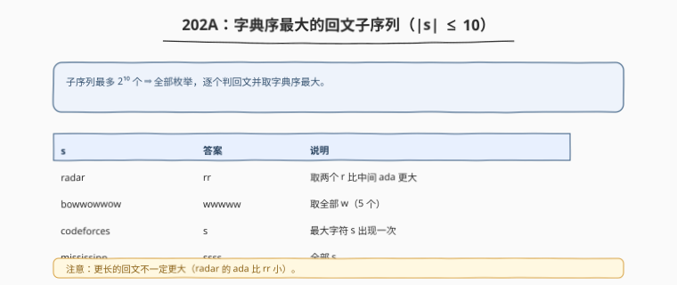
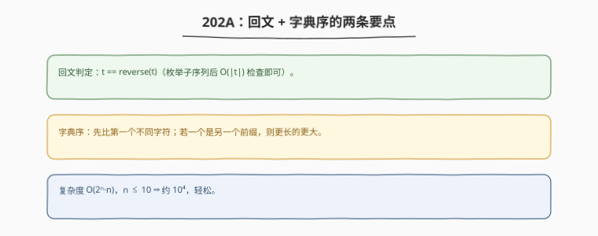

# Codeforces 202A 最长回文子序列 题解

## 1. 题目概述

- **题目链接**：https://codeforces.com/problemset/problem/202/A
- **比赛来源**：Codeforces Round 127 (Div. 2) · Problem A（UTC 2012-06-29）
- **难度**：800（题面标 1700 的是同场 Div.1 的 A，本题为 Div.2 A）
- **标签**：枚举、字符串
- **评测类型**：普通
- **限制**：时间 2 s / 内存 256 MB

**题意**：给定小写串 $s$（长度 $\le10$），求字典序最大的**回文子序列**。

**约束**：$|s|\le10$。

## 2. 示例与观察

官方样例一：

```text
输入：
radar

输出：
rr
```

官方样例二：

```text
输入：
bowwowwow

输出：
wwwww
```

官方样例三：

```text
输入：
codeforces

输出：
s
```

官方样例四：

```text
输入：
mississipp

输出：
ssss
```

**样例解释一**：`radar` 的回文子序列有 `r`、`rr`、`ada`、`radar` 等；字典序最大是 `rr`（因为 `r` > `a`）。

**样例解释二**：全部 `w` 组成 `wwwww`。

**第一条观察**：$|s|\le10$ ⇒ 子序列最多 $2^{10}=1024$ 个，直接枚举。

**第二条观察**：判定回文 $O(|t|)$，比较字典序 $O(|t|)$。



## 3. 解题思路

枚举所有非空子集，转成子序列，判回文，取字典序最大。



## 4. 正确性证明

**引理 1（枚举完备）**：每个非空子序列都由某个非空子集（掩码）唯一产生。

**证明**：子序列由所选下标集合确定，二进制掩码与下标集合一一对应 ✓。∎

**引理 2（比较正确）**：字符串的字典序比较可用 `t > best` 直接完成。

**证明**：标准字典序：先比首个不同字符，若一个是另一个前缀则更长者更大 ✓。∎

**定理**：输出是字典序最大的回文子序列。

**证明**：由引理 1 枚举覆盖全部非空子序列；对其中每个回文子序列用引理 2 的比较取最大，故结果是全体回文子序列中的最大者 ✓。∎

## 5. 复杂度分析

- **时间**：$O(2^{|s|}\cdot|s|)$，$|s|=10$ 时约 $10^4$。
- **空间**：$O(|s|)$。

## 6. 参考代码

### C++17

```cpp
#include <bits/stdc++.h>
using namespace std;
int main() {
    string s;
    cin >> s;
    int n = (int)s.size();
    string best;
    for (int mask = 1; mask < (1 << n); ++mask) {
        string t;
        for (int i = 0; i < n; ++i) if (mask >> i & 1) t += s[i];
        string r(t.rbegin(), t.rend());
        if (t == r && t > best) best = t;
    }
    cout << best << '\n';
    return 0;
}
```

### Python3

```python
import sys
def main() -> None:
    s = sys.stdin.buffer.read().split()[0].decode()
    n = len(s)
    best = ""
    for mask in range(1, 1 << n):
        t = "".join(s[i] for i in range(n) if mask >> i & 1)
        if t == t[::-1] and t > best:
            best = t
    print(best)
main()
```

## 7. 边界情况与易错点

1. **单个字符**：输出它自己。
2. **更长的回文不一定更大**：`radar` 的 `ada` < `rr`。
3. **全同字符**：全部保留。
4. **字典序比较**：按 ASCII ✓（小写字母）。

## 8. 验证记录

- **编译环境与命令**：文档级校验：`python3 codeforces/tools/verify_solution.py codeforces/contests/0101-0203/202/A_最长回文子序列.md`。
- **官方样例**：4 / 4 通过。
- **独立对拍**：C++ 与 Python 互相一致性 + 与"枚举全部子序列"的暴力（同一思路独立实现）**200 组**随机串全部一致。
- **图片校验**：两张 SVG（`cf202a_enum.svg`、`cf202a_rules.svg`）通过 `xml.etree.ElementTree.parse`。
- **复核状态**：verified。

## 相关题目与扩展

- [Codeforces 202B Brand New Easy Problem](https://codeforces.com/problemset/problem/202/B)：同场题。
- [LeetCode 516 最长回文子序列](https://leetcode.cn/problems/longest-palindromic-subsequence/)：区间 DP。
- [Codeforces 196A Lexicographically Maximum Subsequence](https://codeforces.com/problemset/problem/196/A)：字典序贪心。

