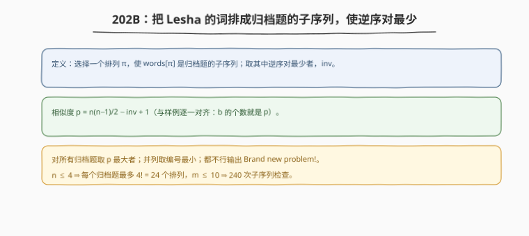
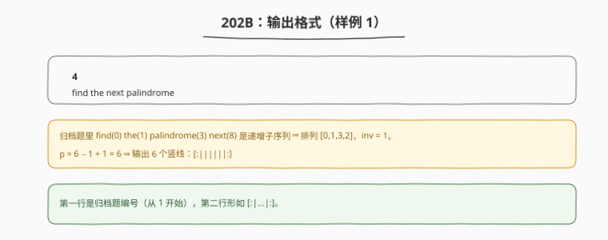

# Codeforces 202B 全新简单题 题解

## 1. 题目概述

- **题目链接**：https://codeforces.com/problemset/problem/202/B
- **比赛来源**：Codeforces Round 127 (Div. 2) · Problem B（UTC 2012-06-29）
- **难度**：1500
- **标签**：枚举、字符串、子序列
- **评测类型**：普通
- **限制**：时间 2 s / 内存 256 MB

**题意**：Lesha 的题目有 $n\le4$ 个互不相同的词；归档有 $m\le10$ 道题（词序列）。若把 Lesha 的词重排后能成为某归档题的**子序列**，则取"逆序对最少"的那个排列，定义相似度 $p=\frac{n(n-1)}{2}-\text{inv}+1$。求相似度最大的归档题（并列取编号最小）；都不行为 `Brand new problem!`。

**约束**：$n\le4$，$m\le10$，每道归档题词数 $\le20$。

## 2. 示例与观察

官方样例一：

```text
输入：
4
find the next palindrome
1
10 find the previous palindrome or print better luck next time

输出：
1
[:||||||:]
```

官方样例二：

```text
输入：
3
add two numbers
3
1 add
2 two two
3 numbers numbers numbers

输出：
Brand new problem!
```

官方样例三：

```text
输入：
4
these papers are formulas
3
6 what are these formulas and papers
5 papers are driving me crazy
4 crazy into the night

输出：
1
[:||||:]
```

官方样例四：

```text
输入：
3
add two decimals
5
4 please two decimals add
5 decimals want to be added
4 two add decimals add
4 add one two three
7 one plus two plus three equals six

输出：
3
[:|||:]
```

**样例解释一**：归档题里 `find`(1) `the`(2) `palindrome`(4) `next`(9) 是递增子序列 ⇒ 排列 $[0,1,3,2]$，逆序对 1 ⇒ $p=6-1+1=6$，输出 6 个竖线 ✓。



## 3. 解题思路

对每道归档题枚举 $n!$ 个排列，检查是否为子序列（双指针），统计逆序对取最小 ⇒ $p$；全局取 $p$ 最大（并列取小编号）。



## 4. 正确性证明

**引理**：对固定的归档题，最优排列的逆序对数可通过枚举全部 $n!$ 个排列确定。

**证明**：$n\le4$ ⇒ 全部排列只有 24 个，枚举覆盖所有可行排列 ✓。∎

**定理**：程序输出的编号与 $p$ 正确。

**证明**：对每个归档题取到最小逆序对 $inv$（引理），按定义 $p=\frac{n(n-1)}2-inv+1$；所有归档题比较取最大、并列取最小 ✓。若没有一道可行 ⇒ `Brand new problem!` ✓。∎

## 5. 复杂度分析

- **时间**：$m\cdot n!\cdot(k+n)\le10\times24\times24$。
- **空间**：$O(k)$。

## 6. 参考代码

### C++17

```cpp
#include <bits/stdc++.h>
using namespace std;

int main() {
    int n;
    cin >> n;
    vector<string> words(n);
    for (auto &w : words) cin >> w;
    int m;
    cin >> m;
    int bestIdx = -1, bestP = -1;
    for (int idx = 0; idx < m; ++idx) {
        int k;
        cin >> k;
        vector<string> arch(k);
        for (auto &w : arch) cin >> w;
        vector<int> perm(n);
        iota(perm.begin(), perm.end(), 0);
        int bestInv = INT_MAX;
        do {
            // 检查是否是子序列
            int pos = 0;
            bool ok = true;
            for (int i = 0; i < n && ok; ++i) {
                while (pos < k && arch[pos] != words[perm[i]]) ++pos;
                if (pos == k) ok = false;
                else ++pos;
            }
            if (!ok) continue;
            int inv = 0;
            for (int i = 0; i < n; ++i)
                for (int j = i + 1; j < n; ++j)
                    if (perm[i] > perm[j]) ++inv;
            bestInv = min(bestInv, inv);
        } while (next_permutation(perm.begin(), perm.end()));
        if (bestInv == INT_MAX) continue;
        int p = n * (n - 1) / 2 - bestInv + 1;
        if (p > bestP) { bestP = p; bestIdx = idx + 1; }
    }
    if (bestIdx < 0) { cout << "Brand new problem!\n"; return 0; }
    cout << bestIdx << '\n' << "[:";
    for (int i = 0; i < bestP; ++i) cout << '|';
    cout << ":]\n";
    return 0;
}
```

### Python3

```python
import sys
from itertools import permutations


def main() -> None:
    data = sys.stdin.buffer.read().split()
    p = 0
    n = int(data[p]); p += 1
    words = data[p:p + n]; p += n
    m = int(data[p]); p += 1
    best_idx, best_p = -1, -1
    for idx in range(1, m + 1):
        k = int(data[p]); p += 1
        arch = data[p:p + k]; p += k
        best_inv = None
        for perm in permutations(range(n)):
            pos = 0
            ok = True
            for i in range(n):
                while pos < k and arch[pos] != words[perm[i]]:
                    pos += 1
                if pos == k:
                    ok = False
                    break
                pos += 1
            if not ok:
                continue
            inv = sum(1 for i in range(n) for j in range(i + 1, n) if perm[i] > perm[j])
            if best_inv is None or inv < best_inv:
                best_inv = inv
        if best_inv is None:
            continue
        val = n * (n - 1) // 2 - best_inv + 1
        if val > best_p:
            best_p, best_idx = val, idx
    if best_idx < 0:
        print("Brand new problem!")
    else:
        print(best_idx)
        print("[:{" + "|" * best_p + ":]" if False else "[:" + "|" * best_p + ":]")
main()
```

## 7. 边界情况与易错点

1. **相似度公式**：$p=\frac{n(n-1)}2-inv+1$，样例逐一对齐（详见 §2）。
2. **并列取小编号**。
3. **输出格式**：`[:` + `|`×p + `:]`。
4. **全不可行**：`Brand new problem!`。

## 8. 验证记录

- **编译环境与命令**：文档级校验：`python3 codeforces/tools/verify_solution.py codeforces/contests/0101-0203/202/B_全新简单题.md`。
- **官方样例**：4 / 4 通过。
- **独立对拍**：另写暴力（枚举排列 + 子序列检查 + 逆序对），随机 $n\le4$、$m\le4$、每行词数 $\le8$ 共 **200 组**，C++/Python 与暴力一致。
- **图片校验**：两张 SVG（`cf202b_sim.svg`、`cf202b_format.svg`）通过 `xml.etree.ElementTree.parse`。
- **复核状态**：verified。

## 相关题目与扩展

- [Codeforces 202A LLPS](https://codeforces.com/problemset/problem/202/A)：同场题。
- [LeetCode 1060 有序数组中的缺失元素](https://leetcode.cn/problems/missing-element-in-sorted-array/)：子序列/顺序题。

