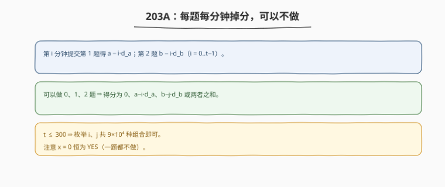
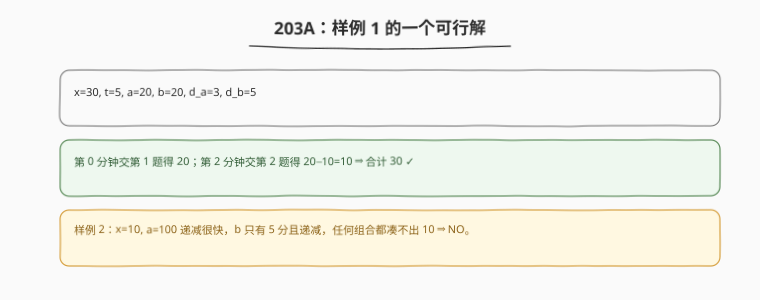

# Codeforces 203A 两道题 题解

## 1. 题目概述

- **题目链接**：https://codeforces.com/problemset/problem/203/A
- **比赛来源**：Codeforces Round 128 (Div. 2) · Problem A（UTC 2012-07-03）
- **难度**：800
- **标签**：枚举、实现
- **评测类型**：普通
- **限制**：时间 2 s / 内存 256 MB

**题意**：比赛 $t$ 分钟（编号 0..t−1），第 1 题初始 $a$ 分、每分钟减 $d_a$；第 2 题初始 $b$ 分、每分钟减 $d_b$。每道题最多提交一次，可以不做。问能否恰好得 $x$ 分。

**约束**：$x\le600$，$t,a,b,d_a,d_b\le300$，且任意分钟分值非负。

## 2. 示例与观察

官方样例一：

```text
输入：
30 5 20 20 3 5

输出：
YES
```

官方样例二：

```text
输入：
10 4 100 5 5 1

输出：
NO
```

**样例解释一**：第 0 分钟交第 1 题得 20，第 2 分钟交第 2 题得 $20-10=10$，合计 30 ✓。

**样例解释二**：无论如何组合都凑不出 10。

**第一条观察**：可得的分数集合 = $\{0\}\cup\{a-i d_a\}\cup\{b-j d_b\}\cup\{a-i d_a+b-j d_b\}$。



## 3. 解题思路

$t\le300$ ⇒ 双重循环枚举 $i,j\in[0,t)$，检查三类和是否等于 $x$；$x=0$ 直接 `YES`。



## 4. 正确性证明

**引理 1（得分形态）**：任何提交方案的得分必为 $0$、$a-i d_a$、$b-j d_b$ 或 $a-i d_a+b-j d_b$（$0\le i,j<t$）。

**证明**：两道题各自最多提交一次，且各自在某个分钟 $i$（或 $j$）提交；不提交则贡献 0 ✓。∎

**引理 2（分钟非负）**：题面保证任意分钟分值非负，故不需要 `max(0, ·)`。

**证明**：条件 $a-i d_a\ge0$ 对 $i\le t-1$ 成立 ✓。∎

**定理**：输出 `YES` 当且仅当存在合法提交方案得 $x$ 分。

**证明**：由引理 1，得分必为四类之一；枚举覆盖全部 $(i,j)$ 与"不提交"，且由引理 2 无需截断 ⇒ 命中 $\iff$ 存在方案 ✓。∎

## 5. 复杂度分析

- **时间**：$O(t^2)\le9\times10^4$。
- **空间**：$O(1)$。

## 6. 参考代码

### C++17

```cpp
#include <bits/stdc++.h>
using namespace std;
int main() {
    int x, t, a, b, da, db;
    cin >> x >> t >> a >> b >> da >> db;
    if (x == 0) { cout << "YES\n"; return 0; }
    for (int i = 0; i < t; ++i) {
        int v1 = a - i * da;
        if (v1 == x) { cout << "YES\n"; return 0; }
        for (int j = 0; j < t; ++j) {
            int v2 = b - j * db;
            if (v1 + v2 == x || v2 == x) { cout << "YES\n"; return 0; }
        }
    }
    cout << "NO\n";
    return 0;
}
```

### Python3

```python
import sys
def main() -> None:
    x, t, a, b, da, db = map(int, sys.stdin.buffer.read().split()[:6])
    if x == 0:
        print("YES"); return
    for i in range(t):
        v1 = a - i * da
        if v1 == x:
            print("YES"); return
        for j in range(t):
            v2 = b - j * db
            if v1 + v2 == x or v2 == x:
                print("YES"); return
    print("NO")
main()
```

## 7. 边界情况与易错点

1. **$x=0$**：一题不做 ⇒ `YES`。
2. **只做一题**：两类都要检查。
3. **分钟范围**：$0..t-1$，不能在第 $t$ 分钟交。
4. **分值非负**：题面保证。

## 8. 验证记录

- **编译环境与命令**：文档级校验：`python3 codeforces/tools/verify_solution.py codeforces/contests/0101-0203/203/A_两道题.md`。
- **官方样例**：2 / 2 通过。
- **独立对拍**：另写枚举方案（含"不做"），随机 $t\le5$、分值 $\le20$、$x\le25$ 共 **200 组**，C++/Python 与暴力一致（含 $x=0$ 的边界）。
- **图片校验**：两张 SVG（`cf203a_enum.svg`、`cf203a_sample.svg`）通过 `xml.etree.ElementTree.parse`。
- **复核状态**：verified。

## 相关题目与扩展

- [Codeforces 203B Game on Paper](https://codeforces.com/problemset/problem/203/B)：同场题。
- [LeetCode 1 两数之和](https://leetcode.cn/problems/two-sum/)：枚举组合。

