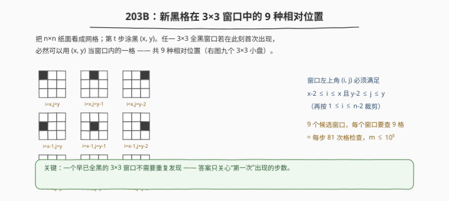

# Codeforces 203B 纸上游戏 题解

## 1. 题目概述

- **题目链接**：https://codeforces.com/problemset/problem/203/B
- **比赛来源**：Codeforces Round 128 (Div. 2) · Problem B（UTC 2012-07-03）
- **难度**：1300
- **标签**：暴力、实现
- **评测类型**：普通
- **限制**：时间 2 s / 内存 256 MB

**题意**：有一张 $n\times n$ 的白色方格纸，Valera 依次把 $m$ 个互不相同的格子涂黑（第 $i$ 次涂 $(x_i,y_i)$）。求最小的步数 $t$，使得涂完第 $t$ 个格子之后纸上存在一个 $3\times 3$ 的全黑正方形；若始终不存在，输出 $-1$。

**约束**：$1\le n\le 1000$（纸面最多 $10^6$ 格），$1\le m\le\min(n^2,10^5)$，所有 $(x_i,y_i)$ 互不相同。

- $n\le1000$ 说明可以开 $n\times n$ 的二维数组（$10^6$ 个 `int` 只有 4 MB）。
- $m\le10^5$ 说明**每一步都要 $O(1)$ 或 $O(9)$ 地增量更新**：每步重扫全图是 $9\times10^{11}$，必然超时。

## 2. 示例与观察

官方样例一：

```text
输入：
4 11
1 1
1 2
1 3
2 2
2 3
1 4
2 4
3 4
3 2
3 3
4 1

输出：
10
```

官方样例二：

```text
输入：
4 12
1 1
1 2
1 3
2 2
2 3
1 4
2 4
3 4
3 2
4 2
4 1
3 1

输出：
-1
```

**样例一走查**：第 1～9 步之后，黑格只覆盖左上角区域，任意 $3\times3$ 窗口都缺角；第 10 步涂 $(3,3)$ 后，窗口 $\{1,2,3\}\times\{1,2,3\}$ 的 9 个格子全部变黑，于是答案为 10。

**样例二走查**：这 12 个格子恰好避开所有能凑满的窗口，最后仍没有任何 $3\times3$ 全黑，输出 $-1$。

**第一条观察**：若第 $t$ 步之后才出现某个全黑的 $3\times3$ 窗口，那么这个窗口在第 $t-1$ 步时还不是全黑，而它包含的格子中只有 $(x_t,y_t)$ 是新涂黑的，所以**这个窗口一定包含 $(x_t,y_t)$**。窗口左上角 $(i,j)$ 含 $(x_t,y_t)$ 当且仅当 $0\le x_t-i\le2$ 且 $0\le y_t-j\le2$，即 $i\in[x_t-2,x_t]$、$j\in[y_t-2,y_t]$ —— 只有 9 种。



**第二条观察**：既然每步只需要看 9 个窗口，就没必要每次都重数 9 个格子。给每个可能的左上角 $(i,j)$ 配一个计数器 $\text{cnt}[i][j]$，第 $t$ 步对 9 个候选窗口各 $+1$，那么 $\text{cnt}[i][j]$ 始终等于窗口 $(i,j)$ 当前的黑格数；某个计数器第一次等于 9 时即得到答案。

## 3. 解题思路

### 3.1 朴素做法与瓶颈

每涂一格就枚举所有 $(n-2)^2$ 个窗口、每个窗口数 9 格：单步 $9(n-2)^2\approx9\times10^6$，总 $9\times10^{11}$，不可行。瓶颈在于「每步都重新统计了与本次涂色无关的窗口」。

### 3.2 核心观察

全黑窗口在第 $t$ 步"首次成立"时必然包含新格，因此每步只需维护含 $(x_t,y_t)$ 的 9 个窗口；又因为黑格只增不减，窗口黑格数只增不减，用 $+1$ 的计数器就能在到达 9 的瞬间判定，无需回查。


### 3.3 算法流程

1. 若 $n<3$，直接输出 $-1$（放不下 $3\times3$）。
2. 开 `cnt[n+2][n+2]`，全部置 0。
3. 依次处理第 $t=1..m$ 步，读入 $(x,y)$：
   - 对 $i\in[\max(1,x-2),\ \min(n-2,x)]$、$j\in[\max(1,y-2),\ \min(n-2,y)]$：
     - `cnt[i][j] += 1`；若 `cnt[i][j] == 9`，输出 $t$ 并结束程序。
4. 循环结束仍未返回，输出 $-1$。

### 3.4 样例走查

以样例一为例：第 10 步之前窗口 $(1,1)$（行 1–3、列 1–3）已经有 8 个黑格，只缺 $(3,3)$。第 10 步涂黑 $(3,3)$，它的 9 个候选左上角是 $i,j\in[1,3]$，其中 $(1,1)$ 的计数由 8 变为 9，于是输出 10。

样例二中 $n=4$，全图只有 4 个 $3\times3$ 窗口。窗口 $(1,1)$ 缺 $(2,1)$ 与 $(3,3)$，窗口 $(1,2)$ 缺 $(3,3)$，窗口 $(2,1)$ 缺 $(2,1)$，窗口 $(2,2)$ 缺 $(4,3)$ 与 $(4,4)$——这些格子始终没被涂黑，故输出 $-1$。

## 4. 正确性证明

**引理 1（新窗口必含新格）**：设第 $t$ 步之后纸面上第一次出现全黑窗口 $W$，则 $(x_t,y_t)\in W$。

**证明**：若 $(x_t,y_t)\notin W$，则 $W$ 的 9 个格子在第 $t-1$ 步时就已经全黑，那么第 $t-1$ 步之后（甚至更早）就存在全黑窗口，与 $t$ 的最小性矛盾。∎

**引理 2（计数器正确性）**：任意时刻，对任意 $1\le i,j\le n-2$，都有 $\text{cnt}[i][j]$ 等于窗口 $(i,j)$ 中黑格的数量。

**证明**：对步数归纳。初始时窗口全白，$\text{cnt}=0$ 成立。第 $t$ 步涂黑 $(x_t,y_t)$ 后，只有包含该格的窗口黑格数增加 1，而算法恰对全部满足 $i\in[x_t-2,x_t]\cap[1,n-2]$、$j\in[y_t-2,y_t]\cap[1,n-2]$ 的窗口执行 $+1$——这些正是包含 $(x_t,y_t)$ 的合法窗口，其余窗口不变。故归纳成立。∎

**定理**：算法输出的 $t$ 等于题目要求的答案；若无解则输出 $-1$。

**证明**：由引理 2，$\text{cnt}[i][j]=9$ 当且仅当窗口 $(i,j)$ 全黑。算法按步号递增处理，并在第一次出现 `cnt == 9` 时输出当前步号 $t$，因此 $t$ 是"存在全黑 $3\times3$"的最小步号；由引理 1，这样的窗口不可能在本次未被检查的窗口中出现，所以不会漏判。若 $m$ 步处理完都未触发，说明任何时刻都不存在全黑窗口，输出 $-1$ 正确。∎

## 5. 复杂度分析

- **时间**：每步最多 $9$ 次加法与比较，共 $O(9m)=O(m)$；$m\le10^5$ 时约 $9\times10^5$ 次操作，远低于 2 s。
- **空间**：`cnt` 为 $(n+2)^2$ 个 `int`，$n\le1000$ 时约 4 MB，另有输入缓冲，远低于 256 MB。

## 6. 参考代码

### C++17

```cpp
#include <bits/stdc++.h>
using namespace std;
int main() {
    int n, m;
    if (scanf("%d %d", &n, &m) != 2) return 0;
    static int cnt[1005][1005];
    for (int t = 1; t <= m; ++t) {
        int x, y;
        scanf("%d %d", &x, &y);
        for (int i = max(1, x - 2); i <= min(n - 2, x); ++i)
            for (int j = max(1, y - 2); j <= min(n - 2, y); ++j)
                if (++cnt[i][j] == 9) { printf("%d\n", t); return 0; }
    }
    printf("-1\n");
    return 0;
}
```

### Python3

```python
import sys


def main() -> None:
    data = sys.stdin.buffer.read().split()
    n, m = int(data[0]), int(data[1])
    cnt = [[0] * (n + 2) for _ in range(n + 2)]
    pos = 2
    for t in range(1, m + 1):
        x, y = int(data[pos]), int(data[pos + 1])
        pos += 2
        for i in range(max(1, x - 2), min(n - 2, x) + 1):
            row = cnt[i]
            for j in range(max(1, y - 2), min(n - 2, y) + 1):
                row[j] += 1
                if row[j] == 9:
                    print(t)
                    return
    print(-1)


main()
```

## 7. 边界情况与易错点

1. **$n<3$**：纸面放不下 $3\times3$，`min(n-2,x) < 1`，内层循环自然不执行，最终输出 $-1$，无需特判（但要知道这是对的）。
2. **候选左上角越界**：$x-2<1$ 或 $x>n-2$ 时必须裁剪，否则访问 `cnt[0][*]` 或 `cnt[n-1][*]` 之外的窗口会统计出根本不存在的窗口。
3. **窗口下标范围**：合法左上角是 $1\le i,j\le n-2$；把上界写成 $n$ 会统计越界窗口。
4. **答案是"步号"而非"格子数"**：输出 $t$（从 1 开始），不是 `cnt` 的值，也不是步子数减一。
5. **重复涂色**：题面保证 $m$ 个格子互不相同，所以计数器不会被同一格加两次；若数据不保证则需先去重。
6. **提前返回**：$\text{cnt}$ 到 9 后必须立刻输出并退出，否则可能被后续步覆盖成更晚（错误）的答案。

## 8. 验证记录

- **编译环境与命令**：文档级校验 `python3 codeforces/tools/verify_solution.py codeforces/contests/0101-0203/203/B_纸上游戏.md`（本机 `g++` 为 Apple clang 包装，`verify_solution.py` 自动追加 `tools/include` 兼容头；正文仍写 `#include <bits/stdc++.h>`）。
- **官方样例**：2 / 2 通过（样例一输出 `10`，样例二输出 `-1`）。
- **随机对拍**：独立暴力程序「每步扫描全部 $(n-2)^2$ 个窗口并重数 9 格」，随机 $n\in[1,7]$、$m\in[1,\min(n^2,25)]$ 共 **400 组**，与正文 C++ 逐组一致；同一生成器另跑 300 组与正文 Python 一致。
- **最大约束性能**：$n=1000$、$m=10^5$ 随机互异格子，C++ 14 ms、Python 250 ms（C++ 约为 2 s 时限的 1/140）。
- **图片校验**：`cf203b_window.svg`、`cf203b_flow.svg` 通过 `xml.etree.ElementTree.parse`，均含 `feTurbulence` 抖动与手写字体。
- **复核状态**：verified。

## 相关题目与扩展

- [Codeforces 203A 两道题](https://codeforces.com/problemset/problem/203/A)：同场 A 题，纯枚举。
- [Codeforces 200A Cinema](https://codeforces.com/problemset/problem/200/A)：同样是"按顺序占用格子 + 找最近空位"的增量维护题。
- [Codeforces 1B Spreadsheets](https://codeforces.com/problemset/problem/1/B)：网格坐标与进制转换。

**延伸思考**：

1. 若把 $3\times3$ 换成 $k\times k$，每步要维护的候选左上角变成 $k^2$ 个，复杂度 $O(k^2m)$；当 $k$ 也很大时，可以只对"被补满的那个窗口"做判定，用二维前缀和 + 二分步号做整体二分。
2. 若要求输出**所有**曾出现过的 $3\times3$ 全黑窗口的最早步号，可以把计数器改成"每个窗口的黑格数"并在每个窗口首次到 9 时记录，答案个数至多 $(n-2)^2$。
3. 本题的"只维护受影响的对象"是典型套路：任何"每次修改后询问是否出现某种局部模式"的题，都可以先问"这个模式能否不含本次修改的元素"，从而把候选集合缩到 $O(1)$。
