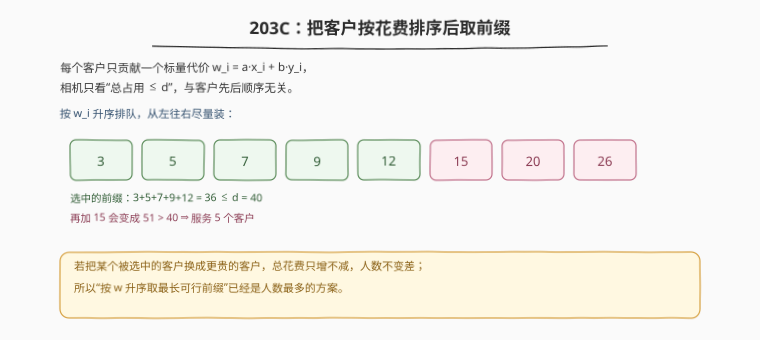
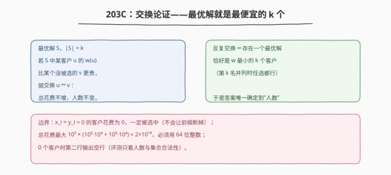

# Codeforces 203C 摄影师 题解

## 1. 题目概述

- **题目链接**：https://codeforces.com/problemset/problem/203/C
- **比赛来源**：Codeforces Round 128 (Div. 2) · Problem C（UTC 2012-07-03）
- **难度**：1400
- **标签**：贪心、排序
- **评测类型**：特殊评测（多解：输出任意一组最优客户集合）
- **限制**：时间 2 s / 内存 256 MB

**题意**：相机内存 $d$ MB，一张低质量照片占 $a$ MB，一张高质量照片占 $b$ MB（$a\le b$）。第 $i$ 位客户要求拍 $x_i$ 张低质量和 $y_i$ 张高质量照片，服务他就要把这 $x_i+y_i$ 张全部拍完且不删除。相机初始为空，问最多能服务多少位客户，并输出这些客户的编号（顺序任意）。

**约束**：$n\le10^5$，$d\le10^9$，$1\le a\le b\le10^4$，$0\le x_i,y_i\le10^5$。

- 第 $i$ 位客户的花费是 $w_i=a x_i+b y_i$，最大约 $2\times10^9$；$n$ 个客户的总和可达 $2\times10^{14}$，**必须用 64 位整数**。
- $n\le10^5$ 允许 $O(n\log n)$ 的排序，排除任何按子集/背包的做法（$d$ 高达 $10^9$，无法用 $d$ 做状态）。

## 2. 示例与观察

官方样例一：

```text
输入：
3 10
2 3
1 4
2 1
1 0

输出：
2
3 2 
```

官方样例二：

```text
输入：
3 6
6 6
1 1
1 0
1 0

输出：
1
2 
```

**样例一走查**：$a=2,b=3$，三位客户的花费分别是 $2\cdot1+3\cdot4=14$、$2\cdot2+3\cdot1=7$、$2\cdot1+3\cdot0=2$。按花费升序是 $2,7,14$：先服务 3 号（用 2 MB），再服务 2 号（累计 9 MB），再加 1 号需要 $9+14=23>10$。所以答案是 2 人，编号 $\{3,2\}$。

**样例二走查**：$a=b=6$，三位客户花费为 $12,6,6$。先选其中一个 6 MB 的客户（2 号），再选另一个 6 MB 就需要 12 MB $>6$，故只能服务 1 人。

**第一条观察**：客户之间的唯一区别是标量花费 $w_i=a x_i+b y_i$；题面里"低质量/高质量"的区分在求和之后完全消失。

**第二条观察**：要服务的客户人数为 $k$ 时，只要这 $k$ 个客户的花费总和不超过 $d$ 即可（顺序无关、不需要任何其他约束）。于是问题变成"在 $n$ 个带权物品中选尽可能多个，使总重不超过 $d$"。



## 3. 解题思路

### 3.1 朴素做法与瓶颈

枚举所有客户子集判断总花费：$2^n$，不可行。把 $d$ 当背包容量做 DP：$O(nd)=10^{14}$，也不可行。瓶颈在于"人数"这个目标只需要比较基数，不需要知道具体选了谁。

### 3.2 核心观察

固定要选 $k$ 个人时，最省内存的选法一定是花费最小的 $k$ 个人。若不然，设最优解 $S$ 里有客户 $u$ 比没被选中的客户 $v$ 更贵，把 $u$ 换成 $v$：人数不变、总花费不增，仍然可行。反复交换就能得到一个"恰好是花费最小的 $k$ 个"的最优解。

于是只需把客户按 $w_i$ 升序排序，从最便宜的往贵里装，一旦加上下一个就超过 $d$ 便停止——这就是能装下的最大人数。



### 3.3 算法流程

1. 读入 $n,d,a,b$，对每个客户算 $w_i=a x_i+b y_i$，与编号组成 `(w_i, i)`。
2. 按 $w_i$ 升序排序（$w_i$ 相同则编号小的在前，纯为输出稳定）。
3. 设 `used = 0`，按序扫描：若 `used + w_i <= d`，则 `used += w_i` 并把 $i$ 记入答案；否则**立即停止**（后面只会更贵）。
4. 输出答案人数与编号。

### 3.4 样例走查

样例一排序后为 $(2,3),(7,2),(14,1)$：`used` 依次为 $2\to9$，第三个会变成 $23>10$ 于是停止，输出 `2` 与 `3 2`。这与官方输出逐字一致。

样例二排序后为 $(6,2),(6,3),(12,1)$：`used` 先取 $(6,2)$ 得 6，接着 $6+6=12>6$ 停止，输出 `1` 与 `2`。

## 4. 正确性证明

**引理 1（花费可加且与顺序无关）**：服务客户集合 $S$ 所需内存恰为 $\sum_{i\in S}w_i$，且服务顺序不影响可行性。

**证明**：服务第 $i$ 位客户只是在相机中新增 $x_i$ 张低质量和 $y_i$ 张高质量照片，占用 $a x_i+b y_i=w_i$；照片不删除，故总占用就是求和，与先后无关。∎

**引理 2（最便宜的 $k$ 个最优）**：若存在大小 $k$ 的可行集合，则花费最小的 $k$ 个客户组成的集合也可行，且它的总花费不大于任何大小 $k$ 的可行集合。

**证明**：设 $T$ 是花费最小的 $k$ 个客户，$S$ 是任一大小 $k$ 的可行集合。若 $S\ne T$，取 $u\in S\setminus T$、$v\in T\setminus S$，由 $T$ 的定义 $w_v\le w_u$，把 $u$ 换成 $v$ 后总花费不增、大小不变。每次交换使 $|S\setminus T|$ 减一，至多 $k$ 次后 $S=T$，总花费单调不增，故 $T$ 可行且总花费最小。∎

**定理**：算法输出的人数 $k_{\max}$ 等于最大可服务人数，且输出的集合合法。

**证明**：设最大人数为 $k_{\max}$。由引理 1、2，花费最小的 $k_{\max}$ 个客户总花费 $\le d$。算法取的就是排序后的前缀：由于前缀总花费随长度单调递增，算法会在第一个"再加就超"的位置停下，此时已取人数恰为使前缀和 $\le d$ 的最大长度，即 $k_{\max}$；输出集合的前缀和 $\le d$，由引理 1 可行。∎

## 5. 复杂度分析

- **时间**：计算花费 $O(n)$，排序 $O(n\log n)$，扫描 $O(n)$。$n=10^5$ 时排序约 $1.7\times10^6$ 次比较，C++ 约 20 ms。
- **空间**：存 $n$ 个 `(long long, int)` 约 1.2 MB，另加输入缓冲，远低于 256 MB。

## 6. 参考代码

### C++17

```cpp
#include <bits/stdc++.h>
using namespace std;
int main() {
    int n; long long d;
    if (scanf("%d %lld", &n, &d) != 2) return 0;
    long long a, b;
    scanf("%lld %lld", &a, &b);
    vector<pair<long long,int>> v(n);
    for (int i = 0; i < n; ++i) {
        long long x, y;
        scanf("%lld %lld", &x, &y);
        v[i] = {a * x + b * y, i + 1};
    }
    sort(v.begin(), v.end());
    vector<int> ans;
    long long used = 0;
    for (auto &p : v) {
        if (used + p.first > d) break;
        used += p.first;
        ans.push_back(p.second);
    }
    printf("%d\n", (int)ans.size());
    for (size_t i = 0; i < ans.size(); ++i) printf("%d%c", ans[i], i + 1 == ans.size() ? '\n' : ' ');
    return 0;
}
```

### Python3

```python
import sys


def main() -> None:
    data = sys.stdin.buffer.read().split()
    n = int(data[0]); d = int(data[1])
    a = int(data[2]); b = int(data[3])
    items = []
    pos = 4
    for i in range(n):
        x = int(data[pos]); y = int(data[pos + 1]); pos += 2
        items.append((a * x + b * y, i + 1))
    items.sort()
    used = 0
    ans = []
    for cost, idx in items:
        if used + cost > d:
            break
        used += cost
        ans.append(idx)
    print(len(ans))
    if ans:
        print(' '.join(map(str, ans)))
    else:
        print()


main()
```

## 7. 边界情况与易错点

1. **64 位溢出**：单个花费 $w_i\le 10^5\cdot10^4+10^5\cdot10^4=2\times10^9$ 会溢出 32 位 `int`，$10^5$ 个之和达 $2\times10^{14}$，累加变量必须是 `long long`（Python 无此问题）。
2. **花费为 0 的客户**：$x_i=y_i=0$ 时 $w_i=0$，会被排在最前面并全部选中，这是正确的（不占内存）。
3. **一个都服务不了**：若最便宜的客户都超过 $d$，答案为 0，第二行必须仍然输出（空行），不能少一行。
4. **不能"跳过贵的选更贵的"**：一旦当前客户装不下就必须停止；继续往后扫描也不会找到更便宜的（已排序），但若误写成"跳过继续找"会破坏前缀性质。
5. **人数与集合的一致性**：第一行的人数必须与第二行编号个数相同，且编号互不重复、都在 $[1,n]$ 内——多解题由 checker 校验。
6. **$a=b$ 或 $a<b$**：算法不区分，因为花费已经合并成一个数；不要因为"高质量更贵"而做额外的优先取舍。

## 8. 验证记录

- **编译环境与命令**：`python3 codeforces/tools/verify_solution.py codeforces/contests/0101-0203/203/C_摄影师.md --checker codeforces/tools/checkers/cf203c.py`。
- **官方样例**：2 / 2 通过（样例一输出 `2 / 3 2`、样例二输出 `1 / 2`，与官方输出逐字一致）。
- **checker**：`codeforces/tools/checkers/cf203c.py` 校验「人数与编号个数一致、编号互异且不越界、总花费不超过 $d$、人数等于内部独立算出的最优值」。
- **随机对拍**：独立暴力程序枚举全部 $2^n$ 子集求最大可行人数，随机 $n\le12$、$d\le40$、$a\le b\le8$、$x_i,y_i\le6$ 共 **300 组**，正文 C++ 输出的人数与暴力一致且集合通过 checker 校验；Python 版再跑 150 组同样一致。
- **最大约束性能**：$n=10^5$、$d=10^9$、$a=1,b=10^4$、$x_i,y_i$ 随机，C++ 20 ms、Python 89 ms（C++ 约为 2 s 时限的 1/100）。
- **图片校验**：`cf203c_prefix.svg`、`cf203c_exchange.svg` 通过 `xml.etree.ElementTree.parse`。
- **复核状态**：verified。

## 相关题目与扩展

- [Codeforces 203E Transportation](https://codeforces.com/problemset/problem/203/E)：同场 E 题，同样是"先按某个代价排序再贪心"的结构。
- [Codeforces 203A 两道题](https://codeforces.com/problemset/problem/203/A)：同场 A 题。
- [LeetCode 1833 雪糕的最大数量](https://leetcode.cn/problems/maximum-ice-cream-bars/)：完全同构的"排序取前缀"贪心。

**延伸思考**：

1. 若每位客户还有一个"必须按输入顺序服务"的限制，问题会变成带权前缀约束，贪心不再成立，需要 DP 或贪心 + 反悔（堆）。
2. 若相机可以删除照片（即任意时刻只需满足峰值占用 $\le d$），问题变成"选择子集使最大同时占用最小"，与本题的排序前缀策略不同。
3. 若要求**恰好**服务 $k$ 人时的最小花费，答案就是排序后的前 $k$ 项和——本题相当于对 $k$ 二分到前缀和超过 $d$ 的位置，也可以写成"对前缀和数组 upper_bound"。
4. 交换论证的模板：目标只依赖"数量"、约束只依赖"可加的标量代价"时，最优解总能被规整成按代价排序的前缀或后缀。
