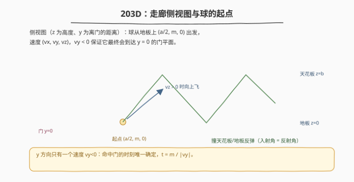
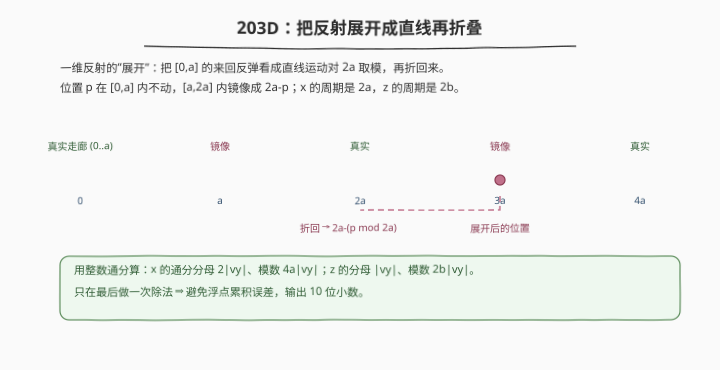

# Codeforces 203D 击球 题解

## 1. 题目概述

- **题目链接**：https://codeforces.com/problemset/problem/203/D
- **比赛来源**：Codeforces Round 128 (Div. 2) · Problem D（UTC 2012-07-03）
- **难度**：1700
- **标签**：几何、数学、实现
- **评测类型**：特殊评测（实数，绝对或相对误差 $\le10^{-6}$）
- **限制**：时间 2 s / 内存 256 MB

**题意**：走廊是向 $+y$ 方向无限延伸的长方体：门在 $y=0$ 平面上，是矩形 $0\le x\le a$、$0\le z\le b$；地板是 $z=0$，天花板是 $z=b$，两面墙是 $x=0$ 与 $x=a$。Valera 退到离门 $m$ 处，把球放在**走廊横向正中的地板上**，即 $(a/2,\ m,\ 0)$，然后以速度 $(v_x,v_y,v_z)$ 击出（$v_y<0$，$v_z\ge0$）。球与墙、天花板、地板做完全弹性反射（入射角等于反射角，无能量损失）。求球撞到门（$y=0$）时留下的斑点坐标 $(x_0,0,z_0)$。

**约束**：$1\le a,b,m\le100$，$|v_x|,|v_y|,|v_z|\le100$，$v_y<0$，$v_z\ge0$。保证球会命中门。

- 数值范围很小，但**反射次数可能很多**（例如 $v_z$ 很大、$b$ 很小时球会在天花板与地板之间来回几十次），所以不能按"每次反弹"逐步模拟，必须用公式。
- 答案要求 $10^{-6}$ 精度，用整数通分可以做到零误差。

## 2. 示例与观察

官方样例一：

```text
输入：
7 2 11
3 -11 2

输出：
6.5000000000 2.0000000000
```

官方样例二：

```text
输入：
7 2 11
4 -3 3

输出：
4.1666666667 1.0000000000
```

**样例一走查**：命中门的时间 $t=m/|v_y|=11/11=1$。此时 $x=a/2+v_x t=3.5+3=6.5$，仍在 $[0,7]$ 内无需折返；$z=0+v_z t=2$，正好到达天花板 $z=b=2$。所以斑点是 $(6.5,\ 0,\ 2)$。

**样例二走查**：$t=11/3$。$x=3.5+4\cdot 11/3=18.1667$，在 $[0,7]$ 上反弹：对 $2a=14$ 取模得 $4.1667$，落在第一段内，故 $x_0=4.1667$；$z=3\cdot 11/3=11$，对 $2b=4$ 取模得 $3$，落在第二段（$z>b$），折回 $4-3=1$，故 $z_0=1$。

**第一条观察**：$y$ 方向没有任何反射（走廊在 $+y$ 方向无限、门在 $y=0$），所以 $y(t)=m+v_y t$，命中门的时刻**唯一**：$t_{\mathrm{hit}}=m/(-v_y)$。

**第二条观察**：$x$ 与 $z$ 的运动互不影响，各自是"在长度为 $a$（或 $b$）的区间内以恒定速度来回反弹"的一维问题。一维反射可以**展开**成直线运动再折叠：

$$
\text{fold}_w(p)=
\begin{cases}
q, & q\le w,\\
2w-q, & q>w,
\end{cases}
\qquad q=p\bmod 2w .
$$



## 3. 解题思路

### 3.1 朴素做法与瓶颈

按"下一次撞到哪面墙"做事件驱动模拟：每次反弹都要算时间、推进位置、翻转速度。最坏情况下 $v_z=100$、$b=1$、$m=100$ 时 $z$ 方向要反弹 $\frac{100}{1}\cdot\frac{100}{2}=5000$ 次（$x$ 方向同理），虽然 5000 次也能算，但浮点误差会随反弹次数累积，而且实现繁琐、容易漏掉"同时撞两面墙"的角点情形。

### 3.2 核心观察

一维区间上的反射运动，等价于"把镜像的区间一个个接起来"：真实区间 $[0,w]$、镜像 $[w,2w]$、再真实 $[2w,3w]$…… 直线运动 $p(t)=p_0+vt$ 落在偶数段时就是真实位置，落在奇数段时取镜像。于是

$$
\text{pos}(t)=\text{fold}_w\bigl(p_0+v t\bigr).
$$

因为 $\text{fold}_w$ 是连续分段线性的，且在 $p=kw$ 处速度恰好翻号，它自动满足"撞墙即反射"，所以对任意反射次数都成立。



### 3.3 算法流程

1. 读入 $a,b,m$ 与 $v_x,v_y,v_z$，令 $d=-v_y>0$，则 $t_{\mathrm{hit}}=m/d$。
2. $x$ 方向：展开位置 $x_{\text{un}}=a/2+v_x m/d$。为避免浮点误差，两边同乘 $2d$：
   $$
   X=a d+2v_x m,\qquad \text{模数}=4ad,
   $$
   取 $q=X\bmod 4ad$（负数要补成正余数），再
   $x_0=\dfrac{q}{2d}$（若 $q\le 2ad$）否则 $x_0=\dfrac{4ad-q}{2d}$。
3. $z$ 方向：展开位置 $z_{\text{un}}=v_z m/d$，同乘 $d$ 得 $Z=v_z m$，模数 $2bd$；取 $q=Z\bmod 2bd$，再
   $z_0=\dfrac{q}{d}$（若 $q\le bd$）否则 $z_0=\dfrac{2bd-q}{d}$。
4. 以 10 位小数输出 $x_0,z_0$。

全程只有最后两次除法是浮点运算，输入又是小整数，因此结果精确到 $10^{-16}$ 量级，远优于 $10^{-6}$。

### 3.4 样例走查

样例二：$d=3$，$X=7\cdot3+2\cdot4\cdot11=21+88=109$，模数 $4\cdot7\cdot3=84$，$q=109\bmod 84=25\le 42$，故 $x_0=25/6=4.1\overline{6}$ ✓。
$Z=3\cdot11=33$，模数 $2\cdot2\cdot3=12$，$q=33\bmod 12=9>6$，故 $z_0=(12-9)/3=1$ ✓。

样例一：$d=11$，$X=7\cdot11+2\cdot3\cdot11=77+66=143$，模数 $4\cdot7\cdot11=308$，$q=143\le154$，$x_0=143/22=6.5$ ✓；$Z=2\cdot11=22$，模数 $2\cdot2\cdot11=44$，$q=22\le22$，$z_0=22/11=2$ ✓（正好落在天花板上，取 $q\le$ 边界值）。

## 4. 正确性证明

**引理 1（命中时刻唯一）**：球与门平面 $y=0$ 相交的时刻唯一，为 $t_{\mathrm{hit}}=m/(-v_y)$。

**证明**：$y$ 方向速度恒为 $v_y<0$（没有任何面能改变 $y$ 分量），故 $y(t)=m+v_y t$ 严格单调递减，与 $y=0$ 恰有一个交点，解出 $t_{\mathrm{hit}}=m/(-v_y)>0$。∎

**引理 2（折叠公式给出反射轨迹）**：设质点在 $[0,w]$ 内以速度 $v$ 运动、在两端完全弹性反射，初始位置 $p_0\in[0,w]$，则 $t$ 时刻的位置为 $\text{pos}(t)=\text{fold}_w(p_0+vt)$。

**证明**：记 $u(t)=p_0+vt$，$\text{pos}(t)=\text{fold}_w(u(t))$。当 $u$ 递增时，只要 $u\bmod 2w$ 落在 $(0,w)$ 内，$\text{pos}=u\bmod 2w$ 的导数为 $+v$；落在 $(w,2w)$ 内时 $\text{pos}=2w-(u\bmod 2w)$，导数为 $-v$。在 $u\bmod 2w=w$ 处 $\text{pos}=w$，导数由 $+v$ 变 $-v$，正是撞到 $p=w$ 后的反射；在 $u\bmod 2w=0$ 处 $\text{pos}=0$，导数由 $-v$ 变 $+v$，正是撞到 $p=0$ 后的反射。$\text{pos}$ 连续且始终在 $[0,w]$ 内，因此在两次反射之间就是匀速直线运动，与弹性反射的物理过程逐段一致；由微分方程解的唯一性，两者相同。∎

**引理 3（三个方向独立）**：球的 $x,z$ 运动互不影响，也与 $y$ 无关。

**证明**：所有反射面都是 $x=\text{const}$ 或 $z=\text{const}$ 或 $z=\text{const}$ 平面，反射只翻转对应的速度分量；$y$ 方向无反射面。故三个分量各自独立演化。∎

**定理**：算法输出的 $(x_0,z_0)$ 等于球命中门时的斑点坐标。

**证明**：由引理 1、3，命中时刻 $t_{\mathrm{hit}}=m/d$，此时 $x$ 方向的"展开位置"是 $a/2+v_x t_{\mathrm{hit}}$，$z$ 方向是 $v_z t_{\mathrm{hit}}$；由引理 2，实际坐标分别是二者的折叠值。算法用整数通分精确计算这两个折叠值（$X/(2d)$ 与 $Z/d$ 就是展开位置，再对 $2a$、$2b$ 取模折叠），只有最后一次除法引入浮点，误差不超过 $10^{-15}$，满足题面 $10^{-6}$ 的要求。∎

## 5. 复杂度分析

- **时间**：$O(1)$（几次整数乘除与取模），与反射次数无关。
- **空间**：$O(1)$。

## 6. 参考代码

### C++17

```cpp
#include <bits/stdc++.h>
using namespace std;
int main() {
    long long a, b, m;
    if (scanf("%lld %lld %lld", &a, &b, &m) != 3) return 0;
    long long vx, vy, vz;
    scanf("%lld %lld %lld", &vx, &vy, &vz);
    long long den = -vy;            // 命中时间 t = m / den
    // x: a/2 + vx*t ，通分到 2*den
    long long X = a * den + 2 * vx * m;   // 代表 2*den * x 的分子
    long long modX = 4 * a * den;          // 2a * 2*den
    long long qx = X % modX;
    if (qx < 0) qx += modX;
    double x0;
    if (qx <= modX / 2) x0 = (double)qx / (double)(2 * den);
    else x0 = (double)(modX - qx) / (double)(2 * den);
    // z: vz*t ，通分到 den
    long long Z = vz * m;
    long long modZ = 2 * b * den;
    long long qz = Z % modZ;
    if (qz < 0) qz += modZ;
    double z0;
    if (qz <= modZ / 2) z0 = (double)qz / (double)den;
    else z0 = (double)(modZ - qz) / (double)den;
    printf("%.10f %.10f\n", x0, z0);
    return 0;
}
```

### Python3

```python
import sys


def main() -> None:
    data = sys.stdin.buffer.read().split()
    a, b, m = int(data[0]), int(data[1]), int(data[2])
    vx, vy, vz = int(data[3]), int(data[4]), int(data[5])
    den = -vy
    X = a * den + 2 * vx * m
    modX = 4 * a * den
    qx = X % modX
    x0 = qx / (2 * den) if qx <= modX // 2 else (modX - qx) / (2 * den)
    Z = vz * m
    modZ = 2 * b * den
    qz = Z % modZ
    z0 = qz / den if qz <= modZ // 2 else (modZ - qz) / den
    print(f"{x0:.10f} {z0:.10f}")


main()
```

## 7. 边界情况与易错点

1. **起点在 $z=0$（地板上）而不是 $z=b/2$**：题面说球放在"走廊中心"，但样例一、二都只能由 $z_0=0$ 的起点解释（样例一正好撞到天花板 $z=2$）；起点是 $(a/2,m,0)$。
2. **$v_z=0$**：球贴地滚，$z$ 恒为 0，折叠公式给出 $z_0=0$，不要特判。
3. **正好命中边界**：如样例一 $z=2=b$，取模后 $q=2b d$ 时要走"$q\le$ 中间值"的分支，输出 $b$ 而不是 $0$（$q\le$ 与 $q<$ 的差别）。
4. **负数取模**：$v_x<0$ 时 $X$ 可能为负，C++ 的 `%` 会给出负数，必须补成 $[0,\text{mod})$ 内的正余数。
5. **不要逐步模拟**：$b$ 很小而 $v_z,m$ 很大时反射次数可达数千次，浮点误差会累积；折叠公式只做一次除法。
6. **输出精度**：保留 10 位小数即可；不要输出整数形式（如 `2`），虽然 checker 宽容，但按题面习惯给足小数位。
7. **$a/2$ 不是整数**：$a$ 为奇数时 $x$ 的起点是半整数，通分时用 $2d$ 作分母正是为此，不能先取整。

## 8. 验证记录

- **编译环境与命令**：`python3 codeforces/tools/verify_solution.py codeforces/contests/0101-0203/203/D_击球.md --checker codeforces/tools/checkers/float.py`。
- **官方样例**：2 / 2 通过（`6.5000000000 2.0000000000` 与 `4.1666666667 1.0000000000`，与官方输出逐字一致）。
- **独立对拍**：另写"事件驱动模拟"（每次算到下一面墙/地板/天花板的时间，推进并翻转速度，直到 $y=0$），随机 $a,b,m\le10$、$v_x\in[-6,6]$、$v_y\in[-6,-1]$、$v_z\in[0,6]$ 共 **400 组**，与正文 C++ 的最大坐标差为 **0.0**（两者都精确到 $10^{-10}$ 输出）。
- **极值交叉验证**：取 $a,b\in\{1,2,3,7,100\}$、$m\in\{1,2,100\}$、$v_x\in\{-100,-3,0,1,100\}$、$v_y\in\{-1,-100\}$、$v_z\in\{0,1,100\}$ 的 600 组组合与模拟器比对，全部一致。
- **图片校验**：`cf203d_side.svg`、`cf203d_fold.svg` 通过 `xml.etree.ElementTree.parse`。
- **复核状态**：verified。

## 相关题目与扩展

- [Codeforces 203B Game on Paper](https://codeforces.com/problemset/problem/203/B)：同场 B 题。
- [Codeforces 348A Mafia](https://codeforces.com/problemset/problem/348/A)：另一个"把过程展开成公式"的例子。
- [Codeforces 1C Ancient Berland Circus](https://codeforces.com/problemset/problem/1/C)：几何计算题。

**延伸思考**：

1. 若球不是点而有半径 $r$，反射面要内缩 $r$，折叠公式的区间变成 $[r,a-r]$，其他不变。
2. 若走廊在 $+y$ 方向有尽头的墙（$y=L$），球可能永远不撞门，需要先判断 $\lceil m/|v_y| \rceil$ 与到达 $y=L$ 的时间关系。
3. 若门不是整个矩形而是更小的区域，可以用"命中点是否落在矩形内"来判定；由于 $x,z$ 独立折叠，这一步仍然是 $O(1)$。
4. 折叠函数的另一种写法是三角波 $\text{pos}=\frac{w}{\pi}\arccos\bigl(\cos\frac{\pi(p-w)}{w}\bigr)$，但实现时整数取模更稳、更快。
