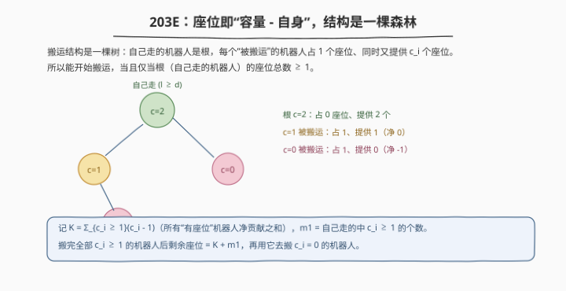

# Codeforces 203E 机器人运输 题解

## 1. 题目概述

- **题目链接**：https://codeforces.com/problemset/problem/203/E
- **比赛来源**：Codeforces Round 128 (Div. 2) · Problem E（UTC 2012-07-03）
- **难度**：2300
- **标签**：贪心、排序、双指针
- **评测类型**：普通
- **限制**：时间 2 s / 内存 256 MB

**题意**：$n$ 个机器人，第 $i$ 个能装载 $c_i$ 个机器人、自己移动需要 $f_i$ 升油、最多能走 $l_i$ 米。到行李舱的距离是 $d$，总油量 $S$。

Valera 先选一部分机器人"自己走"（要求这些机器人都满足 $l_i\ge d$，且它们的 $f_i$ 之和不超过 $S$）；然后把剩下的机器人塞进舱位里——**被装进舱位的机器人自己也能再装别的机器人**，形成嵌套。所有被搬运的机器人跟着走。求最多能运走多少个机器人，以及在此前提下最少花多少油。

**约束**：$n\le10^5$，$d,S\le10^9$，$0\le c_i,f_i,l_i\le10^9$。

- $n$ 很大，需要 $O(n\log n)$ 的排序 + 线性扫描。
- $f_i$ 之和可达 $10^{14}$，要用 64 位整数。

## 2. 示例与观察

官方样例一：

```text
输入：
3 10 10
0 12 10
1 6 10
0 1 1

输出：
2 6
```

官方样例二：

```text
输入：
2 7 10
3 12 10
5 16 8

输出：
0 0
```

官方样例三：

```text
输入：
4 8 10
0 12 3
1 1 0
0 3 11
1 6 9

输出：
4 9
```

**样例一走查**：距离 $d=10$，能自己走的只有 1 号（$l=10$，$f=12$）与 2 号（$l=10$，$f=6$），3 号 $l=1$ 太近。油只有 10 升，只能让 2 号自己走（花 6）。2 号有 1 个舱位，正好装 1 号；3 号装不下。总共 2 个，耗油 6。

**样例二走查**：$d=7$，能自己走的只有 1 号（$l=10$）但要 12 升油 $>S=10$；2 号 $l=8\ge7$ 却要 16 升；1 号虽然有 3 个舱位，但它自己都走不了，更不可能被（没人能走的）2 号装。所以一个也运不走，输出 `0 0`。

**样例三走查**：$d=8$，能自己走的是 3 号（$f=3$，$c=0$，$l=11$）与 4 号（$f=6$，$c=1$，$l=9$）。花 9 升让两者都自己走：4 号有 1 个舱位，装 2 号（$c=1$，被装后还能再装 1 个），2 号的舱位装 1 号；3 号自己走。于是 4 个全运走，耗油 $3+6=9$。

**第一条观察（座位模型）**：把"舱位"看成一棵森林——自己走的机器人是树根，被搬运的机器人各占父节点一个舱位、同时又提供 $c_i$ 个新舱位。于是

- 一个 $c_i\ge1$ 的被搬运机器人：占 1 个、还给 $c_i$ 个，净贡献 $c_i-1\ge0$；
- 一个 $c_i=0$ 的被搬运机器人：占 1 个、给 0 个，净贡献 $-1$；
- 自己走的机器人不占舱位，直接提供 $c_i$ 个。

**关键**：只有当树根的舱位总数 $\ge1$ 时，才可能开始往里塞东西。



**第二条观察**：给定"自己走"的集合 $M$，最优搬运策略是：先把所有 $c_i\ge1$ 的非移动机器人全部塞进去（每塞一个净贡献 $\ge0$，绝不亏），再用剩下的舱位塞 $c_i=0$ 的机器人。

## 3. 解题思路

### 3.1 朴素做法与瓶颈

枚举 $M$ 的所有子集是 $2^n$；即使只枚举合法（$l_i\ge d$、$\sum f_i\le S$）的子集，数量也可能是 $2^{n/2}$ 级别。必须找出"总运输数"对 $M$ 的依赖形式。

### 3.2 核心观察：总数只依赖出勤人数

记 $N_1=\#\{i:c_i\ge1\}$、$K=\sum_{c_i\ge1}(c_i-1)$、$m_1=\#\{i\in M:c_i\ge1\}$。把所有 $c_i\ge1$ 的非移动机器人塞完后，剩余舱位是

$$
\sum_{i\in M}c_i+\sum_{i\notin M,\ c_i\ge1}(c_i-1)=K+m_1 .
$$

再用它去装 $c_i=0$ 的非移动机器人（有 $N_0-m_0$ 个，其中 $m_0=\#\{i\in M:c_i=0\}$）。于是

$$
\text{total}=|M|+(N_1-m_1)+\min(K+m_1,\ N_0-m_0)=\min\bigl(N_1+K+|M|,\ n\bigr),
$$

**只要 $m_1\ge1$**（这样才有舱位可以开始）。若 $m_1=0$（出勤的全是 $c_i=0$），根没有任何舱位，什么都装不了，$\text{total}=|M|$。


### 3.3 算法流程

1. 统计 $N_1$、$K$；把所有满足 $l_i\ge d$ 的机器人按 $f_i$ 升序排列，记前缀和 $p[k]$。
2. 找出最便宜（排序后最靠前）的 $c_i\ge1$ 机器人的位置 $j$。
3. 对每个 $k=1..m$，求"恰好让 $k$ 个机器人自己走、且其中至少一个是 $c_i\ge1$"的最小耗油：
   - 若 $j<k$：最小的 $k$ 个里已经有 $c\ge1$ 的，代价 $p[k]$；
   - 否则：把第 $k$ 个换成第 $j$ 个，代价 $p[k-1]+f_j$。
   若代价 $\le S$，则候选答案是 $\bigl(\min(N_1+K+k,\ n),\ \text{代价}\bigr)$。
4. 另外考虑"只让 $c_i=0$ 的机器人自己走"的情形：按 $f$ 升序取尽量多的 $c_i=0$ 机器人，人数 $k$，耗油即其 $f$ 之和。
5. 所有候选中取"人数最多、同人数耗油最少"的那个；若一个人都运不走，输出 `0 0`。

### 3.4 样例走查

样例三：可行机器人排序后是 $(f=3,c=0)$、$(f=6,c=1)$，$j=1$。$k=1$：$j\not<1$，代价 $p[0]+f_1=6$，人数 $\min(2+0+1,4)=3$；$k=2$：$j<2$，代价 $p[2]=9$，人数 $\min(2+0+2,4)=4$。故答案是 $4$ 与 $9$。

## 4. 正确性证明

**引理 1（座位模型）**：一种搬运方案可行，当且仅当存在一棵以 $M$ 为根集合的森林，每个非根机器人被分配给某个机器人的一个舱位，且每个机器人最多分到 $c_i$ 个子节点。

**证明**：题面描述的正是"被搬运的机器人坐在某个机器人的舱位里"这一层级关系，每个舱位只能放一个机器人，故与森林一一对应。∎

**引理 2（给定 $M$ 的最优值）**：若 $m_1\ge1$，则给定 $M$ 时最多运走 $\min(N_1+K+|M|,\ n)$ 个；若 $m_1=0$，最多运走 $|M|$ 个。

**证明**：$m_1\ge1$ 时根至少有一个舱位，可以逐层塞入。先塞所有 $c_i\ge1$ 的非移动机器人：每塞一个，占 1 个舱位又提供 $c_i\ge1$ 个，舱位数不减，故全部塞完可行，之后剩余舱位恰为 $K+m_1$（对 $\sum_{i\in M}c_i$ 与 $\sum_{i\notin M,c_i\ge1}(c_i-1)$ 相加即得）。再用它塞 $c_i=0$ 的机器人，每个消耗 1 个舱位，能塞 $\min(K+m_1,N_0-m_0)$ 个。于是总数如式。上界方面：被搬运的机器人要么 $c\ge1$（至多 $N_1-m_1$ 个，因为移动中的 $m_1$ 个不占舱位），要么 $c=0$（受剩余舱位限制，至多 $K+m_1$ 个——因为总舱位就是 $K+m_1$ 加上移动者自己占的 0 个），故不可能更多。$m_1=0$ 时所有根舱位为 0，任何机器人无法被塞入，只能运走 $|M|$ 个。∎

**引理 3（同 $|M|$ 时总数固定）**：$m_1\ge1$ 时总数只依赖 $|M|=k$，与具体选了谁无关。

**证明**：由引理 2 的表达式 $\min(N_1+K+k,n)$，其中 $N_1,K,n$ 都是题面常量。∎

**定理**：算法输出的 $(total,fuel)$ 正确。

**证明**：由引理 3，使总数最大的方案必在"$k$ 最大且可行"处取得；算法枚举了所有 $k$ 并给出每个 $k$ 的最小可行耗油（第 3 步的两条分支分别对应"最便宜的 $k$ 个已含 $c\ge1$"与"需要额外换入最便宜的 $c\ge1$"，由排序后的前缀和可知这是该 $k$ 下的最小代价）。第 4 步覆盖了 $m_1=0$ 的全部情形。最后按"人数优先、耗油其次"取最优，与题目要求的两个目标一致。∎

## 5. 复杂度分析

- **时间**：一次排序 $O(n\log n)$ + 两次线性扫描，$n=10^5$ 时约 20 ms。
- **空间**：$O(n)$，约 2 MB。

## 6. 参考代码

### C++17

```cpp
#include <bits/stdc++.h>
using namespace std;
typedef long long ll;
int main() {
    int n; ll d, S;
    if (scanf("%d %lld %lld", &n, &d, &S) != 3) return 0;
    vector<ll> c(n), f(n), l(n);
    for (int i = 0; i < n; ++i) scanf("%lld %lld %lld", &c[i], &f[i], &l[i]);
    ll N1 = 0, N0 = 0, C1 = 0;
    for (int i = 0; i < n; ++i) {
        if (c[i] >= 1) { N1++; C1 += c[i]; }
        else N0++;
    }
    ll K = C1 - N1;                 // sum (c_i - 1) over c_i >= 1
    (void)N0;
    vector<pair<ll,int>> E;          // (fuel, isPositive)
    for (int i = 0; i < n; ++i)
        if (l[i] >= d) E.push_back({f[i], c[i] >= 1 ? 1 : 0});
    sort(E.begin(), E.end());
    int m = (int)E.size();
    vector<ll> p(m + 1, 0);
    for (int i = 0; i < m; ++i) p[i + 1] = p[i] + E[i].first;
    int j = -1;
    for (int i = 0; i < m; ++i) if (E[i].second == 1) { j = i; break; }
    ll bestTotal = 0, bestFuel = 0;
    auto relax = [&](ll total, ll fuel) {
        if (total > bestTotal || (total == bestTotal && fuel < bestFuel)) {
            bestTotal = total; bestFuel = fuel;
        }
    };
    for (int k = 1; k <= m; ++k) {
        ll cost;
        if (j >= 0 && j < k) cost = p[k];
        else if (j >= 0) cost = p[k - 1] + E[j].first;
        else cost = -1;
        if (cost < 0 || cost > S) continue;
        ll total = min(N1 + K + k, (ll)n);
        relax(total, cost);
    }
    {
        ll used = 0; int cnt = 0;
        for (int i = 0; i < m; ++i) {
            if (E[i].second == 1) continue;
            if (used + E[i].first > S) break;
            used += E[i].first; cnt++;
        }
        if (cnt > 0) relax(cnt, used);
    }
    if (bestTotal == 0) printf("0 0\n");
    else printf("%lld %lld\n", bestTotal, bestFuel);
    return 0;
}
```

### Python3

```python
import sys


def main() -> None:
    data = sys.stdin.buffer.read().split()
    n, d, S = int(data[0]), int(data[1]), int(data[2])
    c = [0] * n
    f = [0] * n
    l = [0] * n
    p = 3
    for i in range(n):
        c[i], f[i], l[i] = int(data[p]), int(data[p + 1]), int(data[p + 2])
        p += 3
    N1 = sum(1 for x in c if x >= 1)
    C1 = sum(x for x in c if x >= 1)
    K = C1 - N1
    E = sorted((f[i], 1 if c[i] >= 1 else 0) for i in range(n) if l[i] >= d)
    m = len(E)
    pref = [0] * (m + 1)
    for i in range(m):
        pref[i + 1] = pref[i] + E[i][0]
    j = -1
    for i in range(m):
        if E[i][1] == 1:
            j = i
            break
    best_total = 0
    best_fuel = 0

    def relax(total, fuel):
        nonlocal best_total, best_fuel
        if total > best_total or (total == best_total and fuel < best_fuel):
            best_total, best_fuel = total, fuel

    for k in range(1, m + 1):
        if j >= 0 and j < k:
            cost = pref[k]
        elif j >= 0:
            cost = pref[k - 1] + E[j][0]
        else:
            continue
        if cost > S:
            continue
        relax(min(N1 + K + k, n), cost)
    used = 0
    cnt = 0
    for fuel, pos in E:
        if pos == 1:
            continue
        if used + fuel > S:
            break
        used += fuel
        cnt += 1
    if cnt > 0:
        relax(cnt, used)
    print(best_total, best_fuel)


main()
```

## 7. 边界情况与易错点

1. **必须有一个 $c_i\ge1$ 的机器人自己走**，否则没有任何舱位可以开始搬运，此时只能运走"自己走"的那几个 $c_i=0$ 机器人——别把 $\min(N_1+K+k,n)$ 直接用在 $m_1=0$ 的情形上。
2. **油为 0 的机器人**：$f_i=0$ 时可以免费出勤，前缀和要允许 $p[k]$ 不变，别写成"必须花正数油"。
3. **所有人 $l_i<d$**：没有任何合法出勤者，输出 `0 0`。
4. **同分取舍**：人数相同时要选耗油更小的方案；例如 $k$ 变大但总数被 $n$ 封顶时，应回头取更小的 $k$ 对应的耗油。
5. **溢出**：$f_i$ 之和可达 $10^{14}$，前缀和必须是 `long long`。
6. **$K$ 的计算**：$K=\sum_{c_i\ge1}(c_i-1)$ 包含**所有** $c_i\ge1$ 的机器人（包括那些 $l_i<d$ 的），因为它们虽然不能自己走，却可以被搬运并贡献舱位。
7. **一个也运不走**：输出 `0 0`（两个零），不是单独一个 0。

## 8. 验证记录

- **编译环境与命令**：`python3 codeforces/tools/verify_solution.py codeforces/contests/0101-0203/203/E_机器人运输.md`。
- **官方样例**：3 / 3 通过（`2 6`、`0 0`、`4 9`，与官方输出逐字一致）。
- **随机对拍**：独立暴力枚举出勤集合的全部子集（$n\le9$），对每个集合按"先搬 $c\ge1$、再搬 $c=0$"精确计算可搬运数，随机 $n\le7,c_i\le3,f_i\le6,S\le10$ 共 **300 组**，以及 $n\le9$、故意混入 $c_i\in\{0,5,10\}$、$f_i\in\{0,1,2,3,5,8\}$ 的 **400 + 200 组**，与正文 C++ 全部一致。
- **最大规模性能**：$n=10^5$、随机 $c_i,f_i,l_i\le10^9$，C++ 与 Python 均在几十毫秒内完成（排序为主）。
- **图片校验**：`cf203e_seats.svg`、`cf203e_formula.svg` 通过 `xml.etree.ElementTree.parse`。
- **复核状态**：verified。

## 相关题目与扩展

- [Codeforces 203D Hit Ball](https://codeforces.com/problemset/problem/203/D)：同场 D 题。
- [Codeforces 203C Photographer](https://codeforces.com/problemset/problem/203/C)：同场 C 题，同样是"排序 + 前缀"的贪心。
- [LeetCode 881 救生艇](https://leetcode.cn/problems/boats-to-save-people/)：另一种"容量与人数"的贪心。

**延伸思考**：

1. 若每个机器人只能被**直接**装一层（不允许嵌套），问题退化成"背包 + 容量"，但 $c_i$ 与 $f_i$ 的组合会使问题变成 NP 难（类似装箱）。
2. 若"自己走"的机器人也要占用别人的舱位（例如需要被运到出发点），模型会变成纯森林计数，结论改变。
3. 本题的关键是把"能装多少"化归为"舱位总数"，再注意到每个 $c_i\ge1$ 的被搬运者净贡献非负，从而"能塞就塞"是最优的。
4. 若要求输出具体方案，可以按"先 $c\ge1$、再 $c=0$"的顺序做 BFS 分配，复杂度仍是 $O(n)$。
