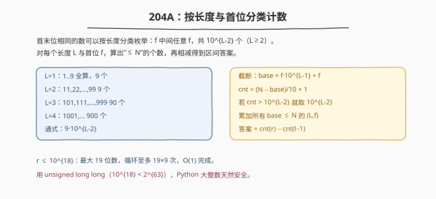

# Codeforces 204A 小象与区间 题解

## 1. 题目概述

- **题目链接**：https://codeforces.com/problemset/problem/204/A
- **比赛来源**：Codeforces Round 129 (Div. 1) · Problem A（UTC 2012-07-11）
- **难度**：1500
- **标签**：二分、组合数学、数位 DP
- **评测类型**：普通
- **限制**：时间 2 s / 内存 256 MB

**题意**：给定 $l\le r$，统计闭区间 $[l,r]$ 中有多少个整数 $x$，其十进制表示的**首位数字等于末位数字**。例如 $101$、$477474$、$9$ 都算，$47$、$253$、$1020$ 都不算。

**约束**：$1\le l\le r\le10^{18}$。

- $10^{18}$ 超出 32 位，必须用 64 位整数（C++ 用 `unsigned long long` 或 `long long`；Python 无此问题）。
- 区间长度可达 $10^{18}$，不能逐个枚举；要按"位数 + 首位"分类计数。

## 2. 示例与观察

官方样例一：

```text
输入：
2 47

输出：
12
```

官方样例二：

```text
输入：
47 1024

输出：
98
```

**样例一走查**：$[2,47]$ 内满足条件的是 $2,3,\dots,9$（9 个）与 $11,22,33,44$（4 个），共 12 个。

**样例二走查**：$[47,1024]$ 内满足条件的有：两位数里 $55,66,77,88,99$（5 个）；三位数全部 $9\times10=90$ 个（$101,111,\dots,999$）；四位数里 $1001,1011,1021$（3 个）——合计 $5+90+3=98$。

**观察 1（按长度分类）**：设 $x$ 有 $L$ 位、首位为 $f\in[1,9]$，则 $x$ 形如

$$
x=f\cdot10^{L-1}+m\cdot10+f,\qquad 0\le m<10^{L-2}\ (L\ge2),
$$

其中 $m$ 是中间 $L-2$ 位的数值。$L=1$ 时 $x=f\in[1,9]$。

**观察 2（按长度统计个数）**：长度为 $L\ge2$ 时，每个 $f$ 对应 $10^{L-2}$ 个合法数，共 $9\cdot10^{L-2}$ 个；长度 $L=1$ 时是 $9$ 个。



**观察 3（截断）**：要统计 $\le N$ 的合法数，对每个 $(L,f)$ 只要 $f\cdot10^{L-1}+f\le N$，就有

$$
\#=\min\Bigl(10^{L-2},\ \Bigl\lfloor\frac{N-f\cdot10^{L-1}-f}{10}\Bigr\rfloor+1\Bigr)
$$

个（$m$ 从 $0$ 开始，每增加 10 才多一个合法数）。

## 3. 解题思路

### 3.1 朴素做法与瓶颈

枚举 $x\in[l,r]$ 逐个判断位数首末：$10^{18}$ 次，不可行。

### 3.2 核心观察

用前缀计数 $C(N)=$「$1..N$ 中首末位相等的数的个数」，则答案 $=C(r)-C(l-1)$。$C(N)$ 按 $(L,f)$ 分类累加，每组 $O(1)$ 计算，一共 $19\times9$ 组。

### 3.3 算法流程

1. 写函数 `countUpTo(N)`：
   - 若 $N\le0$ 返回 0；
   - 先算 1 位数：`min(N, 9)`；
   - 对 $L=2,3,\dots$：令 $p=10^{L-1}$，若 $p>N$ 停止；
     - 对 $f=1..9$：`base=f*p+f`，若 `base>N` 则跳出；
       - `cnt = (N-base)/10 + 1`，再截断到 $10^{L-2}$，累加。
2. 输出 `countUpTo(r) - countUpTo(l-1)`。

### 3.4 样例走查

$N=1024$：1 位数 9；2 位数 $f=1..9$ 每个 1 个（$11..99$）共 9；3 位数 $p=100$、$mid=10$，$f=1$ 时 `base=101`，`cnt=(1024-101)/10+1=93` 截断到 10，$f=2..9$ 同样各 10 ⇒ 90；4 位数 $p=1000$、$mid=100$，$f=1$ 时 `base=1001`，`cnt=(1024-1001)/10+1=3`，$f=2$ 时 `base=2002>1024` 跳出 ⇒ 3。合计 $9+9+90+3=111$。再算 $C(46)=9+4=13$，答案 $111-13=98$ ✓。

## 4. 正确性证明

**引理 1（分类不重不漏）**：每个首末位相等的正整数 $x$ 唯一对应一组 $(L,f,m)$，其中 $L$ 是位数、$f$ 是首位（也是末位）、$m$ 是中间 $L-2$ 位的数值；反之每组合法 $(L,f,m)$ 给出一个这样的数。

**证明**：$x$ 的位数、首位由 $x$ 唯一确定，末位等于首位则中间部分也被唯一确定；反过来按公式构造出的数首位为 $f$、末位为 $f$，位数恰为 $L$。∎

**引理 2（截断公式正确）**：对固定的 $(L,f)$，满足 $x\le N$ 的合法数个数为 $\min\bigl(10^{L-2},\lfloor(N-\text{base})/10\rfloor+1\bigr)$（当 $\text{base}\le N$），否则为 0。

**证明**：由引理 1，这些数就是 $\text{base},\text{base}+10,\dots,\text{base}+10(10^{L-2}-1)$。其中 $\le N$ 的个数为 $\lfloor (N-\text{base})/10\rfloor+1$（若 $\text{base}\le N$），再与总个数 $10^{L-2}$ 取较小值即可。∎

**定理**：输出等于 $[l,r]$ 中首末位相等的整数个数。

**证明**：由引理 1、2，`countUpTo(N)` 精确统计了 $1..N$ 中所有位数 $\le19$ 的合法数（$N\le10^{18}$ 时不会漏掉任何数：$10^{18}$ 的末位是 0、首位是 1，本身不合法）。于是 $C(r)-C(l-1)$ 恰为区间内的个数。∎

## 5. 复杂度分析

- **时间**：$O(19\times9)=O(1)$，两次调用，实测 < 1 ms。
- **空间**：$O(1)$。

## 6. 参考代码

### C++17

```cpp
#include <bits/stdc++.h>
using namespace std;
typedef unsigned long long ull;

static ull countUpTo(ull N) {
    if (N == 0) return 0;
    ull res = min<ull>(N, 9);                 // 1 位：1..9
    for (int L = 2; L <= 19; ++L) {
        ull p10 = 1;
        for (int i = 0; i < L - 1; ++i) p10 *= 10;   // 10^{L-1}
        if (p10 > N) break;
        ull mid = p10 / 10;                          // 中间 L-2 位的取值个数
        for (int f = 1; f <= 9; ++f) {
            ull base = (ull)f * p10 + f;
            if (base > N) break;
            ull cnt = (N - base) / 10 + 1;
            if (cnt > mid) cnt = mid;
            res += cnt;
        }
    }
    return res;
}

int main() {
    ull l, r;
    if (scanf("%llu %llu", &l, &r) != 2) return 0;
    printf("%llu\n", countUpTo(r) - countUpTo(l - 1));
    return 0;
}
```

### Python3

```python
import sys


def count_up_to(n: int) -> int:
    if n <= 0:
        return 0
    res = min(n, 9)
    length = 2
    while True:
        p10 = 10 ** (length - 1)
        if p10 > n:
            break
        mid = p10 // 10
        for f in range(1, 10):
            base = f * p10 + f
            if base > n:
                break
            cnt = (n - base) // 10 + 1
            res += min(cnt, mid)
        length += 1
    return res


def main() -> None:
    data = sys.stdin.buffer.read().split()
    l, r = int(data[0]), int(data[1])
    print(count_up_to(r) - count_up_to(l - 1))


main()
```

## 7. 边界情况与易错点

1. **$l=1$**：`countUpTo(l-1)=countUpTo(0)` 必须返回 0，不能返回 9（1 位数不能无条件加 9）。
2. **截断上界**：`cnt` 必须与 $10^{L-2}$ 取 min，否则当 $N$ 很大时会把中间位"越界"的情况算进来（例如 $N=10^{18}$ 时 3 位数会算多）。
3. **$L=19$**：$10^{18}$ 是 19 位数，首位 1、末位 0，不合法；循环在 $f=1$ 时 `base=10^{18}+1>N` 直接跳出，结果不受影响。
4. **$10^{L-1}$ 的计算**：用 64 位整数循环乘 10（$10^{18}<2^{63}$），不要用 `pow`（浮点误差）。
5. **输出类型**：答案可达 $10^{17}$ 量级，用 `unsigned long long` / Python 大整数；`int` 会溢出。
6. **$l=r$**：差分公式自动处理（$C(r)-C(r-1)$ 为 0 或 1）。
7. **前导零**：十进制表示没有前导零，所以首位 $f$ 从 1 开始；长度 $L$ 就是真实位数。

## 8. 验证记录

- **编译环境与命令**：`python3 codeforces/tools/verify_solution.py codeforces/contests/0101-0203/204/A_小象与区间.md`。
- **官方样例**：2 / 2 通过（`12`、`98`）。
- **随机对拍**：暴力逐个枚举判断（$l\le3000$、$r-l\le3000$）共 **300 组**，与正文 C++ 一致；Python 版同样一致。
- **极端值**：`1 10^18` → `100000000000000008`（手算：$\sum_{L=2}^{18}9\cdot10^{L-2}+9=10^{17}-1+9$）；`10^18 10^18` → `0`；`1 9` → `9`；`10 10` → `0`；`11 11` → `1`。
- **最大约束性能**：C++ < 1 ms。
- **图片校验**：`cf204a_digits.svg` 通过 `xml.etree.ElementTree.parse`。
- **复核状态**：verified。

## 相关题目与扩展

- [Codeforces 204B 小象与卡片](https://codeforces.com/problemset/problem/204/B)：同场 B 题。
- [Codeforces 628D Magic Numbers](https://codeforces.com/problemset/problem/628/D)：数位 DP。
- [LeetCode 233 数字 1 的个数](https://leetcode.cn/problems/number-of-digit-one/)：同样按位数分类计数。

**延伸思考**：

1. 若把条件换成"首位 ≤ 末位"，只需在每层内按 $f$ 与末位的相对大小再分类，仍是 $O(\log N)$。
2. 若条件依赖中间位的和（如"各位数字之和为 $s$"），就必须用数位 DP，$O(\text{位数}\times\text{状态})$。
3. 本题的"按 (长度, 首位) 分组 + 减去上界"是数位计数题的通用模板：把区间拆成前缀差，再把每个前缀内的自由部分算成 $10^k$ 的倍数。
