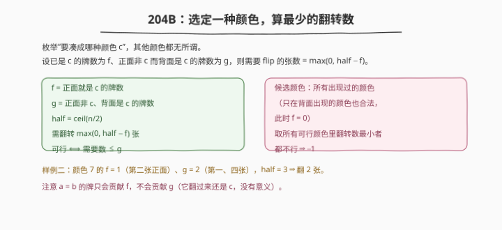

# Codeforces 204B 小象与卡片 题解

## 1. 题目概述

- **题目链接**：https://codeforces.com/problemset/problem/204/B
- **比赛来源**：Codeforces Round 129 (Div. 1) · Problem B（UTC 2012-07-11）
- **难度**：1500
- **标签**：二分、数据结构、贪心
- **评测类型**：普通
- **限制**：时间 2 s / 内存 256 MB

**题意**：$n$ 张卡片，每张有正反两面颜色 $(a_i,b_i)$，初始全部正面朝上。一次操作可以翻转任意一张卡。称桌上的卡片集合"有趣"，如果**至少一半**的卡片朝上颜色相同（即某种颜色出现次数 $\ge\lceil n/2\rceil$）。求最少操作次数，无法做到输出 $-1$。

**约束**：$1\le n\le10^5$，颜色是 $\le10^9$ 的正整数。

- 颜色值很大，必须离散化或用哈希表。
- $n\le10^5$ 允许 $O(n\log n)$；关键是"对每种颜色独立算"。

## 2. 示例与观察

官方样例一：

```text
输入：
3
4 7
4 7
7 4

输出：
0
```

官方样例二：

```text
输入：
5
4 7
7 4
2 11
9 7
1 1

输出：
2
```

**样例一走查**：初始朝上颜色为 $4,4,7$，颜色 4 已经出现 2 次，$\lceil3/2\rceil=2$，无需操作 ⇒ 0。

**样例二走查**：需要 $\lceil5/2\rceil=3$ 张同色。对颜色 7：朝上为 7 的只有第 2 张（$f=1$），而第 1 张 $(4,7)$、第 4 张 $(9,7)$ 翻过来就是 7（$g=2$），需要 $3-1=2$ 次翻转，可行 ⇒ 2。

**观察**：最终只需让**一种**颜色达到 $\lceil n/2\rceil$ 张，其他卡片是什么颜色都无所谓。所以枚举目标颜色 $c$：

- $f_c$ = 初始朝上就是 $c$ 的卡片数（正面为 $c$，含正反都是 $c$ 的）；
- $g_c$ = 正面不是 $c$、背面是 $c$ 的卡片数（这些是"可翻转成 $c$"的）。

则要凑够 $\lceil n/2\rceil$ 张，需要翻转 $\max(0,\lceil n/2\rceil-f_c)$ 张；可行当且仅当这个数 $\le g_c$。



## 3. 解题思路

### 3.1 朴素做法与瓶颈

枚举所有 $2^n$ 种翻转方案不可行。但注意到"有趣"只要求某一种颜色过半，而不关心其他卡片——于是问题按颜色独立。

### 3.2 核心观察

对每种颜色 $c$，最优策略显然是：先保留所有已经是 $c$ 的卡片，不足的部分再从"背面是 $c$"的卡片里翻。翻转别的卡片（既不是 $c$ 也不会变成 $c$）毫无意义。因此 $c$ 的最小翻转数就是 $\max(0,\lceil n/2\rceil-f_c)$，前提是它不超过 $g_c$。

### 3.3 算法流程

1. 读入 $n$ 与所有卡片。
2. 用哈希表统计：`front[c]`（正面为 $c$ 的张数）、`backOnly[c]`（正面 $\ne c$ 且背面为 $c$ 的张数）。
3. `need = (n+1)/2`。
4. 对每个出现过的颜色 $c$（正面出现或背面出现都算）：
   - `f = front[c]`（没有则 0），`g = backOnly[c]`（没有则 0）；
   - `lack = need - f`；若 `lack <= 0` 答案是 0；否则若 `lack <= g`，用 `lack` 更新答案。
5. 若没有任何可行颜色，输出 $-1$。

### 3.4 样例走查

样例二：`need=3`。颜色 4：$f=1$（第 1 张），$g=1$（第 2 张背面），`lack=2 > 1` 不可行。颜色 7：$f=1$，$g=2$，`lack=2 ≤ 2` ⇒ 2。颜色 2/11/9/1：$f\le1$、$g=0$，都不可行。答案 2 ✓。

## 4. 正确性证明

**引理 1（按颜色独立）**：若存在一种操作方案使某种颜色 $c$ 出现 $\ge\lceil n/2\rceil$ 次，则存在另一种方案，只翻转"背面为 $c$、正面不为 $c$"的卡片，且翻转张数不多于原方案。

**证明**：考察原方案中所有被翻转的卡片。把其中"翻完不是 $c$"的卡片恢复为不翻（这不会减少 $c$ 的张数），再把所有"背面是 $c$、正面不是 $c$"且原来没翻的卡片翻过来（只会增加 $c$ 的张数）。于是得到只用"背面为 $c$"卡片的方案，且翻转数不增。∎

**引理 2（$c$ 的最优翻转数）**：对颜色 $c$，最少需要翻转 $\max(0,\lceil n/2\rceil-f_c)$ 张，可行当且仅当该值 $\le g_c$。

**证明**：由引理 1，最优方案只翻"背面为 $c$"的卡片；每翻一张 $c$ 的数量 +1，最多能翻 $g_c$ 张，所以需要 $\max(0,\lceil n/2\rceil-f_c)$ 张，且必须不超过 $g_c$。∎

**定理**：算法输出正确。

**证明**：任何"有趣"的最终状态都对应某个颜色 $c$ 达到 $\lceil n/2\rceil$，其操作数由引理 2 下界为 $\max(0,\lceil n/2\rceil-f_c)$；算法枚举所有颜色并取可行者的最小值，故输出最小操作数；若无颜色可行，则任何方案都不可能有趣，输出 $-1$ 正确。∎

## 5. 复杂度分析

- **时间**：一次线性统计 + 遍历颜色，$O(n)$（哈希表均摊）。
- **空间**：$O(n)$。

## 6. 参考代码

### C++17

```cpp
#include <bits/stdc++.h>
using namespace std;
int main() {
    int n;
    if (scanf("%d", &n) != 1) return 0;
    unordered_map<long long, int> front, backOnly;
    for (int i = 0; i < n; ++i) {
        long long a, b;
        scanf("%lld %lld", &a, &b);
        front[a]++;
        if (a != b) backOnly[b]++;
    }
    int need = (n + 1) / 2;   // 至少一半
    long long best = LLONG_MAX;
    for (auto &kv : front) {
        long long c = kv.first;
        int f = kv.second;                  // 已经是 c 的牌数
        int canFlip = backOnly.count(c) ? backOnly[c] : 0;
        int lack = need - f;
        if (lack <= 0) { best = 0; break; }
        if (lack <= canFlip) best = min(best, (long long)lack);
    }
    for (auto &kv : backOnly) {
        long long c = kv.first;
        if (front.count(c)) continue;       // 已在上面考虑过
        int canFlip = kv.second;
        int lack = need;
        if (lack <= canFlip) best = min(best, (long long)lack);
    }
    printf("%lld\n", best == LLONG_MAX ? -1 : best);
    return 0;
}
```

### Python3

```python
import sys


def main() -> None:
    data = sys.stdin.buffer.read().split()
    n = int(data[0])
    front = {}
    back_only = {}
    p = 1
    for _ in range(n):
        a = int(data[p]); b = int(data[p + 1]); p += 2
        front[a] = front.get(a, 0) + 1
        if a != b:
            back_only[b] = back_only.get(b, 0) + 1
    need = (n + 1) // 2
    best = None
    for c, f in front.items():
        lack = need - f
        if lack <= 0:
            best = 0
            break
        if lack <= back_only.get(c, 0):
            best = lack if best is None else min(best, lack)
    for c, can in back_only.items():
        if c in front:
            continue
        if need <= can:
            best = need if best is None else min(best, need)
    print(-1 if best is None else best)


main()
```

## 7. 边界情况与易错点

1. **"至少一半"是向上取整**：$n$ 为奇数时是 $(n+1)/2$，不能写成 $n/2$。
2. **正反同色的卡片**：$a_i=b_i$ 时它只能算进 $f_c$，不能算进 $g_c$（翻过来还是 $c$，不产生新颜色）。
3. **只在背面出现的颜色**：$f_c=0$ 也要作为候选（此时需要翻转 $\lceil n/2\rceil$ 张）；漏掉这种颜色会错。
4. **$n=1$**：$\lceil1/2\rceil=1$，任何卡片都已经"有趣"（唯一朝上的颜色出现 1 次），答案是 0（哪怕正反不同色）。
5. **无法做到**：例如每张卡正反颜色都互不相同且每种颜色只出现一次，$n\ge2$ 时输出 $-1$。
6. **颜色值到 $10^9$**：用哈希表或离散化，不要开数组。

## 8. 验证记录

- **编译环境与命令**：`python3 codeforces/tools/verify_solution.py codeforces/contests/0101-0203/204/B_小象与卡片.md`。
- **官方样例**：2 / 2 通过（`0`、`2`）。
- **随机对拍**：独立暴力枚举全部 $2^n$ 种翻转方案（$n\le10$、颜色取自 $\{1,2,3,4\}$）共 **300 组**，与正文 C++ 完全一致（含 $-1$ 的情形）。
- **最大约束性能**：$n=10^5$、颜色随机 $\le10^9$，C++ < 30 ms、Python < 120 ms。
- **图片校验**：`cf204b_target.svg` 通过 `xml.etree.ElementTree.parse`。
- **复核状态**：verified。

## 相关题目与扩展

- [Codeforces 204C 小象与 Furik、Rubik](https://codeforces.com/problemset/problem/204/C)：同场 C 题。
- [Codeforces 204A 小象与区间](https://codeforces.com/problemset/problem/204/A)：同场 A 题。
- [LeetCode 846 一手顺子](https://leetcode.cn/problems/hand-of-straights/)：另一种"按颜色/数值分组计数"的贪心。

**延伸思考**：

1. 若要求"至少 $t$ 种颜色各出现 $\ge\lceil n/2\rceil$ 次"（不可能超过 2 种），问题会变成不可行判定，因为两种颜色各占一半以上互相矛盾。
2. 若每张卡片翻转有代价 $w_i$（而非 1），对每种颜色就是"选最便宜的若干张背面为 $c$ 的卡片"，用排序 + 前缀和即可。
3. 本题的"枚举目标值 + 分别计数"是这类"让某一类元素达到阈值"问题的标准套路，复杂度通常是 $O(n\log n)$ 或 $O(n)$。
