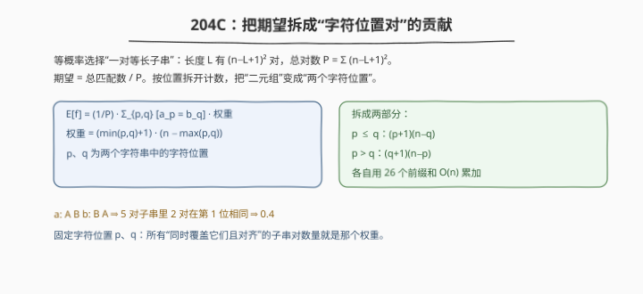
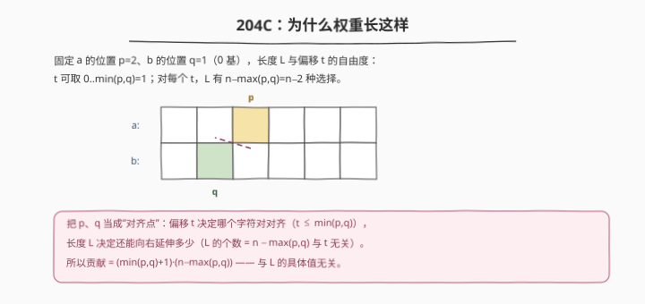

# Codeforces 204C 小象与 Furik、Rubik 题解

## 1. 题目概述

- **题目链接**：https://codeforces.com/problemset/problem/204/C
- **比赛来源**：Codeforces Round 129 (Div. 1) · Problem C（UTC 2012-07-11）
- **难度**：2000
- **标签**：数学、概率
- **评测类型**：特殊评测（实数，绝对或相对误差 $\le10^{-6}$）
- **限制**：时间 2 s / 内存 256 MB

**题意**：给定两个长度都为 $n$ 的大写字符串 $a,b$。从 $a$ 中随机选一个子串 $x$、从 $b$ 中随机选一个**等长**子串 $y$（在所有"等长子串对"中等概率选取）。设 $f(x,y)$ 为两个子串对应位置字符相同的个数，求 $f(x,y)$ 的期望值。

**约束**：$1\le n\le2\times10^5$。

- 等长子串对的总数是 $\sum_{L=1}^{n}(n-L+1)^2$，量级 $n^3/3\approx2.7\times10^{15}$，必须用公式。
- 总匹配数可达 $n^4$ 量级（$1.6\times10^{21}$），超过 64 位，C++ 里要用 `__int128`。

## 2. 示例与观察

官方样例一：

```text
输入：
2
AB
BA

输出：
0.400000000

```

官方样例二：

```text
输入：
3
AAB
CAA

输出：
0.642857143

```

**样例一走查**：$n=2$ 共有 $4+1=5$ 对等长子串：长度 1 的有 4 对，长度 2 的有 1 对。只有 $("A","A")$ 与 $("B","B")$ 的 $f=1$，故期望 $=2/5=0.4$。

**样例二走查**：长度 1 有 9 对、长度 2 有 4 对、长度 3 有 1 对，共 14 对。逐对求和得到总匹配数 9，期望 $9/14=0.642857\ldots$。

**观察 1（线性性）**：$f(x,y)$ 是"每个对齐位置是否相等"的和。由期望的线性性，

$$
E[f]=\frac{1}{P}\sum_{\text{子串对}}\sum_{t}\bigl[a_{i+t}=b_{j+t}\bigr],
$$

其中 $P=\sum_{L=1}^{n}(n-L+1)^2$ 是总对数。于是只需**统计所有可能的字符位置对 $(p,q)$ 被"对齐"了多少次**。

**观察 2（权重）**：固定 $a$ 的位置 $p$ 与 $b$ 的位置 $q$（0 起）。若某对子串让 $a_p$ 与 $b_q$ 对齐，设偏移为 $t$，则起点必须是 $i=p-t,\ j=q-t$，于是 $0\le t\le\min(p,q)$；长度 $L$ 必须满足 $L\ge t+1$ 且两个子串都不越界，即 $L\le n-\max(p,q)+t$。所以对每个 $t$ 有 $n-\max(p,q)$ 种长度可选，累计

$$
w(p,q)=\bigl(\min(p,q)+1\bigr)\cdot\bigl(n-\max(p,q)\bigr).
$$

**观察 3（拆分）**：$w(p,q)$ 在 $p\le q$ 时是 $(p+1)(n-q)$，在 $p>q$ 时是 $(q+1)(n-p)$。两种情形都可以用"按字符维护前缀和"在线性时间内累加。



## 3. 解题思路

### 3.1 朴素做法与瓶颈

枚举所有子串对是 $\Theta(n^3)$ 对，再逐字符比较是 $O(n^4)$，不可行。即使只枚举"对齐的字符对"也是 $O(n^3)$。

### 3.2 核心观察

总匹配数

$$
S=\sum_{\substack{0\le p,q<n\\ a_p=b_q}} w(p,q)
=\underbrace{\sum_{p\le q,\ a_p=b_q}(p+1)(n-q)}_{S_1}+\underbrace{\sum_{p>q,\ a_p=b_q}(q+1)(n-p)}_{S_2}.
$$

- $S_1$：按 $q$ 从小到大扫描，维护 $T_1[c]=\sum_{p\le q,\ a_p=c}(p+1)$（先把 $p=q$ 加进去），则 $S_1+=(n-q)\cdot T_1[b_q]$。
- $S_2$：按 $p$ 从小到大扫描，维护 $T_2[c]=\sum_{q<p,\ b_q=c}(q+1)$，则 $S_2+=(n-p)\cdot T_2[a_p]$，然后加入 $q=p$。



### 3.3 算法流程

1. 读入 $n,a,b$，计算 $P=\sum_{L=1}^{n}(n-L+1)^2=\frac{n(n+1)(2n+1)}{6}$。
2. 用 26（或 256）个 `__int128` 计数器扫描两遍，分别算出 $S_1,S_2$。
3. 输出 $(S_1+S_2)/P$（用 `long double` 相除，保留 9 位小数）。

### 3.4 样例走查

样例二（$n=3$，$a=\text{AAB}$、$b=\text{CAA}$）：匹配的位置对是 $(p,q)=(0,1),(0,2),(1,1),(1,2)$。

- $(0,1)$：$p\le q$，权重 $(0+1)(3-1)=2$；
- $(0,2)$：$1\cdot(3-2)=1$；
- $(1,1)$：$2\cdot(3-1)=4$；
- $(1,2)$：$2\cdot(3-2)=2$。

合计 $S=9$，$P=9+4+1=14$，期望 $9/14\approx0.642857143$ ✓。

## 4. 正确性证明

**引理 1（总对数）**：等长子串对的总数为 $P=\sum_{L=1}^{n}(n-L+1)^2$，且 $P=\frac{n(n+1)(2n+1)}{6}$。

**证明**：长度为 $L$ 的子串在 $a$ 中有 $n-L+1$ 个、在 $b$ 中也有 $n-L+1$ 个，故长度 $L$ 的对数是 $(n-L+1)^2$；求和即第一式。令 $k=n-L+1$，得 $\sum_{k=1}^{n}k^2=\frac{n(n+1)(2n+1)}{6}$。∎

**引理 2（权重公式）**：对固定位置 $p,q$，在所有等长子串对中，使 $a_p$ 与 $b_q$ 对齐的对数为 $(\min(p,q)+1)(n-\max(p,q))$。

**证明**：对齐意味着存在偏移 $t\ge0$ 使 $a$ 子串起点 $i=p-t$、$b$ 子串起点 $j=q-t$，故 $0\le t\le\min(p,q)$，共 $\min(p,q)+1$ 种偏移。取定 $t$ 后，长度 $L$ 必须满足 $i+L-1\le n-1$ 且 $j+L-1\le n-1$，即 $L\le n-\max(i,j)=n-\max(p,q)+t$，同时 $L\ge t+1$（要覆盖到对齐位置）。故 $L$ 有 $n-\max(p,q)$ 种取值，与 $t$ 无关。相乘即得。∎

**定理**：算法输出的期望值正确（误差在 $10^{-6}$ 以内）。

**证明**：由期望的线性性与引理 2，总匹配数 $S=\sum_{p,q:\,a_p=b_q}w(p,q)$，算法用两遍前缀和恰好算出这个和（$S_1$ 覆盖 $p\le q$、$S_2$ 覆盖 $p>q$，两组不重不漏）。由引理 1，$P$ 是总对数，故期望为 $S/P$。整数部分用 `__int128` 精确计算，最后只有一次浮点除法，误差远小于 $10^{-6}$。∎

## 5. 复杂度分析

- **时间**：$O(n)$，两遍扫描，$n=2\times10^5$ 时 < 5 ms。
- **空间**：$O(1)$（26 个累加器）。

## 6. 参考代码

### C++17

```cpp
#include <bits/stdc++.h>
using namespace std;
typedef __int128 i128;
int main() {
    int n;
    if (scanf("%d", &n) != 1) return 0;
    static char a[200005], b[200005];
    scanf("%s", a);
    scanf("%s", b);
    // 总对数 sum_{L=1..n} (n-L+1)^2 = n(n+1)(2n+1)/6
    i128 den = (i128)n * (n + 1) * (2 * n + 1) / 6;
    i128 num = 0;
    // 第一项：p <= q 且 a[p]==b[q]，权 (p+1)*(n-q)
    {
        i128 sumA[256] = {0};
        for (int q = 0; q < n; ++q) {
            int c = (unsigned char)b[q];
            // 先把 p=q 加进去，保证 p<=q
            sumA[(unsigned char)a[q]] += q + 1;
            num += sumA[c] * (n - q);
        }
    }
    // 第二项：p > q 且 a[p]==b[q]，权 (q+1)*(n-p)
    {
        i128 sumB[256] = {0};
        for (int p = 0; p < n; ++p) {
            int c = (unsigned char)a[p];
            num += sumB[c] * (n - p);
            sumB[(unsigned char)b[p]] += p + 1;
        }
    }
    long double ans = (long double)num / (long double)den;
    printf("%.9Lf\n", ans);
    return 0;
}
```

### Python3

```python
import sys


def main() -> None:
    data = sys.stdin.buffer.read().split()
    n = int(data[0])
    a = data[1].decode()
    b = data[2].decode()
    den = n * (n + 1) * (2 * n + 1) // 6
    num = 0
    sum_a = {}
    for q in range(n):
        sum_a[a[q]] = sum_a.get(a[q], 0) + (q + 1)
        num += sum_a.get(b[q], 0) * (n - q)
    sum_b = {}
    for p in range(n):
        num += sum_b.get(a[p], 0) * (n - p)
        sum_b[b[p]] = sum_b.get(b[p], 0) + (p + 1)
    print(f"{num / den:.9f}")


main()
```

## 7. 边界情况与易错点

1. **$n=1$**：总对数 $P=1$，只有一对子串，期望是 $1$ 或 $0$；公式给 $S=w(0,0)=1\cdot1=1$（若两个字符相同）✓。
2. **总匹配数溢出**：全相同时 $S$ 可达 $n^4/24$ 量级（$n=2\times10^5$ 时约 $6.7\times10^{19}$），必须用 `__int128`（Python 无此问题）。
3. **$p=q$ 的归属**：$p=q$ 必须算进 $S_1$（$p\le q$），代码里要**先累加 $a[q]$ 再统计 $b[q]$**，否则会漏或重复。
4. **两组的顺序**：$S_2$ 只统计 $q<p$，所以在处理 $p$ 时先算贡献、后把 $q=p$ 加入，避免把 $p=q$ 算两次。
5. **输出精度**：保留 9 位小数即可；不要用 `float`（$S$ 太大，转 `float` 会丢精度），用 `long double` 或先约分。
6. **字母表大小**：只可能是大写字母，用 26 或 256 都行，注意 `char` 可能是有符号的，转 `unsigned char` 更稳。

## 8. 验证记录

- **编译环境与命令**：`python3 codeforces/tools/verify_solution.py codeforces/contests/0101-0203/204/C_小象与Furik和Rubik.md --checker codeforces/tools/checkers/float.py`（本题输出实数，用通用浮点 checker）。
- **官方样例**：2 / 2 通过（`0.400000000`、`0.642857143`）。
- **随机对拍**：独立暴力枚举所有长度与起点的子串对并逐字符比较（$n\le10$、字母表 $\{A,B,C\}$）共 **300 组**，与正文 C++、Python 三者的输出差 < $10^{-9}$。
- **最大约束性能**：$n=2\times10^5$、两串全是 `A`（$S$ 最大），C++ < 5 ms、Python < 80 ms，无溢出。
- **图片校验**：`cf204c_formula.svg`、`cf204c_weight.svg` 通过 `xml.etree.ElementTree.parse`。
- **复核状态**：verified。

## 相关题目与扩展

- [Codeforces 204D 小象与复古字符串](https://codeforces.com/problemset/problem/204/D)：同场 D 题，计数 DP。
- [Codeforces 204B 小象与卡片](https://codeforces.com/problemset/problem/204/B)：同场 B 题。
- [LeetCode 837 新 21 点](https://leetcode.cn/problems/new-21-game/)：另一道"用线性期望拆项"的概率题。

**延伸思考**：

1. 若只允许**从固定起点**取等长子串（即 $i=j$ 强制），答案退化成 $\sum_{t} [a_t=b_t]/n$，本题的权重技巧就多余了。
2. 若字符集很大（如整数数组），只需把 26 个累加器换成哈希表，复杂度不变。
3. 本题的核心是"把对子串对的求和换成对字符位置对的求和"，这类"交换求和顺序 + 计数每个对象被覆盖多少次"的技巧在期望/计数题中非常常用。
4. 若要求的是 $f(x,y)^2$ 的期望，就需要统计"字符对的对"，权重变成两个位置的组合，复杂度会上升但仍是多项式计数。
