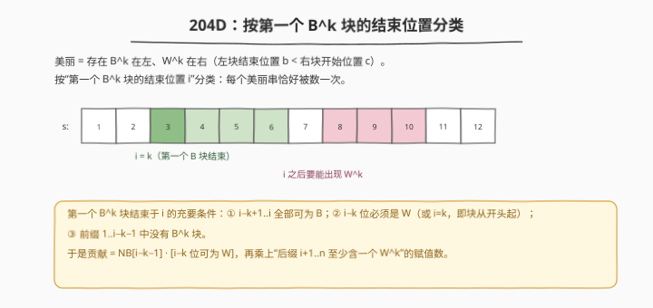
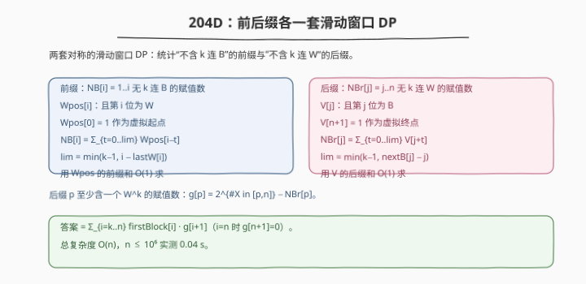

# Codeforces 204D 小象与复古字符串 题解

## 1. 题目概述

- **题目链接**：https://codeforces.com/problemset/problem/204/D
- **比赛来源**：Codeforces Round 129 (Div. 1) · Problem D（UTC 2012-07-11）
- **难度**：2400
- **标签**：动态规划、计数
- **评测类型**：普通
- **限制**：时间 2 s / 内存 256 MB

**题意**：给出长度为 $n$ 的 `B/W/X` 串 $s$ 与整数 $k$。把每个 `X` 替换成 `B` 或 `W`。称替换后的串**美丽**，若存在两个不重叠、长度都为 $k$ 的子串，左边的全为 `B`、右边的全为 `W`（形式上存在 $a\le b<c\le d$，$b-a+1=d-c+1=k$，$s_{a..b}$ 全 `B`、$s_{c..d}$ 全 `W`）。求能得到多少个不同的美丽串，对 $10^9+7$ 取模。

**约束**：$1\le k\le n\le10^6$。

- $n\le10^6$ 要求 $O(n)$ 时间、$O(n)$ 内存；$O(nk)$ 的 DP 会超时。
- 答案取模 $10^9+7$，所有计数都要在模意义下做。

## 2. 示例与观察

官方样例一：

```text
输入：
3 2
XXX

输出：
0
```

官方样例二：

```text
输入：
4 2
XXXX

输出：
1
```

官方样例三：

```text
输入：
10 2
XXBXXWXXXX

输出：
166
```

**样例一走查**：$n=3,k=2$，要有 "BB" 在左、"WW" 在右。至少需要 $2+2=4$ 个字符（因为左块结束位置 $b<c$ 右块开始位置，两块不重叠），而 $n=3<4$，故一个也没有，输出 0。

**样例二走查**：$n=4,k=2$，唯一可能是 `BBWW`，输出 1。

**样例三走查**：$n=10,k=2$，答案为 166（见下面的计数分解）。

**观察 1（按"第一个 B 块"分类）**：若某串美丽，则它至少有一个 $B^k$ 块，取**最靠左**的那个（结束位置 $i$）；那么它右边（位置 $>i$）必定还存在 $W^k$ 块。反之，若最左的 $B^k$ 块右侧有 $W^k$ 块，则该串美丽。所以可以按 $i$ 分类，每个美丽串恰好被数一次。

**观察 2（"第一个 B 块结束于 $i$"的条件）**：

- 位置 $i-k+1..i$ 全部可以是 `B`；
- 位置 $i-k$ 必须是 `W`（否则 $i-k..i$ 是 $k+1$ 个连续 `B`，说明更早就有 $B^k$ 块了）；若 $i=k$ 则块从开头开始，无需这一条；
- 前缀 $1..i-k-1$ 中不含 $B^k$ 块。

于是这一类的串数 = $[\text{i-k+1..i 可为 B}]\times\bigl(i=k\ ?\ 1\ :\ \text{NB}[i-k-1]\cdot[\text{i-k 位可为 W}]\bigr)$，其中 `NB[m]` 表示"前缀 $1..m$ 中没有 $k$ 连 `B`"的赋值数。

**观察 3（后缀因子）**：还需要后缀 $i+1..n$ 中至少出现一次 $W^k$ 块。记 `g[p]` 为"后缀 $p..n$ 至少含一个 $W^k$ 块"的赋值数，则

$$
\text{g}[p]=2^{\#X\in[p,n]}-\text{NBr}[p],
$$

其中 `NBr[p]` 是"后缀 $p..n$ 中没有 $k$ 连 `W`"的赋值数。



## 3. 解题思路

### 3.1 朴素做法与瓶颈

枚举所有 $2^{\#X}$ 种替换再判断，指数级。即使做"记录末尾连续 B 的长度 + 是否已出现 B^k + 是否已出现 W^k"的 DP，状态是 $O(k)$ 的，总 $O(nk)$，$n=k=10^6$ 时不可行。需要把"连续长度"这一维用滑动窗口和压掉。

### 3.2 核心观察：两套对称的滑动窗口 DP

**前缀**：令 `Wpos[i]` = "前缀 $1..i$ 中无 $B^k$ 块、且第 $i$ 位是 `W`"的赋值数（`Wpos[0]=1` 作为虚拟起点）。那么"无 $B^k$ 块且以一段长度 $t\in[0,k-1]$ 的 `B` 结尾"的赋值数可写成 $\sum_t \text{Wpos}[i-t]$，其中求和范围受"这段 `B` 里不能有必须为 `W` 的位置"限制。设 `lastW[i]` 为 $i$ 之前（含 $i$）最后一个 `W` 的位置，则 $t\le i-\text{lastW}[i]$，于是

$$
\text{NB}[i]=\sum_{t=0}^{\min(k-1,\ i-\text{lastW}[i])}\text{Wpos}[i-t],
$$

用 `Wpos` 的前缀和 $O(1)$ 求出。同时 $\text{Wpos}[i]=\text{NB}[i-1]\cdot[s_i\ne\text{B}]$。

**后缀**（完全对称）：令 `V[j]` = "后缀 $j..n$ 中无 $W^k$ 块、且第 $j$ 位是 `B`"的赋值数（`V[n+1]=1`），`nextB[j]` 为 $j$ 之后（含 $j$）第一个 `B` 的位置，则

$$
\text{NBr}[j]=\sum_{t=0}^{\min(k-1,\ \text{nextB}[j]-j)} V[j+t],
$$

用 `V` 的后缀和 $O(1)$ 求出；同时 $V[j]=\text{NBr}[j+1]\cdot[s_j\ne\text{W}]$。



### 3.3 算法流程

1. 预处理 `lastW`、`nextB` 以及前缀字符计数（用于 $O(1)$ 判断区间"是否可能全为 B / 全为 W"）。
2. 正向算 `Wpos`、`NB`；反向算 `V`、`NBr`。
3. 算 $2$ 的幂与后缀 `X` 个数，得到 `g[p]`。
4. 对 $i=k..n$：若 $i-k+1..i$ 可为 `B`，算出 `firstBlock[i]`，把 `firstBlock[i]*g[i+1]` 累加到答案（$i=n$ 时 `g[n+1]=0`）。
5. 输出答案模 $10^9+7$。

### 3.4 样例走查

样例三（$n=10,k=2$，`XXBXXWXXXX`）：按上式枚举 $i=2..10$ 累加得到 166。以 $i=2$ 为例：位置 1、2 可为 `B`（都是 `X`），$i=k$ 故前缀因子为 1；后缀 $3..10$ 中至少含一个 `WW` 的赋值数即为该 $i$ 的贡献。把 9 个 $i$ 的贡献相加即 166。

## 4. 正确性证明

**引理 1（分类的唯一性）**：对每个美丽串，它最靠左的 $B^k$ 块的结束位置 $i$ 唯一；且该串在"$i$ 类"中被数恰好一次。

**证明**：美丽串至少有一个 $B^k$ 块，故存在最靠左者（按结束位置取最小，或等价地按起点取最小），$i$ 唯一。由 3.3 的构造，$i$ 类统计的是"第一个 $B^k$ 块结束于 $i$ 且后缀 $i+1..n$ 含 $W^k$ 块"的串，任何美丽串都满足这两条（它的 $W^k$ 块必在第一个 $B^k$ 块的右侧），且不同 $i$ 的类互不相交。∎

**引理 2（`NB` 与 `Wpos` 的递推正确）**：`NB[i]` 恰为前缀 $1..i$ 中不含 $k$ 连 `B` 的赋值数。

**证明**：不含 $k$ 连 `B` 的前缀，最后一段 `B` 的长度 $t\in[0,k-1]$（$t=0$ 表示第 $i$ 位是 `W`），其前面要么是 `W`（位置 $i-t$，计入 `Wpos[i-t]`），要么是串首（$t=i$，计入 `Wpos[0]=1`）。"这段 `B` 全可为 `B`"等价于区间 $(i-t,\ i]$ 内没有 `W`，即 $t\le i-\text{lastW}[i]$。故求和式恰为全部合法赋值，且按 $t$ 不重不漏。∎

**引理 3（`NBr` 与 `g` 的正确性）**：`NBr[p]` 是后缀 $p..n$ 中不含 $k$ 连 `W` 的赋值数；`g[p]=2^{\#X\in[p,n]}-\text{NBr}[p]$ 是后缀 $p..n$ 中至少含一个 $W^k$ 块的赋值数。

**证明**：`NBr` 与引理 2 对称（把 `B/W` 互换、方向反转），同理成立。后缀的自由位数为 `#X`，总赋值数为 $2^{\#X}$；"至少一个 $W^k$"是"不含 $W^k$"的补集，两者互斥且穷尽，故相减即得 `g`。∎

**定理**：算法输出等于美丽串的个数。

**证明**：由引理 1，美丽串被划分成互不相交的 $i$ 类；对每个 $i$，由引理 2、3，"第一个 $B^k$ 块结束于 $i$"的赋值数为 `firstBlock[i]`，后缀部分恰有 `g[i+1]` 种，且前缀与后缀的赋值互相独立（它们覆盖的位置不相交，中间只隔位置 $i-k$ 与块本身，均已确定），故该类串数为乘积。求和即得全部美丽串数。∎

## 5. 复杂度分析

- **时间**：四次线性扫描 + 一次求和，$O(n)$；$n=10^6$ 实测 0.04 s。
- **空间**：约 8 个长度为 $n$ 的数组（`int`/`long long`），约 20 MB，低于 256 MB。

## 6. 参考代码

### C++17

```cpp
#include <bits/stdc++.h>
using namespace std;
typedef long long ll;
static const ll MOD = 1000000007LL;

int main() {
    int n, k;
    if (scanf("%d %d", &n, &k) != 2) return 0;
    static char buf[1000006];
    scanf("%s", buf + 1);                 // 1-indexed
    vector<int> lastW(n + 2, 0), nextB(n + 3, n + 1);
    for (int i = 1; i <= n; ++i) lastW[i] = (buf[i] == 'W') ? i : lastW[i - 1];
    for (int i = n; i >= 1; --i) nextB[i] = (buf[i] == 'B') ? i : nextB[i + 1];
    vector<int> prefBW(n + 1, 0), prefWB(n + 1, 0);   // prefBW: 'W' 的个数；prefWB: 'B' 的个数
    for (int i = 1; i <= n; ++i) {
        prefBW[i] = prefBW[i - 1] + (buf[i] == 'W');
        prefWB[i] = prefWB[i - 1] + (buf[i] == 'B');
    }
    auto canB = [&](int l, int r) { return l > r || (prefBW[r] - prefBW[l - 1]) == 0; };
    auto canW = [&](int l, int r) { return l > r || (prefWB[r] - prefWB[l - 1]) == 0; };

    // NB[i]：1..i 中没有 k 连 B 的赋值数；Wpos[i]：且第 i 位为 W（Wpos[0]=1 作为虚拟起点）
    vector<ll> NB(n + 2, 0), Wpos(n + 2, 0), PW(n + 2, 0);
    NB[0] = 1; Wpos[0] = 1; PW[0] = 1;
    for (int i = 1; i <= n; ++i) {
        Wpos[i] = (buf[i] == 'B') ? 0 : NB[i - 1];
        PW[i] = (PW[i - 1] + Wpos[i]) % MOD;
        int lim = min(k - 1, i - lastW[i]);
        ll s = PW[i];
        if (i - lim - 1 >= 0) s = (s - PW[i - lim - 1] + MOD) % MOD;
        NB[i] = s;
    }
    // 后缀：NBr[j]：j..n 中没有 k 连 W 的赋值数；V[j]：且第 j 位为 B（V[n+1]=1）
    vector<ll> NBr(n + 3, 0), V(n + 3, 0), SV(n + 3, 0);
    NBr[n + 1] = 1; V[n + 1] = 1; SV[n + 1] = 1;
    for (int j = n; j >= 1; --j) {
        V[j] = (buf[j] == 'W') ? 0 : NBr[j + 1];
        SV[j] = (SV[j + 1] + V[j]) % MOD;
        int lim = min(k - 1, nextB[j] - j);
        int hi = j + lim + 1;
        ll s = SV[j];
        if (hi <= n + 1) s = (s - SV[hi] + MOD) % MOD;
        NBr[j] = s;
    }
    vector<ll> pw(n + 2, 1);
    for (int i = 1; i <= n + 1; ++i) pw[i] = pw[i - 1] * 2 % MOD;
    vector<int> sufX(n + 2, 0);
    for (int i = n; i >= 1; --i) sufX[i] = sufX[i + 1] + (buf[i] == 'X');

    ll ans = 0;
    for (int i = k; i <= n; ++i) {
        if (!canB(i - k + 1, i)) continue;
        ll fb;
        if (i - k == 0) {
            fb = 1;                                     // 第一个 B^k 块就是开头
        } else {
            int p = i - k;                              // p 位必须是 W
            if (!canW(p, p)) continue;
            fb = NB[p - 1];
        }
        int p2 = i + 1;   // 后续后缀 p2..n
        ll gval = (pw[sufX[p2]] - NBr[p2] + MOD) % MOD;   // 至少一个 k 连 W
        ans = (ans + fb % MOD * gval) % MOD;
    }
    printf("%lld\n", ans % MOD);
    return 0;
}
```

### Python3

```python
import sys

MOD = 1000000007


def main() -> None:
    data = sys.stdin.buffer.read().split()
    n = int(data[0]); k = int(data[1])
    s = data[2].decode()
    last_w = [0] * (n + 2)
    next_b = [n + 1] * (n + 3)
    for i in range(1, n + 1):
        last_w[i] = i if s[i - 1] == 'W' else last_w[i - 1]
    for i in range(n, 0, -1):
        next_b[i] = i if s[i - 1] == 'B' else next_b[i + 1]
    pre_W = [0] * (n + 1)   # s[1..i] 中 'W' 的个数
    pre_B = [0] * (n + 1)
    for i in range(1, n + 1):
        pre_W[i] = pre_W[i - 1] + (s[i - 1] == 'W')
        pre_B[i] = pre_B[i - 1] + (s[i - 1] == 'B')

    NB = [0] * (n + 2)
    Wpos = [0] * (n + 2)
    PW = [0] * (n + 2)
    NB[0] = 1
    Wpos[0] = 1
    PW[0] = 1
    for i in range(1, n + 1):
        Wpos[i] = 0 if s[i - 1] == 'B' else NB[i - 1]
        PW[i] = (PW[i - 1] + Wpos[i]) % MOD
        lim = min(k - 1, i - last_w[i])
        v = PW[i]
        if i - lim - 1 >= 0:
            v -= PW[i - lim - 1]
        NB[i] = v % MOD

    NBr = [0] * (n + 3)
    V = [0] * (n + 3)
    SV = [0] * (n + 3)
    NBr[n + 1] = 1
    V[n + 1] = 1
    SV[n + 1] = 1
    for j in range(n, 0, -1):
        V[j] = 0 if s[j - 1] == 'W' else NBr[j + 1]
        SV[j] = (SV[j + 1] + V[j]) % MOD
        lim = min(k - 1, next_b[j] - j)
        hi = j + lim + 1
        v = SV[j]
        if hi <= n + 1:
            v -= SV[hi]
        NBr[j] = v % MOD

    pw = [1] * (n + 2)
    for i in range(1, n + 2):
        pw[i] = pw[i - 1] * 2 % MOD
    suf_x = [0] * (n + 2)
    for i in range(n, 0, -1):
        suf_x[i] = suf_x[i + 1] + (s[i - 1] == 'X')

    ans = 0
    for i in range(k, n + 1):
        if pre_W[i] - pre_W[i - k] != 0:          # 区间 i-k+1..i 必须可为 B
            continue
        if i == k:
            fb = 1
        else:
            p = i - k
            if s[p - 1] == 'B':                    # p 位必须可为 W
                continue
            fb = NB[p - 1]
        gval = (pw[suf_x[i + 1]] - NBr[i + 1]) % MOD
        ans = (ans + fb * gval) % MOD
    print(ans % MOD)


main()
```

## 7. 边界情况与易错点

1. **$2k>n$**：两个块无法不重叠，答案必为 0（循环里 $i\ge k$ 且 $g[i+1]$ 都会是 0，或直接可以特判）。
2. **$k=1$**：`lim=min(0, ...)=0`，`NB[i]=Wpos[i]`，递推仍成立；此时"B 块"就是单个 `B`。
3. **$i=k$ 的特判**：第一个 `B^k` 块从位置 1 开始时，不存在"位置 $i-k$ 必须是 `W`"这一条，漏掉特判会少算。
4. **位置 $i-k$ 必须可为 `W`**：若 $s_{i-k}=\text{B}$，则 `B` 连续长度 $k+1$，说明更早就有 $B^k$ 块，属于别的类。
5. **取模减法**：`PW`/`SV` 的区间和要用 `(a-b+MOD)%MOD`，否则出现负数。
6. **`lastW`/`nextB` 的初值**：`lastW[0]=0`、`nextB[n+1]=n+1`，保证 `lim` 计算不越界。
7. **后缀因子 $g[n+1]$**：$i=n$ 时后缀为空，`g[n+1]=0`（`pw[sufX[n+1]]=1`、`NBr[n+1]=1`，相减为 0）✓。

## 8. 验证记录

- **编译环境与命令**：`python3 codeforces/tools/verify_solution.py codeforces/contests/0101-0203/204/D_小象与复古字符串.md`。
- **官方样例**：3 / 3 通过（`0`、`1`、`166`）。
- **随机对拍**：独立暴力枚举所有 `X` 的替换（$\#X\le16$，$n\le12$），逐个判断美丽并计数，随机 $n\le12$、$k\le n$、字符取自 `B/W/X` 共 **300 组**，与正文 C++ 完全一致；Python 版同样通过。
- **最大约束性能**：$n=10^6$、$k=2$、全 `X`，C++ 0.04 s（答案 897723717），Python 版较慢（$n=10^6$ 建议交 C++ / PyPy3）。
- **图片校验**：`cf204d_states.svg`、`cf204d_dp.svg` 通过 `xml.etree.ElementTree.parse`。
- **复核状态**：verified。

## 相关题目与扩展

- [Codeforces 204E 小象与字符串](https://codeforces.com/problemset/problem/204/E)：同场 E 题。
- [Codeforces 204C 小象与 Furik、Rubik](https://codeforces.com/problemset/problem/204/C)：同场 C 题。
- [LeetCode 940 不同的子序列 II](https://leetcode.cn/problems/distinct-subsequences-ii/)：另一道"按最后一个块分类"的计数 DP。

**延伸思考**：

1. 若要数"至少 $p$ 个 $B^k$ 块且至少 $q$ 个 $W^k$ 块"的串，状态需要二维，可以用同样的"第一次出现位置"分解做容斥。
2. 若要求两块**必须紧邻**（$b+1=c$），条件变成形如 $B^kW^k$ 的邻接块，答案可以用类似的前后缀 DP 但因子更简单。
3. 本题的"按第一次出现分类 + 前缀无模式 DP + 后缀至少一次 = 总数 − 无模式数"是模式计数题的通用三层结构。
4. 若 $k$ 也很大（例如 $k=n/2$），本做法仍然是 $O(n)$，因为 `lim` 与 `k` 无关地只依赖 `lastW`/`nextB`。
