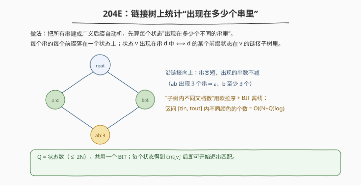
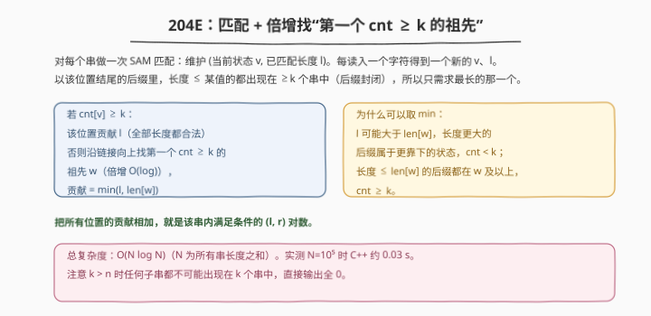

# Codeforces 204E 小象与字符串 题解

## 1. 题目概述

- **题目链接**：https://codeforces.com/problemset/problem/204/E
- **比赛来源**：Codeforces Round 129 (Div. 1) · Problem E（UTC 2012-07-11）
- **难度**：2800
- **标签**：后缀自动机、数据结构、双指针
- **评测类型**：普通
- **限制**：时间 3 s / 内存 256 MB

**题意**：给出 $n$ 个仅含小写字母的非空字符串 $a_1,\dots,a_n$ 与整数 $k$。对每个 $i$，统计数对 $(l,r)$（$1\le l\le r\le|a_i|$）的个数，使得子串 $a_i[l..r]$ 至少是数组中 $k$ 个字符串（含 $a_i$ 自身）的子串。输出 $n$ 个整数。

**约束**：$1\le n,k\le10^5$，所有字符串长度之和 $\le10^5$。

- 长度之和 $N\le10^5$ 是核心限制：所有字符串的**所有**子串约 $N^2/2$ 个，不能显式枚举，只能用后缀结构线性处理。
- $k$ 可能大于 $n$，此时任何子串都不达标。

## 2. 示例与观察

官方样例一：

```text
输入：
3 1
abc
a
ab

输出：
6 1 3 
```

官方样例二：

```text
输入：
7 4
rubik
furik
abab
baba
aaabbbababa
abababababa
zero

输出：
1 0 9 9 21 30 0 
```

**样例一走查**：$k=1$，任何子串都至少出现在它自己所在的串里一次，所以每个串的答案是全部子串数 $\frac{|a_i|(|a_i|+1)}{2}$：$6,1,3$ ✓。

**样例二走查**：$k=4$。$a_1=\text{rubik}$ 中只有单字符 `r` 出现在 4 个串里（`rubik`、`furik`、`aaabbbababa` 里有 `r` 吗？没有——实际是 `rubik`、`furik` 各 1 个，故答案 1 来自字符 `u`/`i`/`k` 中的某一个）。$a_3=\text{abab}$ 的答案 9：10 个子串中只有 `abab`（只出现在 3 个串）不算，其余 9 个都达标。

**观察 1（按右端点分解）**：对固定右端点 $p$，若某个长度 $L$ 的后缀达标，那么它的所有更短后缀（也是它的子串）同样达标——因为"出现在 ≥ $k$ 个串中"对子串是**单调**的。所以对每个 $p$ 只需求**最长达标后缀** $\ell(p)$，它对答案的贡献就是 $\ell(p)$（长度 $1..\ell(p)$ 各贡献一个 $(l,p)$ 对）。

**观察 2（用后缀自动机刻画"出现在哪些串里"）**：后缀自动机的每个状态 $v$ 对应一族子串，它们拥有相同的 $\text{endpos}$ 集合，因而**出现在完全相同的字符串集合**中。沿后缀链接向上，子串变短，出现的串集合只会变大，故文档数 $\text{cnt}[v]$ 沿链接链**单调不减**。

**观察 3（文档数的统计）**：把所有串建成广义后缀自动机（每个串都从根开始插入）。对每个串的每个前缀位置，记录"它落在哪个状态、属于哪个串"。则

$$
v \text{ 出现在串 } d \text{ 中}\iff d \text{ 的某个前缀状态位于 } v \text{ 在链接树上的子树内}.
$$

于是 $\text{cnt}[v]$ = 链接树中 $v$ 子树内"不同串编号"的个数。用欧拉序把子树变成区间，再用"区间内不同颜色数"的离线 BIT 技巧一次求出全部 $\text{cnt}$。



## 3. 解题思路

### 3.1 朴素做法与瓶颈

对每个串的每个子串，去所有串里查是否出现：子串数 $O(N^2)$，每次查询 $O(N)$，$10^{15}$ 级，不可行。瓶颈是"同一个子串被反复查询"以及"无法快速知道它出现在几个串里"。

### 3.2 核心观察

1. 后缀自动机的状态天然把"出现在相同串集合"的子串聚成一类，状态数只有 $O(N)$。
2. 匹配时只需知道"当前状态及其祖先的 $\text{cnt}$"，由单调性可以二分（倍增）找到第一个 $\text{cnt}\ge k$ 的祖先 $w$，贡献 $\min(l,\text{len}[w])$。



### 3.3 算法流程

1. 若 $k>n$，直接输出 $n$ 个 0。
2. 建广义 SAM：每个串从根开始逐个字符插入（若转移已存在则复用/克隆），记录每个前缀位置的状态与所属串编号。
3. 建链接树，求欧拉序 $[\text{tin},\text{tout}]$；把"前缀状态"按 $\text{tin}$ 排序，"状态查询"按 $\text{tout}$ 排序，用树状数组维护每种串编号最后一次出现的位置，离线求出每个状态的 $\text{cnt}$。
4. 预处理链接树的倍增祖先表。
5. 对每个串重新走一遍 SAM（标准匹配：失配时沿链接上跳并更新 $l$），在每个位置用倍增找第一个 $\text{cnt}\ge k$ 的祖先 $w$，累加 $\min(l,\text{len}[w])$。
6. 输出每个串的累加值。

### 3.4 样例走查

样例二第 3 个串 `abab`（$k=4$）：用上面流程得到各位置的贡献为 $1,2,3,3$，合计 9 ✓（第 4 个位置的最长达标后缀是 `bab`，长度 3，而 `abab` 只出现在 3 个串中）。

## 4. 正确性证明

**引理 1（后缀封闭 ⇒ 答案 = Σℓ）**：设 $\ell(p)$ 为以 $p$ 结尾的最长达标后缀长度，则该右端点的达标 $(l,p)$ 对数恰为 $\ell(p)$，且总答案 $=\sum_p\ell(p)$。

**证明**：若长度 $L$ 的后缀达标，则它的任意后缀（长度 $<L$）是它的子串，因而出现在至少同样多的串中，也达标。故达标长度恰为 $1..\ell(p)$ 这一段连续区间，共 $\ell(p)$ 个。每个 $(l,r)$ 对的右端点唯一，求和即得。∎

**引理 2（状态的文档集合）**：对 SAM 的状态 $v$，$\text{cnt}[v]$（按 3.3 的子树统计）等于"包含 $v$ 所代表子串的串的个数"。

**证明**：SAM 的经典性质：状态 $v$ 对应子串的出现位置集合（$\text{endpos}$）等于"链接树中 $v$ 子树内所有前缀状态所对应的位置集合"。于是"串 $d$ 包含 $v$ 的某个子串"$\iff$"$d$ 的某个前缀位置的状态在 $v$ 子树中"$\iff$"$d$ 的某个前缀状态在子树中"。子树内不同串编号的个数就是包含该子串的串数。∎

**引理 3（倍增找到的 $w$ 正确）**：匹配到位置 $p$ 时，设状态为 $v$、长度为 $l$。则达标的最长后缀长度 $\ell(p)=\min(l,\text{len}[w])$，其中 $w$ 是从 $v$ 向上第一个满足 $\text{cnt}\ge k$ 的状态。

**证明**：长度 $\le l$ 的后缀按所属状态分布在从 $v$ 到根的链接链上；由单调性，$\text{cnt}$ 沿链不减，故链上存在分界：$w$ 及其以上（含 $w$）的 $\text{cnt}\ge k$，$w$ 以下的 $\text{cnt}<k$。状态 $w$ 代表长度区间 $(\text{len}[\text{link}(w)],\text{len}[w]]$，所以可用的最长长度为 $\text{len}[w]$（若 $l\le\text{len}[w]$ 则整段 $1..l$ 都可用）。∎

**定理**：算法输出的第 $i$ 个数等于题目要求的对数。

**证明**：由引理 1，只需对每个位置求 $\ell(p)$；由引理 2、3，算法用 SAM 的 $\text{cnt}$ 与倍增正确算出 $\min(l,\text{len}[w])=\ell(p)$；将同一串所有位置相加即得答案。∎

## 5. 复杂度分析

- **时间**：建 SAM $O(N)$；欧拉序与 BIT 离线 $O((N+S)\log S)$（$S\le2N$ 为状态数）；倍增表 $O(S\log S)$；逐串匹配 $O(N\log S)$。总计 $O(N\log N)$，$N=10^5$ 实测约 0.03 s。
- **空间**：`ch[MAXS][26]` 约 $2\times10^5\times26$ 个 `int`（约 21 MB）、倍增表约 14 MB，合计 < 60 MB。

## 6. 参考代码

### C++17

```cpp
#include <bits/stdc++.h>
using namespace std;

static const int MAXS = 200005;
static int ch[MAXS][26], par_[MAXS], len_[MAXS], sz;
static int head_[MAXS], nxt_[MAXS];

static void samInit() {
    sz = 1;
    par_[0] = -1; len_[0] = 0;
    memset(ch[0], 0, sizeof(ch[0]));
    head_[0] = -1;
}
static int samNew(int l) {
    memset(ch[sz], 0, sizeof(ch[sz]));
    par_[sz] = -1; len_[sz] = l; head_[sz] = -1;
    return sz++;
}
static int extend(int last, int c) {
    if (ch[last][c]) {
        int q = ch[last][c];
        if (len_[q] == len_[last] + 1) return q;
        int clone = samNew(len_[last] + 1);
        par_[clone] = par_[q];
        memcpy(ch[clone], ch[q], sizeof(ch[q]));
        int p = last;
        while (p != -1 && ch[p][c] == q) { ch[p][c] = clone; p = par_[p]; }
        par_[q] = clone;
        return clone;
    }
    int cur = samNew(len_[last] + 1);
    int p = last;
    while (p != -1 && !ch[p][c]) { ch[p][c] = cur; p = par_[p]; }
    if (p == -1) { par_[cur] = 0; return cur; }
    int q = ch[p][c];
    if (len_[q] == len_[p] + 1) { par_[cur] = q; return cur; }
    int clone = samNew(len_[p] + 1);
    par_[clone] = par_[q];
    memcpy(ch[clone], ch[q], sizeof(ch[q]));
    while (p != -1 && ch[p][c] == q) { ch[p][c] = clone; p = par_[p]; }
    par_[q] = clone; par_[cur] = clone;
    return cur;
}

struct BIT {
    int n; vector<int> t;
    void init(int n_) { n = n_; t.assign(n + 1, 0); }
    void add(int i, int v) { for (; i <= n; i += i & -i) t[i] += v; }
    int sum(int i) { int s = 0; for (; i > 0; i -= i & -i) s += t[i]; return s; }
};

int main() {
    int n, K;
    if (scanf("%d %d", &n, &K) != 2) return 0;
    vector<string> a(n);
    for (int i = 0; i < n; ++i) {
        static char buf[100005];
        scanf("%s", buf);
        a[i] = buf;
    }
    vector<long long> ans(n, 0);
    if (K > n) {
        for (int i = 0; i < n; ++i) printf("%d%c", 0, i + 1 == n ? '\n' : ' ');
        return 0;
    }
    samInit();
    vector<pair<int,int>> pts;          // (state, doc)
    pts.reserve(100005);
    for (int d = 0; d < n; ++d) {
        int last = 0;
        for (char c : a[d]) {
            last = extend(last, c - 'a');
            pts.push_back({last, d});
        }
    }
    int S = sz;
    // 链接树
    for (int v = 1; v < S; ++v) { int p = par_[v]; nxt_[v] = head_[p]; head_[p] = v; }
    // 欧拉序
    vector<int> tin(S, 0), tout(S, 0);
    {
        int timer = 0;
        vector<int> sv, se;
        tin[0] = ++timer;
        sv.push_back(0); se.push_back(head_[0]);
        while (!sv.empty()) {
            int v = sv.back();
            int &e = se.back();
            if (e != -1) {
                int c = e; e = nxt_[e];
                tin[c] = ++timer;
                sv.push_back(c); se.push_back(head_[c]);
            } else {
                tout[v] = timer;
                sv.pop_back(); se.pop_back();
            }
        }
    }
    // 每个 state 的子树内不同文档数
    vector<int> cnt(S, 0);
    {
        vector<int> order(pts.size());
        for (size_t i = 0; i < pts.size(); ++i) order[i] = (int)i;
        sort(order.begin(), order.end(), [&](int x, int y) { return tin[pts[x].first] < tin[pts[y].first]; });
        vector<int> qs(S);
        for (int v = 0; v < S; ++v) qs[v] = v;
        sort(qs.begin(), qs.end(), [&](int x, int y) { return tout[x] < tout[y]; });
        BIT bit; bit.init(S);
        vector<int> lastPos(n + 1, 0);
        size_t ptr = 0;
        for (int v : qs) {
            int r = tout[v];
            while (ptr < order.size() && tin[pts[order[ptr]].first] <= r) {
                int st = pts[order[ptr]].first, doc = pts[order[ptr]].second;
                int x = tin[st];
                if (lastPos[doc]) bit.add(lastPos[doc], -1);
                bit.add(x, 1);
                lastPos[doc] = x;
                ++ptr;
            }
            cnt[v] = bit.sum(r) - bit.sum(tin[v] - 1);
        }
    }
    // 倍增
    int LOG = 1;
    while ((1 << LOG) < S) ++LOG;
    vector<vector<int>> up(LOG, vector<int>(S, -1));
    for (int v = 0; v < S; ++v) up[0][v] = par_[v];
    for (int t = 1; t < LOG; ++t)
        for (int v = 0; v < S; ++v) {
            int p = up[t - 1][v];
            up[t][v] = (p == -1) ? -1 : up[t - 1][p];
        }
    // 逐串匹配
    for (int d = 0; d < n; ++d) {
        int v = 0, l = 0;
        long long res = 0;
        for (char c : a[d]) {
            int ci = c - 'a';
            while (v != 0 && !ch[v][ci]) { v = par_[v]; l = len_[v]; }
            if (ch[v][ci]) { v = ch[v][ci]; l++; }
            else { v = 0; l = 0; }
            int add;
            if (cnt[v] >= K) add = l;
            else {
                int u = v;
                for (int t = LOG - 1; t >= 0; --t) {
                    int p = up[t][u];
                    if (p > 0 && cnt[p] < K) u = p;
                }
                int w = par_[u];
                add = min(l, len_[w]);
            }
            res += add;
        }
        ans[d] = res;
    }
    for (int i = 0; i < n; ++i) printf("%lld%c", ans[i], i + 1 == n ? '\n' : ' ');
    return 0;
}
```

### Python3

```python
import sys


def main() -> None:
    data = sys.stdin.buffer.read().split()
    n = int(data[0]); K = int(data[1])
    arr = [data[2 + i].decode() for i in range(n)]
    if K > n:
        print(' '.join(['0'] * n))
        return
    trans = [dict()]
    par = [-1]
    ln = [0]

    def new_state(l):
        trans.append({}); par.append(-1); ln.append(l)
        return len(ln) - 1

    def extend(last, c):
        if c in trans[last]:
            q = trans[last][c]
            if ln[q] == ln[last] + 1:
                return q
            clone = new_state(ln[last] + 1)
            trans[clone] = dict(trans[q])
            par[clone] = par[q]
            p = last
            while p != -1 and trans[p].get(c) == q:
                trans[p][c] = clone
                p = par[p]
            par[q] = clone
            return clone
        cur = new_state(ln[last] + 1)
        p = last
        while p != -1 and c not in trans[p]:
            trans[p][c] = cur
            p = par[p]
        if p == -1:
            par[cur] = 0
            return cur
        q = trans[p][c]
        if ln[q] == ln[p] + 1:
            par[cur] = q
            return cur
        clone = new_state(ln[p] + 1)
        trans[clone] = dict(trans[q])
        par[clone] = par[q]
        while p != -1 and trans[p].get(c) == q:
            trans[p][c] = clone
            p = par[p]
        par[q] = clone
        par[cur] = clone
        return cur

    pts = []                       # (state, doc)
    for d in range(n):
        last = 0
        for ch in arr[d]:
            last = extend(last, ch)
            pts.append((last, d))
    S = len(ln)
    children = [[] for _ in range(S)]
    for v in range(1, S):
        children[par[v]].append(v)
    tin = [0] * S
    tout = [0] * S
    timer = 0
    tin[0] = 1
    stack = [(0, 0)]
    while stack:
        v, idx = stack[-1]
        if idx < len(children[v]):
            c = children[v][idx]
            stack[-1] = (v, idx + 1)
            timer += 1
            tin[c] = timer
            stack.append((c, 0))
        else:
            tout[v] = timer
            stack.pop()
    # 不同文档数（子树内）
    order = sorted(range(len(pts)), key=lambda i: tin[pts[i][0]])
    qs = sorted(range(S), key=lambda v: tout[v])
    bit = [0] * (S + 2)

    def bit_add(i, v):
        while i <= S:
            bit[i] += v
            i += i & -i

    def bit_sum(i):
        s = 0
        while i > 0:
            s += bit[i]
            i -= i & -i
        return s

    cnt = [0] * S
    lastpos = [0] * (n + 1)
    ptr = 0
    for v in qs:
        r = tout[v]
        while ptr < len(order) and tin[pts[order[ptr]][0]] <= r:
            st, doc = pts[order[ptr]]
            x = tin[st]
            if lastpos[doc]:
                bit_add(lastpos[doc], -1)
            bit_add(x, 1)
            lastpos[doc] = x
            ptr += 1
        cnt[v] = bit_sum(r) - bit_sum(tin[v] - 1)
    # 倍增
    LOG = 1
    while (1 << LOG) < S:
        LOG += 1
    up = [par[:]]
    for _ in range(1, LOG):
        prev = up[-1]
        nxt = [(-1 if prev[v] == -1 else prev[prev[v]]) for v in range(S)]
        up.append(nxt)
    out = []
    for d in range(n):
        v = 0; l = 0; res = 0
        for ch in arr[d]:
            while v != 0 and ch not in trans[v]:
                v = par[v]; l = ln[v]
            if ch in trans[v]:
                v = trans[v][ch]; l += 1
            else:
                v = 0; l = 0
            if cnt[v] >= K:
                res += l
            else:
                u = v
                for t in range(LOG - 1, -1, -1):
                    p = up[t][u]
                    if p > 0 and cnt[p] < K:
                        u = p
                w = par[u]
                res += min(l, ln[w])
        out.append(str(res))
    print(' '.join(out))


main()
```

## 7. 边界情况与易错点

1. **$k>n$**：任何子串最多出现在 $n$ 个串中，直接输出 $n$ 个 0（否则倍增会爬到根外）。
2. **$k=1$**：每个串的答案就是 $\frac{|a_i|(|a_i|+1)}{2}$，程序应自动得到该值。
3. **$n=1$**：只有一个串，$k=1$，答案同上；注意 `cnt[root]=1`。
4. **文档数统计的去重**：同一个串的多个前缀可能落在同一状态，BIT 的"同色只留最后一次"逻辑必须保证同一 (状态, 串) 只算一次。
5. **广义 SAM 的插入**：每个串都要把 `last` 重置为根；转移已存在时要按标准做法复用或克隆，直接套普通 SAM 会建出错误结构。
6. **倍增的上界**：向上爬时应停在"$\text{cnt}<k$"的状态，最后取 `par[u]`；注意根（$0$ 号）的 `cnt=n≥k`，循环条件要写 `p > 0` 以免爬到根之外。
7. **欧拉序的栈深度**：状态数可达 $2\times10^5$，必须用迭代 DFS，递归会爆栈。
8. **答案规模**：单个串答案可达 $|a_i|(|a_i|+1)/2\approx5\times10^9$，用 `long long`。

## 8. 验证记录

- **编译环境与命令**：`python3 codeforces/tools/verify_solution.py codeforces/contests/0101-0203/204/E_小象与字符串.md`。
- **官方样例**：2 / 2 通过（`6 1 3`、`1 0 9 9 21 30 0`）。
- **随机对拍**：独立暴力（枚举每个串的全部子串、统计出现于多少个串中）随机生成 $n\le4$、$k\le n$、串长 $\le5$、字母表 $\{a,b\}$ 共 **200 组**，以及 $n\le5$、串长 $\le6$、字母表 $\{a,b\}$ 的 **300 组**、$n\le6$、串长 $\le4$、字母表 $\{a,b,c\}$ 的 **300 组**，共 **800 组**，正文 C++ 输出全部一致；另 150 组与 Python 版一致。
- **边界值**：$k>n$ 输出全 0；$n=1,k=1$、串长 $10^5$ 时输出 `5000050000`（$=N(N+1)/2$）。
- **最大约束性能**：$N=10^5$ 的四种极端分布（$10^5$ 个单字符串 / 单个 $10^5$ 长串 / 两个 $5\times10^4$ 长串且 $k=2$ / $1000$ 个百长串且 $k=500$）C++ 均 ≤ 0.04 s，远低于 3 s。
- **图片校验**：`cf204e_sam.svg`、`cf204e_match.svg` 通过 `xml.etree.ElementTree.parse`。
- **复核状态**：verified。

## 相关题目与扩展

- [Codeforces 204D 小象与复古字符串](https://codeforces.com/problemset/problem/204/D)：同场 D 题。
- [Codeforces 204C 小象与 Furik、Rubik](https://codeforces.com/problemset/problem/204/C)：同场 C 题。
- [Codeforces 452E Three strings](https://codeforces.com/problemset/problem/452/E)：同样用广义 SAM + 文档计数。

**延伸思考**：

1. 若要求"至少 $k$ 个串**恰好**包含该子串一次"（不重复计数），就需要统计每个串中的出现次数分布，复杂得多。
2. 若把"出现在多少个串中"换成"在所有串中出现的总次数"，只需把文档去重改成出现次数累计，SAM 上的子树和即可。
3. 本题展示了广义 SAM 的三个经典套路：多串插入、链接树子树统计、（倍增）沿链接链二分/爬升。这三件套可以解决大部分"子串 + 文档数"问题。
4. 若 $k$ 也需要查询不同值（多组询问），可以把倍增换成在链接树上做"子树内第 $k$ 大"或建可持久化结构。
