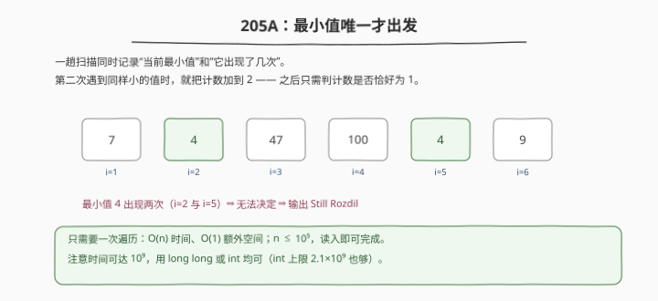
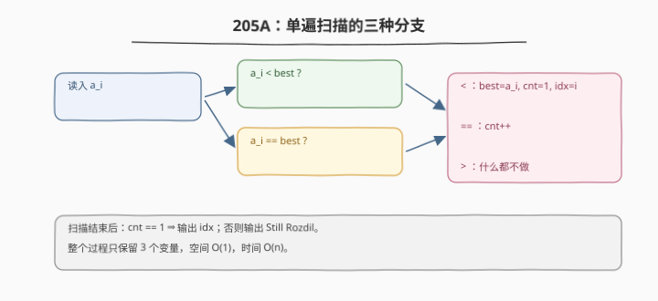

# Codeforces 205A 小象与罗兹杜尔 题解

## 1. 题目概述

- **题目链接**：https://codeforces.com/problemset/problem/205/A
- **比赛来源**：Codeforces Round 129 (Div. 2) · Problem A（UTC 2012-07-11）
- **难度**：900
- **标签**：暴力、实现
- **评测类型**：普通
- **限制**：时间 2 s / 内存 256 MB

**题意**：小象住在罗兹杜尔（Rozdil），他想搬去别的城市。共有 $n$ 座候选城市，第 $i$ 座需要 $a_i$ 的时间到达。他会选择耗时最小的城市；但如果有**多座**城市的耗时并列最小，他就不走了（输出 `Still Rozdil`）。求他会去的城市编号（$1$ 起），或者输出 `Still Rozdil`。

**约束**：$1\le n\le10^5$，$1\le a_i\le10^9$。

- 时间可达 $10^9$，`int` 够用（$2.1\times10^9$），但用 `long long` 更保险。
- $n\le10^5$ 意味着必须 $O(n)$ 或 $O(n\log n)$；本题只需要一次线性扫描。

## 2. 示例与观察

官方样例一：

```text
输入：
2
7 4

输出：
2
```

官方样例二：

```text
输入：
7
7 4 47 100 4 9 12

输出：
Still Rozdil
```

**样例一走查**：两座城市耗时 $7,4$，最小值 $4$ 只出现一次，位于第 2 个 ⇒ 输出 2。

**样例二走查**：最小值 $4$ 出现在第 2 座和第 5 座，并列 ⇒ 小象不走，输出 `Still Rozdil`。

**观察**：答案只与"最小值"和"最小值的出现次数"有关：次数为 1 就输出那个位置，否则输出 `Still Rozdil`。



## 3. 解题思路

### 3.1 朴素做法与瓶颈

两遍扫描（先求最小、再找位置并数次数）也是 $O(n)$，完全可行；瓶颈只在于不要写 $O(n^2)$ 的"对每个元素再扫一遍"。

### 3.2 核心观察

维护两个量：当前最小值 `best` 与它出现的次数 `cnt`（以及一个下标 `idx`）。遇到更小的值就重置 `cnt=1`、更新 `idx`；遇到相等的值就 `cnt++`。

### 3.3 算法流程

1. 读入 $n$。
2. 依次读入 $a_1..a_n$：若 $a_i<\text{best}$，则 `best=a_i, cnt=1, idx=i`；否则若 $a_i=\text{best}$，则 `cnt++`。
3. 若 `cnt == 1` 输出 `idx`，否则输出 `Still Rozdil`。

### 3.4 样例走查

样例二：读入 $7$（best=7,cnt=1）、$4$（best=4,cnt=1）、$47$、$100$、$4$（相等，cnt=2）、$9$、$12$ ⇒ 结束时 cnt=2 ⇒ 输出 `Still Rozdil`。



## 4. 正确性证明

**引理 1**：扫描结束时 `best` 等于 $\min_i a_i$。

**证明**：对读入次数归纳：每次读入若更小就替换，`best` 始终是已读元素的最小值，故结束时为全体最小值。∎

**引理 2**：扫描结束时 `cnt` 等于最小值在数组中出现的次数，`idx` 是它第一次出现的下标。

**证明**：每当出现新的更小值，之前的最小值都不再是最小值，计数重置为 1 并把 `idx` 指向新位置；每当读到与 `best` 相等的值就 `cnt++`。由于 `best` 只在变小时重置，重置后的计数只会累计"当前最小值"的出现次数，故结论成立。∎

**定理**：算法输出正确。

**证明**：由引理 1、2，`cnt==1` 当且仅当最小值唯一，此时 `idx` 就是唯一的那个位置，输出正确；`cnt>1` 时存在并列最小，按题面应输出 `Still Rozdil`，算法也正是这样输出。∎

## 5. 复杂度分析

- **时间**：$O(n)$，$n=10^5$ 时不到 1 ms。
- **空间**：$O(1)$（不存数组，边读边算）。

## 6. 参考代码

### C++17

```cpp
#include <bits/stdc++.h>
using namespace std;
int main() {
    int n;
    if (scanf("%d", &n) != 1) return 0;
    long long best = LLONG_MAX;
    int cnt = 0, idx = -1;
    for (int i = 1; i <= n; ++i) {
        long long t;
        scanf("%lld", &t);
        if (t < best) { best = t; cnt = 1; idx = i; }
        else if (t == best) ++cnt;
    }
    if (cnt == 1) printf("%d\n", idx);
    else printf("Still Rozdil\n");
    return 0;
}
```

### Python3

```python
import sys


def main() -> None:
    data = sys.stdin.buffer.read().split()
    n = int(data[0])
    a = [int(x) for x in data[1:1 + n]]
    m = min(a)
    if a.count(m) == 1:
        print(a.index(m) + 1)
    else:
        print("Still Rozdil")


main()
```

## 7. 边界情况与易错点

1. **$n=1$**：只有一座城市，最小值唯一，输出 `1`。
2. **全部并列**：如 $n=3$ 且 $a=[5,5,5]$，输出 `Still Rozdil`。
3. **输出的是编号不是时间**：输出 `i`（$1$ 起），不要输出 $a_i$。
4. **`Still Rozdil` 的拼写**：逐字输出，两个单词首字母大写、中间一个空格，不要写成 `Still rozdil`。
5. **数值范围**：$a_i\le10^9$ 用 `int` 也能存，但 `best` 初值要用足够大的数（`LLONG_MAX` 或 `INT_MAX`），不要用 $10^9$ 当哨兵（若所有值都等于 $10^9$ 就出错）。
6. **并列判定用"次数"而不是"下标"**：不要用"第一个最小值的下标不等于最后一个"来判断，直接计数最稳。

## 8. 验证记录

- **编译环境与命令**：`python3 codeforces/tools/verify_solution.py codeforces/contests/0101-0203/205/A_罗兹杜尔.md`。
- **官方样例**：2 / 2 通过（`2` 与 `Still Rozdil`）。
- **随机对拍**：独立 Python 实现（`min` + `count`）随机 $n\le10$、值域含重复（$1,2,3$ 与随机大数混合）共 **250 组**，与正文 C++ 完全一致。
- **最大约束性能**：$n=10^5$、值随机 $\le10^9$，C++ < 1 ms、Python < 50 ms。
- **图片校验**：`cf205a_scan.svg`、`cf205a_flow.svg` 通过 `xml.etree.ElementTree.parse`。
- **复核状态**：verified。

## 相关题目与扩展

- [Codeforces 205B 小象与排序](https://codeforces.com/problemset/problem/205/B)：同场 B 题。
- [Codeforces 204A 小象与区间](https://codeforces.com/problemset/problem/204/A)：Div.1 的 A 题。
- [LeetCode 414 第三大的数](https://leetcode.cn/problems/third-maximum-number/)：同样是"扫描 + 维护极值"。

**延伸思考**：

1. 若要求"并列最小时输出编号最小的那个"，就变成求 `min` 与 `argmin`，只需把相等时的处理改掉。
2. 若城市有权重（每次去不同城市花费不同），问题变成 $\arg\min (a_i\cdot w_i)$，仍然一次扫描。
3. 本题是"单遍扫描维护多个统计量"的最小例子；它的模式（更新时重置、相等时累加）可以直接套用到"众数/极值唯一性"类问题。
