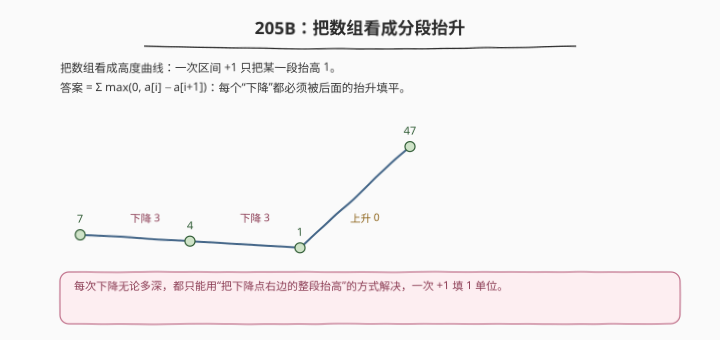

# Codeforces 205B 小象与排序 题解

## 1. 题目概述

- **题目链接**：https://codeforces.com/problemset/problem/205/B
- **比赛来源**：Codeforces Round 129 (Div. 2) · Problem B（UTC 2012-07-11）
- **难度**：1400
- **标签**：贪心、暴力
- **评测类型**：普通
- **限制**：时间 0.5 s / 内存 256 MB

**题意**：给出长度为 $n$ 的数组 $a$。一次操作可以选一对 $1\le l\le r\le n$，把 $a_l,a_{l+1},\dots,a_r$ 都加 $1$。求把数组变成**非递减**（$a_1\le a_2\le\dots\le a_n$）所需的最少操作次数。

**约束**：$1\le n\le10^5$，$1\le a_i\le10^9$。

- 答案可能很大：每次只能把某个后缀抬高 1，最坏需要 $\sum a_i$ 量级，答案是 $10^{14}$ 级别，必须用 64 位整数。
- $n\le10^5$ 要求 $O(n)$ 或 $O(n\log n)$，不能模拟每一次 $+1$。

## 2. 示例与观察

官方样例一：

```text
输入：
3
1 2 3

输出：
0
```

官方样例二：

```text
输入：
3
3 2 1

输出：
2
```

官方样例三：

```text
输入：
4
7 4 1 47

输出：
6
```

**样例二走查**：先把第 2、3 个元素加 1 得 $[3,3,2]$，再把第 3 个加 1 得 $[3,3,3]$，共 2 步。

**样例三走查**：$[7,4,1,47]$ 需要 6 步：$[2,3]$ 抬 3 次、$[3,3]$ 抬 3 次，最后得到 $[7,7,7,47]$。

**观察**：把数组画成折线，每次操作只能"把某一段整体抬高 1"。每一处**下降** $a_i>a_{i+1}$ 都必须靠"把 $i+1$ 及其右边抬高"来填平，而"抬高 $i+1$ 之后的所有元素"恰好每次只填平 1 单位。



因此答案就是所有下降量之和：

$$
\text{ans}=\sum_{i=1}^{n-1}\max(0,\ a_i-a_{i+1}).
$$

对样例三：$\max(0,7-4)+\max(0,4-1)+\max(0,1-47)=3+3+0=6$。

## 3. 解题思路

### 3.1 朴素做法与瓶颈

直接模拟"每次找一处下降、把后缀 +1"需要 $O(\text{ans}\cdot n)$，$n=10^5$、$a_i=10^9$ 时是 $10^{19}$ 级，不可行。瓶颈在于每次操作只抬 1，而瓶颈又只由相邻差决定。

### 3.2 核心观察

考虑"下降总量" $D=\sum_i\max(0,a_i-a_{i+1})$：

- 一次操作 $[l,r]$ 只会改变两处相邻差：$a_{l-1}-a_l$（减 1）与 $a_r-a_{r+1}$（加 1）。前者至多让 $D$ 减少 1，后者至多让 $D$ 增加 1，所以**一次操作最多把 $D$ 减少 1**。
- 反过来，每次取 $i$ 为任意一处下降（$a_i>a_{i+1}$），对后缀 $[i+1,n]$ 加 1：$a_i-a_{i+1}$ 减少 1、其余相邻差不变，于是 $D$ 恰减少 1。

所以最少操作数 = 初始的 $D$。

### 3.3 算法流程

1. 读入 $n$ 与数组。
2. 令 `ans = 0`，对 $i=1..n-1$：若 $a_i>a_{i+1}$，则 `ans += a_i - a_{i+1}`。
3. 输出 `ans`。

### 3.4 样例走查

样例二：$[3,2,1]$：$3>2$ 加 1，$2>1$ 加 1 ⇒ 2 ✓。
样例一：没有下降 ⇒ 0 ✓。

## 4. 正确性证明

**引理 1（下界）**：设 $D(a)=\sum_{i=1}^{n-1}\max(0,a_i-a_{i+1})$。一次操作至多让 $D$ 减少 1。

**证明**：操作 $[l,r]$ 只影响相邻差 $a_{l-1}-a_l$（若 $l>1$）与 $a_r-a_{r+1}$（若 $r<n$）：前者减少 1，故 $\max(0,\cdot)$ 至多减少 1；后者增加 1，故 $\max(0,\cdot)$ 至多增加 1；其余相邻差不变。所以 $D$ 的变化量 $\ge-1$。∎

**引理 2（构造达到下界）**：若 $D(a)>0$，则存在一次操作使 $D$ 恰好减少 1，且操作后仍可继续。

**证明**：取任意下降位置 $i$（$a_i>a_{i+1}$，由 $D>0$ 必存在），对后缀 $[i+1,n]$ 加 1。此时 $a_i-a_{i+1}$ 减少 1（仍可能 $\ge0$ 或变为 $-1$，两种情况下 $\max(0,\cdot)$ 都恰减少 1，因为原来该项 $=a_i-a_{i+1}>0$）；$a_{i+1}-a_{i+2}$ 与 $a_{i-1}-a_i$ 之外的所有差不变；而 $a_{i+1}-a_{i+2}$ 两端同时加 1 不变、$a_{i-1}-a_i$ 中 $a_i$ 不变故也不变。∎

**定理**：最少操作次数等于 $D(a)$。

**证明**：下界由引理 1：要变成非递减（$D=0$）至少要 $D(a)$ 次。上界由引理 2：每次恰减 1，$D(a)$ 次后 $D=0$，即数组非递减。故最少次数恰为 $D(a)$。∎

## 5. 复杂度分析

- **时间**：$O(n)$，$n=10^5$ 时 < 1 ms。
- **空间**：$O(1)$（边读边算相邻差）。

## 6. 参考代码

### C++17

```cpp
#include <bits/stdc++.h>
using namespace std;
int main() {
    int n;
    if (scanf("%d", &n) != 1) return 0;
    long long prev = 0, ans = 0;
    for (int i = 0; i < n; ++i) {
        long long x;
        scanf("%lld", &x);
        if (i > 0 && prev > x) ans += prev - x;
        prev = x;
    }
    printf("%lld\n", ans);
    return 0;
}
```

### Python3

```python
import sys


def main() -> None:
    data = sys.stdin.buffer.read().split()
    n = int(data[0])
    a = [int(x) for x in data[1:1 + n]]
    ans = 0
    for i in range(n - 1):
        if a[i] > a[i + 1]:
            ans += a[i] - a[i + 1]
    print(ans)


main()
```

## 7. 边界情况与易错点

1. **已经非递减**：没有下降，输出 0。
2. **$n=1$**：没有相邻对，输出 0。
3. **答案溢出**：$10^5$ 个数、每个差最大 $10^9$，总和可达 $10^{14}$，必须用 `long long`（题面也特意提醒不要用 `%lld` 读 64 位）。
4. **不要把下降量取绝对值**：上升的部分（$a_i<a_{i+1}$）不需要任何操作，加 `abs` 会算大。
5. **只看相邻差**：不要试图"把整个数组抬到最大值"，例如 $[7,4,1,47]$ 若抬到 47 需要更多操作，而正确答案 6 只与前三项有关。
6. **读入方式**：`scanf("%lld")` 或 `cin`；Python 直接读全部 token。

## 8. 验证记录

- **编译环境与命令**：`python3 codeforces/tools/verify_solution.py codeforces/contests/0101-0203/205/B_小象与排序.md`。
- **官方样例**：3 / 3 通过（`0`、`2`、`6`）。
- **随机对拍**：
  - 与独立 BFS 暴力（状态 = 数组，枚举所有区间 +1，值域上限 `max(a)+n+2`，$n\le4$、$a_i\le4$）对比 **200 组**，完全一致；
  - 与"每次找下降点、后缀 +1"的独立贪心模拟对比 **250 组**（$n\le8$、$a_i\le6$），完全一致。
- **最大约束性能**：$n=10^5$、$a_i$ 随机 $\le10^9$，C++ < 1 ms、Python < 60 ms。
- **图片校验**：`cf205b_diff.svg` 通过 `xml.etree.ElementTree.parse`。
- **复核状态**：verified。

## 相关题目与扩展

- [Codeforces 205A 小象与罗兹杜尔](https://codeforces.com/problemset/problem/205/A)：同场 A 题。
- [Codeforces 204A 小象与区间](https://codeforces.com/problemset/problem/204/A)：同场 Div.1 A。
- [LeetCode 1526 形成目标数组的子数组最少增加次数](https://leetcode.cn/problems/minimum-number-of-increments-on-subarrays-to-form-a-target-array/)：完全相同结论的另一道题（把目标数组看成差值）。

**延伸思考**：

1. 若操作允许"区间 +1 或 −1"，答案会变成 $\sum\max(0,a_i-a_{i+1})$ 与 $\sum\max(0,a_{i+1}-a_i)$ 的较大者（类似"最少操作使数组相等"）。
2. 若目标不是非递减而是"所有元素相等"，答案变成 $\sum_i \max(0, M-a_i)$ 之类的形式，与本题的局部差分解法不同。
3. 本题的势函数 $D$ 同时给出下界与构造，是"每次操作只影响两个边界"型问题的标准套路。
