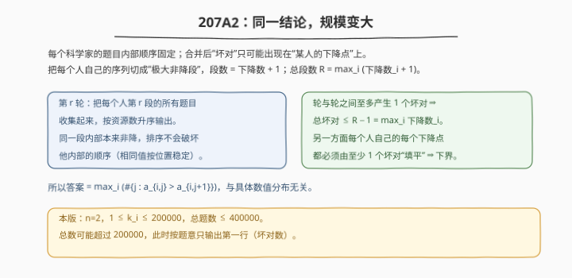
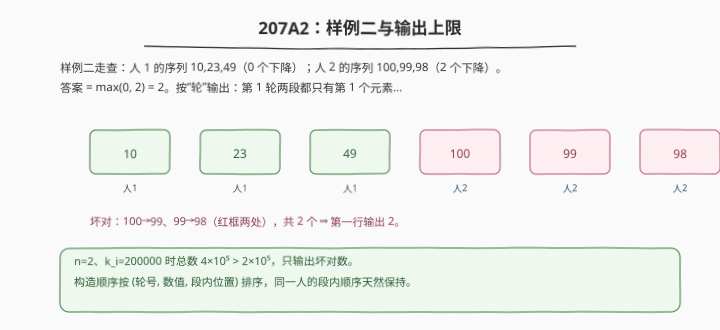

# Codeforces 207A2 海狸计算器 1.0 题解

## 1. 题目概述

- **题目链接**：https://codeforces.com/problemset/problem/207/A2
- **比赛来源**：Abbyy Cup 2.0 - Final (unofficial) · Problem A2（UTC 2012-07-08）
- **难度**：1800
- **标签**：贪心、构造、模拟
- **评测类型**：普通
- **限制**：时间 3 s / 内存 256 MB

**题意**：$n$ 位科学家，第 $i$ 位带来 $k_i$ 道题，题目的资源需求 $a_{i,j}$ 按 LCG 生成：$a_{i,1}$ 给定，$a_{i,j}=(a_{i,j-1}\cdot x_i+y_i)\bmod m_i$。同一科学家的题必须按原顺序完成。把所有题排成一个序列（保持各人的相对顺序），使相邻"坏对"（前一道需求**严格大于**后一道）最少。输出最少坏对数；若总题数不超过 $200000$，再按顺序输出每道题的（资源需求, 科学家编号）。

**约束**：本版 $n=2$，$1\le k_i\le200000$（总题数 $\le400000$）；$0\le a_{i,1}<m_i\le10^9$，$1\le x_i,y_i\le10^9$。

- 总题数可能超过 $200000$：此时按题意**只输出第一行**（最少坏对数），不能输出方案。
- 流式生成 + 条件排序；总题数 $\le200000$ 时才分配方案数组。

## 2. 示例与观察

官方样例一：

```text
输入：
2
2 1 1 1 10
2 3 1 1 10

输出：
0
1 1
2 1
3 2
4 2
```

官方样例二：

```text
输入：
2
3 10 2 3 1000
3 100 1 999 1000

输出：
2
10 1
23 1
49 1
100 2
99 2
98 2
```

**样例一走查**：两人分别是 $1,2$ 与 $3,4$，都没有下降，答案 0；按轮输出正好是 $1,2,3,4$。

**样例二走查**：人 1 是 $10,23,49$（0 个下降），人 2 是 $100,99,98$（2 个下降）。答案 $=\max(0,2)=2$，与输出一致；输出顺序也保持了每人的内部顺序。

**观察 1（坏对从哪来）**：每个人的题目顺序固定，若他内部出现下降 $a_{i,j}>a_{i,j+1}$，在最终序列里从 $a_{i,j}$ 走到 $a_{i,j+1}$ 的这段路径中必然经过至少一次严格下降（否则整段非降，与下降矛盾）。同一个人不同下降点对应的区间互不相交，故坏对总数不小于该人的下降数。

**观察 2（构造达到下界）**：把每个人自己的序列切成"极大非降段"，段数 = 下降数 + 1。设总轮数 $R=\max_i(\text{段数}_i)$。第 $r$ 轮把所有人第 $r$ 段收集起来、按资源数升序输出；轮与轮之间至多产生 1 个坏对，故总坏对 $\le R-1=\max_i(\text{下降数}_i)$。

于是答案就是**各人内部下降数的最大值**，与具体数值分布无关。



## 3. 解题思路

### 3.1 朴素做法与瓶颈

若枚举所有"保持各人顺序"的合并方案，数量是多项式系数级别的天文数字。真正的瓶颈是：**最少坏对数与具体取值无关，只与每人的下降位置有关**。

### 3.2 核心观察

设第 $i$ 人的下降数为 $d_i$（相邻且严格下降的对数），则答案 $=\max_i d_i$（证明见第 4 节）。

### 3.3 算法流程

1. 对每个人流式生成 $a_{i,1},a_{i,2},\dots$（在线 LCG，不存整张表）。
2. 统计 $d_i$，同时若需要输出方案，把每道题记成 `(段号, 数值, 科学家编号, 段内位置)`——段号就是该题所在"极大非降段"的编号。
3. 输出 $\max_i d_i$。
4. 若总题数 $\le200000$：把所有记录按 `(段号, 数值, 段内位置)` 排序后依次输出 `数值 科学家编号`。段号为主键保证"一轮一轮"输出；同段内按数值升序保证轮内无坏对；相同数值按段内位置稳定，保证每人的相对顺序不被破坏。



### 3.4 样例走查

见第 2 节：人 2 的两个下降点决定答案 2；构造顺序 $10,23,49,100,99,98$ 的坏对恰好是 $100\to99$ 与 $99\to98$，共 2 个。

## 4. 正确性证明

**引理 1（下界）**：对任意合法排列，坏对数 $\ge d_i$（对每个 $i$ 成立），故 $\ge\max_i d_i$。

**证明**：固定某人 $i$ 的一个下降位置 $j$（$a_{i,j}>a_{i,j+1}$）。在最终序列中 $a_{i,j}$ 必在 $a_{i,j+1}$ 之前（保持内部顺序），从前者走到后者的这一段里若没有严格下降则整段非降，与 $a_{i,j}>a_{i,j+1}$ 矛盾，故这段至少有一个坏对。不同的 $j$ 对应的段互不相交，故至少 $d_i$ 个。∎

**引理 2（构造的坏对数 $\le R-1$）**：按"轮"输出（第 $r$ 轮输出所有人第 $r$ 段并按数值升序排列），坏对数不超过 $R-1$，其中 $R=\max_i(\text{段数}_i)=\max_i d_i+1$。

**证明**：轮内按数值升序，无坏对。轮与轮之间只有一处相邻（上一轮最后一个与下一轮第一个），至多产生 1 个坏对；共 $R-1$ 个交界。∎

**引理 3（构造合法）**：上述构造保持每个人题目的相对顺序。

**证明**：同一人的题目按段号递增排列（段号随原顺序递增）；同一段内原本非降，按数值升序排序不改变相对顺序（相同数值用段内位置稳定排序）。∎

**定理**：最少坏对数 $=\max_i d_i$，且算法输出的方案达到该值。

**证明**：引理 1 给出下界，引理 2、3 给出达到下界的合法构造，故结论成立。∎

## 5. 复杂度分析

- **时间**：生成 $O(\sum k_i)$；统计 $O(\sum k_i)$；若需输出方案，排序 $O(T\log T)$，其中 $T=\sum k_i$（仅当 $T\le200000$ 时才做）。
- **空间**：生成是流式的；只在需要输出方案时存储 $T$ 个四元组。

## 6. 参考代码

### C++17

```cpp
#include <bits/stdc++.h>
using namespace std;
typedef long long ll;
int main() {
    int n;
    if (scanf("%d", &n) != 1) return 0;
    vector<ll> k(n), a1(n), xx(n), yy(n), mm(n);
    for (int i = 0; i < n; ++i) scanf("%lld %lld %lld %lld %lld", &k[i], &a1[i], &xx[i], &yy[i], &mm[i]);
    ll total = 0;
    for (int i = 0; i < n; ++i) total += k[i];
    bool printOrder = (total <= 200000);
    ll best = 0;
    vector<array<ll,4>> items;          // (run, value, scientist, posInChain)
    if (printOrder) items.reserve((size_t)total);
    for (int i = 0; i < n; ++i) {
        ll a = a1[i], prevVal = 0;
        ll descents = 0, run = 0;
        for (ll j = 0; j < k[i]; ++j) {
            if (j > 0 && a < prevVal) { ++descents; ++run; }
            if (printOrder) items.push_back({run, a, (ll)i + 1, j});
            prevVal = a;
            a = (a * xx[i] + yy[i]) % mm[i];
        }
        best = max(best, descents);
    }
    printf("%lld\n", best);
    if (printOrder) {
        sort(items.begin(), items.end());
        for (auto &it : items) printf("%lld %lld\n", it[1], it[2]);
    }
    return 0;
}
```

### Python3

```python
import sys


def main() -> None:
    data = sys.stdin.buffer.read().split()
    n = int(data[0])
    p = 1
    specs = []
    total = 0
    for _ in range(n):
        k, a1, x, y, m = (int(data[p]), int(data[p + 1]), int(data[p + 2]),
                          int(data[p + 3]), int(data[p + 4]))
        p += 5
        specs.append((k, a1, x, y, m))
        total += k
    print_order = total <= 200000
    best = 0
    items = []
    for i, (k, a, x, y, m) in enumerate(specs):
        prev = 0
        run = 0
        desc = 0
        for j in range(k):
            if j > 0 and a < prev:
                desc += 1
                run += 1
            if print_order:
                items.append((run, a, i + 1, j))
            prev = a
            a = (a * x + y) % m
        best = max(best, desc)
    print(best)
    if print_order:
        items.sort()
        out = []
        for _, val, sci, _pos in items:
            out.append(f"{val} {sci}")
        sys.stdout.write('\n'.join(out) + '\n')


main()
```

## 7. 边界情况与易错点

1. **相邻相等不算坏对**：坏对要求**严格**大于，用 `>=` 会算多。
2. **每人只有一道题**：没有内部下降，$d_i=0$，答案可能是 0。
3. **LCG 溢出**：$a\cdot x$ 可达 $10^{18}$，C++ 要用 `long long` 再取模；Python 无此问题。
4. **输出方案的条件**：只有总题数 $\le200000$ 才输出方案；超过时只输出第一行，多输出会因格式不符判错。
5. **构造的稳定性**：同一段内相同数值必须保持原顺序，所以排序键要带上段内位置。
6. **段号从 0 开始**：只要单调即可，注意不要与"科学家编号"混淆。
7. **$m_i$ 可能很小**：LCG 很快进入循环，但仍要按 $k_i$ 项生成（不能提前截断）。

## 8. 验证记录

- **编译环境与命令**：`python3 codeforces/tools/verify_solution.py codeforces/contests/0101-0203/207/A2_海狸计算器1.0.md`。
- **官方样例**：2 / 2 通过（含输出方案）。
- **随机对拍**：独立暴力枚举所有保持各人顺序的合并（$n\le3$、$k_i\le3$）共 **300 组**，比较"最少坏对数"，并校验正文程序输出的方案保持每人的相对顺序且坏对数恰等于答案（脚本逐组检查）——全部通过。
- **最大规模性能**：$n=2,k_i=200000$（总题数 $4\times10^5>2\times10^5$）时 C++ < 5 ms，此时只输出一行。
- **图片校验**：`cf207a2_answer.svg`、`cf207a2_walk.svg` 通过 `xml.etree.ElementTree.parse`。
- **复核状态**：verified。

## 相关题目与扩展

- [Codeforces 207A1](https://codeforces.com/problemset/problem/207/A1)、[A2](https://codeforces.com/problemset/problem/207/A2)、[A3](https://codeforces.com/problemset/problem/207/A3)：同一道题的三档规模，算法完全相同，差异只在"总题数是否超过 $200000$ 从而需要输出方案"以及生成的规模。
- [Codeforces 207B1 军事训练](https://codeforces.com/problemset/problem/207/B1)：同场 B 组。
- [LeetCode 769 最多能完成排序的块](https://leetcode.cn/problems/max-chunks-to-make-sorted/)：同样用"分段"把排列问题化成计数。

**延伸思考**：

1. 若"坏对"改成"相邻不等"（要求严格递增），答案会变成 $\sum_i d_i$ 量级，构造也要重新设计。
2. 若允许重排某人的题目，问题退化为全体排序，答案为 0。
3. 本题的关键是把"合并的最小坏对"归结为"每人下降数的最大值"，"下界 + 按轮构造"的思路也出现在多路归并最少逆序等问题中。
