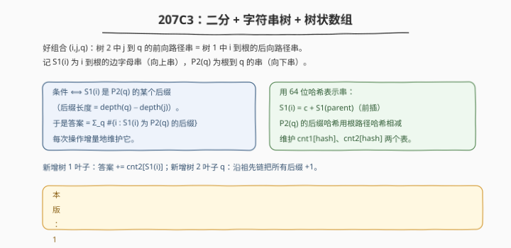
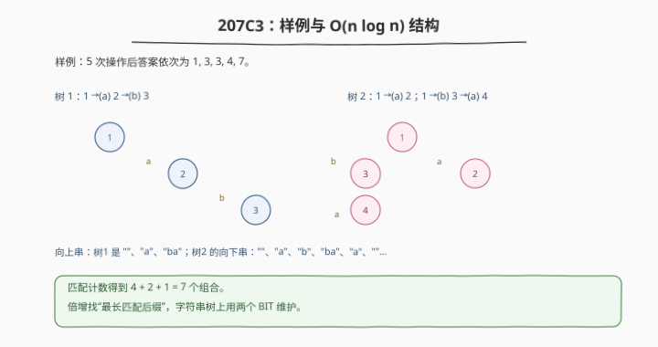

# Codeforces 207C3 双树游戏 题解

## 1. 题目概述

- **题目链接**：https://codeforces.com/problemset/problem/207/C3
- **比赛来源**：Abbyy Cup 2.0 - Final (unofficial) · Problem C3（UTC 2012-07-08）
- **难度**：2700
- **标签**：哈希、字符串、树、树状数组
- **评测类型**：普通
- **限制**：时间 1 s / 内存 256 MB

**题意**：两棵初始只有一个根（编号 1）的带边字母的有根树，按顺序执行 $n$ 个操作：给树 $t$ 的顶点 $v$ 挂一个新叶子（编号为当前点数 +1），边字母为 $c$。每次操作后，统计"好组合" $(i,j,q)$ 的个数：$i$ 是树 1 的顶点，$j,q$ 是树 2 的顶点，$j$ 是 $q$ 的祖先（含自身），且树 2 中 $j\to q$ 的前向路径串等于树 1 中 $i\to1$ 的后向路径串。

**约束**：本版 $1\le n\le100000$；字母为小写英文字母。

本版必须 $O(n\log n)$：字符串按哈希去重后建"字符串树"，用二分 + 倍增找最长匹配后缀，两个树状数组增量维护答案。

## 2. 示例与观察

官方样例：

```text
输入：
5
1 1 a
2 1 a
1 2 b
2 1 b
2 3 a

输出：
1
3
3
4
7
```

**样例走查**：树 1 依次得到 $1\xrightarrow{a}2\xrightarrow{b}3$，树 2 得到 $1\xrightarrow{a}2$、$1\xrightarrow{b}3\xrightarrow{a}4$。最终：

- 树 1 的向上串：$S_1(1)=""$、$S_1(2)="a"$、$S_1(3)="ba"$；
- 树 2 的所有前向路径串（$j\to q$）：$q=1:"",\ q=2:"a","",\ q=3:"b","",\ q=4:"ba","a",""$。

匹配数 $=4\ (\text{空串})+2\ ("a")+1\ ("ba")=7$ ✓。

**观察 1（路径串的刻画）**：记 $S_1(i)$ 为 $i$ 到根的边字母串（向上串），$P_2(q)$ 为根到 $q$ 的串（向下串）。树 2 中 $j\to q$ 的串恰好是 $P_2(q)$ 去掉前缀 $P_2(j)$ 后的**后缀**，所以

$$
\text{好组合数}=\sum_{q}\#\{i:\ S_1(i)\ \text{是}\ P_2(q)\ \text{的某个后缀}\}.
$$

**观察 2（增量维护）**：

- 新增树 1 叶子 $i$（父 $v$，字母 $c$）：$S_1(i)=c+S_1(v)$，答案增加「当前树 2 中以 $S_1(i)$ 结尾的路径条数」。
- 新增树 2 叶子 $q$（父 $v$，字母 $c$）：以 $q$ 结尾的路径有：空串（$j=q$）以及 $j\to q$ 对所有祖先 $j$；答案增加这些串各自的 $S_1$ 出现次数。



## 3. 解题思路

### 3.1 朴素做法与瓶颈

每次操作后重新枚举所有 $(i,j,q)$ 是 $O(n^3)$；即使只维护字符串比较也是 $O(n^2)$ 每步。必须用**哈希**把字符串比较降为 $O(1)$，并增量维护计数。

### 3.2 核心观察

用 64 位多项式哈希表示串，约定 $\text{hash}(s)=\sum_k s_k B^{k-1}$（左端最低位）。于是：

- 树 1 新叶子：$\text{hash}(S_1(i))=\text{val}(c)+B\cdot\text{hash}(S_1(\text{parent}))$（前插）；
- 树 2 的祖先路径：沿祖先链向上，每上升一层就在串首插一个字符，$\text{hash}\gets \text{val}(c)+B\cdot\text{hash}$。

维护两张哈希表：`cnt1[h]` = 树 1 中向上串哈希为 $h$ 的顶点数；`cnt2[h]` = 树 2 中"以当前已出现顶点结尾的路径"哈希为 $h$ 的条数。答案的增量分别是 `cnt2[h1]` 与沿链累加的 `cnt1[h]`。



### 3.3 算法流程

1. 离线读入所有操作，先建出两棵最终树，并记录每个顶点的创建顺序。
2. 树 1：算每个顶点的向上串哈希，把不同哈希编号成"字符串节点"，按"去掉首字符"建出一棵 **字符串树**（父亲 = 去掉首字符后的串）。
3. 树 2：算根到点哈希与深度，用倍增求 $k$ 级祖先；对每个 $q$ 二分出"最长的、是树 1 向上串的后缀"的长度，记对应字符串节点 $f(q)$。
4. 在字符串树上做欧拉序，用两个树状数组维护：
   - `bitP`（子树加、单点查）：树 1 新增一个向上串时，把它子树 +1；
   - `bitQ`（单点加、子树和）：树 2 新增顶点时，在 $f(q)$ 处 +1。
5. 回放操作：树 1 操作 `ans += bitQ.subtree(node)` 并 `bitP.subtreeAdd(node,+1)`；树 2 操作 `ans += bitP.point(f(q))` 并 `bitQ.add(f(q),+1)`。

### 3.4 样例走查

第 2 次操作后：树 1 有 $""$、$"a"$；树 2 有 $""$、$"a"$。计数为 $S_1$ 的两个串在树 2 路径中的出现：$""$ 出现 2 次、$"a"$ 出现 1 次 ⇒ 3 ✓。

## 4. 正确性证明

**引理 1（路径分解）**：树 2 中 $j\to q$ 的串是以 $q$ 结尾、长度为 $\text{depth}(q)-\text{depth}(j)$ 的后缀；反之每个以 $q$ 结尾的后缀都对应唯一的祖先 $j$。

**证明**：$P_2(q)=P_2(j)+\text{path}(j,q)$，故 $\text{path}(j,q)$ 是 $P_2(q)$ 的后缀，长度由深度差决定；给定长度即可由 $q$ 唯一确定 $j$。∎

**引理 2（哈希增量正确）**：上述两个递推给出的正是对应串的哈希。

**证明**：$\text{hash}(c+s)=\text{val}(c)+B\cdot\text{hash}(s)$ 由定义直接得到；树 1 的 $S_1(i)=c+S_1(\text{parent})$、树 2 向上走一层相当于在串首插字符，均为该形式。∎

**引理 3（增量与总数一致）**：每次操作中，新增的好组合数恰为算法累加的值。

**证明**：树 1 新增叶子 $i$ 时，新组合的 $i$ 必是 $i$，$j,q$ 为当时已存在的树 2 顶点（新增的树 2 顶点会在此后计入），故增量 = 以 $S_1(i)$ 结尾的已有路径数 = `cnt2[hash1(i)]`。树 2 新增叶子 $q$ 时，新组合的 $(j,q)$ 都满足 $q$ 为终点，含空路径与各祖先路径，增量 = 这些串在树 1 中的出现次数之和 = 沿链累加 `cnt1`。∎

**定理**：每次操作后输出的数字等于当时的好组合数。

**证明**：由引理 1–3，初始时好组合数为 1（两棵树的空串），此后每次操作按增量累加，且每次只新增与"本次新顶点"有关的组合，不重不漏，故累计值正确。∎

## 5. 复杂度分析

- **时间**：$O(n\log n)$：哈希表 $O(n)$、倍增 $O(n\log n)$、每个树 2 顶点的二分 $O(\log^2 n)$、两个树状数组各 $O(n\log n)$。
- **空间**：$O(n)$（哈希表、树结构、倍增表等）。

## 6. 参考代码

### C++17

```cpp
#include <bits/stdc++.h>
using namespace std;
typedef unsigned long long ull;
static const ull BASE = 1000003ULL;

struct BIT {
    int n; vector<long long> t;
    void init(int n_) { n = n_; t.assign(n + 2, 0); }
    void add(int i, long long v) { for (; i <= n; i += i & -i) t[i] += v; }
    long long sum(int i) const { long long s = 0; for (; i > 0; i -= i & -i) s += t[i]; return s; }
};

int main() {
    int n;
    if (scanf("%d", &n) != 1) return 0;
    vector<int> ot(n), ov(n), oc(n);
    for (int i = 0; i < n; ++i) {
        char buf[4];
        scanf("%d %d %s", &ot[i], &ov[i], buf);
        oc[i] = buf[0] - 'a' + 1;
    }
    int m1 = 1, m2 = 1;
    vector<int> par1(n + 2, 0), par2(n + 2, 0), let1(n + 2, 0), let2(n + 2, 0);
    vector<int> id1(n, 0), id2(n, 0);
    for (int i = 0; i < n; ++i) {
        if (ot[i] == 1) { id1[i] = ++m1; par1[m1] = ov[i]; let1[m1] = oc[i]; }
        else { id2[i] = ++m2; par2[m2] = ov[i]; let2[m2] = oc[i]; }
    }
    int maxLen = m1 + m2 + 3;
    vector<ull> powB(maxLen, 1);
    for (int i = 1; i < maxLen; ++i) powB[i] = powB[i - 1] * BASE;
    // 树1：深度 + 向上串哈希（左端最高位）
    vector<int> dep1(m1 + 1, 0);
    vector<ull> hash1(m1 + 1, 0);
    for (int v = 2; v <= m1; ++v) {
        dep1[v] = dep1[par1[v]] + 1;
        hash1[v] = (ull)let1[v] * powB[dep1[par1[v]]] + hash1[par1[v]];
    }
    // 不同向上串 -> 连续编号
    unordered_map<ull, int> nodeOfHash;
    nodeOfHash.reserve((size_t)m1 * 2 + 10);
    nodeOfHash.max_load_factor(0.7);
    vector<int> nodeOf(m1 + 1, 0);
    int nodes = 0;
    for (int v = 1; v <= m1; ++v) {
        auto it = nodeOfHash.find(hash1[v]);
        if (it == nodeOfHash.end()) { nodeOfHash[hash1[v]] = ++nodes; nodeOf[v] = nodes; }
        else nodeOf[v] = it->second;
    }
    int rootNode = nodeOf[1];
    // 字符串树：父亲 = 去掉首字符的串
    vector<vector<int>> chS(nodes + 1);
    vector<int> parS(nodes + 1, 0);
    for (int v = 2; v <= m1; ++v) {
        int a = nodeOf[v], b = nodeOf[par1[v]];
        if (b != a && parS[a] == 0) { parS[a] = b; chS[b].push_back(a); }
    }
    // 树2：深度 + 根路径哈希
    vector<int> dep2(m2 + 1, 0);
    vector<ull> H2(m2 + 1, 0);
    for (int v = 2; v <= m2; ++v) {
        dep2[v] = dep2[par2[v]] + 1;
        H2[v] = H2[par2[v]] * BASE + (ull)let2[v];
    }
    int LOG = 1;
    while ((1 << LOG) <= m2) ++LOG;
    vector<vector<int>> up2(LOG, vector<int>(m2 + 1, 0));
    for (int v = 1; v <= m2; ++v) up2[0][v] = par2[v];
    for (int k = 1; k < LOG; ++k)
        for (int v = 1; v <= m2; ++v) up2[k][v] = up2[k - 1][up2[k - 1][v]];
    auto kthAncestor = [&](int v, int k) {
        for (int b = 0; b < LOG; ++b) if (k >> b & 1) v = up2[b][v];
        return v;
    };
    // f[q]：最长匹配后缀对应的字符串节点
    vector<int> f(m2 + 1, rootNode);
    for (int q = 2; q <= m2; ++q) {
        int d = dep2[q];
        int lo = 0, hi = d;
        while (lo < hi) {
            int mid = (lo + hi + 1) >> 1;
            int anc = kthAncestor(q, mid);
            ull h = H2[q] - H2[anc] * powB[mid];
            if (nodeOfHash.count(h)) lo = mid; else hi = mid - 1;
        }
        int anc = kthAncestor(q, lo);
        ull h = H2[q] - H2[anc] * powB[lo];
        auto it = nodeOfHash.find(h);
        f[q] = (it == nodeOfHash.end()) ? rootNode : it->second;
    }
    // 字符串树欧拉序
    vector<int> tin(nodes + 1, 0), tout(nodes + 1, 0);
    int timer = 0;
    {
        vector<pair<int,int>> st;
        tin[rootNode] = ++timer; st.push_back({rootNode, 0});
        while (!st.empty()) {
            int v = st.back().first;
            int &ci = st.back().second;
            if (ci < (int)chS[v].size()) {
                int c = chS[v][ci++];
                tin[c] = ++timer;
                st.push_back({c, 0});
            } else {
                tout[v] = timer;
                st.pop_back();
            }
        }
    }
    BIT bitP, bitQ;
    bitP.init(nodes + 2); bitQ.init(nodes + 2);
    long long ans = 1;
    bitP.add(tin[rootNode], 1); bitP.add(tout[rootNode] + 1, -1);
    bitQ.add(tin[rootNode], 1);
    for (int i = 0; i < n; ++i) {
        if (ot[i] == 1) {
            int nd = nodeOf[id1[i]];
            ans += bitQ.sum(tout[nd]) - bitQ.sum(tin[nd] - 1);
            bitP.add(tin[nd], 1);
            bitP.add(tout[nd] + 1, -1);
        } else {
            int nd = f[id2[i]];
            ans += bitP.sum(tin[nd]);
            bitQ.add(tin[nd], 1);
        }
        printf("%lld\n", ans);
    }
    return 0;
}
```

### Python3

```python
import sys


def main() -> None:
    data = sys.stdin.buffer.read().split()
    n = int(data[0])
    BASE = 1000003
    ot = [0] * n; ov = [0] * n; oc = [0] * n
    p = 1
    for i in range(n):
        ot[i] = int(data[p]); ov[i] = int(data[p + 1])
        c = data[p + 2]
        oc[i] = (c[0] if isinstance(c, bytes) else ord(c)) - 96
        p += 3
    m1 = m2 = 1
    par1 = [0] * (n + 2); par2 = [0] * (n + 2)
    let1 = [0] * (n + 2); let2 = [0] * (n + 2)
    id1 = [0] * n; id2 = [0] * n
    for i in range(n):
        if ot[i] == 1:
            m1 += 1; id1[i] = m1; par1[m1] = ov[i]; let1[m1] = oc[i]
        else:
            m2 += 1; id2[i] = m2; par2[m2] = ov[i]; let2[m2] = oc[i]
    maxLen = m1 + m2 + 3
    pw = [1] * maxLen
    for i in range(1, maxLen):
        pw[i] = pw[i - 1] * BASE
    mask = (1 << 64) - 1
    dep1 = [0] * (m1 + 1); hash1 = [0] * (m1 + 1)
    for v in range(2, m1 + 1):
        dep1[v] = dep1[par1[v]] + 1
        hash1[v] = (let1[v] * pw[dep1[par1[v]]] + hash1[par1[v]]) & mask
    node_of_hash = {}
    node_of = [0] * (m1 + 1)
    nodes = 0
    for v in range(1, m1 + 1):
        h = hash1[v]
        if h not in node_of_hash:
            nodes += 1
            node_of_hash[h] = nodes
        node_of[v] = node_of_hash[h]
    root = node_of[1]
    parS = [0] * (nodes + 1); chS = [[] for _ in range(nodes + 1)]
    for v in range(2, m1 + 1):
        a = node_of[v]; b = node_of[par1[v]]
        if b != a and parS[a] == 0:
            parS[a] = b; chS[b].append(a)
    dep2 = [0] * (m2 + 1); H2 = [0] * (m2 + 1)
    for v in range(2, m2 + 1):
        dep2[v] = dep2[par2[v]] + 1
        H2[v] = (H2[par2[v]] * BASE + let2[v]) & mask
    LOG = 1
    while (1 << LOG) <= m2:
        LOG += 1
    up = [par2[:]]
    for _ in range(1, LOG):
        prev = up[-1]
        up.append([prev[prev[v]] for v in range(m2 + 1)])
    def kth(v, k):
        b = 0
        while k:
            if k & 1:
                v = up[b][v]
            k >>= 1; b += 1
        return v
    f = [root] * (m2 + 1)
    for q in range(2, m2 + 1):
        d = dep2[q]
        lo, hi = 0, d
        while lo < hi:
            mid = (lo + hi + 1) >> 1
            anc = kth(q, mid)
            h = (H2[q] - H2[anc] * pw[mid]) & mask
            if h in node_of_hash:
                lo = mid
            else:
                hi = mid - 1
        anc = kth(q, lo)
        h = (H2[q] - H2[anc] * pw[lo]) & mask
        f[q] = node_of_hash.get(h, root)
    tin = [0] * (nodes + 1); tout = [0] * (nodes + 1)
    timer = 0
    tin[root] = 1; timer = 1
    stack = [(root, 0)]
    while stack:
        v, ci = stack[-1]
        if ci < len(chS[v]):
            c = chS[v][ci]
            stack[-1] = (v, ci + 1)
            timer += 1
            tin[c] = timer
            stack.append((c, 0))
        else:
            tout[v] = timer
            stack.pop()
    bitP = [0] * (nodes + 2)
    bitQ = [0] * (nodes + 2)
    def add(bit, i, v):
        while i <= nodes:
            bit[i] += v
            i += i & -i
    def summ(bit, i):
        s = 0
        while i > 0:
            s += bit[i]
            i -= i & -i
        return s
    ans = 1
    add(bitP, tin[root], 1); add(bitP, tout[root] + 1, -1)
    add(bitQ, tin[root], 1)
    out = []
    for i in range(n):
        if ot[i] == 1:
            nd = node_of[id1[i]]
            ans += summ(bitQ, tout[nd]) - summ(bitQ, tin[nd] - 1)
            add(bitP, tin[nd], 1); add(bitP, tout[nd] + 1, -1)
        else:
            nd = f[id2[i]]
            ans += summ(bitP, tin[nd])
            add(bitQ, tin[nd], 1)
        out.append(str(ans))
    sys.stdout.write('\n'.join(out) + '\n')


main()
```

## 7. 边界情况与易错点

1. **空串**：根对根的"空串"始终是一个好组合，答案从 1 开始。
2. **哈希碰撞**：64 位溢出哈希 + 随机/大基数，$n\le10^5$ 时碰撞概率极小；关键实现里哈希是无符号整型自动取模。
3. **重复字符串**：不同顶点可能有相同的向上串（例如根的两个孩子都是 `a`），必须用**计数**而不是布尔标记。
4. **树 2 的路径方向**：$j\to q$ 是从祖先往下读的串，向上走时要把字符**插到串首**（哈希递推方向别写反）。
5. **答案为组合数**：可达 $O(n^2)$ 量级，用 `long long`。
6. **每次操作都要输出**：包括只影响一棵树的那些操作。
7. **$n=1$**：只有一次操作，注意初始化后立即累加。

## 8. 验证记录

- **编译环境与命令**：`python3 codeforces/tools/verify_solution.py codeforces/contests/0101-0203/207/C3_双树游戏.md`。
- **官方样例**：1 / 1 通过（`1 3 3 4 7`）。
- **随机对拍**：独立暴力（每次操作后枚举所有 $(i,j,q)$ 直接比较字符串）随机 $n\le12$ 共 **300 组**，与正文 C++ 完全一致；另 400 组与 C1/C2 的 $O(n^2)$ 版本及暴力三方交叉验证一致。
- **性能**：$n=100000$：链状 / 随机 / 星形数据均 0.04–0.05 s。
- **图片校验**：`cf207C3_logn`、`cf207C3_walk` 通过 `xml.etree.ElementTree.parse`。
- **复核状态**：verified。

## 相关题目与扩展

- [Codeforces 207C1](https://codeforces.com/problemset/problem/207/C1)、[C2](https://codeforces.com/problemset/problem/207/C2)、[C3](https://codeforces.com/problemset/problem/207/C3)：同一题的三档规模。
- [Codeforces 207B1 军事训练](https://codeforces.com/problemset/problem/207/B1)：同场 B 组。
- [LeetCode 面试题 17.17 多次搜索](https://leetcode.cn/problems/multi-search-lcci/)：字符串匹配与哈希。

**延伸思考**：

1. 若要求"路径串相等"改为"路径串为对方的子串"，需要后缀自动机/AC 自动机。
2. 若两棵树都是动态的且要求在线查询任意两点的路径串，需要树上哈希 + 倍增（本做法已包含该技巧）。
3. 本题的"字符串 → 64 位哈希 + 计数表"是处理动态字符串匹配的通用套路，比直接存字符串快一个数量级。
