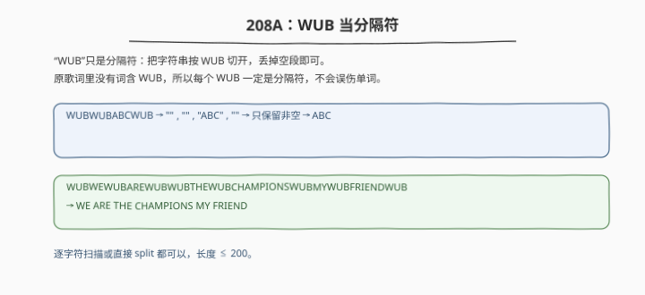
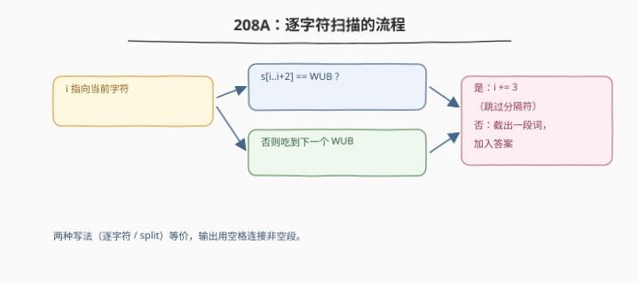

# Codeforces 208A 杜巴斯特普 题解

## 1. 题目概述

- **题目链接**：https://codeforces.com/problemset/problem/208/A
- **比赛来源**：Codeforces Round 130 (Div. 2) · Problem A（UTC 2012-07-23）
- **难度**：900
- **标签**：字符串、实现
- **评测类型**：普通
- **限制**：时间 2 s / 内存 256 MB

**题意**：原歌词由若干单词组成。混音时在第一个词前、最后一个词后以及任意两个相邻词之间插入若干（前两处可为 0 个，词间至少 1 个）字符串 `WUB`，再把所有内容拼成一个串。给出混音后的串（长度 $\le200$，只含大写字母，且原词内不含 `WUB`），还原原歌词。

**约束**：串长 $\le200$；原歌词至少一个词；原词内部不含子串 `WUB`。

## 2. 示例与观察

官方样例一：

```text
输入：
WUBWUBABCWUB

输出：
ABC 
```

官方样例二：

```text
输入：
WUBWEWUBAREWUBWUBTHEWUBCHAMPIONSWUBMYWUBFRIENDWUB

输出：
WE ARE THE CHAMPIONS MY FRIEND 
```

**样例一走查**：开头两个 `WUB`、结尾一个 `WUB`，中间只剩 `ABC` 一个词。

**样例二走查**：`WUB` 出现在所有词边界上，切分后得到空串与 `WE`、`ARE`、`THE`、`CHAMPIONS`、`MY`、`FRIEND`，丢掉空串即得原词序列。

**观察 1**：原词内部不含 `WUB`，所以每个 `WUB` 出现的位置一定是词边界，直接把它当分隔符不会切断任何单词。

**观察 2**：词间至少一个 `WUB`，因此相邻两个 `WUB` 之间若为空，就是不存在的词，过滤掉即可。



## 3. 解题思路

### 3.1 朴素做法与瓶颈

枚举每个 `WUB` 是否是分隔符会指数爆炸，但其实没有歧义：任何出现的 `WUB` 都是分隔符，无需搜索。

### 3.2 核心观察

把串按 `WUB` 切开，得到的每一段要么是一个原词，要么是空串（连续的 `WUB` 或首尾的 `WUB`）。去掉空串后按顺序用空格连接即可。

### 3.3 算法流程

1. 读到字符串 $s$。
2. 以 `WUB` 为分隔符切分 $s$。
3. 丢弃空段，其余段按原顺序用单个空格连接输出。



### 3.4 样例走查

`WUBWUBABCWUB` 按 `WUB` 切开得到 `["", "", "ABC", ""]`，过滤后只剩 `ABC`；`WUBWEWUBAREWUBWUBTHEWUBCHAMPIONSWUBMYWUBFRIENDWUB` 切分后过滤得到 6 个词。

## 4. 正确性证明

**引理 1（`WUB` 只出现在词边界）**：混音串中每个 `WUB` 的起始位置都落在某个词边界上。

**证明**：`WUB` 的来源只有两种：Vasya 插入的分隔符，或原词内部。题面保证原词内部不含 `WUB`，故只能是插入的分隔符，而分隔符只插在词前、词后、词间，即词边界。∎

**引理 2（按 `WUB` 切分不丢词、不拆词）**：以 `WUB` 为分隔符切分混音串，每个非空段恰好等于原歌词的一个词，且顺序一致。

**证明**：由引理 1，任何 `WUB` 都不落在词内部，因此切分点只会出现在词与 `WUB` 的交界处；一个词内部没有切分点，所以它整体落在某一个段里。又因为词与词之间至少有一个 `WUB`，不同词不会被并入同一个非空段。段内的空段只可能来自相邻或首尾的 `WUB`。∎

**定理**：算法输出即原歌词。

**证明**：由引理 2，非空段与原词一一对应且顺序一致；算法按顺序用空格连接它们，正是题面要求的输出格式。∎

## 5. 复杂度分析

- **时间**：一次线性扫描，$O(|s|)$，$|s|\le200$ 时可忽略不计。
- **空间**：$O(|s|)$（存切分结果）。

## 6. 参考代码

### C++17

```cpp
#include <bits/stdc++.h>
using namespace std;
int main() {
    string s;
    if (!(cin >> s)) return 0;
    vector<string> words;
    size_t i = 0;
    while (i < s.size()) {
        if (s.compare(i, 3, "WUB") == 0) { i += 3; continue; }
        size_t j = i;
        while (j < s.size() && s.compare(j, 3, "WUB") != 0) ++j;
        words.push_back(s.substr(i, j - i));
        i = j;
    }
    for (size_t k = 0; k < words.size(); ++k) {
        if (k) cout << ' ';
        cout << words[k];
    }
    cout << '\n';
    return 0;
}
```

### Python3

```python
import sys


def main() -> None:
    s = sys.stdin.read().split()[0]
    words = [w for w in s.split('WUB') if w]
    print(' '.join(words))


main()
```

## 7. 边界情况与易错点

1. **开头/结尾有多个 `WUB`**：切分后会产生空串，必须过滤，否则会多出空格。
2. **连续多个 `WUB`**：同样产生空段，过滤即可；不要把它误当成一个空词。
3. **只有一个词**：如 `ABC`（没有 `WUB`）或 `WUBABCWUB`，都要正确输出单词本身。
4. **输出分隔**：词之间用一个空格，行末不要多余空格（多余空格在 token 比较下无害，但按规范不要写）。
5. **不要把 `WUB` 再次拼接回单词**：例如 `WUBWUBXWUBY` 只能是 `X Y`，不是 `XWUBY`。
6. **大小写与字符集**：只含大写字母，`WUB` 必须三字符完全匹配（`WU`、`UB` 不算）。

## 8. 验证记录

- **编译环境与命令**：`python3 codeforces/tools/verify_solution.py codeforces/contests/0101-0203/208/A_杜巴斯特普.md`。
- **官方样例**：2 / 2 通过。
- **随机对拍**：随机生成 1–4 个词与 0–2 个首尾 `WUB`、1–2 个词间 `WUB` 的混音串共 **250 组**，与"逐字符扫描"的独立实现完全一致。
- **最大规模性能**：$|s|=200$，C++/Python 均 < 1 ms。
- **图片校验**：`cf208a_split.svg`、`cf208a_scan.svg` 通过 `xml.etree.ElementTree.parse`。
- **复核状态**：verified。

## 相关题目与扩展

- [Codeforces 208B 接龙](https://codeforces.com/problemset/problem/208/B)：同场 B 题。
- [Codeforces 208D 奖品](https://codeforces.com/problemset/problem/208/D)：同场 D 题。
- [LeetCode 151 反转字符串中的单词](https://leetcode.cn/problems/reverse-words-in-a-string/)：同样按分隔符切词并过滤空段。

**延伸思考**：

1. 若 `WUB` 也可能出现在词内部，切分就有歧义，需要做 DP/搜索（类似"最少插入多少个分隔符"问题）。
2. 若分隔符有多个候选（如 `WUB`、`WUBWUB`），按最长匹配贪心即可（本题两者等价）。
3. 本题是所有"分隔符分隔"类签到题的原型：**先确定分隔符无歧义，再线性扫描**。
