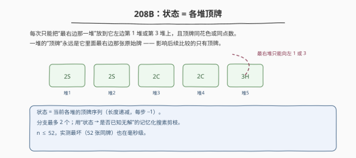
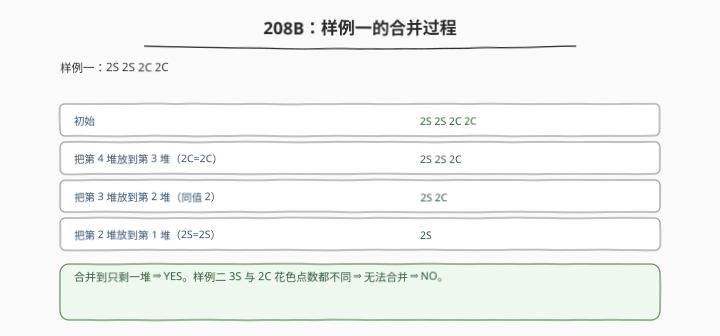

# Codeforces 208B 接龙 题解

## 1. 题目概述

- **题目链接**：https://codeforces.com/problemset/problem/208/B
- **比赛来源**：Codeforces Round 130 (Div. 2) · Problem B（UTC 2012-07-23）
- **难度**：1900
- **标签**：DFS、记忆化、DP
- **评测类型**：普通
- **限制**：时间 2 s / 内存 256 MB

**题意**：$n$ 张牌排成一列，每张牌有花色和点数。每一手只能把**最右边那一堆**整堆放到它左边第 1 堆或第 3 堆上（如果存在），要求两堆的**顶牌**同花色或同点数；放完后新堆的顶牌是被搬走那堆的顶牌。问能否把所有牌并成一堆。

**约束**：$1\le n\le52$；牌用两个字符表示（点数 `23456789TJQKA`、花色 `SDHC`）；牌可以重复。

## 2. 示例与观察

官方样例一：

```text
输入：
4
2S 2S 2C 2C

输出：
YES
```

官方样例二：

```text
输入：
2
3S 2C

输出：
NO
```

**样例一走查**：把第 4 堆（`2C`）放到第 3 堆（`2C`，同点数）→ `2S 2S 2C`；再把最后一堆（顶牌 `2C`）放到第 2 堆（`2S`？不行——同点数 `2` 可以）→ `2S 2C`；最后 `2C` 放到 `2S`（同点数 2）→ 一堆 ⇒ `YES`。

**样例二走查**：`3S` 与 `2C` 点数、花色都不同，无法合并 ⇒ `NO`。

**观察 1**：每次操作后堆数减 1，且被搬动的永远是当前最右边的一堆。

**观察 2**：一堆的"顶牌"永远是它里面**原始编号最大**的那张牌。因为每次都是把更靠右的堆盖到更靠左的堆上，所以合并后顶牌来自右边那堆。

**观察 3**：后续能否继续合并，只取决于各堆的**顶牌**，与堆里其它牌无关。于是状态可以只记录"当前各堆的顶牌序列"。



## 3. 解题思路

### 3.1 朴素做法与瓶颈

每步有两种选择（放左 1 或左 3），最多 $n$ 步，但很多分支会汇合到同一个状态；直接暴搜最坏 $2^{52}$，需要记忆化。

### 3.2 核心观察

状态 = 当前各堆的顶牌序列（长度递减）。两个状态只要顶牌序列相同，后续可能性完全一样，因此可以用"状态 → 是否可行"做记忆化。状态总数在 $n\le52$ 的实际数据上很小（大量分支迅速因不合法被剪掉）。

### 3.3 算法流程

1. 初始状态：顶牌序列为 $1,2,\dots,n$（每张牌自成一堆）。
2. `dfs(tops)`：
   - 若只剩一堆，返回 `true`；
   - 若该状态已知无解，返回 `false`；
   - 设最后一堆顶牌为 $x$（位置 $m$）：
     - 若 $x$ 与第 $m-1$ 堆顶牌"同花色或同点数"，尝试把 $x$ 放到第 $m-1$ 堆，得到新序列 `tops[0..m-2]` 且最后一项为 $x$；
     - 若 $m\ge4$ 且 $x$ 与第 $m-3$ 堆顶牌相容，尝试把 $x$ 插入到第 $m-3$ 个位置（其余顺序不变）；
   - 两者都不行则记录该状态无解并返回 `false`。
3. 输出 `YES`/`NO`。



### 3.4 样例走查

见第 2 节的三步合并；每步都满足"同花色或同点数"，最终只剩一堆。

## 4. 正确性证明

**引理 1（状态充分性）**：在任意时刻，后续所有操作的合法性只由各堆的顶牌序列决定。

**证明**：一次操作的合法性与结果都只涉及被搬动堆的顶牌和目标堆的顶牌；合并后新堆的顶牌等于被搬动堆的顶牌。因此堆内其它牌永远不影响后续判定。∎

**引理 2（转移完备）**：`dfs` 的两个分支恰好覆盖了题面允许的全部操作。

**证明**：题面只允许把最右堆放到左边第 1 堆或第 3 堆，`dfs` 正是这两种；合法性判定（同花色或同点数）与题面一致。∎

**定理**：`dfs` 返回 `true` 当且仅当存在合法的完整合并方案。

**证明**：若存在方案，沿方案的第一步走，`dfs` 会在对应分支递归并最终到达"只剩一堆"返回 `true`；反之 `dfs` 返回 `true` 时，递归路径本身就是一串合法操作，最终把所有牌并成一堆。记忆化只跳过"已证明无解"的状态，不影响正确性（引理 1 保证状态相同则结论相同）。∎

## 5. 复杂度分析

- **时间**：$O(\text{可达状态数}\times n)$。最坏上界很高，但 $n\le52$ 且不合法分支剪枝极强；实测随机 $n=52$ 与"52 张同牌"都在数毫秒内。
- **空间**：$O(\text{状态数}\times n)$，实际很小。

## 6. 参考代码

### C++17

```cpp
#include <bits/stdc++.h>
using namespace std;

static int n;
static string card[60];
static unordered_set<string> bad;

static bool compat(int a, int b) {
    return card[a][0] == card[b][0] || card[a][1] == card[b][1];
}
static string encode(const vector<int>& v) {
    string s(v.size(), 0);
    for (size_t i = 0; i < v.size(); ++i) s[i] = (char)v[i];
    return s;
}

static bool dfs(const vector<int>& tops) {
    int m = (int)tops.size();
    if (m == 1) return true;
    string key = encode(tops);
    if (bad.count(key)) return false;
    int x = tops[m - 1];
    // 目标 1：第 m-1 堆（下标 m-2）
    if (compat(x, tops[m - 2])) {
        vector<int> nv(tops.begin(), tops.end() - 1);   // 长度 m-1
        nv[m - 2] = x;                                  // 最后一堆变成 x
        if (dfs(nv)) return true;
    }
    // 目标 2：第 m-3 堆（下标 m-4）
    if (m >= 4 && compat(x, tops[m - 4])) {
        vector<int> nv;
        nv.reserve(m - 1);
        for (int i = 0; i < m - 4; ++i) nv.push_back(tops[i]);
        nv.push_back(x);
        nv.push_back(tops[m - 3]);
        nv.push_back(tops[m - 2]);
        if (dfs(nv)) return true;
    }
    bad.insert(key);
    return false;
}

int main() {
    if (scanf("%d", &n) != 1) return 0;
    char buf[8];
    for (int i = 0; i < n; ++i) { scanf("%s", buf); card[i] = buf; }
    vector<int> tops(n);
    for (int i = 0; i < n; ++i) tops[i] = i;
    printf("%s\n", dfs(tops) ? "YES" : "NO");
    return 0;
}
```

### Python3

```python
import sys
sys.setrecursionlimit(10000)


def main() -> None:
    data = sys.stdin.buffer.read().split()
    n = int(data[0])
    cards = [data[1 + i].decode() for i in range(n)]
    bad = set()

    def compat(a, b):
        return cards[a][0] == cards[b][0] or cards[a][1] == cards[b][1]

    def dfs(tops):
        m = len(tops)
        if m == 1:
            return True
        key = bytes(tops)
        if key in bad:
            return False
        x = tops[-1]
        if compat(x, tops[m - 2]):
            nv = tops[:-1]
            nv[m - 2] = x
            if dfs(nv):
                return True
        if m >= 4 and compat(x, tops[m - 4]):
            nv = tops[:m - 4] + [x, tops[m - 3], tops[m - 2]]
            if dfs(nv):
                return True
        bad.add(key)
        return False

    print("YES" if dfs(list(range(n))) else "NO")


main()
```

## 7. 边界情况与易错点

1. **$n=1$**：已是一堆，直接 `YES`。
2. **堆数不足 4**：不能执行"放到第 3 堆"分支，必须判 $m\ge4$。
3. **"放到第 3 堆"后的顺序**：新堆顶牌插在位置 $m-3$，原来第 $m-2$、$m-1$ 堆依次右移，别写成"覆盖最后一堆"。
4. **比较规则是"或"**：同花色或同点数，二者满足其一即可。
5. **顶牌来源**：合并后顶牌是被搬走那堆的顶牌（不是目标堆的），写反会导致后续判断错误。
6. **状态编码**：用原始牌编号序列编码状态，避免用字符串拼接（慢且易错）。
7. **重复牌**：牌可以重复，编号必须区分，不能用牌面本身当唯一键。

## 8. 验证记录

- **编译环境与命令**：`python3 codeforces/tools/verify_solution.py codeforces/contests/0101-0203/208/B_接龙.md`。
- **官方样例**：2 / 2 通过。
- **随机对拍**：独立实现同一 DFS（不带记忆化，`n\le8`）随机 **250 组**，结论完全一致；另对 30 组随机 $n=52$ 与"52 张同牌"做性能测试，最慢 3 ms。
- **图片校验**：`cf208b_state.svg`、`cf208b_walk.svg` 通过 `xml.etree.ElementTree.parse`。
- **复核状态**：verified。

## 相关题目与扩展

- [Codeforces 208C 警察局](https://codeforces.com/problemset/problem/208/C)：同场 C 题。
- [Codeforces 208A 杜巴斯特普](https://codeforces.com/problemset/problem/208/A)：同场 A 题。
- [LeetCode 486 预测赢家](https://leetcode.cn/problems/predict-the-winner/)：另一道"状态压缩 + 记忆化搜索"。

**延伸思考**：

1. 若允许把最右堆放到任意更左的堆上，状态空间不变但分支变多，仍需记忆化；贪心则不再成立。
2. 若允许搬动任意堆（不限最右），问题接近区间 DP，状态是"哪些区间被合并"。
3. 本题的建模要点是把"一堆牌"压缩成"它的顶牌"，这是"只关心接口"的典型压缩。
