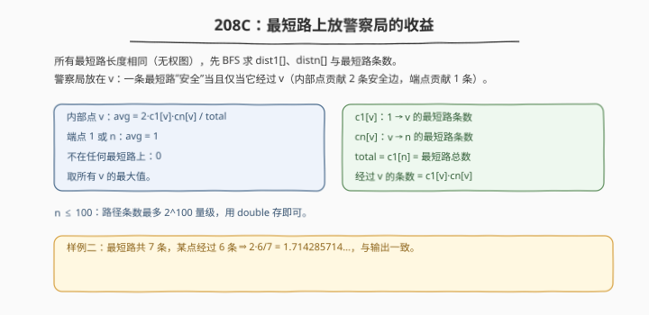
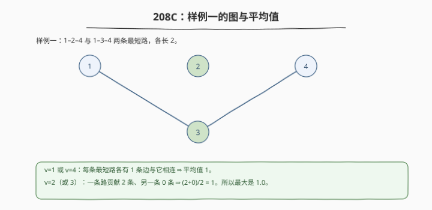

# Codeforces 208C 警察局 题解

## 1. 题目概述

- **题目链接**：https://codeforces.com/problemset/problem/208/C
- **比赛来源**：Codeforces Round 130 (Div. 2) · Problem C（UTC 2012-07-23）
- **难度**：1900
- **标签**：图论、最短路计数、DP
- **评测类型**：特殊评测（实数，误差 $10^{-6}$）
- **限制**：时间 2 s / 内存 256 MB

**题意**：$n$ 个城市、$m$ 条双向道路组成连通无向图（城市 1 是文化首都、$n$ 是主首都），每条路通过时间相同。所有人从 1 到 $n$ 都走**最短路**。政府要在一个城市建警察局：与警察局相连的路称为"安全"。对每条最短路径，记它包含的安全路边数；求把警察局放在哪个城市能使"所有最短路径上安全边数的平均值"最大，输出这个最大值。

**约束**：$2\le n\le100$，$m\le n(n-1)/2$，图连通、无重边自环。

## 2. 示例与观察

官方样例一：

```text
输入：
4 4
1 2
2 4
1 3
3 4

输出：
1.000000000000
```

官方样例二：

```text
输入：
11 14
1 2
1 3
2 4
3 4
4 5
4 6
5 11
6 11
1 8
8 9
9 7
11 7
1 10
10 4

输出：
1.714285714286
```

**样例一走查**：两条最短路 $1-2-4$、$1-3-4$。若把警察局放在 1 或 4，每条路各贡献 1 条安全边，平均 1；放在 2 或 3，则一条路贡献 2 条、另一条 0 条，平均仍是 1。故答案为 1。

**样例二走查**：最短路共 7 条，某个城市位于其中 6 条的内部，每条贡献 2 条安全边，平均 $2\cdot6/7=12/7\approx1.7142857$。

**观察 1**：一条最短路含安全边 ⟺ 它经过警察局所在城市（经过内部点时有 2 条边与它相连，端点为 1 或 $n$ 时只有 1 条）。

**观察 2**：所有最短路长度相同（无权图），可以用 BFS 求出 `dist1[]`、`distn[]` 以及最短路的条数。



## 3. 解题思路

### 3.1 朴素做法与瓶颈

枚举所有最短路再统计是 $O(\text{路径数}\times n)$，路径数可达 $2^{100}$，不可行。需要按"每个城市被多少条最短路经过"来聚合。

### 3.2 核心观察

设 $D=\text{dist}(1,n)$，`c1[v]` 为 $1\to v$ 的最短路条数、`cn[v]` 为 $v\to n$ 的最短路条数（BFS 时按层累加）。则

- $v$ 在最短路上 ⟺ `dist1[v] + distn[v] == D`；
- 经过 $v$ 的最短路条数 = `c1[v] * cn[v]`（前段与后段独立组合）。

于是警察局放在内部城市 $v$ 时，平均安全边数 $=2\cdot c1[v]\cdot cn[v]/\text{total}$；放在 1 或 $n$ 时恒为 1（每条最短路各有一条边与其相连）。

### 3.3 算法流程

1. 从 1 与从 $n$ 各做一次 BFS（按 `dist` 递增累加路径条数）。
2. `total = c1[n]`。
3. 对每个 $v$：按上文公式算平均值，取最大。
4. 输出最大值（保留 12 位小数）。



### 3.4 样例走查

样例一：`total=2`；$v=2$ 时 `c1[2]=1, cn[2]=1` → $2\cdot1\cdot1/2=1$；$v=1$ 时按端点公式得 1。最大值 1 ✓。

## 4. 正确性证明

**引理 1（路径计数正确）**：`c1[v]` 等于 $1\to v$ 的最短路条数。

**证明**：最短路图的边只从第 $d$ 层指向第 $d+1$ 层（`dist` 递增 1），按层累加即得；$v$ 的每条最短路唯一对应"到某个前驱的最短路 + 一条边"，故累加不重不漏。∎

**引理 2（经过 $v$ 的条数）**：经过 $v$ 的最短路条数为 `c1[v]*cn[v]`（当 `dist1[v]+distn[v]==D` 时），否则 0。

**证明**：一条最短路经过 $v$ ⟺ 它可以拆成"$1\to v$ 的最短路"与"$v\to n$ 的最短路"，两段选择独立，故条数为乘积。若 $v$ 不在任何最短路上则乘积对应的拼接长度大于 $D$，不是最短路。∎

**引理 3（安全边贡献）**：经过内部城市 $v$ 的最短路恰有 2 条边与 $v$ 相连；以 1 或 $n$ 为警察局时每条最短路恰有 1 条。

**证明**：最短路是简单路径，经过内部点 $v$ 时恰有一条入边、一条出边；端点只有一条相邻边。∎

**定理**：算法输出的平均值正确。

**证明**：由引理 1–3，总和 $=\sum_{\text{最短路}} (\text{与 }v\text{ 相连的边数})$ 可写成 $2\cdot c1[v]cn[v]$（内部点）或 $\text{total}$（端点），除以总条数即平均值；算法对所有 $v$ 取最大，故正确。∎

## 5. 复杂度分析

- **时间**：两次 BFS，$O(n+m)$；统计 $O(n)$。$n\le100$ 时可忽略。
- **空间**：$O(n+m)$。

## 6. 参考代码

### C++17

```cpp
#include <bits/stdc++.h>
using namespace std;
int main() {
    int n, m;
    if (scanf("%d %d", &n, &m) != 2) return 0;
    vector<vector<int>> adj(n + 1);
    for (int i = 0; i < m; ++i) {
        int u, v;
        scanf("%d %d", &u, &v);
        adj[u].push_back(v);
        adj[v].push_back(u);
    }
    auto bfs = [&](int src, vector<int>& dist, vector<double>& cnt) {
        dist.assign(n + 1, -1);
        cnt.assign(n + 1, 0.0);
        queue<int> q;
        dist[src] = 0; cnt[src] = 1.0;
        q.push(src);
        while (!q.empty()) {
            int u = q.front(); q.pop();
            for (int v : adj[u]) {
                if (dist[v] < 0) { dist[v] = dist[u] + 1; q.push(v); }
                if (dist[v] == dist[u] + 1) cnt[v] += cnt[u];
            }
        }
    };
    vector<int> d1, dn;
    vector<double> c1, cn;
    bfs(1, d1, c1);
    bfs(n, dn, cn);
    int D = d1[n];
    double total = c1[n];
    double best = 0.0;
    for (int v = 1; v <= n; ++v) {
        double avg;
        if (v == 1 || v == n) avg = 1.0;
        else if (d1[v] + dn[v] == D) avg = 2.0 * c1[v] * cn[v] / total;
        else avg = 0.0;
        best = max(best, avg);
    }
    printf("%.12f\n", best);
    return 0;
}
```

### Python3

```python
import sys
from collections import deque


def main() -> None:
    data = sys.stdin.buffer.read().split()
    n = int(data[0]); m = int(data[1])
    adj = [[] for _ in range(n + 1)]
    p = 2
    for _ in range(m):
        u = int(data[p]); v = int(data[p + 1]); p += 2
        adj[u].append(v)
        adj[v].append(u)

    def bfs(src):
        dist = [-1] * (n + 1)
        cnt = [0.0] * (n + 1)
        dist[src] = 0
        cnt[src] = 1.0
        q = deque([src])
        while q:
            u = q.popleft()
            for v in adj[u]:
                if dist[v] < 0:
                    dist[v] = dist[u] + 1
                    q.append(v)
                if dist[v] == dist[u] + 1:
                    cnt[v] += cnt[u]
        return dist, cnt

    d1, c1 = bfs(1)
    dn, cn = bfs(n)
    D = d1[n]
    total = c1[n]
    best = 0.0
    for v in range(1, n + 1):
        if v == 1 or v == n:
            avg = 1.0
        elif d1[v] + dn[v] == D:
            avg = 2.0 * c1[v] * cn[v] / total
        else:
            avg = 0.0
        if avg > best:
            best = avg
    print(f"{best:.12f}")


main()
```

## 7. 边界情况与易错点

1. **警察局在端点 1 或 $n$**：平均值为 1，不能套用内部点的公式（否则会算成 0）。
2. **路径条数溢出**：最短路条数可达 $2^{100}$ 量级，用 `double`（或 `long double`）而不是整数。
3. **不在任何最短路上的城市**：平均值为 0，公式中 `dist1[v]+distn[v] != D` 要排除。
4. **直接边 $1-n$**：此时 $D=1$，所有端点情形与内部点都按公式正确处理（内部点不存在）。
5. **多条最短路经过同一城市**：必须用乘积 `c1[v]*cn[v]` 计数，不能用加法。
6. **输出精度**：保留 12 位小数即可满足 $10^{-6}$。
7. **$n=2$**：只有一条路，答案是 1。

## 8. 验证记录

- **编译环境与命令**：`python3 codeforces/tools/verify_solution.py codeforces/contests/0101-0203/208/C_警察局.md --checker codeforces/tools/checkers/float.py`。
- **官方样例**：2 / 2 通过（`1.000000000000`、`1.714285714286`）。
- **随机对拍**：独立暴力 DFS 枚举所有最短路并逐条统计安全边（$n\le7$，含随机额外边）共 **250 组**，与正文 C++ 的差 < $10^{-9}$；Python 版同样一致。
- **最大规模性能**：$n=100$ 的随机连通图，C++/Python 均 < 5 ms。
- **图片校验**：`cf208c_paths.svg`、`cf208c_walk.svg` 通过 `xml.etree.ElementTree.parse`。
- **复核状态**：verified。

## 相关题目与扩展

- [Codeforces 208B 接龙](https://codeforces.com/problemset/problem/208/B)：同场 B 题。
- [Codeforces 208E 血亲](https://codeforces.com/problemset/problem/208/E)：同场 E 题。
- [LeetCode 1976 到达目的地的方案数](https://leetcode.cn/problems/number-of-ways-to-arrive-at-destination/)：最短路计数。

**延伸思考**：

1. 若边带权，最短路计数需要 Dijkstra 并在松弛相等时累加，思路相同。
2. 若要求"至少经过警察局一次"的路径比例，就变成概率/计数问题，仍需按城市聚合。
3. 本题的关键是**把"逐条路径统计"换成"逐城市聚合"**：路径数可指数爆炸，但每个城市的贡献可以闭式算出。
