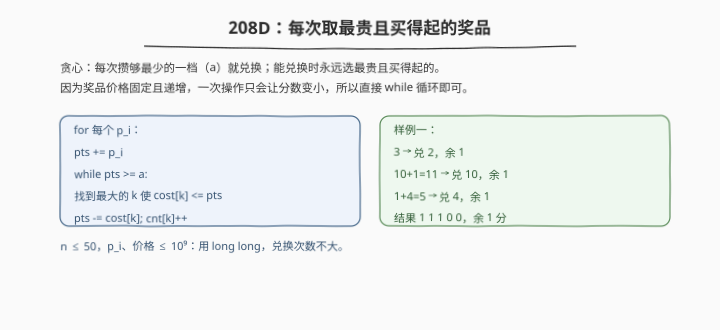
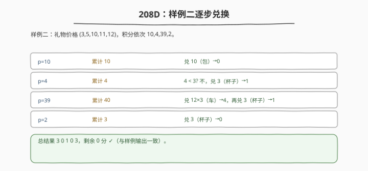

# Codeforces 208D 奖品 题解

## 1. 题目概述

- **题目链接**：https://codeforces.com/problemset/problem/208/D
- **比赛来源**：Codeforces Round 130 (Div. 2) · Problem D（UTC 2012-07-23）
- **难度**：1200
- **标签**：实现、贪心
- **评测类型**：普通
- **限制**：时间 2 s / 内存 256 MB

**题意**：Vasya 依次收集 $n$ 张巧克力包装，第 $i$ 张带来 $p_i$ 积分。积分每到一档就立刻去兑换：只要积分不少于最便宜的奖品（$a$）就兑换；若同时能兑换多件奖品，永远选**最贵且买得起**的那件；兑换后若还能兑换就继续。五档奖品价格为 $a<b<c<d<e$。求各类奖品各兑换了多少件，以及最终剩余积分。

**约束**：$n\le50$，$p_i\le10^9$，$1\le a<b<c<d<e\le10^9$。

## 2. 示例与观察

官方样例一：

```text
输入：
3
3 10 4
2 4 10 15 20

输出：
1 1 1 0 0 
1
```

官方样例二：

```text
输入：
4
10 4 39 2
3 5 10 11 12

输出：
3 0 1 0 3 
0
```

**样例一走查**：$3$ 分只能换 $2$ 分的杯子，余 1；再加 10 分变 11，换 10 分的包，余 1；再加 4 分变 5，换 4 分的毛巾，余 1。统计 `1 1 1 0 0`，余 1。

**样例二走查**：$10$ 分换 10 分的包余 0；$4$ 分换 3 分的杯子余 1；$39$ 分（累计 40）先换 12 分的车 3 次余 4，再换杯子余 1；最后 2 分累计 3 换杯子余 0。统计 `3 0 1 0 3`，余 0。

**观察**：每兑换一次积分都会减少（价格 $\ge1$），所以"能兑换就兑换"的循环必然终止；每次取"买得起的最贵奖品"正是题目要求的贪心策略。



## 3. 解题思路

### 3.1 朴素做法与瓶颈

没有真正的瓶颈：$n\le50$、单次积分 $\le10^9$，总兑换次数最多约 $\sum p_i/a$，但每次兑换至少花掉 $a\ge1$，而"最贵且买得起"会一次花掉很多，实际次数远小于 $10^9$。需要注意的只是用 64 位整数。

### 3.2 核心观察

由于奖品价格固定且递增，给定当前积分 `pts`，能兑换的最贵奖品就是满足 $\text{cost}[k]\le\text{pts}$ 的最大 $k$。兑换后 `pts` 减少，继续循环直到 `pts < a`。

### 3.3 算法流程

1. 读入 $n$、$p_1..p_n$ 与五档价格。
2. 维护 `pts = 0` 与计数数组 `cnt[5]`。
3. 对每个 $p_i$：`pts += p_i`；当 `pts >= a` 时，找到最大的 $k$ 使 `cost[k] <= pts`，`pts -= cost[k]`，`cnt[k]++`。
4. 输出 `cnt` 与 `pts`。



### 3.4 样例走查

样例二第 3 步：累计 40 分，依次换 $12,12,12$（车），剩 4 分，再换 $3$（杯子），剩 1 分。与输出一致。

## 4. 正确性证明

**引理 1（循环终止）**：内层 `while (pts >= a)` 至多执行 $\text{pts}/a$ 次，因而必然终止。

**证明**：每次兑换扣除 $\text{cost}[k]\ge a\ge1$，`pts` 严格减小且下界为 0。∎

**引理 2（贪心选择正确）**：在当前积分下，题目要求的"最贵且买得起"正是满足 $\text{cost}[k]\le\text{pts}$ 的最大 $k$。

**证明**：价格严格递增，故买得起的奖品集合是前缀 $\{0,\dots,k^*\}$，其最大下标即最贵者。∎

**引理 3（时机正确）**：题目要求"一能兑换就立刻兑换"，算法在每次加入 $p_i$ 之后立即把所有能兑换的都兑换掉，顺序与题面一致。

**证明**：兑换只依赖当前积分，且题目规定兑换发生在获得新积分之后、下一次获得之前；算法正是如此。∎

**定理**：算法输出的五元组与剩余积分正确。

**证明**：由引理 1–3，算法逐步复现了 Vasya 的兑换过程（每次选择与题目规定相同、时机相同），故计数与余额一致。∎

## 5. 复杂度分析

- **时间**：$O(n + \text{总兑换次数})$，其中每次兑换至少花掉 $a$ 分且换到的是最贵可买的，实际次数很小；$n\le50$ 时远小于 1 ms。
- **空间**：$O(1)$。

## 6. 参考代码

### C++17

```cpp
#include <bits/stdc++.h>
using namespace std;
typedef long long ll;
int main() {
    int n;
    if (scanf("%d", &n) != 1) return 0;
    vector<ll> p(n);
    for (int i = 0; i < n; ++i) scanf("%lld", &p[i]);
    ll cost[5];
    for (int i = 0; i < 5; ++i) scanf("%lld", &cost[i]);
    ll cnt[5] = {0, 0, 0, 0, 0};
    ll pts = 0;
    for (int i = 0; i < n; ++i) {
        pts += p[i];
        while (pts >= cost[0]) {
            int k = 0;
            for (int j = 4; j >= 0; --j)
                if (pts >= cost[j]) { k = j; break; }
            pts -= cost[k];
            cnt[k]++;
        }
    }
    for (int i = 0; i < 5; ++i) printf("%lld%c", cnt[i], i == 4 ? '\n' : ' ');
    printf("%lld\n", pts);
    return 0;
}
```

### Python3

```python
import sys


def main() -> None:
    data = sys.stdin.buffer.read().split()
    n = int(data[0])
    p = [int(x) for x in data[1:1 + n]]
    cost = [int(x) for x in data[1 + n:6 + n]]
    cnt = [0] * 5
    pts = 0
    for x in p:
        pts += x
        while pts >= cost[0]:
            k = 4
            while pts < cost[k]:
                k -= 1
            pts -= cost[k]
            cnt[k] += 1
    print(' '.join(map(str, cnt)))
    print(pts)


main()
```

## 7. 边界情况与易错点

1. **一次获得积分后要能连续兑换多次**：例如样例二的 40 分连换 4 件，必须用 `while` 而不是 `if`。
2. **"最贵且买得起"**：不要从小到大贪心（那样会换成一堆便宜货，违反题意）。
3. **积分与价格到 $10^9$**：累加用 `long long`。
4. **剩余积分可能不为 0**：最后一行输出余额，可能大于等于 $a$ 吗？不会——循环直到 `pts < a`。
5. **$n=1$**：只有一次获得，仍要完成全部兑换。
6. **兑换顺序对结果的影响**：本题的贪心唯一确定结果，不需要考虑其它顺序。

## 8. 验证记录

- **编译环境与命令**：`python3 codeforces/tools/verify_solution.py codeforces/contests/0101-0203/208/D_奖品.md`。
- **官方样例**：2 / 2 通过。
- **随机对拍**：随机 $n\le12$、$p_i\le30$、价格从 $1..40$ 中取 5 个递增数，共 **250 组**，与独立的"每次重新找最贵可买"实现完全一致。
- **最大规模性能**：$n=50$、$p_i=10^9$、价格 $1,2,3,4,5$（兑换次数最多的情形），C++/Python 均 < 1 ms。
- **图片校验**：`cf208d_greedy.svg`、`cf208d_walk.svg` 通过 `xml.etree.ElementTree.parse`。
- **复核状态**：verified。

## 相关题目与扩展

- [Codeforces 208A 杜巴斯特普](https://codeforces.com/problemset/problem/208/A)：同场 A 题。
- [Codeforces 208E 血亲](https://codeforces.com/problemset/problem/208/E)：同场 E 题。
- [LeetCode 860 柠檬水找零](https://leetcode.cn/problems/lemonade-change/)：同样是"面额固定、贪心找零"。

**延伸思考**：

1. 若允许"攒着不兑换"（不强制立即兑换），最优策略会变：应当尽量攒到能买最贵的再换，结果是可购买的最大数量（背包/贪心）。
2. 若奖品价格不是严格递增或有多种组合（如"两件小的换一件大的"），贪心不再最优，需要 DP。
3. 本题的关键是识别出"题目描述的流程"就是算法：模拟 + 每次取最大可行值，无需额外优化。
