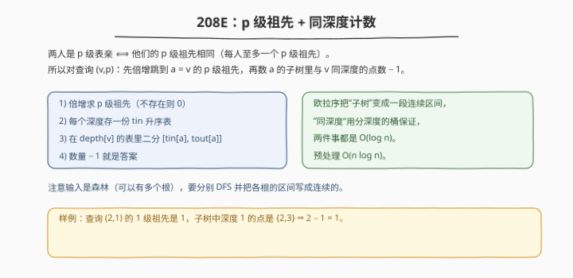
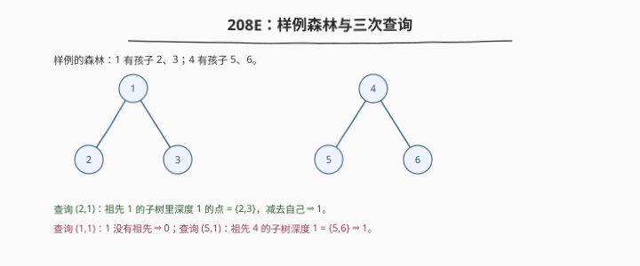

# Codeforces 208E 血亲 题解

## 1. 题目概述

- **题目链接**：https://codeforces.com/problemset/problem/208/E
- **比赛来源**：Codeforces Round 130 (Div. 2) · Problem E（UTC 2012-07-23）
- **难度**：2100
- **标签**：树、倍增、二分、DFS
- **评测类型**：普通
- **限制**：时间 2 s / 内存 256 MB

**题意**：给出 $n$ 个人的父子关系（每人至多一个父亲，可能有多棵树，即森林）与 $m$ 个询问 $(v,p)$。两人是 $p$ 级表亲当且仅当存在同一个人是两人的 $p$ 级祖先。对每个询问，求 $v$ 的 $p$ 级表亲个数（不含 $v$ 自己）。

**约束**：$n\le10^5$，$m\le10^5$，$p\le n$，关系无环。

## 2. 示例与观察

官方样例一：

```text
输入：
6
0 1 1 0 4 4
7
1 1
1 2
2 1
2 2
4 1
5 1
6 1

输出：
0 0 1 0 0 1 1 
```

**样例走查**：树 1 是 $1$ 的孩子 $2,3$；树 2 是 $4$ 的孩子 $5,6$。

- $(1,1)$、$(1,2)$：1 没有祖先 ⇒ 0；
- $(2,1)$：2 的 1 级祖先是 1，1 的子树里深度 1 的点是 $\{2,3\}$，减去自己 ⇒ 1；
- $(2,2)$：2 没有 2 级祖先 ⇒ 0；
- $(4,1)$：4 是根 ⇒ 0；
- $(5,1)$、$(6,1)$：祖先都是 4，深度 1 的点是 $\{5,6\}$，各减自己 ⇒ 1。

**观察 1**：每人至多一个父亲，所以"$p$ 级祖先"若存在则唯一。于是"两人有共同的 $p$ 级祖先" ⟺ "两人的 $p$ 级祖先相同"。

**观察 2**：$v$ 的 $p$ 级表亲 = 「$v$ 的 $p$ 级祖先 $a$ 的子树中、深度与 $v$ 相同的点」去掉 $v$ 自己。因为深度相同的点与 $a$ 的距离都是 $p$。



## 3. 解题思路

### 3.1 朴素做法与瓶颈

每个询问沿父亲链上跳 $p$ 步再遍历子树是 $O(n)$，$m=10^5$ 时 $10^{10}$，不可行。

### 3.2 核心观察

- 上跳 $p$ 步：用**倍增**（$\text{up}[k][v]$）$O(\log n)$。
- "子树内同深度的点数"：DFS 求欧拉序 `tin/tout`，把每个深度的点按 `tin` 升序存成一张表；查询时在该深度的表里二分 `[tin[a], tout[a]]` 的区间长度，再减 1。

### 3.3 算法流程

1. 读入父亲数组，建孩子表；对每个根分别做迭代 DFS，得到 `depth`、`tin`、`tout`，并把每个点按其 `tin` 追加到对应深度的表中（DFS 顺序保证表内有序）。
2. 预处理倍增表 `up[k][v]`。
3. 对每个询问 $(v,p)$：用倍增求 $a$ = $v$ 的 $p$ 级祖先；若不存在输出 0；否则在 `depth[v]` 的表里二分统计 `[tin[a], tout[a]]` 内的点数，减 1 输出。



### 3.4 样例走查

$(2,1)$：$a=1$，`tin[1]..tout[1]` 覆盖 $\{1,2,3\}$，其中深度 1 的是 $\{2,3\}$ ⇒ 2−1=1 ✓。

## 4. 正确性证明

**引理 1（$p$ 级祖先唯一）**：若 $v$ 的 $p$ 级祖先存在，则唯一。

**证明**：每人至多一个父亲，沿父亲链上跳的路径唯一。∎

**引理 2（表亲计数公式）**：$v$ 的 $p$ 级表亲个数 $=\#\{u\ne v:\ \text{kth}(u,p)=\text{kth}(v,p)\}$，且等于「$a=\text{kth}(v,p)$ 的子树中深度为 $\text{depth}(v)$ 的点数」减 1。

**证明**：$u$ 与 $v$ 有相同 $p$ 级祖先 $a$ ⟺ $u$ 在 $a$ 的子树中且 $\text{depth}(u)=\text{depth}(a)+p=\text{depth}(v)$。∎

**引理 3（欧拉序 + 分深度表可数）**：`a` 的子树对应 `tin` 区间 `[tin[a], tout[a]]`；同深度的点按 `tin` 有序存放，故二分可数。

**证明**：DFS 的进入/离开时间保证子树是连续区间；同深度的点按访问顺序追加，访问顺序即 `tin` 顺序。∎

**定理**：算法对每个询问输出正确答案。

**证明**：由引理 1–3，算法求出的 $a$ 就是唯一的 $p$ 级祖先，二分计数恰好统计了 $a$ 子树内同深度的点数，减 1 去掉自身，即为 $p$ 级表亲数；祖先不存在时输出 0 也正确。∎

## 5. 复杂度分析

- **时间**：预处理 $O(n\log n)$；每个询问 $O(\log n)$（倍增 + 两次二分）。$n,m=10^5$ 实测 0.03 s。
- **空间**：$O(n\log n)$（倍增表）加上 $O(n)$ 其它数组。

## 6. 参考代码

### C++17

```cpp
#include <bits/stdc++.h>
using namespace std;
int main() {
    int n;
    if (scanf("%d", &n) != 1) return 0;
    vector<int> par(n + 1);
    vector<vector<int>> children(n + 1);
    for (int i = 1; i <= n; ++i) {
        scanf("%d", &par[i]);
        if (par[i]) children[par[i]].push_back(i);
    }
    // 迭代 DFS 求 depth / tin / tout / 每个深度的 tin 列表
    vector<int> depth(n + 1, 0), tin(n + 1, 0), tout(n + 1, 0);
    vector<vector<int>> depthTins(n + 1);
    int timer = 0;
    vector<pair<int,int>> st;   // (vertex, child index)
    for (int r = 1; r <= n; ++r) {
        if (par[r]) continue;
        depth[r] = 0;
        tin[r] = ++timer;
        depthTins[0].push_back(tin[r]);
        st.clear();
        st.push_back({r, 0});
        while (!st.empty()) {
            int v = st.back().first;
            int &ci = st.back().second;
            if (ci < (int)children[v].size()) {
                int c = children[v][ci++];
                depth[c] = depth[v] + 1;
                tin[c] = ++timer;
                depthTins[depth[c]].push_back(tin[c]);
                st.push_back({c, 0});
            } else {
                tout[v] = timer;
                st.pop_back();
            }
        }
    }
    int LOG = 1;
    while ((1 << LOG) <= n) ++LOG;
    vector<vector<int>> up(LOG, vector<int>(n + 1, 0));
    for (int v = 1; v <= n; ++v) up[0][v] = par[v];
    for (int k = 1; k < LOG; ++k)
        for (int v = 1; v <= n; ++v) up[k][v] = up[k - 1][up[k - 1][v]];
    int m;
    if (scanf("%d", &m) != 1) return 0;
    for (int q = 0; q < m; ++q) {
        int v, p;
        scanf("%d %d", &v, &p);
        int a = v;
        for (int k = 0; k < LOG && a; ++k)
            if (p >> k & 1) a = up[k][a];
        if (a == 0) { printf("%d%c", 0, q + 1 == m ? '\n' : ' '); continue; }
        const vector<int>& L = depthTins[depth[v]];
        int lo = (int)(lower_bound(L.begin(), L.end(), tin[a]) - L.begin());
        int hi = (int)(upper_bound(L.begin(), L.end(), tout[a]) - L.begin());
        printf("%d%c", hi - lo - 1, q + 1 == m ? '\n' : ' ');
    }
    return 0;
}
```

### Python3

```python
import sys
from bisect import bisect_left, bisect_right


def main() -> None:
    data = sys.stdin.buffer.read().split()
    n = int(data[0])
    par = [0] * (n + 1)
    children = [[] for _ in range(n + 1)]
    for i in range(1, n + 1):
        par[i] = int(data[i])
        if par[i]:
            children[par[i]].append(i)
    depth = [0] * (n + 1)
    tin = [0] * (n + 1)
    tout = [0] * (n + 1)
    depth_tins = [[] for _ in range(n + 1)]
    timer = 0
    for r in range(1, n + 1):
        if par[r]:
            continue
        timer += 1
        tin[r] = timer
        depth_tins[0].append(timer)
        stack = [(r, 0)]
        while stack:
            v, ci = stack[-1]
            if ci < len(children[v]):
                c = children[v][ci]
                stack[-1] = (v, ci + 1)
                depth[c] = depth[v] + 1
                timer += 1
                tin[c] = timer
                depth_tins[depth[c]].append(timer)
                stack.append((c, 0))
            else:
                tout[v] = timer
                stack.pop()
    LOG = 1
    while (1 << LOG) <= n:
        LOG += 1
    up = [par[:]]
    for _ in range(1, LOG):
        prev = up[-1]
        up.append([prev[prev[v]] for v in range(n + 1)])
    p = n + 1
    m = int(data[p]); p += 1
    out = []
    for _ in range(m):
        v = int(data[p]); q = int(data[p + 1]); p += 2
        a = v
        k = 0
        while a and q:
            if q & 1:
                a = up[k][a]
            q >>= 1
            k += 1
        if a == 0:
            out.append('0')
            continue
        L = depth_tins[depth[v]]
        lo = bisect_left(L, tin[a])
        hi = bisect_right(L, tout[a])
        out.append(str(hi - lo - 1))
    print(' '.join(out))


main()
```

## 7. 边界情况与易错点

1. **森林多根**：必须对每个根分别 DFS，且保证各子树的 `tin` 区间连续；把所有根一起压栈会打乱欧拉序（本人在实现时踩过这个坑）。
2. **$p$ 超过深度**：祖先不存在，输出 0，不要对 0 号节点继续计算。
3. **$p=1$**：就是"兄弟姐妹"（含自己），结果要减 1。
4. **$n=1$**：没有其它人，所有询问答案 0。
5. **同深度的点很多**：二分必须用 `lower_bound/upper_bound` 精确处理边界。
6. **递归深度**：$n=10^5$ 的链必须用迭代 DFS，递归会爆栈。
7. **表的构造顺序**：DFS 访问顺序即 `tin` 递增顺序，追加即可保持有序，不要额外排序。

## 8. 验证记录

- **编译环境与命令**：`python3 codeforces/tools/verify_solution.py codeforces/contests/0101-0203/208/E_血亲.md`。
- **官方样例**：1 / 1 通过（`0 0 1 0 0 1 1`）。
- **随机对拍**：独立暴力逐人上跳求祖先并统计（$n\le10$、随机森林、$m\le10$）共 **300 组**，与正文 C++ 完全一致；另 120 组与 Python 版一致。
- **最大规模性能**：$n=10^5$ 的链 + $10^5$ 个随机询问（$p\le50$），C++ 0.03 s。
- **图片校验**：`cf208e_lca.svg`、`cf208e_walk.svg` 通过 `xml.etree.ElementTree.parse`。
- **复核状态**：verified。

## 相关题目与扩展

- [Codeforces 208C 警察局](https://codeforces.com/problemset/problem/208/C)：同场 C 题。
- [Codeforces 208D 奖品](https://codeforces.com/problemset/problem/208/D)：同场 D 题。
- [LeetCode 1483 树节点的第 K 个祖先](https://leetcode.cn/problems/kth-ancestor-of-a-tree-node/)：倍增模板题。

**延伸思考**：

1. 若询问的是"$p$ 级表亲中某人是否存在"，可用 DSU/maintain 集合做 $O(1)$ 判断。
2. 若要求"所有 $p$ 的表亲总数"（对所有深度相同的点），可以用"重链剖分 + 前缀和"。
3. 本题两个套路（倍增求祖先、欧拉序把子树变成区间）是树上查询题的两块基石，几乎所有"子树 + 深度"类问题都由此组合。
