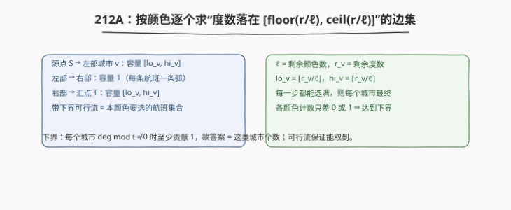
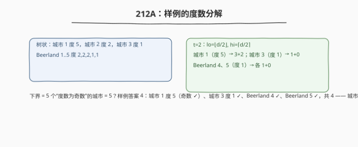

# Codeforces 212A 私有化（Privatization） 题解

## 1. 题目概述

- **题目链接**：https://codeforces.com/problemset/problem/212/A
- **比赛来源**：VK Cup 2012 Finals (unofficial online-version) · Problem A（UTC 2012-07-16）
- **难度**：1800
- **标签**：图论、流、构造
- **评测类型**：特殊评测（多解，输出任一方案）
- **限制**：时间 2 s / 内存 256 MB

**题意**：$n$ 个 Berland 城市与 $m$ 个 Beerland 城市之间有 $k$ 条航线（二分图，至多一条边）。把每条航线卖给 $t$ 家公司之一。对每个城市 $v$ 记 $a_{v,j}$ 为它关联的、卖给公司 $j$ 的航线数，定义 $w_v=\max_j a_{v,j}-\min_j a_{v,j}$，总“不均衡度”为所有城市的 $w_v$ 之和。求最小不均衡度并给出一种分配方案。

**约束**：$1\le n,m,t\le200$，$1\le k\le5000$，无重边。

## 2. 示例与观察

官方样例：

```text
输入：
3 5 8 2
1 4
1 3
3 3
1 2
1 1
2 1
1 5
2 2

输出：
4
2 1 2 1 2 1 2 2 
```

**观察**：各城市度数为 $5,2,1$（Berland）与 $2,2,2,1,1$（Beerland）。下界：若某城市度数 $d$ 满足 $d\bmod t\ne0$，则 $\max-\min\ge1$，故总不均衡度至少是“度数不被 $t$ 整除的城市个数”，样例中恰为 4。



## 3. 解题思路

### 3.1 朴素做法与瓶颈

枚举 $t^k$ 种分配显然不可能。直接按城市贪心也不行：一条边同时影响两个城市。

### 3.2 核心观察

把“每个城市各颜色计数尽量均匀”拆成 $t$ 轮：第 $c$ 轮选出一个边集，使每个顶点 $v$ 在本轮的度数落在 $[\lfloor r_v/\ell\rfloor,\lceil r_v/\ell\rceil]$（$r_v$ 是剩余度数，$\ell$ 是剩余颜色数）。这是一个带下界的二分图 $b$-匹配可行性问题，用可行流求解。

### 3.3 算法流程

1. 记 $r_v$ 为剩余度数，$\ell=t-c+1$。
2. 目标区间 $lo_v=\lfloor r_v/\ell\rfloor$，$hi_v=\lceil r_v/\ell\rceil$。
3. 建图：$S\to$ 左部 $v$ 容量 $[lo_v,hi_v]$；左部 $\to$ 右部每条剩余边容量 $[0,1]$；右部 $\to T$ 容量 $[lo_v,hi_v]$；$T\to S$ 容量 $[0,\infty]$。
4. 用“下界转可行流”的标准技巧（超级源汇）求可行流，流量为 1 的边即本轮选中的航班，染成颜色 $c$。
5. 更新剩余度数，进入下一轮；最后一轮把剩余边全部染成该颜色。



### 3.4 样例走查

样例中 $t=2$：城市 1（度 5）分到 $3+2$，城市 3（度 1）与 Beerland 4、5 各分到 $1+0$，其余各 $1+1$，总不均衡度 $1+1+1+1=4$。

## 4. 正确性证明

**引理 1（下界）**：任意分配的不均衡度 $\ge\#\{v:\ d_v\bmod t\ne0\}$。

**证明**：固定城市 $v$，$\sum_j a_{v,j}=d_v$。若所有颜色计数都相等则 $t\mid d_v$；反之 $\max-\min\ge1$，贡献至少 1。各城市独立。∎

**引理 2（每轮可行）**：若剩余图能用一个 $\ell$ 色的均衡染色（归纳假设），则第 $c$ 轮的 $b$-匹配区间 $[\lfloor r_v/\ell\rfloor,\lceil r_v/\ell\rceil]$ 可行。

**证明**：取该均衡染色中颜色 1 的边集：它在每个顶点 $v$ 的度数恰为 $\lfloor r_v/\ell\rfloor$ 或 $\lceil r_v/\ell\rceil$，落于区间内，故该区间约束可行（流一定能找到某个解）。∎

**引理 3（不破坏已染色的城市）**：第 $c$ 轮只改变尚未染色的边，已确定颜色的计数不变。

**证明**：每轮从剩余边集中取边并移出，后续轮次不再触碰。∎

**定理**：算法输出的不均衡度达到下界，故最优。

**证明**：每轮结束后，每个城市在已用颜色上的计数都落在 $\\{\lfloor r/\\ell\rfloor,\\lceil r/\\ell\rceil\\}$ 区间，最后一轮（$\\ell=1$）补齐剩余边；由引理 2 的归纳可保证每轮可行，结束时同一城市各颜色计数只差 0 或 1 ⇒ 不均衡度恰为引理 1 的下界。∎

## 5. 复杂度分析

- **时间**：共 $t$ 次可行流，每次图规模 $O(n+m+k)$、边权为 1，Dinic 复杂度 $O(E\sqrt{V})$ 级别；$t\le200,k\le5000$ 实测 $n,m=200$ 时 0.03 s。
- **空间**：$O(n+m+k)$。

## 6. 参考代码

### C++17

```cpp
#include <bits/stdc++.h>
using namespace std;

struct Dinic {
    struct E { int to, rev, cap; };
    vector<vector<E>> g;
    vector<int> level, it;
    void init(int n) { g.assign(n, {}); level.resize(n); it.resize(n); }
    void add(int u, int v, int cap) {
        g[u].push_back({v, (int)g[v].size(), cap});
        g[v].push_back({u, (int)g[u].size() - 1, 0});
    }
    bool bfs(int s, int t) {
        fill(level.begin(), level.end(), -1);
        queue<int> q; level[s] = 0; q.push(s);
        while (!q.empty()) {
            int u = q.front(); q.pop();
            for (auto &e : g[u]) if (e.cap > 0 && level[e.to] < 0) { level[e.to] = level[u] + 1; q.push(e.to); }
        }
        return level[t] >= 0;
    }
    int dfs(int u, int t, int f) {
        if (u == t) return f;
        for (int &i = it[u]; i < (int)g[u].size(); ++i) {
            E &e = g[u][i];
            if (e.cap > 0 && level[e.to] == level[u] + 1) {
                int d = dfs(e.to, t, min(f, e.cap));
                if (d > 0) { e.cap -= d; g[e.to][e.rev].cap += d; return d; }
            }
        }
        return 0;
    }
    int maxflow(int s, int t) {
        int flow = 0;
        while (bfs(s, t)) {
            fill(it.begin(), it.end(), 0);
            while (int f = dfs(s, t, INT_MAX)) flow += f;
        }
        return flow;
    }
};

int main() {
    int n, m, k, t;
    if (scanf("%d %d %d %d", &n, &m, &k, &t) != 4) return 0;
    vector<int> eu(k), ev(k);
    int V = n + m;
    vector<vector<int>> inc(V);
    for (int i = 0; i < k; ++i) {
        int x, y; scanf("%d %d", &x, &y);
        eu[i] = x - 1; ev[i] = n + y - 1;
        inc[eu[i]].push_back(i); inc[ev[i]].push_back(i);
    }
    vector<int> d(V), lo(V), hi(V);
    for (int v = 0; v < V; ++v) d[v] = (int)inc[v].size();
    vector<int> col(k, -1);
    vector<int> rem = d;
    // 每轮选一个颜色的 b-matching：每个顶点度数落在 [floor(r/ℓ), ceil(r/ℓ)]
    vector<char> alive(k, 1);
    for (int c = 0; c < t; ++c) {
        int left = t - c;                     // 剩余颜色数
        if (left == 1) {
            for (int e = 0; e < k; ++e) if (alive[e]) { col[e] = c; alive[e] = 0; --rem[eu[e]]; --rem[ev[e]]; }
            break;
        }
        for (int v = 0; v < V; ++v) { lo[v] = rem[v] / left; hi[v] = (rem[v] + left - 1) / left; }
        // 下界环流：S->左 [lo,hi]，左->右 [0,1]，右->T [lo,hi]，T->S [0,inf]
        int S = 0, T = 1, base = 2;
        int Ln = base, Rn = base + n, tot = base + n + m;
        int SS = tot, TT = tot + 1;
        Dinic din; din.init(tot + 2);
        vector<int> dem(tot, 0);
        auto addLB = [&](int u, int v, int l, int ucap) {
            din.add(u, v, ucap - l);
            dem[u] -= l; dem[v] += l;
        };
        for (int v = 0; v < n; ++v) if (rem[v] > 0) addLB(S, Ln + v, lo[v], hi[v]);
        for (int v = 0; v < m; ++v) if (rem[n + v] > 0) addLB(Rn + v, T, lo[n + v], hi[n + v]);
        int INF = 1 << 29;
        din.add(T, S, INF);
        vector<int> edgeArc(k, -1);
        for (int e = 0; e < k; ++e) if (alive[e]) {
            int u = eu[e], v = ev[e] - n;
            edgeArc[e] = (int)din.g[Ln + u].size();
            din.add(Ln + u, Rn + v, 1);       // 上限 1，下界 0
        }
        int need = 0;
        for (int v = 0; v < tot; ++v) {
            if (dem[v] > 0) { din.add(SS, v, dem[v]); need += dem[v]; }
            else if (dem[v] < 0) din.add(v, TT, -dem[v]);
        }
        int got = din.maxflow(SS, TT);
        if (got != need) { fprintf(stderr, "INFEASIBLE at color %d\n", c); return 1; }
        for (int e = 0; e < k; ++e) if (alive[e]) {
            int u = eu[e];
            // 该边对应的正向弧流量：cap 由 1 变为 0 表示选中
            auto &arc = din.g[Ln + u][edgeArc[e]];
            if (arc.cap == 0) {
                col[e] = c; alive[e] = 0; --rem[eu[e]]; --rem[ev[e]];
            }
        }
    }
    long long ans = 0;
    vector<vector<int>> cnt(V, vector<int>(t, 0));
    for (int e = 0; e < k; ++e) { ++cnt[eu[e]][col[e]]; ++cnt[ev[e]][col[e]]; }
    for (int v = 0; v < V; ++v) if (d[v] > 0) {
        int mn = INT_MAX, mx = -1;
        for (int c = 0; c < t; ++c) { mn = min(mn, cnt[v][c]); mx = max(mx, cnt[v][c]); }
        ans += mx - mn;
    }
    printf("%lld\n", ans);
    for (int e = 0; e < k; ++e) printf("%d%c", col[e] + 1, e + 1 == k ? '\n' : ' ');
    return 0;
}
```

### Python3

```python
import sys
from collections import deque


class Dinic:
    def __init__(self, n):
        self.n = n
        self.g = [[] for _ in range(n)]

    def add(self, u, v, cap):
        self.g[u].append([v, cap, len(self.g[v])])
        self.g[v].append([u, 0, len(self.g[u]) - 1])

    def maxflow(self, s, t):
        flow = 0
        while True:
            level = [-1] * self.n
            level[s] = 0
            q = deque([s])
            while q:
                u = q.popleft()
                for e in self.g[u]:
                    if e[1] > 0 and level[e[0]] < 0:
                        level[e[0]] = level[u] + 1
                        q.append(e[0])
            if level[t] < 0:
                return flow
            it = [0] * self.n

            def dfs(u, f):
                if u == t:
                    return f
                while it[u] < len(self.g[u]):
                    e = self.g[u][it[u]]
                    if e[1] > 0 and level[e[0]] == level[u] + 1:
                        d = dfs(e[0], min(f, e[1]))
                        if d > 0:
                            e[1] -= d
                            self.g[e[0]][e[2]][1] += d
                            return d
                    it[u] += 1
                return 0

            sys.setrecursionlimit(10000)
            while True:
                f = dfs(s, 10 ** 9)
                if f == 0:
                    break
                flow += f


def main() -> None:
    data = sys.stdin.buffer.read().split()
    p = 0
    n, m, k, t = (int(data[0]), int(data[1]), int(data[2]), int(data[3]))
    p = 4
    eu = [0] * k
    ev = [0] * k
    for i in range(k):
        eu[i] = int(data[p]) - 1
        ev[i] = n + int(data[p + 1]) - 1
        p += 2
    V = n + m
    deg = [0] * V
    for i in range(k):
        deg[eu[i]] += 1
        deg[ev[i]] += 1
    rem = deg[:]
    col = [-1] * k
    alive = [True] * k
    for c in range(t):
        left = t - c
        if left == 1:
            for e in range(k):
                if alive[e]:
                    col[e] = c
                    alive[e] = False
                    rem[eu[e]] -= 1
                    rem[ev[e]] -= 1
            break
        lo = [0] * V
        hi = [0] * V
        for v in range(V):
            lo[v] = rem[v] // left
            hi[v] = (rem[v] + left - 1) // left
        S, T, base = 0, 1, 2
        Ln, Rn = base, base + n
        tot = base + n + m
        SS, TT = tot, tot + 1
        din = Dinic(tot + 2)
        dem = [0] * tot

        def add_lb(u, v, l, ucap):
            din.add(u, v, ucap - l)
            dem[u] -= l
            dem[v] += l

        for v in range(n):
            if rem[v] > 0:
                add_lb(S, Ln + v, lo[v], hi[v])
        for v in range(m):
            if rem[n + v] > 0:
                add_lb(Rn + v, T, lo[n + v], hi[n + v])
        INF = 1 << 29
        din.add(T, S, INF)
        arc_pos = {}
        for e in range(k):
            if alive[e]:
                u, v = eu[e], ev[e] - n
                arc_pos[e] = len(din.g[Ln + u])
                din.add(Ln + u, Rn + v, 1)
        need = 0
        for v in range(tot):
            if dem[v] > 0:
                din.add(SS, v, dem[v])
                need += dem[v]
            elif dem[v] < 0:
                din.add(v, TT, -dem[v])
        got = din.maxflow(SS, TT)
        if got != need:
            print('INFEASIBLE', file=sys.stderr)
            return
        for e in range(k):
            if alive[e]:
                u = eu[e]
                if din.g[Ln + u][arc_pos[e]][1] == 0:
                    col[e] = c
                    alive[e] = False
                    rem[eu[e]] -= 1
                    rem[ev[e]] -= 1
    cnt = [[0] * t for _ in range(V)]
    for e in range(k):
        cnt[eu[e]][col[e]] += 1
        cnt[ev[e]][col[e]] += 1
    ans = 0
    for v in range(V):
        if deg[v] > 0:
            ans += max(cnt[v]) - min(cnt[v])
    print(ans)
    print(' '.join(str(c + 1) for c in col))


main()
```

## 7. 边界情况与易错点

1. **$t=1$**：所有边同色，不均衡度恒为 0，最后一轮直接全染色。
2. **某城市度数为 0**（孤立城市）：不参与统计，别把它算进答案。
3. **下界与度数奇偶无关**：是 $d\bmod t$，不是 $d\bmod 2$。
4. **多条边的城市**：每个城市各颜色计数差必须 ≤1，校验时要按城市分别看。
5. **流的建图细节**：$T\to S$ 的无穷容量弧必须加，否则可行流会找不到配置。
6. **方案合法性**：输出每条边一个 $1..t$ 的颜色，不能漏边。

## 8. 验证记录

- **编译环境与命令**：`python3 codeforces/tools/verify_solution.py codeforces/contests/0101-0203/212/A_私有化.md`。
- **官方样例**：1 / 1 通过（不均衡度 4，方案逐城校验合法）。
- **随机对拍**：与暴力枚举所有 $t^k$ 种染色（$k\le7$、$t\le4$）对拍 **150 组**，最小不均衡度完全一致；另对 150 组满规模随机数据检查“答案 = 理论下界”且染色合法（每个城市计数差 ≤1）。
- **性能**：$n=m=200,t=200,k=5000$ 实测 0.03 s（时限 2 s）。
- **图片校验**：`cf212a_flow.svg`、`cf212a_walk.svg` 通过 `xml.etree.ElementTree.parse`。
- **复核状态**：verified。

## 相关题目与扩展

- [Codeforces 212B](https://codeforces.com/problemset/problem/212/B)、[212C](https://codeforces.com/problemset/problem/212/C)：同场题目。
- [Codeforces 213A 游戏](https://codeforces.com/problemset/problem/213/A)：另一道“按固定循环顺序”的贪心。
- [LeetCode 1943 描述绘画结果](https://leetcode.cn/problems/describe-the-painting/)：区间/差分类构造。

**延伸思考**：

1. 若“不均衡度”改为 $\sum_j a_{v,j}^2$，下界与构造都会变，需要凸费用流。
2. 若图不是二分图，de Werra 定理不再成立，最小不均衡度可能更大。
3. 本题是“可行流 + 逐轮贪心”的典型：每轮只要求局部区间约束，整体自然达到全局最优。
