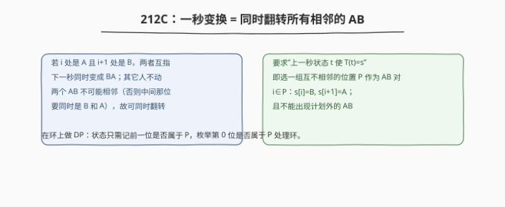
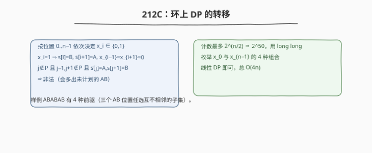

# Codeforces 212C 牛仔（Cowboys） 题解

## 1. 题目概述

- **题目链接**：https://codeforces.com/problemset/problem/212/C
- **比赛来源**：VK Cup 2012 Finals (unofficial online-version) · Problem C（UTC 2012-07-16）
- **难度**：2300
- **标签**：环、动态规划、计数
- **评测类型**：普通
- **限制**：时间 2 s / 内存 256 MB

**题意**：$n$ 个牛仔围成一圈，每人朝顺时针（A）或逆时针（B）瞄准邻居。每一秒，所有“互相瞄准”的相邻对同时转身。给出这一秒之后的状态串 $s$，求可能的“上一秒”状态数。

**约束**：$3\le n\le100$，$s$ 只含 `A`、`B`。

## 2. 示例与观察

官方样例一：

```text
输入：
BABBBABBA

输出：
2
```

官方样例二：

```text
输入：
ABABB

输出：
2
```

官方样例三：

```text
输入：
ABABAB

输出：
4
```

**观察**：互相瞄准当且仅当相邻两位是 `AB`；一秒变换就是同时把所有 `AB` 换成 `BA`。两个 `AB` 不可能相邻（否则中间那位要同时是 B 和 A），因此可以同时翻转。



## 3. 解题思路

### 3.1 朴素做法与瓶颈

枚举所有 $2^n$ 个前驱，$n\le100$ 不可行。

### 3.2 核心观察

设在上一秒中 `AB` 出现的位置集合为 $P$（互不相邻，环上首尾也不能同时取）。则：$i\in P$ 要求 $s_i=B,s_{i+1}=A$；被 $P$ 覆盖的位置由规则唯一确定，其余保持 $s$；并且不能有“计划外”的 `AB`。所有约束只涉及 $(x_{i-1},x_i,x_{i+1})$ 三连，可在环上做小状态 DP。

### 3.3 算法流程

1. $x_i\in\{0,1\}$ 表示 $i\in P$。
2. $x_i=1\Rightarrow s_i=B,\ s_{i+1}=A,\ x_{i-1}=x_{i+1}=0$。
3. $x_j=x_{j-1}=x_{j+1}=0$ 且 $s_j=A,s_{j+1}=B$ ⇒ 非法。
4. 枚举 $x_0,x_1$ 的 4 种组合，状态 $(x_{i-1},x_i)$ 线性转移；最后单独检查 $j=n-1$ 与 $j=0$ 两个环上三连。



### 3.4 样例走查

$\texttt{ABABAB}$：`AB` 可出现在位置 0、2、4，但环上 4 与 0 相邻不能同选，DP 统计出合法 $P$ 共 4 个 ⇒ 答案 4。

## 4. 正确性证明

**引理 1（变换刻画）**：一秒变换等于把所有相邻 `AB` 同时替换为 `BA`。

**证明**：互相瞄准的对正是 $t_i=A,t_{i+1}=B$，转身后变 $BA$；两个这样的对不共享端点，故可同时进行。∎

**引理 2（前驱刻画）**：$T(t)=s$ 当且仅当存在满足三条约束的集合 $P$，且 $t$ 由 $P$ 唯一确定。

**证明**：给定 $P$：$i\in P\Rightarrow t_i=A$，$i-1\in P\Rightarrow t_i=B$，否则 $t_i=s_i$，唯一确定。三条约束恰好保证 $T(t)=s$ 且 $P$ 恰为 $t$ 的全部 `AB` 位置。∎

**引理 3（DP 完备）**：DP 枚举的正是所有合法 $P$。

**证明**：约束都是三连局部的；固定 $x_0,x_1$ 后按位置线性转移即可覆盖所有组合，环上只差 $j=n-1,0$ 两条，收尾时检查。∎

**定理**：答案 = DP 统计数。

**证明**：由引理 2 前驱与合法 $P$ 一一对应，由引理 3 DP 无重不漏。∎

## 5. 复杂度分析

- **时间**：$O(4n)$。
- **空间**：$O(1)$（4 个状态滚动）。
- 计数上界：$|P|\le n/2$ ⇒ 答案 $\le2^{50}$，`long long` 足够。

## 6. 参考代码

### C++17

```cpp
#include <bits/stdc++.h>
using namespace std;
int main() {
    char buf[128];
    if (scanf("%s", buf) != 1) return 0;
    int n = (int)strlen(buf);
    string s = buf;
    auto ok = [&](int j, int a, int b, int c) -> bool {   // 三元组 (x[j-1],x[j],x[j+1])
        int jp = (j + 1) % n;
        if (b == 1) {
            if (a != 0 || c != 0) return false;
            return s[j] == 'B' && s[jp] == 'A';
        }
        if (a == 0 && c == 0 && s[j] == 'A' && s[jp] == 'B') return false;
        return true;
    };
    long long ans = 0;
    for (int x0 = 0; x0 < 2; ++x0)
        for (int x1 = 0; x1 < 2; ++x1) {
            long long dp[2][2];
            memset(dp, 0, sizeof(dp));
            dp[x0][x1] = 1;
            for (int i = 1; i <= n - 2; ++i) {
                long long nd[2][2];
                memset(nd, 0, sizeof(nd));
                for (int a = 0; a < 2; ++a)
                    for (int b = 0; b < 2; ++b) {
                        if (!dp[a][b]) continue;
                        for (int c = 0; c < 2; ++c)
                            if (ok(i, a, b, c)) nd[b][c] += dp[a][b];
                    }
                memcpy(dp, nd, sizeof(dp));
            }
            for (int a = 0; a < 2; ++a)
                for (int b = 0; b < 2; ++b) {
                    if (!dp[a][b]) continue;
                    if (!ok(n - 1, a, b, x0)) continue;
                    if (!ok(0, b, x0, x1)) continue;
                    ans += dp[a][b];
                }
        }
    printf("%lld\n", ans);
    return 0;
}
```

### Python3

```python
import sys


def main() -> None:
    s = sys.stdin.read().split()[0]
    n = len(s)

    def ok(j, a, b, c):
        jp = (j + 1) % n
        if b == 1:
            if a != 0 or c != 0:
                return False
            return s[j] == 'B' and s[jp] == 'A'
        if a == 0 and c == 0 and s[j] == 'A' and s[jp] == 'B':
            return False
        return True

    ans = 0
    for x0 in (0, 1):
        for x1 in (0, 1):
            dp = [[0, 0], [0, 0]]
            dp[x0][x1] = 1
            for i in range(1, n - 1):
                nd = [[0, 0], [0, 0]]
                for a in (0, 1):
                    for b in (0, 1):
                        if dp[a][b] == 0:
                            continue
                        for c in (0, 1):
                            if ok(i, a, b, c):
                                nd[b][c] += dp[a][b]
                dp = nd
            for a in (0, 1):
                for b in (0, 1):
                    if dp[a][b] and ok(n - 1, a, b, x0) and ok(0, b, x0, x1):
                        ans += dp[a][b]
    print(ans)


main()
```

## 7. 边界情况与易错点

1. **环首尾相邻**：$x_0$ 与 $x_{n-1}$ 不能同时为 1，收尾必须检查。
2. **答案规模**：最大约 $2^{50}$，不能用 `int`。
3. **计划外 `AB`**：只查 $x_j=0$ 不够，还要保证左右都没被翻转。
4. **全 `A`/全 `B`**：唯一前驱是自身 ⇒ 答案 1。
5. **守恒量**：翻转不改变 `A` 的总数，可用作自检。
6. **$n=3$**：环上三连全部重叠，必须四个方向都检查。

## 8. 验证记录

- **编译环境与命令**：`python3 codeforces/tools/verify_solution.py codeforces/contests/0101-0203/212/C_牛仔.md`。
- **官方样例**：3 / 3 通过（2、2、4）。
- **随机对拍**：暴力枚举全部 $2^n$ 个前驱（$n\le10$）与 DP 对拍 **300 组**，C++/Python 与暴力完全一致。
- **性能**：$n=100$ 时 < 1 ms。
- **图片校验**：`cf212c_pairs.svg`、`cf212c_dp.svg` 通过 `xml.etree.ElementTree.parse`。
- **复核状态**：verified。

## 相关题目与扩展

- [Codeforces 212B 好子串](https://codeforces.com/problemset/problem/212/B)、[212D 切栅栏](https://codeforces.com/problemset/problem/212/D)：同场题目。
- [LeetCode 213 打家劫舍 II](https://leetcode.cn/problems/house-robber-ii/)：环上 DP 要枚举首尾。
- [Codeforces 213B 数字](https://codeforces.com/problemset/problem/213/B)：计数 DP。

**延伸思考**：

1. 若规则改为同时翻转所有 `ABA`，约束变成四连，DP 状态需再加一位。
2. 若问“$k$ 秒后的状态数”，可以做矩阵快速幂/自动机迭代。
3. 核心是把“同时翻转”转成“对集合 $P$ 的局部约束”。
