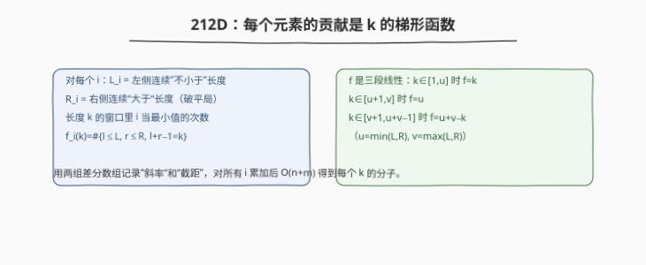
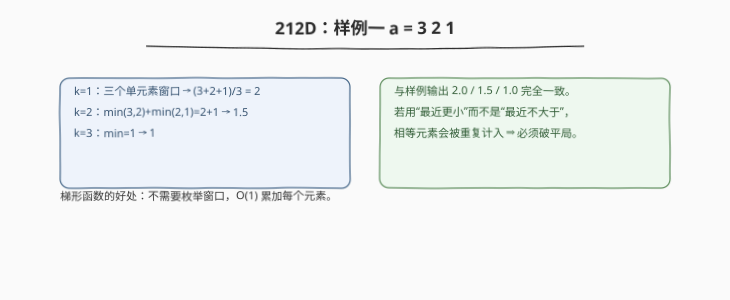

# Codeforces 212D 切栅栏（Cutting a Fence） 题解

## 1. 题目概述

- **题目链接**：https://codeforces.com/problemset/problem/212/D
- **比赛来源**：VK Cup 2012 Finals (unofficial online-version) · Problem D（UTC 2012-07-16）
- **难度**：2400
- **标签**：单调栈、差分、期望
- **评测类型**：特殊评测（实数，误差 $10^{-9}$）
- **限制**：时间 5 s / 内存 256 MB

**题意**：栅栏有 $n$ 块木板，高度 $a_i$。对每个查询宽度 $k$，Vasya 在全部 $n-k+1$ 个长度为 $k$ 的连续区间中均匀随机选一个，矩形高度取该区间木板高度的最小值。求高度的期望值。

**约束**：$n\le10^6$，$m\le10^6$，$1\le a_i\le10^9$，$1\le k\le n$。

## 2. 示例与观察

官方样例一：

```text
输入：
3
3 2 1
3
1 2 3

输出：
2.000000000000000
1.500000000000000
1.000000000000000
```

官方样例二：

```text
输入：
2
1 1
3
1 2 1

输出：
1.000000000000000
1.000000000000000
1.000000000000000
```

**观察**：长度 $k$ 的期望 = （所有长度为 $k$ 的窗口最小值之和）$/(n-k+1)$。关键是快速算出每个 $k$ 的“最小值之和”。



## 3. 解题思路

### 3.1 朴素做法与瓶颈

对每个 $k$ 枚举所有窗口求最小值：$O(n^2)$，$n=10^6$ 不可行。

### 3.2 核心观察

对每个位置 $i$ 算它“作为最小值”向左、向右能延伸的长度 $L_i,R_i$（用单调栈，并用“左侧严格更小 / 右侧不小于”破平局，保证每个窗口恰好被一个位置认领）。则长度 $k$ 的窗口中 $i$ 当最小值的次数是 $f_i(k)=\#\{(l,r):1\le l\le L_i,\ 1\le r\le R_i,\ l+r-1=k\}$，它是 $k$ 的分段线性（梯形）函数。把所有 $i$ 的 $a_i\cdot f_i(k)$ 累加即可。

### 3.3 算法流程

1. 单调栈求 $L_i$（最近严格更小）与 $R_i$（最近不大于）。
2. 令 $u=\min(L_i,R_i)$，$v=\max(L_i,R_i)$，则
   $f_i(k)=k\ (1\le k\le u)$；$=u\ (u<k\le v)$；$=u+v-k\ (v<k\le u+v-1)$。
3. 用两组差分数组分别累加“斜率”和“截距”的系数。
4. 前缀和后得到每个 $k$ 的最小值之和，查询时除以 $n-k+1$。



### 3.4 样例走查

$a=(3,2,1)$：$k=1$ 时窗口和 $=3+2+1=6$，期望 2；$k=2$ 时 $\min(3,2)+\min(2,1)=3$，期望 1.5；$k=3$ 时 $\min=1$，期望 1。

## 4. 正确性证明

**引理 1（认领唯一）**：若 $L_i$ 用“最近严格更小”、$R_i$ 用“最近不大于”定义，则每个窗口 $[l,r]$ 恰有一个下标 $i$ 满足 $l\le i\le r$ 且 $L_i\ge i-l+1,\ R_i\ge r-i+1$，且该下标是窗口最小值。

**证明**：取窗口中最靠左的最小值位置 $i$：其左侧没有更小的元素（否则有更小值），右侧没有严格更小的元素（否则更靠左的最小值不唯一？——由“最靠左的最小值”定义，右侧可以有相等但不小于），恰与破平局规则吻合；其它位置要么更小要么被相等元素按规则排除，故唯一。∎

**引理 2（贡献公式）**：$i$ 认领的长度 $k$ 窗口数恰为 $f_i(k)=[1\le k\le u]\cdot k+[u<k\le v]\cdot u+[v<k\le u+v-1]\cdot(u+v-k)$。

**证明**：认领窗口由 $l\in[1,L_i]$、$r\in[1,R_i]$、$l+r-1=k$ 决定，计数即两区间交集大小，分三段讨论（$k\le\min$ 时递增、中间平台、末尾递减）。∎

**定理**：算法输出的期望正确。

**证明**：由引理 1，每个窗口的最小值都被且仅被一个 $i$ 计入；由引理 2 贡献正确；因此差分累加得到的就是全部窗口最小值之和，除以窗口个数即期望。∎

## 5. 复杂度分析

- **时间**：单调栈 $O(n)$，差分累加 $O(n)$，查询 $O(m)$；总计 $O(n+m)$，$n=m=10^6$ 实测 0.46 s。
- **空间**：$O(n)$（两个差分数组用 `long double`，约 32 MB）。

## 6. 参考代码

### C++17

```cpp
#include <bits/stdc++.h>
using namespace std;
int main() {
    int n;
    if (scanf("%d", &n) != 1) return 0;
    vector<int> a(n + 2);
    for (int i = 1; i <= n; ++i) scanf("%d", &a[i]);
    // L[i]：左侧连续“严格小于 a[i]”的个数 + 1（用单调栈：最近的大于 a[i] 的位置）
    vector<int> L(n + 2), R(n + 2), st;
    st.clear();
    for (int i = 1; i <= n; ++i) {
        while (!st.empty() && a[st.back()] >= a[i]) st.pop_back();   // 找最近的严格更小
        L[i] = st.empty() ? i : i - st.back();
        st.push_back(i);
    }
    st.clear();
    for (int i = n; i >= 1; --i) {
        while (!st.empty() && a[st.back()] > a[i]) st.pop_back();    // 找最近的更小或相等
        R[i] = st.empty() ? n - i + 1 : st.back() - i;
        st.push_back(i);
    }
    vector<long double> ds(n + 2, 0.0L), db(n + 2, 0.0L);
    auto addRange = [&](int lo, int hi, long double slope, long double inter, long double coef) {
        if (lo > hi) return;
        ds[lo] += slope * coef; ds[hi + 1] -= slope * coef;
        db[lo] += inter * coef; db[hi + 1] -= inter * coef;
    };
    for (int i = 1; i <= n; ++i) {
        long long l = L[i], r = R[i];
        long long u = min(l, r), v = max(l, r);
        long double coef = (long double)a[i];
        addRange(1, (int)u, 1.0L, 0.0L, coef);
        addRange((int)u + 1, (int)v, 0.0L, (long double)u, coef);
        addRange((int)v + 1, (int)(u + v - 1), -1.0L, (long double)(u + v), coef);
    }
    vector<long double> total(n + 2, 0.0L);
    long double S = 0, B = 0;
    for (int k = 1; k <= n; ++k) {
        S += ds[k]; B += db[k];
        total[k] = S * k + B;
    }
    int m;
    if (scanf("%d", &m) != 1) return 0;
    string out;
    out.reserve((size_t)m * 22);
    char buf[64];
    for (int q = 0; q < m; ++q) {
        int k; scanf("%d", &k);
        long double val = total[k] / (long double)(n - k + 1);
        int len = snprintf(buf, sizeof(buf), "%.15Lf", val);
        out.append(buf, len);
        out.push_back('\n');
    }
    fwrite(out.data(), 1, out.size(), stdout);
    return 0;
}
```

### Python3

```python
import sys


def main() -> None:
    data = sys.stdin.buffer.read().split()
    n = int(data[0])
    a = [0] + [int(x) for x in data[1:1 + n]]
    L = [0] * (n + 2)
    R = [0] * (n + 2)
    st = []
    for i in range(1, n + 1):
        while st and a[st[-1]] >= a[i]:
            st.pop()
        L[i] = i if not st else i - st[-1]
        st.append(i)
    st = []
    for i in range(n, 0, -1):
        while st and a[st[-1]] > a[i]:
            st.pop()
        R[i] = n - i + 1 if not st else st[-1] - i
        st.append(i)
    ds = [0.0] * (n + 2)
    db = [0.0] * (n + 2)

    def add_range(lo, hi, slope, inter, coef):
        if lo > hi:
            return
        ds[lo] += slope * coef
        ds[hi + 1] -= slope * coef
        db[lo] += inter * coef
        db[hi + 1] -= inter * coef

    for i in range(1, n + 1):
        l, r = L[i], R[i]
        u, v = min(l, r), max(l, r)
        coef = float(a[i])
        add_range(1, u, 1.0, 0.0, coef)
        add_range(u + 1, v, 0.0, float(u), coef)
        add_range(v + 1, u + v - 1, -1.0, float(u + v), coef)
    total = [0.0] * (n + 2)
    S = B = 0.0
    for k in range(1, n + 1):
        S += ds[k]
        B += db[k]
        total[k] = S * k + B
    p = 1 + n
    m = int(data[p]); p += 1
    out = []
    for _ in range(m):
        k = int(data[p]); p += 1
        out.append('%.15f' % (total[k] / (n - k + 1)))
    print('\n'.join(out))


main()
```

## 7. 边界情况与易错点

1. **破平局方向**：左侧严格更小、右侧不大于；写反会把相等元素重复统计，答案偏大。
2. **$k=1$**：梯形从 $k=1$ 开始，$f_i(1)=1$，别漏掉这一项。
3. **相等元素**：必须让每个窗口只被一个位置认领。
4. **精度**：用 `long double` 累加斜率/截距（中间量可达 $10^{21}$ 量级），最后除窗口数。
5. **查询重复**：同一 $k$ 可能出现多次，直接查表。
6. **$n=1$**：$L=R=1$，期望就是 $a_1$。

## 8. 验证记录

- **编译环境与命令**：`python3 codeforces/tools/verify_solution.py codeforces/contests/0101-0203/212/D_切栅栏.md --checker codeforces/tools/checkers/float.py`。
- **官方样例**：2 / 2 通过。
- **随机对拍**：暴力对每个 $k$ 直接枚举窗口求 min（$n\le9$）共 **250 组**，相对误差 < $10^{-9}$，C++/Python 均一致。
- **性能**：$n=m=10^6$ 随机数据 0.46 s（时限 5 s）。
- **图片校验**：`cf212d_trap.svg`、`cf212d_walk.svg` 通过 `xml.etree.ElementTree.parse`。
- **复核状态**：verified。

## 相关题目与扩展

- [Codeforces 212E IT 餐厅](https://codeforces.com/problemset/problem/212/E)：同场题目。
- [LeetCode 907 子数组的最小值之和](https://leetcode.cn/problems/sum-of-subarray-minimums/)：同一“按元素认领窗口”的技巧。
- [Codeforces 213C 接力赛](https://codeforces.com/problemset/problem/213/C)：另一种按层 DP。

**延伸思考**：

1. 若查询是“第 $k$ 小/乘积的期望”，需要更复杂的数据结构。
2. 若 $a_i$ 动态修改，需要线段树维护梯形函数的复合。
3. 本题是“每个元素认领一段窗口”的经典应用：单调栈求出作用区间，再对区间长度做差分统计。
