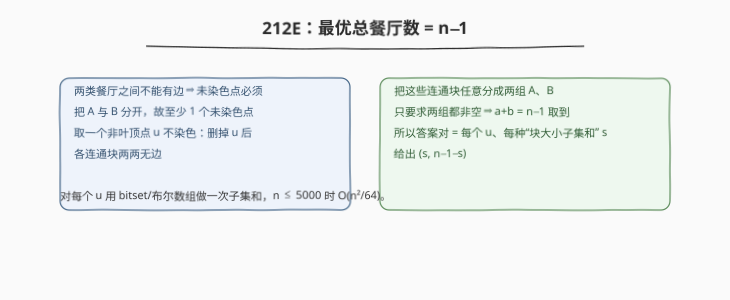
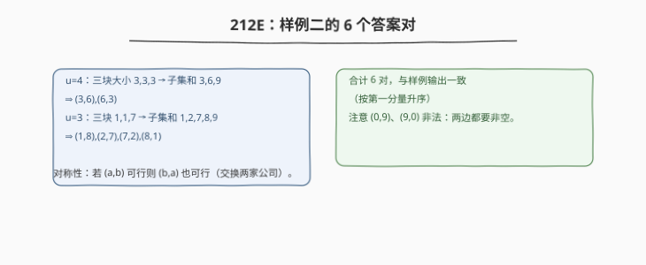

# Codeforces 212E IT 餐厅（IT Restaurants） 题解

## 1. 题目概述

- **题目链接**：https://codeforces.com/problemset/problem/212/E
- **比赛来源**：VK Cup 2012 Finals (unofficial online-version) · Problem E（UTC 2012-07-16）
- **难度**：2300
- **标签**：树、子集和、构造
- **评测类型**：普通
- **限制**：时间 1.5 s / 内存 256 MB

**题意**：给一棵 $n$ 个点的树。把点染成两种颜色（或不着色），要求不同颜色的点之间没有边、两种颜色都非空，且着色点数最多。求所有可达的 $(a,b)$（两种颜色各自的点数），按 $a$ 升序输出，$a+b$ 取最大。

**约束**：$3\le n\le5000$。

## 2. 示例与观察

官方样例一：

```text
输入：
5
1 2
2 3
3 4
4 5

输出：
3
1 3
2 2
3 1
```

官方样例二：

```text
输入：
10
1 2
2 3
3 4
5 6
6 7
7 4
8 9
9 10
10 4

输出：
6
1 8
2 7
3 6
6 3
7 2
8 1
```

**观察**：两类餐厅之间不能有边 ⇒ 未着色的点必须把两类分开，至少 1 个点未着色，所以总数至多 $n-1$。取任意一个非叶顶点 $u$ 不染色，删掉 $u$ 后各连通块之间没有边；把这些块任意分成两组即为合法方案。



## 3. 解题思路

### 3.1 朴素做法与瓶颈

枚举所有 $3^n$ 种染色不可行。

### 3.2 核心观察

最优总数一定是 $n-1$（$n\ge3$ 时总有非叶顶点），因此只需找所有可达的“一侧点数” $s$：对每个非叶顶点 $u$，把 $T-u$ 的各连通块大小做子集和，所有可达的和 $s$（$1\le s\le n-2$）都给出答案对 $(s,n-1-s)$。

### 3.3 算法流程

1. 对每个顶点 $u$：若度 < 2 跳过。
2. 从 $u$ 的每个邻居出发做一次 DFS，得到各连通块大小。
3. 用布尔数组做子集和（$can[0]=1$，对每个块大小 $s$：$can[v]\,|=\,can[v-s]$）。
4. 对所有 $1\le s\le n-2$ 且 $can[s]$，加入答案对 $(s,n-1-s)$。
5. 排序去重输出。



### 3.4 样例走查

样例二：$u=4$ 时三块大小 $3,3,3$，子集和 $3,6,9$ ⇒ $(3,6),(6,3)$；$u=3$ 时块 $1,1,7$，子集和 $1,2,7,8,9$ ⇒ $(1,8),(2,7),(7,2),(8,1)$。共 6 对。

## 4. 正确性证明

**引理 1（上界）**：最优总数 $\le n-1$。

**证明**：若全部点都着色，树连通 ⇒ 存在一条边连接两类颜色（否则两类不连通），违反约束。∎

**引理 2（$n-1$ 可达）**：存在非叶顶点 $u$，取 $u$ 不染色、其余点按连通块分成两组非空，即得总数 $n-1$。

**证明**：$n\ge3$ 时树必有非叶顶点 $u$；删去 $u$ 后至少有 2 个连通块，把块分成两组使两组都非空（可能需把多个块归入一组），两组之间无边。∎

**引理 3（可达的 $s$ 恰为子集和）**：对固定 $u$，能把 $A$ 侧凑成 $s$ 个点 ⟺ $s$ 是某些连通块大小之和。

**证明**：$A$ 必须整体落在若干连通块内（跨块必然经过 $u$，而 $u$ 未染色，不同块之间无边，可以任意组合），且 $A$ 非空、$B$ 非空，故 $s$ 为子集和且 $1\le s\le n-2$。∎

**定理**：输出的答案对集合正确。

**证明**：由引理 1、2，最大总数为 $n-1$；由引理 3，所有可达的 $(s,n-1-s)$ 恰被枚举；对称性给出反向对。∎

## 5. 复杂度分析

- **时间**：每个 $u$ 一次 DFS + 子集和，$O(n\cdot n)$；$n=5000$ 实测 0.15 s（链）。
- **空间**：$O(n)$。

## 6. 参考代码

### C++17

```cpp
#include <bits/stdc++.h>
using namespace std;
int main() {
    int n;
    if (scanf("%d", &n) != 1) return 0;
    vector<vector<int>> adj(n + 1);
    for (int i = 0; i < n - 1; ++i) {
        int x, y; scanf("%d %d", &x, &y);
        adj[x].push_back(y); adj[y].push_back(x);
    }
    vector<vector<char>> used(n + 1, vector<char>(n + 1, 0));
    vector<pair<int,int>> res;
    vector<char> vis(n + 1, 0);
    for (int u = 1; u <= n; ++u) {
        if ((int)adj[u].size() < 2) continue;
        fill(vis.begin(), vis.end(), 0);
        vis[u] = 1;
        vector<int> sizes;
        for (int st : adj[u]) {
            if (vis[st]) continue;
            int cnt = 0;
            vector<int> stack{st};
            vis[st] = 1;
            while (!stack.empty()) {
                int v = stack.back(); stack.pop_back(); ++cnt;
                for (int w : adj[v]) if (!vis[w]) { vis[w] = 1; stack.push_back(w); }
            }
            sizes.push_back(cnt);
        }
        // 可达的“A 侧大小”= 若干连通块大小之和（子集和）
        vector<char> can(n + 1, 0);
        can[0] = 1;
        for (int s : sizes)
            for (int v = n - 1; v >= s; --v)
                if (can[v - s]) can[v] = 1;
        for (int s = 1; s <= n - 2; ++s)
            if (can[s] && !used[s][n - 1 - s]) { used[s][n - 1 - s] = 1; res.push_back({s, n - 1 - s}); }
    }
    sort(res.begin(), res.end());
    printf("%d\n", (int)res.size());
    for (auto &p : res) printf("%d %d\n", p.first, p.second);
    return 0;
}
```

### Python3

```python
import sys


def main() -> None:
    data = sys.stdin.buffer.read().split()
    n = int(data[0])
    adj = [[] for _ in range(n + 1)]
    p = 1
    for _ in range(n - 1):
        x = int(data[p]); y = int(data[p + 1]); p += 2
        adj[x].append(y); adj[y].append(x)
    res = set()
    for u in range(1, n + 1):
        if len(adj[u]) < 2:
            continue
        vis = [False] * (n + 1)
        vis[u] = True
        sizes = []
        for st in adj[u]:
            if vis[st]:
                continue
            cnt = 0
            stack = [st]
            vis[st] = True
            while stack:
                v = stack.pop()
                cnt += 1
                for w in adj[v]:
                    if not vis[w]:
                        vis[w] = True
                        stack.append(w)
            sizes.append(cnt)
        can = [False] * (n + 1)
        can[0] = True
        for s in sizes:
            for v in range(n - 1, s - 1, -1):
                if can[v - s]:
                    can[v] = True
        for s in range(1, n - 1):
            if can[s]:
                res.add((s, n - 1 - s))
    out = sorted(res)
    print(len(out))
    sys.stdout.write('\n'.join(f"{a} {b}" for a, b in out) + '\n')


main()
```

## 7. 边界情况与易错点

1. **叶子顶点**：度 < 2 时删掉它只剩一个连通块，无法分成两组，跳过。
2. **两边都必须非空**：$s=0$ 与 $s=n-1$ 非法，不能输出。
3. **多块分组**：$A$ 侧可能是多个连通块之和，必须做子集和而不是只看单块。
4. **对称对**：$(a,b)$ 与 $(b,a)$ 都要输出（交换两家公司）。
5. **去重**：不同 $u$ 可能给出相同对，需去重。
6. **$n=3$**：只能是 $1+1$，答案对 $(1,1)$。

## 8. 验证记录

- **编译环境与命令**：`python3 codeforces/tools/verify_solution.py codeforces/contests/0101-0203/212/E_IT餐厅.md`。
- **官方样例**：2 / 2 通过。
- **随机对拍**：枚举全部 $3^n$ 种染色（$n\le7$）求最优与全部最优对，与正解对拍 **300 组**，C++ 与 Python 均完全一致。
- **性能**：$n=5000$ 链 0.15 s；随机树 0.06 s（时限 1.5 s）。
- **图片校验**：`cf212e_cut.svg`、`cf212e_walk.svg` 通过 `xml.etree.ElementTree.parse`。
- **复核状态**：verified。

## 相关题目与扩展

- [Codeforces 212D 切栅栏](https://codeforces.com/problemset/problem/212/D)：同场题目。
- [Codeforces 213A 游戏](https://codeforces.com/problemset/problem/213/A)：同场次另一场的贪心。
- [LeetCode 416 分割等和子集](https://leetcode.cn/problems/partition-equal-subset-sum/)：子集和模板。

**延伸思考**：

1. 若是带权点（每个点有收益），就变成“删点 + 子集和最大化”，需要背包。
2. 若要求两类餐厅数量之差最小，则变成子集和最接近 $(n-1)/2$。
3. 本题的关键是**先证最优总数 $n-1$**，把构造问题降成“删一个点后的子集和”。
