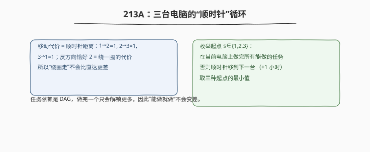
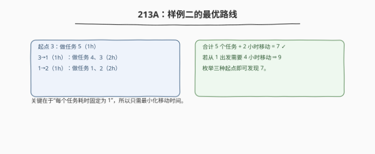

# Codeforces 213A 游戏（Game） 题解

## 1. 题目概述

- **题目链接**：https://codeforces.com/problemset/problem/213/A
- **比赛来源**：Codeforces Round 131 (Div. 1) · Problem A（UTC 2012-07-30）
- **难度**：1400
- **标签**：贪心、模拟、DAG
- **评测类型**：普通
- **限制**：时间 1 s / 内存 256 MB

**题意**：$n$ 个游戏任务，任务之间有依赖（无环），每个任务只能在指定的一台电脑（1、2、3）上完成，每个任务耗时 1 小时。在三台电脑之间移动的耗时：$1\to2$、$2\to3$、$3\to1$ 各 1 小时，反向各 2 小时。初始位置任选，求完成全部任务的最少小时数。

**约束**：$1\le n\le200$。

## 2. 示例与观察

官方样例一：

```text
输入：
1
1
0

输出：
1
```

官方样例二：

```text
输入：
5
2 2 1 1 3
1 5
2 5 1
2 5 4
1 5
0

输出：
7
```

**观察**：三台电脑构成环 $1\to2\to3\to1$，每次顺时针走一步恰好 1 小时；反向走一步是 2 小时，等于顺时针走两步。因此“路径代价 = 顺时针距离”，绕圈永远不会比直达更差。



## 3. 解题思路

### 3.1 朴素做法与瓶颈

需要决定任务顺序与移动路线，搜索空间大；但注意每个任务固定 1 小时。

### 3.2 核心观察

总耗时 = $n$ + 总移动时间。由于任务依赖无环且“做完一个只会解锁更多”，在当前位置上把所有能做的任务做完不会变差；没有可做的就顺时针走到下一台。只需枚举起点 3 种。

### 3.3 算法流程

1. 对起点 $s\in\{1,2,3\}$：
2. 重复：在当前电脑上反复扫描，把所有“依赖已完成”的任务做完（每个 +1 小时）。
3. 若还有任务，顺时针移动到下一台（+1 小时），继续。
4. 三种起点取最小。



### 3.4 样例走查

样例二从 3 出发：做任务 5（1h）→ 移到 1（1h）做任务 4、3（2h）→ 移到 2（1h）做任务 1、2（2h），共 7 小时；从 1 出发需要 9 小时。

## 4. 正确性证明

**引理 1（移动代价）**：从 $i$ 到 $j$ 的最短移动时间等于顺时针距离 $(j-i)\bmod3$。

**证明**：$1\to2=1$、$2\to3=1$、$3\to1=1$；反向一步为 2，恰好等于顺时针绕两步，故最小代价就是顺时针距离。∎

**引理 2（“能做就做”不劣）**：固定起点，若当前电脑上有可做任务，先做它不会使总时间变大。

**证明**：任务只耗时 1 且位置不变；做完后依赖集合单调减少（解锁更多任务），任何原本可行的后续计划仍然可行，且不增加移动。∎

**引理 3（枚举起点充分）**：最优方案一定在某个起点下被上述模拟复现。

**证明**：模拟中移动方向恒为顺时针且“无任务可做才移动”，由引理 2 可把最优方案中的任务完成时刻前移而不增加移动次数；移动顺序即顺时针逐台推进，起点即最优方案的初始电脑。∎

**定理**：三种起点模拟结果的最小值即答案。

**证明**：由引理 2、3，每种起点下模拟给出该起点的最优值，取最小覆盖所有可能起点。∎

## 5. 复杂度分析

- **时间**：$O(3\cdot(n+\text{移动次数}))=O(n)$，移动次数 ≤ $3n$。
- **空间**：$O(n)$。
- $n\le200$，实测 < 1 ms。

## 6. 参考代码

### C++17

```cpp
#include <bits/stdc++.h>
using namespace std;
int main() {
    int n;
    if (scanf("%d", &n) != 1) return 0;
    vector<int> c(n + 1);
    for (int i = 1; i <= n; ++i) scanf("%d", &c[i]);
    vector<vector<int>> pre(n + 1), dep(n + 1);
    for (int i = 1; i <= n; ++i) {
        int k; scanf("%d", &k);
        for (int j = 0; j < k; ++j) { int a; scanf("%d", &a); pre[i].push_back(a); dep[a].push_back(i); }
    }
    int best = INT_MAX;
    for (int start = 1; start <= 3; ++start) {
        vector<char> done(n + 1, 0);
        vector<int> need(n + 1);
        for (int i = 1; i <= n; ++i) need[i] = (int)pre[i].size();
        int cur = start, hours = 0, left = n;
        while (left > 0) {
            bool any = true;
            while (any) {
                any = false;
                for (int i = 1; i <= n; ++i)
                    if (!done[i] && need[i] == 0 && c[i] == cur) {
                        done[i] = 1; ++hours; --left; any = true;
                        for (int j : dep[i]) --need[j];
                    }
            }
            if (left == 0) break;
            int nxt = cur % 3 + 1;
            hours += 1;   // 顺时针走一步 = 1 小时
            cur = nxt;
        }
        best = min(best, hours);
    }
    printf("%d\n", best);
    return 0;
}
```

### Python3

```python
import sys
from collections import deque


def main() -> None:
    data = sys.stdin.buffer.read().split()
    p = 0
    n = int(data[p]); p += 1
    comp = [0] * (n + 1)
    for i in range(1, n + 1):
        comp[i] = int(data[p]); p += 1
    pre = [[] for _ in range(n + 1)]
    dep = [[] for _ in range(n + 1)]
    for i in range(1, n + 1):
        k = int(data[p]); p += 1
        for _ in range(k):
            a = int(data[p]); p += 1
            pre[i].append(a); dep[a].append(i)
    best = None
    for start in (1, 2, 3):
        done = [False] * (n + 1)
        need = [len(pre[i]) for i in range(n + 1)]
        cur = start
        hours = 0
        left = n
        while left > 0:
            any = True
            while any:
                any = False
                for i in range(1, n + 1):
                    if not done[i] and need[i] == 0 and comp[i] == cur:
                        done[i] = True
                        hours += 1
                        left -= 1
                        any = True
                        for j in dep[i]:
                            need[j] -= 1
            if left == 0:
                break
            cur = cur % 3 + 1
            hours += 1
        if best is None or hours < best:
            best = hours
    print(best)


main()
```

## 7. 边界情况与易错点

1. **起点选择**：必须枚举 3 种起点，样例二从 1 出发会多花 2 小时。
2. **依赖为空**：所有任务随时可做。
3. **同一台电脑上的连环解锁**：做完一个后可能立刻解锁同电脑的另一个，必须循环扫描到没有可做为止。
4. **反向移动的代价**：$2$ 等于顺时针两步，代码里统一按顺时针一步 +1 处理。
5. **$n=1$**：直接在指定电脑上做，答案 1（不需要移动）。
6. **移动次数上界**：循环中要保证不会无限转圈（依赖无环保证最终可做完）。

## 8. 验证记录

- **编译环境与命令**：`python3 codeforces/tools/verify_solution.py codeforces/contests/0101-0203/213/A_游戏.md`。
- **官方样例**：2 / 2 通过（1、7）。
- **随机对拍**：独立 Dijkstra 暴力（状态 = 已完成集合 + 当前电脑，$n\le6$）随机 **250 组**，与贪心完全一致。
- **性能**：$n=200$ 时 < 1 ms。
- **图片校验**：`cf213a_cycle.svg`、`cf213a_walk.svg` 通过 `xml.etree.ElementTree.parse`。
- **复核状态**：verified。

## 相关题目与扩展

- [Codeforces 213B 数字](https://codeforces.com/problemset/problem/213/B)：同场计数 DP。
- [LeetCode 2050 并行课程 III](https://leetcode.cn/problems/parallel-courses-iii/)：DAG 上的调度。
- [Codeforces 212A 私有化](https://codeforces.com/problemset/problem/212/A)：另一场的流/构造。

**延伸思考**：

1. 若任务耗时不统一，贪心不再最优，需要最短路 DP。
2. 若电脑数为 $k$ 而非 3，环上的距离矩阵仍成立，枚举 $k$ 个起点即可。
3. 核心：把“移动”与“做任务”解耦 —— 任务耗时固定，只需最小化移动。
