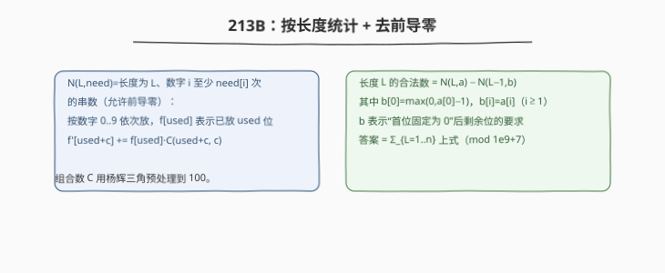
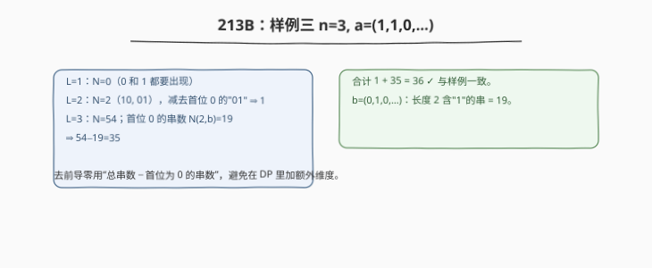

# Codeforces 213B 数字（Numbers） 题解

## 1. 题目概述

- **题目链接**：https://codeforces.com/problemset/problem/213/B
- **比赛来源**：Codeforces Round 131 (Div. 1) · Problem B（UTC 2012-07-30）
- **难度**：1600
- **标签**：计数、组合数学、DP
- **评测类型**：普通
- **限制**：时间 2 s / 内存 256 MB

**题意**：给定 $n$ 与十个整数 $a_0..a_9$。统计满足下列条件的正整数个数（对 $10^9+7$ 取模）：位数不超过 $n$；没有前导零；数字 $i$ 至少出现 $a_i$ 次。

**约束**：$1\le n\le100$，$0\le a_i\le100$。

## 2. 示例与观察

官方样例一：

```text
输入：
1
0 0 0 0 0 0 0 0 0 1

输出：
1
```

官方样例二：

```text
输入：
2
1 1 0 0 0 0 0 0 0 0

输出：
1
```

官方样例三：

```text
输入：
3
1 1 0 0 0 0 0 0 0 0

输出：
36
```

**观察**：按长度 $L$ 分开统计。先算“允许前导零”的串数 $N(L,\text{need})$，再减去“首位为 0”的串数 $N(L-1,\text{need′})$，其中 $\text{need}_0=\max(0,a_0-1)$、其余不变。



## 3. 解题思路

### 3.1 朴素做法与瓶颈

枚举所有长度不超过 100 的数不可能。

### 3.2 核心观察

固定长度 $L$ 后，只需决定每个数字出现次数 $c_i\ge a_i$、$\sum c_i=L$，方案数 $=\frac{L!}{\prod c_i!}$。用“按数字逐个放”的 DP：$f[\text{used}]$ 表示已放 used 位，放数字 $i$ 的 $c$ 次时乘以 $\binom{\text{used}+c}{c}$。

### 3.3 算法流程

1. 预处理组合数到 100。
2. 对长度 $L=1..n$：算 $N(L,a)$ 与 $N(L-1,b)$。
3. 答案为 $\sum_L \big(N(L,a)-N(L-1,b)\big) \bmod (10^9+7)$。



### 3.4 样例走查

$n=3,a=(1,1,0,\dots)$：$L=1$ 无解；$L=2$ 有 `10`、`01`，去掉首位 0 的 `01` 得 1；$L=3$ 时 $N(3,a)=54$，首位 0 的 $N(2,b)=19$，得 35；合计 36。

## 4. 正确性证明

**引理 1（DP 正确）**：$f[L]$ 等于长度为 $L$、每个数字 $i$ 出现次数 $\ge a_i$ 的串数（允许前导零）。

**证明**：按数字 0..9 依次决定出现次数；已放 used 位时插入 $c$ 个相同数字的方案数为 $\binom{\text{used}+c}{c}$，乘法原理与加法原理给出递推，最终 $f[L]$ 即所求。∎

**引理 2（去前导零）**：长度 $L$ 的合法数 $=N(L,a)-N(L-1,b)$，其中 $b_0=\max(0,a_0-1)$，其余 $b_i=a_i$。

**证明**：首位为 0 的串与“剩余 $L-1$ 位、数字 0 至少还要 $a_0-1$ 次、其它数字至少 $a_i$ 次”的串一一对应。∎

**定理**：答案公式正确。

**证明**：各长度互不相交，由引理 1、2 逐长度求和即得。∎

## 5. 复杂度分析

- **时间**：$O(10n^2)$（对每个 $L$ 做一次 $O(10L^2)$ 的 DP），$n\le100$ 时约 $10^5$。
- **空间**：$O(n)$。

## 6. 参考代码

### C++17

```cpp
#include <bits/stdc++.h>
using namespace std;
typedef long long ll;
static const ll MOD = 1000000007;
static ll C_[105][105];
int main() {
    int n;
    if (scanf("%d", &n) != 1) return 0;
    vector<int> a(10);
    for (int i = 0; i < 10; ++i) scanf("%d", &a[i]);
    for (int i = 0; i <= 100; ++i) { C_[i][0] = 1; for (int j = 1; j <= i; ++j) C_[i][j] = (C_[i-1][j-1] + C_[i-1][j]) % MOD; }
    // N(L, need) = 长度为 L、数字 i 至少出现 need[i] 次的串数
    auto calc = [&](int L, const vector<int> &need) -> ll {
        if (L < 0) return 0;
        vector<ll> f(L + 1, 0), g(L + 1, 0);
        f[0] = 1;
        for (int d = 0; d < 10; ++d) {
            fill(g.begin(), g.end(), 0);
            for (int used = 0; used <= L; ++used) {
                if (!f[used]) continue;
                for (int c = need[d]; used + c <= L; ++c)
                    g[used + c] = (g[used + c] + f[used] * C_[used + c][c]) % MOD;
            }
            f.swap(g);
        }
        return f[L];
    };
    vector<int> b = a;
    b[0] = max(0, a[0] - 1);
    ll ans = 0;
    for (int L = 1; L <= n; ++L) {
        ll tot = calc(L, a);
        ll lead0 = calc(L - 1, b);
        ans = ((ans + tot - lead0) % MOD + MOD) % MOD;
    }
    printf("%lld\n", ans);
    return 0;
}
```

### Python3

```python
import sys

MOD = 1000000007


def main() -> None:
    data = sys.stdin.buffer.read().split()
    n = int(data[0])
    a = [int(x) for x in data[1:11]]
    C = [[0] * 105 for _ in range(105)]
    for i in range(105):
        C[i][0] = 1
        for j in range(1, i + 1):
            C[i][j] = (C[i - 1][j - 1] + C[i - 1][j]) % MOD

    def calc(L, need):
        if L < 0:
            return 0
        f = [0] * (L + 1)
        f[0] = 1
        for d in range(10):
            g = [0] * (L + 1)
            for used in range(L + 1):
                if f[used] == 0:
                    continue
                c = need[d]
                while used + c <= L:
                    g[used + c] = (g[used + c] + f[used] * C[used + c][c]) % MOD
                    c += 1
            f = g
        return f[L]

    b = a[:]
    b[0] = max(0, a[0] - 1)
    ans = 0
    for L in range(1, n + 1):
        ans = (ans + calc(L, a) - calc(L - 1, b)) % MOD
    print(ans)


main()
```

## 7. 边界情况与易错点

1. **$a_0>0$ 与前导零**：必须减去首位为 0 的情形，否则重复计数。
2. **总需求超过 $L$**：$N(L,\cdot)=0$，DP 自然处理。
3. **$n=1$ 且只要数字 0**：没有合法数（正整数不能是 0），答案为 0。
4. **取模**：中间组合数与乘法都要取模。
5. **重复数字**：排列数用多项式系数，别忘记除以重复次数。
6. **长度上界**：$L$ 从 1 到 $n$，$L=0$ 时 $N(0,\cdot)$ 只在全部 $a_i=0$ 时为 1。

## 8. 验证记录

- **编译环境与命令**：`python3 codeforces/tools/verify_solution.py codeforces/contests/0101-0203/213/B_数字.md`。
- **官方样例**：3 / 3 通过（1、1、36）。
- **随机对拍**：枚举所有长度 ≤ 4 的十进制数（$\le1.1\times10^4$ 个）暴力计数，随机 $a$ 共 **200 组**，与正解一致。
- **性能**：$n=100,a_i=2$ 时 < 1 ms。
- **图片校验**：`cf213b_dp.svg`、`cf213b_walk.svg` 通过 `xml.etree.ElementTree.parse`。
- **复核状态**：verified。

## 相关题目与扩展

- [Codeforces 213C 接力赛](https://codeforces.com/problemset/problem/213/C)：同场题目。
- [LeetCode 902 最大为 N 的数字组合](https://leetcode.cn/problems/numbers-at-most-n-given-digit-set/)：按位计数。
- [Codeforces 212C 牛仔](https://codeforces.com/problemset/problem/212/C)：环上计数 DP。

**延伸思考**：

1. 若要求“恰好”出现 $a_i$ 次，直接用多项式系数。
2. 若要求数字和是 $k$ 的倍数，DP 再加一维余数。
3. 本题的关键是把“至少”条件转成“按数字放位”的组合 DP，并用“总 − 首位 0”处理前导零。
