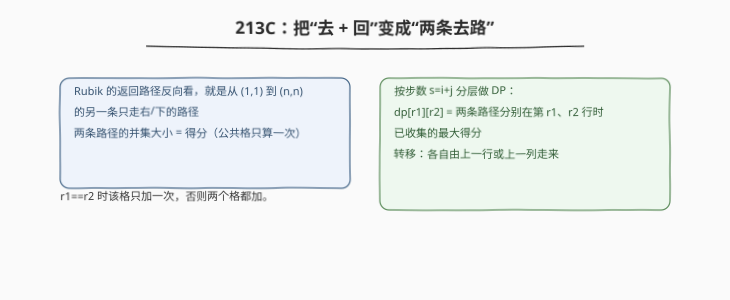
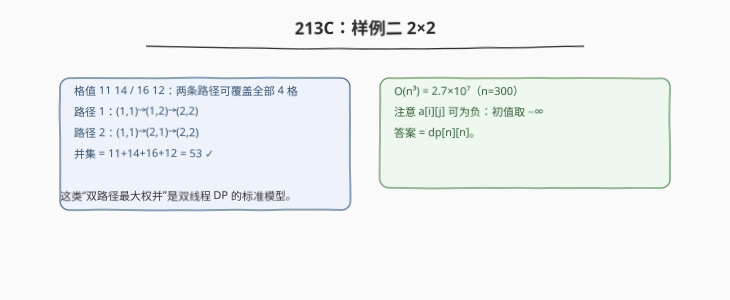

# Codeforces 213C 接力赛（Relay Race） 题解

## 1. 题目概述

- **题目链接**：https://codeforces.com/problemset/problem/213/C
- **比赛来源**：Codeforces Round 131 (Div. 1) · Problem C（UTC 2012-07-30）
- **难度**：2200
- **标签**：动态规划、网格、双路径
- **评测类型**：普通
- **限制**：时间 4 s / 内存 256 MB

**题意**：$n\times n$ 网格每格有权值 $a_{i,j}$（可负）。Furik 从 $(1,1)$ 只向右/下走到 $(n,n)$，随后 Rubik 从 $(n,n)$ 只向左/上走回 $(1,1)$。得分是两人经过的所有格子权值之和（同一格只算一次）。求最大得分。

**约束**：$1\le n\le300$，$-1000\le a_{i,j}\le1000$。

## 2. 示例与观察

官方样例一：

```text
输入：
1
5

输出：
5
```

官方样例二：

```text
输入：
2
11 14
16 12

输出：
53
```

官方样例三：

```text
输入：
3
25 16 25
12 18 19
11 13 8

输出：
136
```

**观察**：把 Rubik 的返回路径反向看，它也是一条从 $(1,1)$ 到 $(n,n)$ 的只向右/下的路径。于是问题变成“选两条路径，使它们覆盖格子的权值并集最大”。



## 3. 解题思路

### 3.1 朴素做法与瓶颈

枚举两条路径是 $\binom{2n-2}{n-1}^2$，不可行。

### 3.2 核心观察

两条路径同时走，按步数 $s=i+j$ 分层：$dp[r_1][r_2]$ = 两路径分别在第 $r_1$、$r_2$ 行时已收集的最大得分。同一层两步后两路径的列坐标由行坐标唯一确定；若 $r_1=r_2$ 说明两路径重合于同一格，只加一次。

### 3.3 算法流程

1. 初值 $dp[1][1]=a_{1,1}$。
2. 对 $s=3..2n$：$dp'[r_1][r_2]=\max$ 上一层的四种前驱 $+$ 本层权值。
3. 本层权值：$r_1=r_2$ 时加 $a_{r_1,s-r_1}$，否则加两格。
4. 答案 $dp[n][n]$。



### 3.4 样例走查

$2\times2$ 时两条路径覆盖全部 4 格：$11+14+16+12=53$。

## 4. 正确性证明

**引理 1（等价性）**：任意“去 + 回”方案与两条从 $(1,1)$ 到 $(n,n)$ 的右/下路径一一对应，且覆盖格子集合相同。

**证明**：把返回路径反向，方向由左/上变为右/下，起点终点对调；经过的格子集合不变。∎

**引理 2（分层 DP 完备）**：$dp[r_1][r_2]$ 枚举了所有两条路径在第 $s$ 步到达行 $r_1,r_2$ 的组合。

**证明**：第 $s$ 步两路径的列坐标必为 $s-r_1$、$s-r_2$，故状态完整；每步各路径只能来自上一行或上一列，四种转移覆盖全部。∎

**引理 3（重复格只算一次）**：$r_1=r_2$ 时两路径在同一格，加一次正确。

**证明**：同一层且同行 ⇒ 同格（列也相同），题目要求该格只计一次。∎

**定理**：DP 结果即最大得分。

**证明**：由引理 1 问题等价；由引理 2、3 DP 精确枚举并正确累加，取最大值即为答案。∎

## 5. 复杂度分析

- **时间**：$O(n^3)$，$n=300$ 约 $2.7\times10^7$，实测 0.07 s。
- **空间**：$O(n^2)$。

## 6. 参考代码

### C++17

```cpp
#include <bits/stdc++.h>
using namespace std;
int main() {
    int n;
    if (scanf("%d", &n) != 1) return 0;
    vector<vector<int>> a(n + 2, vector<int>(n + 2, 0));
    for (int i = 1; i <= n; ++i) for (int j = 1; j <= n; ++j) scanf("%d", &a[i][j]);
    const int NEG = -1000000000;
    vector<vector<int>> dp(n + 2, vector<int>(n + 2, NEG)), nd(n + 2, vector<int>(n + 2, NEG));
    dp[1][1] = a[1][1];
    for (int s = 3; s <= 2 * n; ++s) {
        for (int r1 = 1; r1 <= n; ++r1) for (int r2 = 1; r2 <= n; ++r2) nd[r1][r2] = NEG;
        for (int r1 = 1; r1 <= n; ++r1) {
            int c1 = s - r1;
            if (c1 < 1 || c1 > n) continue;
            for (int r2 = 1; r2 <= n; ++r2) {
                int c2 = s - r2;
                if (c2 < 1 || c2 > n) continue;
                int add = (r1 == r2) ? a[r1][c1] : a[r1][c1] + a[r2][c2];
                int best = NEG;
                // 上一步：两条路径各自位于 (r1-1,c1) 或 (r1,c1-1)
                for (int d1 = 0; d1 < 2; ++d1) {
                    int pr1 = r1 - d1, pc1 = c1 - (1 - d1);
                    if (pr1 < 1 || pc1 < 1) continue;
                    for (int d2 = 0; d2 < 2; ++d2) {
                        int pr2 = r2 - d2, pc2 = c2 - (1 - d2);
                        if (pr2 < 1 || pc2 < 1) continue;
                        best = max(best, dp[pr1][pr2]);
                    }
                }
                if (best > NEG / 2) nd[r1][r2] = best + add;
            }
        }
        dp.swap(nd);
    }
    printf("%d\n", dp[n][n]);
    return 0;
}
```

### Python3

```python
import sys


def main() -> None:
    data = sys.stdin.buffer.read().split()
    n = int(data[0])
    a = [[0] * (n + 2) for _ in range(n + 2)]
    p = 1
    for i in range(1, n + 1):
        for j in range(1, n + 1):
            a[i][j] = int(data[p]); p += 1
    NEG = -10 ** 9
    dp = [[NEG] * (n + 2) for _ in range(n + 2)]
    dp[1][1] = a[1][1]
    for s in range(3, 2 * n + 1):
        nd = [[NEG] * (n + 2) for _ in range(n + 2)]
        for r1 in range(1, n + 1):
            c1 = s - r1
            if not (1 <= c1 <= n):
                continue
            for r2 in range(1, n + 1):
                c2 = s - r2
                if not (1 <= c2 <= n):
                    continue
                add = a[r1][c1] if r1 == r2 else a[r1][c1] + a[r2][c2]
                best = NEG
                for pr1 in (r1 - 1, r1):
                    pc1 = s - 1 - pr1
                    if pr1 < 1 or pc1 < 1 or pc1 > n:
                        continue
                    for pr2 in (r2 - 1, r2):
                        pc2 = s - 1 - pr2
                        if pr2 < 1 or pc2 < 1 or pc2 > n:
                            continue
                        if dp[pr1][pr2] > best:
                            best = dp[pr1][pr2]
                if best > NEG // 2:
                    nd[r1][r2] = best + add
        dp = nd
    print(dp[n][n])


main()
```

## 7. 边界情况与易错点

1. **负权值**：初值与不可达状态用 $-\infty$，不能默认 0。
2. **$n=1$**：答案是唯一格子的值（可能为负）。
3. **两路径重合**：重合格只加一次，否则会重复计分。
4. **边界**：列坐标必须落在 $[1,n]$，转移前要判断。
5. **答案范围**：$n^2\cdot1000=9\times10^7$，`int` 足够但建议 `long long`。
6. **行列方向**：返回路径反向是“右/下”，不要写成左/上。

## 8. 验证记录

- **编译环境与命令**：`python3 codeforces/tools/verify_solution.py codeforces/contests/0101-0203/213/C_接力赛.md`。
- **官方样例**：3 / 3 通过（5、53、136）。
- **随机对拍**：暴力枚举两条路径的全部组合（$n\le3$）共 **120 组**，与 DP 完全一致。
- **性能**：$n=300$ 随机数据 0.07 s（时限 4 s）。
- **图片校验**：`cf213c_paths.svg`、`cf213c_walk.svg` 通过 `xml.etree.ElementTree.parse`。
- **复核状态**：verified。

## 相关题目与扩展

- [Codeforces 213B 数字](https://codeforces.com/problemset/problem/213/B)：同场计数 DP。
- [Codeforces 213D 星星](https://codeforces.com/problemset/problem/213/D)：同场构造题。
- [LeetCode 741 摘樱桃](https://leetcode.cn/problems/cherry-pickup/)：完全同型的双路径 DP。

**延伸思考**：

1. 若允许四方向移动，问题变成最大费用流。
2. 若要求两条路径不相交，需要额外状态或容斥。
3. 核心是**把“往返”对称成“两条同向路径”**，这是双线程 DP 的标准起点。
