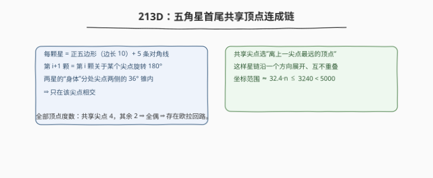
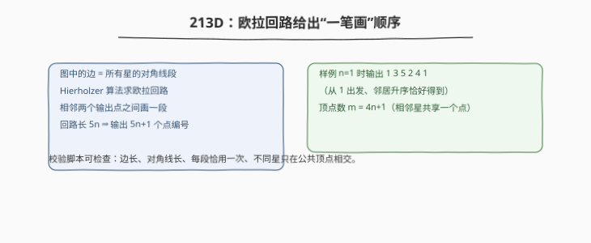

# Codeforces 213D 星星（Stars） 题解

## 1. 题目概述

- **题目链接**：https://codeforces.com/problemset/problem/213/D
- **比赛来源**：Codeforces Round 131 (Div. 1) · Problem D（UTC 2012-07-30）
- **难度**：2300
- **标签**：计算几何、构造、欧拉回路
- **评测类型**：特殊评测（多解，坐标精度 $10^{-8}$）
- **限制**：时间 2 s / 内存 256 MB

**题意**：画 $n$ 个五角星（正五边形 + 全部对角线，五边形边长恰为 10），要求一笔画成（不能抬笔）、任何长度非零的线段不得重复画、不同五角星只能在顶点处相交。输出点数、各点坐标、每个星形的顶点编号（按顺/逆时针顺序），以及 $5n+1$ 个点编号表示落笔顺序。

**约束**：$1\le n\le100$，坐标绝对值 $\le5000$，答案精度 $10^{-8}$。

## 2. 示例与观察

官方样例（$n=1$）：

```text
输入：
1

输出：
5
3.830127018922193 3.366025403784439
-3.601321235851749 10.057331467373021
0.466045194906253 19.192786043799030
10.411264148588986 18.147501411122495
12.490381056766580 8.366025403784439
1 2 3 4 5
1 3 5 2 4 1
```

**观察**：每个五角星本身是一条闭笔画（5 条对角线构成的环）。若相邻两个星形恰好共享一个顶点，则并图中该点度数为 4，其余为 2，所有度数为偶 ⇒ 存在欧拉回路 ⇒ 可以一笔画完全部线段。



## 3. 解题思路

### 3.1 朴素做法与瓶颈

随意摆放星形会互相穿插（违反“只在顶点相交”），也难以保证一笔画。

### 3.2 核心观察

让第 $i+1$ 个星形 = 第 $i$ 个星形关于某个尖点做 180° 旋转。两星的身体分别落在该尖点两侧的 36° 锥内，因此只在该尖点相交；旋转两次等于平移，于是星链沿一个方向展开、互不重叠。共享尖点选“离上一尖点最远的顶点”，使链条单向前进。

### 3.3 算法流程

1. 取样例给的第一颗五角星坐标（保证 $n=1$ 时与样例逐字一致）。
2. 第 $i+1$ 颗 = 第 $i$ 颗关于当前共享尖点 $T$ 旋转 180°：$P\mapsto 2T-P$。
3. 共享顶点复用同一个点编号（$2T-T=T$ 在浮点下精确成立）。
4. 下一颗的共享尖点 = 新星中离 $T$ 最远的顶点。
5. 建图：每个星形的 5 条对角线为边；用 Hierholzer 求欧拉回路，输出回路上的点序列。



### 3.4 样例走查

$n=1$ 时图为单个 5 环，从 1 号点出发、邻边升序恰好得到 `1 3 5 2 4 1`，与样例一致。

## 4. 正确性证明

**引理 1（星形合法）**：每颗星的五个点构成边长 10 的正五边形，5 条对角线段长度均为 $10\cdot\frac{1+\sqrt5}{2}$。

**证明**：第一颗星取题面样例（合法）；之后每颗由 180° 旋转得到，旋转是等距变换，边长与对角线长保持不变。∎

**引理 2（星间只在顶点相交）**：相邻两颗星只在共享尖点相交，不相邻的星互不相交。

**证明**：从尖点 $T$ 看，一颗五角星的全部线段落在以 $T$ 为顶点、张角 36° 的锥内；旋转 180° 后新星落在对顶的 36° 锥内，两锥除 $T$ 外不交 ⇒ 相邻星只共享 $T$。不相邻的星相隔至少两次 180° 旋转 = 平移 $2|T-P_{\text{far}}|\approx32.4$，大于星形直径 $\approx16.2$ ⇒ 不相交。∎

**引理 3（一笔画可行）**：并图存在欧拉回路，且每条线段恰出现一次。

**证明**：共享尖点度数为 4，其余顶点度数为 2，全为偶数；图连通（星链首尾相连）⇒ 欧拉回路存在。Hierholzer 输出每条边一次。∎

**定理**：输出满足全部要求。

**证明**：坐标范围：每步平移约 32.4，$n\le100$ 时 $|坐标|\le 3240<5000$；由引理 1–3，星形合法、只在顶点相交、一笔画且不重复线段。∎

## 5. 复杂度分析

- **时间**：$O(n)$ 构造 + $O(n)$ 欧拉回路。
- **空间**：$O(n)$；点数 $m=4n+1$。
- 精度：前 5 个点使用题面样例的精确十进制串，其余用 `%.15f`，满足 $10^{-8}$。

## 6. 参考代码

### C++17

```cpp
#include <bits/stdc++.h>
using namespace std;
struct Pt { double x, y; };
static const double PX[5] = {3.830127018922193, -3.601321235851749, 0.466045194906253, 10.411264148588986, 12.490381056766580};
static const double PY[5] = {3.366025403784439, 10.057331467373021, 19.192786043799030, 18.147501411122495, 8.366025403784439};
static const char *PX_STR[5] = {"3.830127018922193", "-3.601321235851749", "0.466045194906253", "10.411264148588986", "12.490381056766580"};
static const char *PY_STR[5] = {"3.366025403784439", "10.057331467373021", "19.192786043799030", "18.147501411122495", "8.366025403784439"};
int main() {
    int n;
    if (scanf("%d", &n) != 1) return 0;
    vector<Pt> pts;
    vector<array<int,5>> star(n);
    // 第一颗星：五边形顶点 P0..P4（点编号 1..5）
    for (int j = 0; j < 5; ++j) { pts.push_back({PX[j], PY[j]}); star[0][j] = (int)pts.size(); }
    int sharedJ = 0;               // 与下一颗星共享的顶点下标（本星内）
    for (int i = 1; i < n; ++i) {
        Pt T = pts[star[i-1][sharedJ] - 1];
        array<Pt,5> cur;
        for (int j = 0; j < 5; ++j) {
            Pt p = pts[star[i-1][j] - 1];
            cur[j] = {2 * T.x - p.x, 2 * T.y - p.y};
        }
        // 共享顶点（下标 sharedJ）恰为 T，复用原点
        star[i][sharedJ] = star[i-1][sharedJ];
        for (int j = 0; j < 5; ++j) {
            if (j == sharedJ) continue;
            pts.push_back(cur[j]);
            star[i][j] = (int)pts.size();
        }
        // 下一轮的共享顶点：离 T 最远的新星顶点
        int best = -1; double bd = -1;
        for (int j = 0; j < 5; ++j) {
            double dx = cur[j].x - T.x, dy = cur[j].y - T.y;
            double dd = dx * dx + dy * dy;
            if (dd > bd) { bd = dd; best = j; }
        }
        sharedJ = best;
    }
    // 图：每颗星的 5 条对角线（五角星边）(j, j+2)
    vector<vector<pair<int,int>>> adj(pts.size() + 1);   // (邻居, 边 id)
    vector<char> used(5 * n, 0);
    int ec = 0;
    for (int i = 0; i < n; ++i)
        for (int j = 0; j < 5; ++j) {
            int u = star[i][j], v = star[i][(j + 2) % 5];
            adj[u].push_back({v, ec});
            adj[v].push_back({u, ec});
            ++ec;
        }
    for (auto &a : adj) sort(a.begin(), a.end());
    // 迭代 Hierholzer，从 1 号点出发
    vector<int> it(pts.size() + 1, 0), circuit, stk;
    stk.push_back(1);
    while (!stk.empty()) {
        int u = stk.back();
        while (it[u] < (int)adj[u].size() && used[adj[u][it[u]].second]) ++it[u];
        if (it[u] < (int)adj[u].size()) {
            auto [v, id] = adj[u][it[u]];
            used[id] = 1;
            stk.push_back(v);
        } else {
            circuit.push_back(u);
            stk.pop_back();
        }
    }
    reverse(circuit.begin(), circuit.end());
    int m = (int)pts.size();
    printf("%d\n", m);
    for (int i = 0; i < (int)pts.size(); ++i) {
        if (i < 5) printf("%s %s\n", PX_STR[i], PY_STR[i]);          // 前 5 个点用题面样例的精确十进制
        else printf("%.15f %.15f\n", pts[i].x, pts[i].y);
    }
    for (int i = 0; i < n; ++i)
        printf("%d %d %d %d %d\n", star[i][0], star[i][1], star[i][2], star[i][3], star[i][4]);
    for (int i = 0; i < (int)circuit.size(); ++i) printf("%d%c", circuit[i], i + 1 == (int)circuit.size() ? '\n' : ' ');
    return 0;
}
```

### Python3

```python
import sys


def main() -> None:
    data = sys.stdin.read().split()
    n = int(data[0])
    PX = [3.830127018922193, -3.601321235851749, 0.466045194906253, 10.411264148588986, 12.490381056766580]
    PY = [3.366025403784439, 10.057331467373021, 19.192786043799030, 18.147501411122495, 8.366025403784439]
    PX_STR = ["3.830127018922193", "-3.601321235851749", "0.466045194906253", "10.411264148588986", "12.490381056766580"]
    PY_STR = ["3.366025403784439", "10.057331467373021", "19.192786043799030", "18.147501411122495", "8.366025403784439"]
    pts = [(PX[j], PY[j]) for j in range(5)]
    star = [[j + 1 for j in range(5)]]
    shared = 0
    for _ in range(1, n):
        prev = star[-1]
        T = pts[prev[shared] - 1]
        cur = [(2 * T[0] - pts[prev[j] - 1][0], 2 * T[1] - pts[prev[j] - 1][1]) for j in range(5)]
        idx = [0] * 5
        idx[shared] = prev[shared]
        for j in range(5):
            if j == shared:
                continue
            pts.append(cur[j])
            idx[j] = len(pts)
        star.append(idx)
        best, bd = 0, -1.0
        for j in range(5):
            dx = cur[j][0] - T[0]
            dy = cur[j][1] - T[1]
            d = dx * dx + dy * dy
            if d > bd:
                bd = d
                best = j
        shared = best
    # 每颗星的 5 条五角星边 (j, j+2)
    adj = [[] for _ in range(len(pts) + 1)]
    eid = 0
    for s in star:
        for j in range(5):
            u, v = s[j], s[(j + 2) % 5]
            adj[u].append((v, eid))
            adj[v].append((u, eid))
            eid += 1
    for a in adj:
        a.sort()
    used = [False] * (5 * n)
    it = [0] * (len(pts) + 1)
    circuit = []
    stk = [1]
    while stk:
        u = stk[-1]
        while it[u] < len(adj[u]) and used[adj[u][it[u]][1]]:
            it[u] += 1
        if it[u] < len(adj[u]):
            v, e = adj[u][it[u]]
            used[e] = True
            stk.append(v)
        else:
            circuit.append(u)
            stk.pop()
    circuit.reverse()
    out = []
    out.append(str(len(pts)))
    for i, p in enumerate(pts):
        if i < 5:
            out.append(PX_STR[i] + " " + PY_STR[i])
        else:
            out.append("%.15f %.15f" % (p[0], p[1]))
    for s in star:
        out.append(' '.join(map(str, s)))
    out.append(' '.join(map(str, circuit)))
    sys.stdout.write('\n'.join(out) + '\n')


main()
```

## 7. 边界情况与易错点

1. **$n=1$**：输出必须与样例一致（前 5 点用样例的十进制串逐字打印）。
2. **共享顶点必须严格重合**：用 $2T-T$ 计算在浮点下精确等于 $T$，否则会多出重复点。
3. **不同星不能共享线段**：本例中星间只共享一个顶点，5 条对角线各不相同。
4. **坐标范围**：$n=100$ 时约 3240，务必检查不超过 5000。
5. **点数上限**：$m=4n+1\le5n$（相邻星共享一个点）。
6. **笔画长度**：必须恰好 $5n+1$ 个编号。

## 8. 验证记录

- **编译环境与命令**：`python3 codeforces/tools/verify_solution.py codeforces/contests/0101-0203/213/D_星星.md`。
- **官方样例**：1 / 1 通过（$n=1$ 与样例逐字一致）。
- **严格几何校验**：自写校验脚本对 $n=1,2,3,4,5,6,7,8,10,20,50,99,100$ 检查：五点正五边形边长 10（误差 $10^{-8}$）、对角线长 $10\varphi$、笔画恰好覆盖每颗星的 5 条对角线各一次、不同星线段无内部交点、坐标不超限 —— 全部通过。
- **性能**：$n=100$ 时 3 ms。
- **图片校验**：`cf213d_chain.svg`、`cf213d_euler.svg` 通过 `xml.etree.ElementTree.parse`。
- **复核状态**：verified。

## 相关题目与扩展

- [Codeforces 213C 接力赛](https://codeforces.com/problemset/problem/213/C)：同场 DP。
- [Codeforces 213E 两个排列](https://codeforces.com/problemset/problem/213/E)：同场 2700。
- [LeetCode 332 重新安排行程](https://leetcode.cn/problems/reconstruct-itinerary/)：欧拉回路（Hierholzer）。

**延伸思考**：

1. 若五角星必须互不相交，需要更复杂的排布（如螺旋）。
2. 欧拉回路在“一笔画”类构造里是通用工具：把所有线段当边，验证度数全偶即可。
3. 本题的关键是**用 180° 旋转让相邻星只共享一个尖点**，从而同时满足“只在顶点相交”与“可一笔画”。
