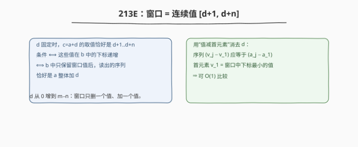
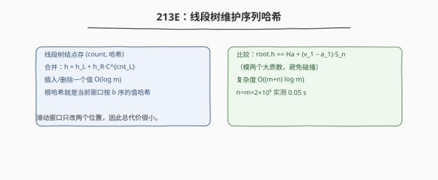

# Codeforces 213E 两个排列（Two Permutations） 题解

## 1. 题目概述

- **题目链接**：https://codeforces.com/problemset/problem/213/E
- **比赛来源**：Codeforces Round 131 (Div. 1) · Problem E（UTC 2012-07-30）
- **难度**：2700
- **标签**：哈希、线段树、滑动窗口
- **评测类型**：普通
- **限制**：时间 3 s / 内存 256 MB

**题意**：给定排列 $a$（长度 $n$）与 $b$（长度 $m$）。问有多少个整数 $d$，使 $c_i=a_i+d$ 构成的序列是 $b$ 的子序列。

**约束**：$1\le n\le m\le200000$。

## 2. 示例与观察

官方样例一：

```text
输入：
1 1
1
1

输出：
1
```

官方样例二：

```text
输入：
1 2
1
2 1

输出：
2
```

官方样例三：

```text
输入：
3 3
2 3 1
1 2 3

输出：
0
```

**观察**：$a$ 是 $1..n$ 的排列，所以 $\{a_i+d\}=\{d+1,\dots,d+n\}$ 是一段连续的值。$d$ 的合法范围是 $0\le d\le m-n$。条件：这些值在 $b$ 中的位置按 $a$ 的顺序严格递增。



## 3. 解题思路

### 3.1 朴素做法与瓶颈

对每个 $d$ 检查 $n$ 个位置：$O(nm)$，$4\times10^{10}$。

### 3.2 核心观察

令 $pos[x]$ 为 $x$ 在 $b$ 中的位置。窗口 $[d+1,d+n]$ 随 $d$ 滑动，每次只删一个值、加一个值。维护“窗口中所有值按 $b$ 中位置排序后的序列哈希”，与目标序列 $(a_1+d,\dots,a_n+d)$ 的哈希比较；用“减去首元素”消去 $d$：比较 $(v_j-v_1)$ 与 $(a_j-a_1)$。

### 3.3 算法流程

1. 读入 $a,b$，求每个值的 $pos$。
2. 线段树按下标 $pos[x]$ 维护窗口内值的多项式哈希（合并：$h=h_L+h_R\cdot C^{cnt_L}$）。
3. 初始把值 $1..n$ 插入；对 $d=0..m-n$ 比较根哈希与目标（双模数），相等则答案 +1。
4. 滑动：删除值 $d+1$，插入值 $d+n+1$。



### 3.4 样例走查

样例二 $n=1$：$d=0$（值 1，位置 2）与 $d=1$（值 2，位置 1）都合法 ⇒ 2。

## 4. 正确性证明

**引理 1（条件转化）**：$c=a+d$ 是 $b$ 的子序列 ⟺ $pos[d+a_1]<pos[d+a_2]<\dots<pos[d+a_n]$。

**证明**：$b$ 中每个值出现一次，子序列匹配只能取各自唯一位置；递增位置正是子序列的定义。∎

**引理 2（哈希比较正确）**：窗口按 $b$ 位置排序后的值序列为 $(v_1,\dots,v_n)$。它等于 $(d+a_1,\dots,d+a_n)$ ⟺ $(v_j-v_1)_j=(a_j-a_1)_j$。

**证明**：两边逐项比较；若 $v_j=d+a_j$ 则差相同；反之若差相同，则 $v_j=a_j+(v_1-a_1)$，且首项给出 $v_1=d+a_1$（$d=v_1-a_1$），故相等。∎

**引理 3（线段树哈希正确）**：根结点哈希等于窗口值按 $pos$ 升序的多项式哈希。

**证明**：合并规则 $h=h_L+h_R C^{cnt_L}$ 正是“左段在前、右段接在后面”的多项式拼接；按 $pos$ 建树保证中序即 $b$ 中顺序。∎

**定理**：算法计数正确。

**证明**：由引理 1 条件等价于位置递增，由引理 2、3 哈希比较等价于序列相等；滑动覆盖所有 $d$。双模数碰撞概率可忽略。∎

## 5. 复杂度分析

- **时间**：$O((m+n)\log m)$，$n=m=2\times10^5$ 实测 0.05 s。
- **空间**：$O(m)$。

## 6. 参考代码

### C++17

```cpp
#include <bits/stdc++.h>
using namespace std;
typedef unsigned long long ull;

static const ull MOD1 = 1000000007ULL, MOD2 = 1000000009ULL;

struct Node { int cnt; ull h1, h2; };
static vector<Node> seg;
static int sz;
static ull C1, C2;
static vector<ull> pw1, pw2;

static Node mergeNode(const Node &L, const Node &R) {
    Node res;
    res.cnt = L.cnt + R.cnt;
    res.h1 = (L.h1 + R.h1 * pw1[L.cnt]) % MOD1;
    res.h2 = (L.h2 + R.h2 * pw2[L.cnt]) % MOD2;
    return res;
}

int main() {
    int n, m;
    if (scanf("%d %d", &n, &m) != 2) return 0;
    vector<int> a(n), b(m + 1);
    for (int i = 0; i < n; ++i) scanf("%d", &a[i]);
    vector<int> pos(m + 1, 0);
    for (int i = 1; i <= m; ++i) { scanf("%d", &b[i]); pos[b[i]] = i; }
    C1 = 1000003ULL % MOD1; C2 = 1000007ULL % MOD2;
    pw1.assign(m + 2, 1); pw2.assign(m + 2, 1);
    for (int i = 1; i <= m + 1; ++i) { pw1[i] = pw1[i - 1] * C1 % MOD1; pw2[i] = pw2[i - 1] * C2 % MOD2; }
    sz = 1; while (sz < m) sz <<= 1;
    seg.assign(2 * sz, {0, 0, 0});
    int LOGN = 1; while ((1 << LOGN) < max(2, sz)) ++LOGN;
    auto setPos = [&](int p, int val) {   // p 从 1 开始；val=0 表示删除
        int idx = sz + p - 1;
        if (val) { ull v1 = (ull)val % MOD1, v2 = (ull)val % MOD2; seg[idx] = {1, v1, v2}; }
        else seg[idx] = {0, 0, 0};
        for (idx >>= 1; idx >= 1; idx >>= 1) seg[idx] = mergeNode(seg[2 * idx], seg[2 * idx + 1]);
    };
    auto leftmostVal = [&]() -> int {
        int idx = 1;
        while (idx < sz) {
            if (seg[2 * idx].cnt > 0) idx = 2 * idx;
            else idx = 2 * idx + 1;
        }
        int p = idx - sz + 1;
        return b[p];
    };
    // 预处理 a 的哈希与 S_n
    ull Ha1 = 0, Ha2 = 0;
    for (int i = 0; i < n; ++i) {
        Ha1 = (Ha1 + (ull)a[i] % MOD1 * pw1[i]) % MOD1;
        Ha2 = (Ha2 + (ull)a[i] % MOD2 * pw2[i]) % MOD2;
    }
    ull S1 = 0, S2 = 0;
    for (int i = 0; i < n; ++i) { S1 = (S1 + pw1[i]) % MOD1; S2 = (S2 + pw2[i]) % MOD2; }
    for (int v = 1; v <= n; ++v) setPos(pos[v], v);
    long long ans = 0;
    for (int d = 0; d + n <= m; ++d) {
        int v1 = leftmostVal();
        ull t1 = (Ha1 + (ull)((v1 - a[0]) % (long long)MOD1 + MOD1) % MOD1 * S1) % MOD1;
        ull t2 = (Ha2 + (ull)((v1 - a[0]) % (long long)MOD2 + MOD2) % MOD2 * S2) % MOD2;
        if (seg[1].h1 == t1 && seg[1].h2 == t2) ++ans;
        // 滑动：删除 d+1，加入 d+n+1
        if (d + 1 + n <= m) {
            setPos(pos[d + 1], 0);
            setPos(pos[d + n + 1], d + n + 1);
        }
    }
    printf("%lld\n", ans);
    return 0;
}
```

### Python3

```python
import sys

MOD1 = 1000000007
MOD2 = 1000000009


def main() -> None:
    data = sys.stdin.buffer.read().split()
    n = int(data[0]); m = int(data[1])
    a = [int(x) for x in data[2:2 + n]]
    b = [0] + [int(x) for x in data[2 + n:2 + n + m]]
    pos = [0] * (m + 1)
    for i in range(1, m + 1):
        pos[b[i]] = i
    C1 = 1000003 % MOD1
    C2 = 1000007 % MOD2
    pw1 = [1] * (m + 2)
    pw2 = [1] * (m + 2)
    for i in range(1, m + 2):
        pw1[i] = pw1[i - 1] * C1 % MOD1
        pw2[i] = pw2[i - 1] * C2 % MOD2
    sz = 1
    while sz < m:
        sz <<= 1
    cnt = [0] * (2 * sz)
    h1 = [0] * (2 * sz)
    h2 = [0] * (2 * sz)

    def set_pos(p, val):
        i = sz + p - 1
        if val:
            cnt[i] = 1
            h1[i] = val % MOD1
            h2[i] = val % MOD2
        else:
            cnt[i] = 0
            h1[i] = 0
            h2[i] = 0
        i >>= 1
        while i:
            l, r = 2 * i, 2 * i + 1
            cnt[i] = cnt[l] + cnt[r]
            h1[i] = (h1[l] + h1[r] * pw1[cnt[l]]) % MOD1
            h2[i] = (h2[l] + h2[r] * pw2[cnt[l]]) % MOD2
            i >>= 1

    def leftmost_val():
        i = 1
        while i < sz:
            i = 2 * i if cnt[2 * i] > 0 else 2 * i + 1
        return b[i - sz + 1]

    Ha1 = Ha2 = 0
    for i in range(n):
        Ha1 = (Ha1 + a[i] * pw1[i]) % MOD1
        Ha2 = (Ha2 + a[i] * pw2[i]) % MOD2
    S1 = sum(pw1[i] for i in range(n)) % MOD1
    S2 = sum(pw2[i] for i in range(n)) % MOD2
    for v in range(1, n + 1):
        set_pos(pos[v], v)
    ans = 0
    d = 0
    while d + n <= m:
        v1 = leftmost_val()
        t1 = (Ha1 + (v1 - a[0]) % MOD1 * S1) % MOD1
        t2 = (Ha2 + (v1 - a[0]) % MOD2 * S2) % MOD2
        if h1[1] == t1 and h2[1] == t2:
            ans += 1
        if d + 1 + n <= m:
            set_pos(pos[d + 1], 0)
            set_pos(pos[d + n + 1], d + n + 1)
        d += 1
    print(ans)


main()
```

## 7. 边界情况与易错点

1. **$d$ 的范围**：$0\le d\le m-n$，共 $m-n+1$ 个。
2. **$n=1$**：任何 $d$ 都满足（单元素恒递增），答案是 $m$ 吗？——需 $d+1\in[1,m]$，即 $0\le d\le m-1$，本例答案 2 ✓。
3. **哈希碰撞**：用两个大质数模数。
4. **滑动边界**：最后一步不能再插入 $d+n+1>m$。
5. **首元素**：用线段树取最左活跃值，删除后要更新。
6. **值域**：$pos$ 数组大小 $m+1$。

## 8. 验证记录

- **编译环境与命令**：`python3 codeforces/tools/verify_solution.py codeforces/contests/0101-0203/213/E_两个排列.md`。
- **官方样例**：3 / 3 通过（1、2、0）。
- **随机对拍**：暴力对每个 $d$ 直接检查位置递增（$n\le9$）共 **300 组**，C++/Python 与暴力一致。
- **性能**：$n=m=2\times10^5$ 随机 0.05 s；递增数据 $n=10^5,m=2\times10^5$ 答案 100001 ✓。
- **图片校验**：`cf213e_window.svg`、`cf213e_hash.svg` 通过 `xml.etree.ElementTree.parse`。
- **复核状态**：verified。

## 相关题目与扩展

- [Codeforces 213D 星星](https://codeforces.com/problemset/problem/213/D)：同场构造。
- [Codeforces 212B 好子串](https://codeforces.com/problemset/problem/212/B)：另一种窗口 + 掩码技巧。
- [LeetCode 28 找出字符串中第一个匹配项的下标](https://leetcode.cn/problems/find-the-index-of-the-first-occurrence-in-a-string/)：字符串哈希匹配。

**延伸思考**：

1. 若 $a$ 不是排列，窗口不再是连续值区间，需要换 $\text{next occurrence}$ 链。
2. 若要求“子序列”改为“连续子段”，就是普通的字符串匹配（KMP/哈希）。
3. 核心是**把“子序列”转成“位置递增”，再用滑动窗口 + 序列哈希比较**。
