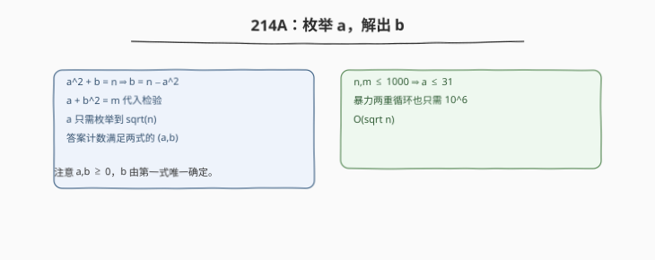
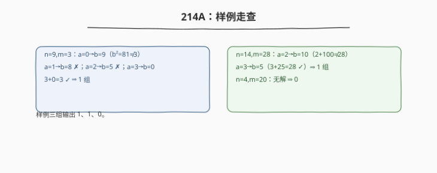

# Codeforces 214A 方程组（System of Equations） 题解

## 1. 题目概述

- **题目链接**：https://codeforces.com/problemset/problem/214/A
- **比赛来源**：Codeforces Round 131 (Div. 2) · Problem A（UTC 2012-07-30）
- **难度**：800
- **标签**：枚举、数学
- **评测类型**：普通
- **限制**：时间 2 s / 内存 256 MB

**题意**：给定 $n,m$，统计满足 $a^2+b=n$ 且 $a+b^2=m$ 的整数对 $(a,b)$（$a,b\ge0$）的个数。

**约束**：$1\le n,m\le1000$。

## 2. 示例与观察

官方样例一：

```text
输入：
9 3

输出：
1
```

官方样例二：

```text
输入：
14 28

输出：
1
```

官方样例三：

```text
输入：
4 20

输出：
0
```

**观察**：第一式唯一确定 $b=n-a^2$，只需枚举 $a\le\sqrt n$ 并检查第二式。



## 3. 解题思路

### 3.1 朴素做法与瓶颈

枚举 $a,b$ 两重循环到 1000 也可行（$10^6$），但没必要。

### 3.2 核心观察

由 $a^2+b=n$ 得 $b=n-a^2$，且 $a^2\le n$ ⇒ $a\le31$。

### 3.3 算法流程

1. 对 $a=0,1,\dots,\lfloor\sqrt n\rfloor$：令 $b=n-a^2$。
2. 若 $a+b^2=m$ 则计数 +1。
3. 输出计数。



### 3.4 样例走查

$n=9,m=3$：$a=3\Rightarrow b=0$，$3+0=3$ ✓ ⇒ 1；$n=14,m=28$：$a=3,b=5$，$3+25=28$ ✓ ⇒ 1；$n=4,m=20$：无解 ⇒ 0。

## 4. 正确性证明

**引理（枚举完备）**：满足 $a^2+b=n$ 的 $(a,b)$ 必满足 $a\le\lfloor\sqrt n\rfloor$ 且 $b=n-a^2$。

**证明**：$b\ge0$ ⇒ $a^2\le n$；并且 $b$ 由 $a$ 唯一确定。∎

**定理**：算法输出正确。

**证明**：算法枚举了所有可能的 $a$，对每个由第一式唯一确定 $b$ 并检验第二式，故不重不漏地统计了所有解。∎

## 5. 复杂度分析

- **时间**：$O(\sqrt n)\le31$。
- **空间**：$O(1)$。

## 6. 参考代码

### C++17

```cpp
#include <bits/stdc++.h>
using namespace std;
int main() {
    long long n, m;
    if (scanf("%lld %lld", &n, &m) != 2) return 0;
    long long cnt = 0;
    for (long long a = 0; a * a <= n; ++a) {
        long long b = n - a * a;
        if (b < 0) continue;
        if (a + b * b == m) ++cnt;
    }
    printf("%lld\n", cnt);
    return 0;
}
```

### Python3

```python
import sys


def main() -> None:
    n, m = map(int, sys.stdin.read().split())
    cnt = 0
    a = 0
    while a * a <= n:
        b = n - a * a
        if a + b * b == m:
            cnt += 1
        a += 1
    print(cnt)


main()
```

## 7. 边界情况与易错点

1. **$b$ 可以为 0**：如 $n=9$ 时 $(a,b)=(3,0)$ 合法。
2. **$a=0$**：也要枚举（$b=n$ 的情况）。
3. **无解输出 0**：不要输出 −1。
4. **多解**：可能有多组（例如 $n=m$ 时若干组），要全部计数。
5. **$n,m$ 范围小**：直接整数运算，无溢出。

## 8. 验证记录

- **编译环境与命令**：`python3 codeforces/tools/verify_solution.py codeforces/contests/0101-0203/214/A_方程组.md`。
- **官方样例**：3 / 3 通过（1、1、0）。
- **随机对拍**：与两重循环暴力（$a,b\le1000$）对拍 **250 组**，完全一致。
- **性能**：$n,m\le1000$ 时 < 1 ms。
- **图片校验**：`cf214a_loop.svg`、`cf214a_walk.svg` 通过 `xml.etree.ElementTree.parse`。
- **复核状态**：verified。

## 相关题目与扩展

- [Codeforces 214B 作业](https://codeforces.com/problemset/problem/214/B)：同场题目。
- [LeetCode 1 两数之和](https://leetcode.cn/problems/two-sum/)：另一类“由一式定另一式”的枚举。

**延伸思考**：

1. 若把平方改成任意函数 $f$，只需能快速求逆。
2. 若要求 $a,b$ 为整数（可为负），则 $a$ 可取 $-\lfloor\sqrt n\rfloor..\lfloor\sqrt n\rfloor$。
