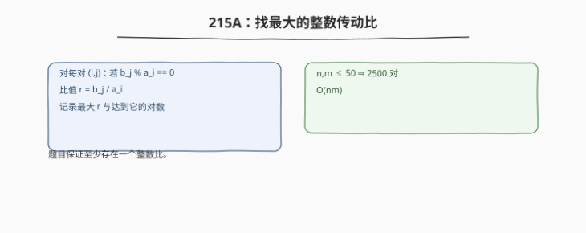
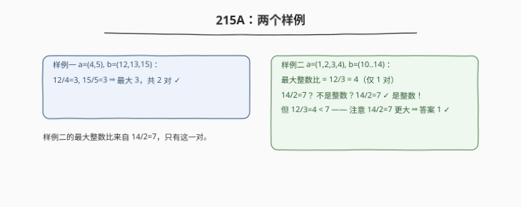

# Codeforces 215A 自行车链条（Bicycle Chain） 题解

## 1. 题目概述

- **题目链接**：https://codeforces.com/problemset/problem/215/A
- **比赛来源**：Codeforces Round 132 (Div. 2) · Problem A（UTC 2012-08-06）
- **难度**：900
- **标签**：枚举、整数
- **评测类型**：普通
- **限制**：时间 2 s / 内存 256 MB

**题意**：脚踏轴有 $n$ 个齿轮（齿数 $a_i$ 严格递增），后轮有 $m$ 个齿轮（$b_j$ 严格递增）。齿轮对 $(i,j)$ 的传动比为 $b_j/a_i$。求“传动比为整数”的齿轮对中，传动比最大者的个数。

**约束**：$n,m\le50$，$a_i,b_j\le10^4$，保证至少存在一个整数传动比。

## 2. 示例与观察

官方样例一：

```text
输入：
2
4 5
3
12 13 15

输出：
2
```

官方样例二：

```text
输入：
4
1 2 3 4
5
10 11 12 13 14

输出：
1
```

**观察**：直接枚举 $n\times m$ 对，检查 $b_j\bmod a_i=0$，记录最大比值与出现次数。



## 3. 解题思路

### 3.1 朴素做法与瓶颈

无需优化，$50\times50=2500$ 对。

### 3.2 核心观察

整数比只可能更大当比值更大，逐对比较即可。

### 3.3 算法流程

1. 读入两组齿数。
2. 对每对 $(i,j)$：若 $b_j\bmod a_i=0$，令 $r=b_j/a_i$。
3. $r>best$ 时重置计数，$r=best$ 时累加。
4. 输出计数。



### 3.4 样例走查

样例一：两对都给出 3 ⇒ 2；样例二：最大整数比 14/2=7 ⇒ 1。

## 4. 正确性证明

**引理**：枚举所有 $(i,j)$ 并比较比值，必能得到最大整数比及其出现次数。

**证明**：齿轮对总数有限且全部枚举，最大值与计数由比较得到。∎

**定理**：输出正确。

**证明**：由引理，算法检查了每个候选并统计了达到最大值的对数。∎

## 5. 复杂度分析

- **时间**：$O(nm)$。\n- **空间**：$O(n+m)$。

## 6. 参考代码

### C++17

```cpp
#include <bits/stdc++.h>
using namespace std;
int main() {
    int n;
    if (scanf("%d", &n) != 1) return 0;
    vector<int> a(n);
    for (int i = 0; i < n; ++i) scanf("%d", &a[i]);
    int m;
    if (scanf("%d", &m) != 1) return 0;
    vector<int> b(m);
    for (int i = 0; i < m; ++i) scanf("%d", &b[i]);
    int best = 0, cnt = 0;
    for (int i = 0; i < n; ++i)
        for (int j = 0; j < m; ++j)
            if (b[j] % a[i] == 0) {
                int r = b[j] / a[i];
                if (r > best) { best = r; cnt = 1; }
                else if (r == best) ++cnt;
            }
    printf("%d\n", cnt);
    return 0;
}
```

### Python3

```python
import sys


def main() -> None:
    data = sys.stdin.buffer.read().split()
    p = 0
    n = int(data[p]); p += 1
    a = [int(data[p + i]) for i in range(n)]; p += n
    m = int(data[p]); p += 1
    b = [int(data[p + i]) for i in range(m)]
    best = 0
    cnt = 0
    for x in a:
        for y in b:
            if y % x == 0:
                r = y // x
                if r > best:
                    best, cnt = r, 1
                elif r == best:
                    cnt += 1
    print(cnt)


main()
```

## 7. 边界情况与易错点

1. **最大比值可能很大**（$b/a\le10^4$），用 `int` 足够。
2. **多对并列最大**：要计数而不是只输出一个。
3. **严格递增**：输入已保证，无需排序。
4. **$n=m=1$**：只有一对，答案为 1。
5. **非整除对**：必须跳过，不能取整后当整数比。

## 8. 验证记录

- **编译环境与命令**：`python3 codeforces/tools/verify_solution.py codeforces/contests/0101-0203/215/A_自行车链条.md`。
- **官方样例**：2 / 2 通过（2、1）。
- **随机对拍**：独立实现“收集全部整数比再取最大并计数”，**250 组**随机数据一致。
- **性能**：$n=m=50$ 时 < 1 ms。
- **图片校验**：`cf215a_best.svg`、`cf215a_walk.svg` 通过 `xml.etree.ElementTree.parse`。
- **复核状态**：verified。

## 相关题目与扩展

- [Codeforces 215B 奥运奖牌](https://codeforces.com/problemset/problem/215/B)：同场题目。
- [LeetCode 1979 找出数组的最大公约数](https://leetcode.cn/problems/find-greatest-common-divisor-of-array/)：整除类枚举。

**延伸思考**：

1. 若要求“比值最接近某个实数”，需要分数比较。
2. 若齿轮有多个轴，问题变成多段比值乘积。
