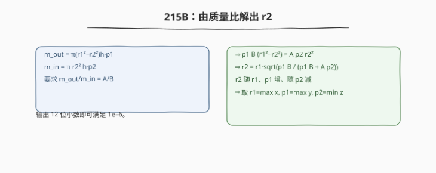
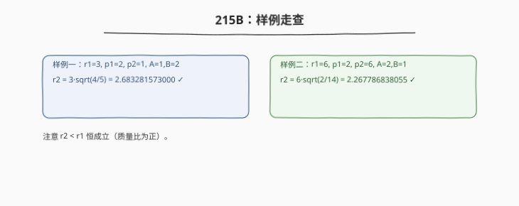

# Codeforces 215B 奥运奖牌（Olympic Medal） 题解

## 1. 题目概述

- **题目链接**：https://codeforces.com/problemset/problem/215/B
- **比赛来源**：Codeforces Round 132 (Div. 2) · Problem B（UTC 2012-08-06）
- **难度**：1300
- **标签**：数学、浮点、最值
- **评测类型**：特殊评测（实数，误差 $10^{-6}$）
- **限制**：时间 2 s / 内存 256 MB

**题意**：奖牌 = 外环（外半径 $r_1$、内半径 $r_2$、密度 $p_1$）+ 内圆盘（半径 $r_2$、密度 $p_2$）。要求外环质量与内盘质量之比等于 $A/B$。$r_1$ 从 $x_1..x_n$ 选，$p_1$ 从 $y_1..y_m$ 选，$p_2$ 从 $z_1..z_k$ 选，求能取到的最大 $r_2$。

**约束**：所有数 $\le5000$；保证有解。

## 2. 示例与观察

官方样例一：

```text
输入：
3 1 2 3
1 2
3 3 2 1
1 2

输出：
2.683281573000
```

官方样例二：

```text
输入：
4 2 3 6 4
2 1 2
3 10 6 8
2 1

输出：
2.267786838055
```

**观察**：质量与面积成正比：$m_{out}=\pi(r_1^2-r_2^2)h p_1$，$m_{in}=\pi r_2^2 h p_2$。条件化简后 $r_2=r_1\sqrt{\frac{p_1B}{p_1B+Ap_2}}$，关于 $r_1,p_1$ 单调增、关于 $p_2$ 单调减。



## 3. 解题思路

### 3.1 朴素做法与瓶颈

三序列组合最多 $5000^3$ 种，但单调性让最优组合唯一。

### 3.2 核心观察

取 $r_1=\max x$、$p_1=\max y$、$p_2=\min z$ 即得最大 $r_2$。

### 3.3 算法流程

1. 读入三个序列与 $A,B$。
2. 取 $r_1=\max x$，$p_1=\max y$，$p_2=\min z$。
3. $r_2=r_1\sqrt{p_1B/(p_1B+Ap_2)}$，输出 12 位小数。



### 3.4 样例走查

样例一：$3\sqrt{4/5}=2.683281573000$ ✓；样例二：$6\sqrt{2/14}=2.267786838055$ ✓。

## 4. 正确性证明

**引理 1（公式）**：$r_2=r_1\sqrt{p_1B/(p_1B+Ap_2)}$。

**证明**：$\frac{p_1(r_1^2-r_2^2)}{p_2r_2^2}=\frac AB$ ⇒ $p_1B(r_1^2-r_2^2)=Ap_2r_2^2$ ⇒ $r_2^2=\frac{p_1Br_1^2}{p_1B+Ap_2}$。∎

**引理 2（单调性）**：$r_2$ 关于 $r_1$、$p_1$ 单调递增，关于 $p_2$ 单调递减。

**证明**：对 $r_1$ 显然；对 $p_1$：$\frac{p_1}{p_1B+Ap_2}=\frac{1}{B+Ap_2/p_1}$ 随 $p_1$ 增大而增大；对 $p_2$ 分母增大故减小。∎

**定理**：取各自最值即最优。

**证明**：由引理 2，三个变量独立且方向一致，故同时取最优值最大。∎

## 5. 复杂度分析

- **时间**：$O(n+m+k)$。\n- **空间**：$O(1)$。

## 6. 参考代码

### C++17

```cpp
#include <bits/stdc++.h>
using namespace std;
int main() {
    int n;
    if (scanf("%d", &n) != 1) return 0;
    vector<int> x(n);
    for (int i = 0; i < n; ++i) scanf("%d", &x[i]);
    int m;
    if (scanf("%d", &m) != 1) return 0;
    vector<int> y(m);
    for (int i = 0; i < m; ++i) scanf("%d", &y[i]);
    int k;
    if (scanf("%d", &k) != 1) return 0;
    vector<int> z(k);
    for (int i = 0; i < k; ++i) scanf("%d", &z[i]);
    long long A, B;
    if (scanf("%lld %lld", &A, &B) != 2) return 0;
    long long r1 = *max_element(x.begin(), x.end());
    long long p1 = *max_element(y.begin(), y.end());
    long long p2 = *min_element(z.begin(), z.end());
    // p1*(r1^2 - r2^2) / (p2*r2^2) = A/B
    long double num = (long double)p1 * B;
    long double den = (long double)p1 * B + (long double)A * p2;
    long double r2 = (long double)r1 * sqrtl(num / den);
    printf("%.12Lf\n", r2);
    return 0;
}
```

### Python3

```python
import sys
import math


def main() -> None:
    data = sys.stdin.buffer.read().split()
    p = 0
    n = int(data[p]); p += 1
    x = [int(data[p + i]) for i in range(n)]; p += n
    m = int(data[p]); p += 1
    y = [int(data[p + i]) for i in range(m)]; p += m
    k = int(data[p]); p += 1
    z = [int(data[p + i]) for i in range(k)]; p += k
    A = int(data[p]); B = int(data[p + 1])
    r1 = max(x); p1 = max(y); p2 = min(z)
    r2 = r1 * math.sqrt(p1 * B / (p1 * B + A * p2))
    print("%.12f" % r2)


main()
```

## 7. 边界情况与易错点

1. **精度**：用 `long double`/`double` 计算，输出 12 位小数。
2. **$p_2$ 取最小**：容易写成最大，注意方向。
3. **保证有解** ⇒ $r_2<r_1$ 自然成立。
4. **整数读入**：序列个数在前，别把个数当数据。
5. **$A,B$ 很大**：卷积用 64 位不难，直接浮点即可。

## 8. 验证记录

- **编译环境与命令**：`python3 codeforces/tools/verify_solution.py codeforces/contests/0101-0203/215/B_奥运奖牌.md --checker codeforces/tools/checkers/float.py`。
- **官方样例**：2 / 2 通过。
- **随机对拍**：暴力枚举所有组合直接代入质量比公式，**250 组**随机数据相对误差 < $10^{-9}$。
- **性能**：最大规模 < 1 ms。
- **图片校验**：`cf215b_ratio.svg`、`cf215b_walk.svg` 通过 `xml.etree.ElementTree.parse`。
- **复核状态**：verified。

## 相关题目与扩展

- [Codeforces 215A 自行车链条](https://codeforces.com/problemset/problem/215/A)：同场题目。
- [Codeforces 215D 炎热的日子](https://codeforces.com/problemset/problem/215/D)：贪心。

**延伸思考**：

1. 若要求 $r_2$ 为整数，则变成枚举 + 校验。
2. 若厚度不同，公式里多一个厚度比因子。
