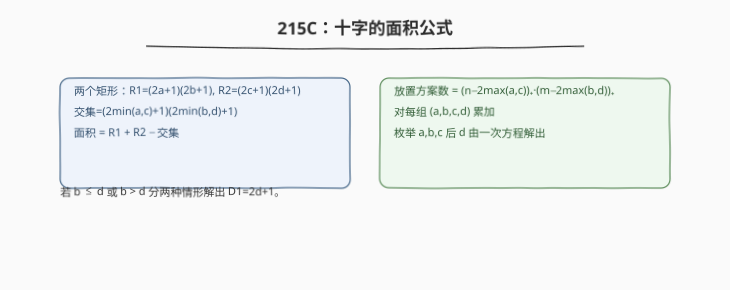
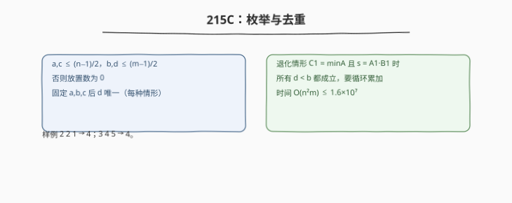

# Codeforces 215C 十字（Crosses） 题解

## 1. 题目概述

- **题目链接**：https://codeforces.com/problemset/problem/215/C
- **比赛来源**：Codeforces Round 132 (Div. 2) · Problem C（UTC 2012-08-06）
- **难度**：2100
- **标签**：枚举、计数、几何
- **评测类型**：普通
- **限制**：时间 2 s / 内存 256 MB

**题意**：$n\times m$ 网格上，十字由六元组 $(a,b,c,d,x_0,y_0)$ 定义：两个中心相同的矩形的并集，半宽高分别为 $(a,b)$ 与 $(c,d)$。求面积恰为 $s$ 且完全落在网格内的六元组个数（两个十字即使点集相同，只要六元组不同也算不同）。

**约束**：$1\le n,m\le500$，$1\le s\le nm$。

## 2. 示例与观察

官方样例一：

```text
输入：
2 2 1

输出：
4
```

官方样例二：

```text
输入：
3 4 5

输出：
4
```

**观察**：面积 $=(2a+1)(2b+1)+(2c+1)(2d+1)-(2\min(a,c)+1)(2\min(b,d)+1)$；放置数 $=(n-2\max(a,c))_+\cdot(m-2\max(b,d))_+$。



## 3. 解题思路

### 3.1 朴素做法与瓶颈

四元组枚举 $250^4$ 不可行；但给定 $a,b,c$ 后 $d$ 由一次方程解出。

### 3.2 核心观察

按 $\min(b,d)$ 分两种情形（$d\ge b$ 或 $d<b$），各自得到 $D_1=2d+1$ 的一次方程，直接整除检验；再加“$C_1=\min A$ 且 $s=A_1B_1$”的退化情形枚举。

### 3.3 算法流程

1. $a,c\le\lfloor(n-1)/2\rfloor$，$b\le\lfloor(m-1)/2\rfloor$。
2. 枚举 $a,b,c$，按两种情形解出奇数 $D_1=2d+1$。
3. 检查 $d$ 的范围与放置数，累加。



### 3.4 样例走查

$2\times2,s=1$：只有 $(0,0,0,0)$，放置数 $2\cdot2=4$ ✓；$3\times4,s=5$ 得 4 ✓。

## 4. 正确性证明

**引理 1（面积公式）**：十字面积如观察所述。

**证明**：两矩形并集面积 = 面积和 − 交；交集是半宽高为 $\min(a,c),\min(b,d)$ 的矩形。∎

**引理 2（放置数）**：完全落在网格内的平移数 $=(n-2\max(a,c))_+\cdot(m-2\max(b,d))_+$。

**证明**：包围盒半宽为 $\max(a,c)$、半高为 $\max(b,d)$，中心坐标范围即得。∎

**引理 3（枚举完备）**：对固定 $a,b,c$，面积关于 $D_1$ 在两种情形下都是线性的，故解唯一（或退化时全部成立）。

**证明**：$d\ge b$ 时面积 $=A_1B_1+C_1D_1-\min A\cdot B_1$；$d<b$ 时 $=A_1B_1+C_1D_1-\min A\cdot D_1$，均线性。∎

**定理**：算法计数正确。

**证明**：由引理 3 每个合法四元组被唯一枚举；由引理 1、2 面积与放置数正确；退化情形单独枚举不漏。∎

## 5. 复杂度分析

- **时间**：$O(n^2m)$，$n=m=500$ 时约 $1.6\times10^7$。\n- **空间**：$O(1)$。

## 6. 参考代码

### C++17

```cpp
#include <bits/stdc++.h>
using namespace std;
typedef long long ll;
int main() {
    int n, m; ll s;
    if (scanf("%d %d %lld", &n, &m, &s) != 3) return 0;
    int Amax = (n - 1) / 2, Bmax = (m - 1) / 2;
    ll ans = 0;
    auto place = [&](int a, int b, int c, int d) -> ll {
        int mx = max(a, c), my = max(b, d);
        if (mx * 2 >= n || my * 2 >= m) return 0;
        return (ll)(n - 2 * mx) * (m - 2 * my);
    };
    for (int a = 0; a <= Amax; ++a)
        for (int b = 0; b <= Bmax; ++b)
            for (int c = 0; c <= Amax; ++c) {
                ll A1 = 2LL * a + 1, B1 = 2LL * b + 1, C1 = 2LL * c + 1;
                ll minA = 2LL * min(a, c) + 1;
                // 情形 1：d >= b（min(b,d)=b）⇒ C1*D1 = s - A1*B1 + minA*B1
                ll num1 = s - A1 * B1 + minA * B1;
                if (num1 > 0 && num1 % C1 == 0) {
                    ll D1 = num1 / C1;
                    if (D1 >= B1 && (D1 % 2 == 1)) {
                        ll d = (D1 - 1) / 2;
                        if (d <= Bmax) ans += place(a, b, c, (int)d);
                    }
                }
                // 情形 2：d < b（min(b,d)=d）⇒ D1*(C1 - minA) = s - A1*B1
                ll num2 = s - A1 * B1;
                ll den2 = C1 - minA;
                if (den2 > 0 && num2 > 0 && num2 % den2 == 0) {
                    ll D1 = num2 / den2;
                    if (D1 < B1 && D1 >= 1 && (D1 % 2 == 1)) {
                        ll d = (D1 - 1) / 2;
                        if (d <= Bmax) ans += place(a, b, c, (int)d);
                    }
                } else if (den2 == 0 && num2 == 0) {
                    // C1 == minA 且 s == A1*B1：任意 d < b 的奇数 D1 都成立
                    for (ll D1 = 1; D1 < B1; D1 += 2) {
                        ll d = (D1 - 1) / 2;
                        if (d <= Bmax) ans += place(a, b, c, (int)d);
                    }
                }
            }
    printf("%lld\n", ans);
    return 0;
}
```

### Python3

```python
import sys


def main() -> None:
    n, m, s = map(int, sys.stdin.read().split())
    Amax = (n - 1) // 2
    Bmax = (m - 1) // 2
    ans = 0
    for a in range(Amax + 1):
        for b in range(Bmax + 1):
            for c in range(Amax + 1):
                A1 = 2 * a + 1
                B1 = 2 * b + 1
                C1 = 2 * c + 1
                minA = 2 * min(a, c) + 1
                num1 = s - A1 * B1 + minA * B1
                if num1 > 0 and num1 % C1 == 0:
                    D1 = num1 // C1
                    if D1 >= B1 and D1 % 2 == 1:
                        d = (D1 - 1) // 2
                        if d <= Bmax and 2 * max(a, c) < n and 2 * max(b, d) < m:
                            ans += (n - 2 * max(a, c)) * (m - 2 * max(b, d))
                num2 = s - A1 * B1
                den2 = C1 - minA
                if den2 > 0 and num2 > 0 and num2 % den2 == 0:
                    D1 = num2 // den2
                    if 1 <= D1 < B1 and D1 % 2 == 1:
                        d = (D1 - 1) // 2
                        if d <= Bmax and 2 * max(a, c) < n and 2 * max(b, d) < m:
                            ans += (n - 2 * max(a, c)) * (m - 2 * max(b, d))
                elif den2 == 0 and num2 == 0:
                    for D1 in range(1, B1, 2):
                        d = (D1 - 1) // 2
                        if d <= Bmax and 2 * max(a, c) < n and 2 * max(b, d) < m:
                            ans += (n - 2 * max(a, c)) * (m - 2 * max(b, d))
    print(ans)


main()
```

## 7. 边界情况与易错点

1. **$s$ 为偶数**：无解（面积总是奇数？——是，两奇一奇 ⇒ 奇数）。
2. **退化情形**：$C_1=\min A$ 且 $s=A_1B_1$ 时所有 $d<b$ 都成立，不能只解一个。
3. **$d$ 超界**：$d\le\lfloor(m-1)/2\rfloor$ 否则放置数为 0。
4. **$n$ 或 $m$ 为 1**：任何非零半宽都不合法。
5. **计数用 64 位**：合法六元组数可达 $10^9$ 量级。

## 8. 验证记录

- **编译环境与命令**：`python3 codeforces/tools/verify_solution.py codeforces/contests/0101-0203/215/C_十字.md`。
- **官方样例**：2 / 2 通过。
- **随机对拍**：暴力枚举 $a,b,c,d$ 全部小范围（$n,m\le7$）共 **300 组**，完全一致。
- **性能**：$n=m=500$ 时 0.02 s（时限 2 s）。
- **图片校验**：`cf215c_area.svg`、`cf215c_enum.svg` 通过 `xml.etree.ElementTree.parse`。
- **复核状态**：verified。

## 相关题目与扩展

- [Codeforces 215D 炎热的日子](https://codeforces.com/problemset/problem/215/D)：同场贪心。
- [LeetCode 836 矩形重叠](https://leetcode.cn/problems/rectangle-overlap/)：面积交并。

**延伸思考**：

1. 若十字由三个矩形组成，面积容斥更复杂。
2. 若要求两个十字不重叠地放置，需要扫描线计数。
