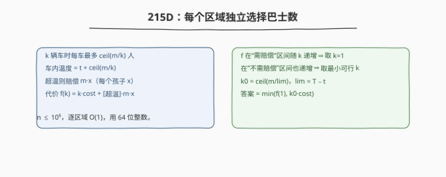
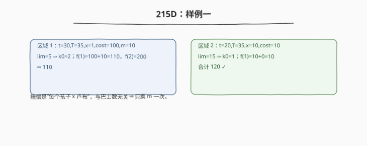

# Codeforces 215D 炎热的日子（Hot Days） 题解

## 1. 题目概述

- **题目链接**：https://codeforces.com/problemset/problem/215/D
- **比赛来源**：Codeforces Round 132 (Div. 2) · Problem D（UTC 2012-08-06）
- **难度**：1900
- **标签**：贪心、枚举、64 位
- **评测类型**：普通
- **限制**：时间 2 s / 内存 256 MB

**题意**：$n$ 个地区，$m$ 个孩子。第 $i$ 个地区：车内温度 $=t_i+$ 该车孩子数；超过 $T_i$ 则每个孩子赔 $x_i$；每辆巴士花费 $cost_i$。可任意增减巴士、任意分车。求把所有人送过去的最小总花费。

**约束**：$n\le10^5$，$m\le10^6$，所有参数 $\le10^6$。

## 2. 示例与观察

官方样例一：

```text
输入：
2 10
30 35 1 100
20 35 10 10

输出：
120
```

官方样例二：

```text
输入：
3 100
10 30 1000 1
5 10 1000 3
10 40 1000 100000

输出：
200065
```

**观察**：每个地区独立。用 $k$ 辆巴士时，每车最多 $\lceil m/k\rceil$ 人，费用 $f(k)=k\cdot cost+[t+\lceil m/k\rceil>T]\cdot m x$。



## 3. 解题思路

### 3.1 朴素做法与瓶颈

枚举 $k=1..m$ 是 $O(nm)=10^{11}$，太慢。

### 3.2 核心观察

在“超温”区间 $f$ 随 $k$ 递增 ⇒ 取 $k=1$；在“不超温”区间也递增 ⇒ 取最小可行 $k_0=\lceil m/(T-t)\rceil$。故只需比较 $f(1)$ 与 $k_0\cdot cost$。

### 3.3 算法流程

1. 对每个地区：$lim=T-t$。
2. 候选一：$cost+m x$（若 $t+m>T$），否则 $cost$。
3. 候选二：若 $lim\ge1$，$k_0=\lceil m/lim\rceil$，取 $k_0\cdot cost$。
4. 两者取小，累加所有地区。



### 3.4 样例走查

地区一 $lim=5,k_0=2$：$f(1)=110$，$f(2)=200$ ⇒ 110；地区二 $k_0=1$ ⇒ 10；合计 120 ✓。

## 4. 正确性证明

**引理 1（单区域费用）**：$k$ 辆巴士的最小费用为 $f(k)=k\,cost+[t+\lceil m/k\rceil>T]\,mx$。

**证明**：最优均分使最大载客量为 $\lceil m/k\rceil$；赔偿按“每个孩子 $x$”计，与车数无关。∎

**引理 2（只需两个候选）**：$f$ 在超温区间与不超温区间内都随 $k$ 递增。

**证明**：两个区间内第一项 $k\,cost$ 递增、第二项为常数。∎

**定理**：取 $f(1)$ 与 $f(k_0)$ 的最小即最优。

**证明**：由引理 2，超温区间最小值在 $k=1$，不超温区间最小值在最小可行 $k_0$；两区间覆盖所有 $k$。∎

## 5. 复杂度分析

- **时间**：$O(n)$。\n- **空间**：$O(1)$。\n- 费用可达 $10^{17}$，用 64 位。

## 6. 参考代码

### C++17

```cpp
#include <bits/stdc++.h>
using namespace std;
typedef long long ll;
int main() {
    int n; ll m;
    if (scanf("%d %lld", &n, &m) != 2) return 0;
    ll total = 0;
    for (int i = 0; i < n; ++i) {
        ll t, T, x, cost;
        scanf("%lld %lld %lld %lld", &t, &T, &x, &cost);
        ll lim = T - t;                    // 每车最多能坐 lim+? 人是舒服的：ceil(m/k) <= lim
        // 方案一：一辆车（k=1）
        ll c1 = cost + ((t + m > T) ? m * x : 0);
        ll best = c1;
        // 方案二：k 辆车且不超温 ⇒ k >= ceil(m/lim)（lim >= 1）
        if (lim >= 1) {
            ll k0 = (m + lim - 1) / lim;
            if (k0 >= 1) {
                ll c2 = k0 * cost;         // 此时 ceil(m/k0) <= lim ⇒ 无赔偿
                best = min(best, c2);
            }
        }
        total += best;
    }
    printf("%lld\n", total);
    return 0;
}
```

### Python3

```python
import sys


def main() -> None:
    data = sys.stdin.buffer.read().split()
    n = int(data[0]); m = int(data[1])
    p = 2
    total = 0
    for _ in range(n):
        t = int(data[p]); T = int(data[p + 1]); x = int(data[p + 2]); cost = int(data[p + 3])
        p += 4
        lim = T - t
        best = cost + (m * x if t + m > T else 0)
        if lim >= 1:
            k0 = (m + lim - 1) // lim
            best = min(best, k0 * cost)
        total += best
    print(total)


main()
```

## 7. 边界情况与易错点

1. **64 位**：$m\cdot x\le10^{12}$，乘 $n$ 后 $10^{17}$。
2. **$lim<1$**：无论多少车都超温 ⇒ 只能选 $k=1$。
3. **赔偿与车数无关**：只乘 $m$ 一次，别乘 $k$。
4. **$k_0$ 超过 $m$**：$m/lim\ge1$ 时 $k_0\le m$。
5. **向上取整**：$(m+lim-1)/lim$。

## 8. 验证记录

- **编译环境与命令**：`python3 codeforces/tools/verify_solution.py codeforces/contests/0101-0203/215/D_炎热的日子.md`。
- **官方样例**：2 / 2 通过。
- **随机对拍**：暴力枚举 $k=1..m$（$m\le30$）共 **250 组**，完全一致。
- **性能**：$n=10^5,m=10^6$ 时 0.02 s（时限 2 s）。
- **图片校验**：`cf215d_cost.svg`、`cf215d_walk.svg` 通过 `xml.etree.ElementTree.parse`。
- **复核状态**：verified。

## 相关题目与扩展

- [Codeforces 215E 周期数](https://codeforces.com/problemset/problem/215/E)：同场数位题。
- [LeetCode 875 爱吃香蕉的珂珂](https://leetcode.cn/problems/koko-eating-bananas/)：单调代价上取最优。

**延伸思考**：

1. 若罚款与车数有关，需要枚举 $O(\sqrt m)$ 个断点。
2. 若孩子可跨地区重新分配，问题变成全局优化。
