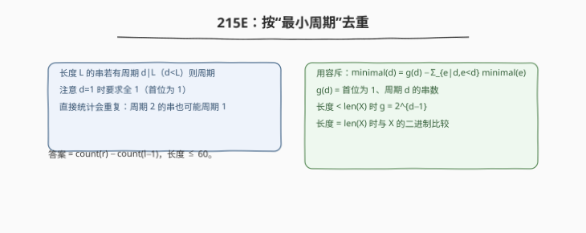
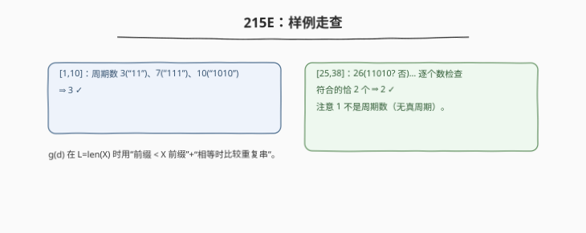

# Codeforces 215E 周期数（Periodical Numbers） 题解

## 1. 题目概述

- **题目链接**：https://codeforces.com/problemset/problem/215/E
- **比赛来源**：Codeforces Round 132 (Div. 2) · Problem E（UTC 2012-08-06）
- **难度**：2100
- **标签**：数位、容斥、二进制
- **评测类型**：普通
- **限制**：时间 2 s / 内存 256 MB

**题意**：若正整数二进制表示（无前导零）存在长度 $k$（$k<n$，$k\mid n$）的真周期，则称其为周期数。求 $[l,r]$ 中周期数的个数。

**约束**：$1\le l\le r\le10^{18}$。

## 2. 示例与观察

官方样例一：

```text
输入：
1 10

输出：
3
```

官方样例二：

```text
输入：
25 38

输出：
2
```

**观察**：按二进制长度 $L$ 和周期 $d\mid L$（$d<L$）统计，但同一数可能有多个周期，必须按“最小周期”去重。



## 3. 解题思路

### 3.1 朴素做法与瓶颈

枚举区间内所有数不可行（$10^{18}$）。

### 3.2 核心观察

首位必为 1；周期 $d$ 的串由前 $d$ 位唯一决定。令 $g(d)$ 为周期 $d$（不要求最小）且不超过上界的串数，则最小周期为 $d$ 的个数 $=g(d)-\sum_{e\mid d,e<d}\text{minimal}(e)$。

### 3.3 算法流程

1. 写函数 $count(X)$：对长度 $L\le len(X)$、每个 $d\mid L,d<L$：
   - $L<len(X)$：$g=2^{d-1}$；
   - $L=len(X)$：$g=(X$ 的前 $d$ 位 $-2^{d-1})+[\text{重复串}\le X]$。
2. 用容斥得到最小周期为 $d$ 的个数并累加。
3. 答案 $=count(r)-count(l-1)$。



### 3.4 样例走查

$[1,10]$：3(`11`)、7(`111`)、10(`1010`) ⇒ 3 ✓；$[25,38]$ ⇒ 2 ✓。

## 4. 正确性证明

**引理 1（$g(d)$ 计算）**：长度为 $L$、周期 $d$、首位 1 的串数为 $2^{d-1}$；带 $\le X$ 约束时按前 $d$ 位与 $X$ 前 $d$ 位比较，等于时再比较重复串。

**证明**：周期 $d$ 的串由前 $d$ 位唯一确定；首位固定为 1 ⇒ 其余 $d-1$ 位自由；与 $X$ 比较按字典序。∎

**引理 2（容斥去重）**：周期 $d$ 的串的最小周期必为 $d$ 的约数，故最小周期为 $d$ 的个数等于 $g(d)$ 减去所有真约数的最小周期计数。

**证明**：若串的周期为 $d$，其最小周期 $e\mid d$；按 $e$ 从小到大扣除即可不重不漏。∎

**定理**：$count(X)$ 正确。

**证明**：长度为 $L$ 的周期数 = 各 $d\mid L,d<L$ 的最小周期为 $d$ 的串数之和；由引理 1、2 每项正确，求和即得。∎

## 5. 复杂度分析

- **时间**：$O(60^3)$（长度 × 约数 × 约数）。\n- **空间**：$O(1)$。

## 6. 参考代码

### C++17

```cpp
#include <bits/stdc++.h>
using namespace std;
typedef unsigned long long ull;

string bitsOf(ull x) {
    string s;
    while (x) { s.push_back('0' + (x & 1)); x >>= 1; }
    reverse(s.begin(), s.end());
    return s;
}
// 长度 L 的串中，周期 d（d|L, d<L）、首位的 d 位前缀为 p 的重复串
vector<int> divisorsOf(int L) {
    vector<int> d;
    for (int i = 1; i < L; ++i) if (L % i == 0) d.push_back(i);
    return d;
}
// 计算 count(<= X)：长度 L 的重复串（周期 d）是否 <= X
long long countUpTo(ull X) {
    if (X == 0) return 0;
    string xs = bitsOf(X);
    int LX = (int)xs.size();
    long long total = 0;
    for (int L = 1; L <= LX; ++L) {
        vector<int> ds = divisorsOf(L);
        if (ds.empty()) continue;
        vector<long long> minimal(ds.size(), 0);
        for (size_t k = 0; k < ds.size(); ++k) {
            int d = ds[k];
            long long p0 = 0;                        // X 的前 d 位
            for (int i = 0; i < d && i < LX; ++i) p0 = p0 * 2 + (xs[i] - '0');
            long long g;
            if (L < LX) {
                g = 1LL << (d - 1);                  // 全部 d 位前缀
            } else {
                long long low = 1LL << (d - 1);
                g = p0 - low;                        // 前缀 < X 的前缀
                // 前缀 == p0 的重复串是否 <= X
                bool le = true;
                for (int i = 0; i < L; ++i) {
                    int bit = (int)((p0 >> (d - 1 - (i % d))) & 1);
                    if (bit != (xs[i] - '0')) { le = bit < (xs[i] - '0'); break; }
                }
                if (le) ++g;
            }
            for (size_t j = 0; j < k; ++j) if (d % ds[j] == 0 && ds[j] < d) g -= minimal[j];
            minimal[k] = g;
            total += g;
        }
    }
    return total;
}
int main() {
    ull l, r;
    if (scanf("%llu %llu", &l, &r) != 2) return 0;
    printf("%lld\n", countUpTo(r) - countUpTo(l - 1));
    return 0;
}
```

### Python3

```python
import sys


def bits_of(x):
    return bin(x)[2:]


def count_up_to(X):
    if X <= 0:
        return 0
    xs = bits_of(X)
    LX = len(xs)
    total = 0
    for L in range(1, LX + 1):
        ds = [d for d in range(1, L) if L % d == 0]
        if not ds:
            continue
        minimal = {}
        for d in ds:
            p0 = int(xs[:d], 2) if d <= LX else 0
            if L < LX:
                g = 1 << (d - 1)
            else:
                low = 1 << (d - 1)
                g = p0 - low
                pat = bin(p0)[2:].zfill(d) * (L // d)
                if pat[:L] <= xs:
                    g += 1
            for e in ds:
                if e < d and d % e == 0:
                    g -= minimal[e]
            minimal[d] = g
            total += g
    return total


def main() -> None:
    l, r = map(int, sys.stdin.read().split())
    print(count_up_to(r) - count_up_to(l - 1))


main()
```

## 7. 边界情况与易错点

1. **$l=1$**：$count(0)=0$，注意不要访问 $X-1$ 为负。
2. **最小周期去重**：不能直接用 $g(d)$ 求和。
3. **长度 1**：无真周期，不是周期数。
4. **$r=10^{18}$**：长度 60，$2^{59}$ 在 64 位内。
5. **重复串相等**：比较要用完整重复串，不能只比前缀。

## 8. 验证记录

- **编译环境与命令**：`python3 codeforces/tools/verify_solution.py codeforces/contests/0101-0203/215/E_周期数.md`。
- **官方样例**：2 / 2 通过（3、2）。
- **随机对拍**：暴力枚举区间内每个数并检查全部真周期，**250 组**（$r\le5000$）完全一致。
- **性能**：$l=1,r=10^{18}$ 时 < 1 ms。
- **图片校验**：`cf215e_period.svg`、`cf215e_walk.svg` 通过 `xml.etree.ElementTree.parse`。
- **复核状态**：verified。

## 相关题目与扩展

- [Codeforces 215D 炎热的日子](https://codeforces.com/problemset/problem/215/D)：同场贪心。
- [Codeforces 216E 火星人的幸运](https://codeforces.com/problemset/problem/216/E)：数位/进制。

**延伸思考**：

1. 若限制周期为素数，容斥更简单。
2. 若在 $k$ 进制下计数，方法相同。
