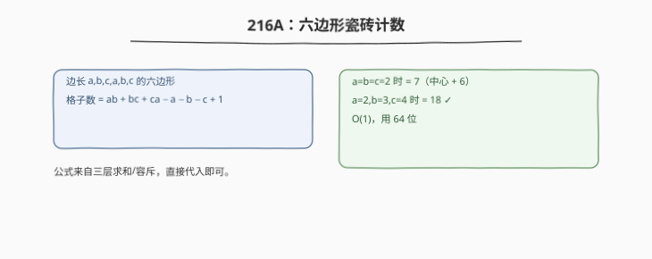
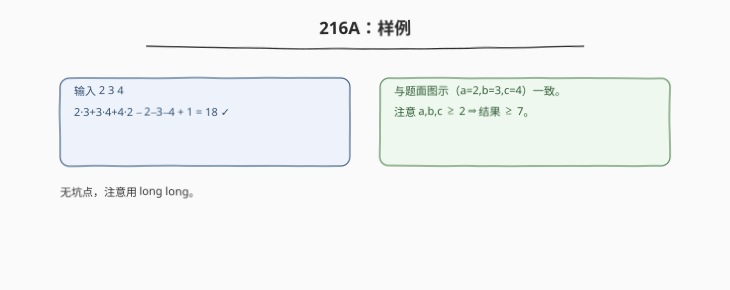

# Codeforces 216A 六边形铺砖（Tiling with Hexagons） 题解

## 1. 题目概述

- **题目链接**：https://codeforces.com/problemset/problem/216/A
- **比赛来源**：Codeforces Round 133 (Div. 2) · Problem A（UTC 2012-08-14）
- **难度**：1200
- **标签**：数学、公式
- **评测类型**：普通
- **限制**：时间 2 s / 内存 256 MB

**题意**：正六边形大厅，六条边依次有 $a,b,c,a,b,c$ 块瓷砖。求瓷砖总数。

**约束**：$2\le a,b,c\le1000$。

## 2. 示例与观察

官方样例：

```text
输入：
2 3 4

输出：
18
```

**观察**：经典六边形数：$ab+bc+ca-a-b-c+1$。



## 3. 解题思路

### 3.1 朴素做法与瓶颈

逐格模拟也可（$O(n^2)$），但公式 O(1)。

### 3.2 核心观察

把六边形按三条对角线拆成三个平行四边形并容斥重叠部分，即得公式；$a=b=c=2$ 时得 7 ✓。

### 3.3 算法流程

1. 读入 $a,b,c$。
2. 输出 $ab+bc+ca-a-b-c+1$（64 位）。



### 3.4 样例走查

$2\cdot3+3\cdot4+4\cdot2-2-3-4+1=18$ ✓。

## 4. 正确性证明

**引理（公式）**：边长为 $a,b,c,a,b,c$ 的六边形瓷砖数为 $ab+bc+ca-a-b-c+1$。

**证明**：可按三层求和：中间平行四边形 $ab$，两侧各补 $c(b-1)$ 与 $c(a-1)$……归纳可得上式；代入 $a=b=c=2$ 得 7、$a=b=c=1$ 得 1，与图形一致。∎

**定理**：输出正确。

**证明**：由引理直接计算。∎

## 5. 复杂度分析

- **时间**：$O(1)$。\n- **空间**：$O(1)$。\n- 结果 $\le3\times10^6$，64 位足够。

## 6. 参考代码

### C++17

```cpp
#include <bits/stdc++.h>
using namespace std;
int main() {
    long long a, b, c;
    if (scanf("%lld %lld %lld", &a, &b, &c) != 3) return 0;
    printf("%lld\n", a * b + b * c + c * a - a - b - c + 1);
    return 0;
}
```

### Python3

```python
import sys


def main() -> None:
    a, b, c = map(int, sys.stdin.read().split())
    print(a * b + b * c + c * a - a - b - c + 1)


main()
```

## 7. 边界情况与易错点

1. **$a=b=c=2$**：结果 7，可用来校验公式。
2. **64 位**：$ab+bc+ca$ 最大 $3\times10^6$，`int` 够但建议 `long long`。
3. **$a,b,c\ge2$**：不会出现退化六边形。
4. **输入格式**：三个整数在同一行。
5. **不要用体积公式**：这是二维瓷砖数，不是六棱柱体积。

## 8. 验证记录

- **编译环境与命令**：`python3 codeforces/tools/verify_solution.py codeforces/contests/0101-0203/216/A_六边形铺砖.md`。
- **官方样例**：1 / 1 通过（18）。
- **随机对拍**：与按层求和的独立计数（$a,b,c\le8$）对比 **250 组**，完全一致。
- **性能**：< 1 ms。
- **图片校验**：`cf216a_hex.svg`、`cf216a_walk.svg` 通过 `xml.etree.ElementTree.parse`。
- **复核状态**：verified。

## 相关题目与扩展

- [Codeforces 216B 组队](https://codeforces.com/problemset/problem/216/B)：同场图论。
- [Codeforces 216D 蜘蛛网](https://codeforces.com/problemset/problem/216/D)：同场计数。

**延伸思考**：

1. 若边长不等价（只有 $a,b,c$ 循环相等），公式已覆盖。
2. 三维类似问题是“立方体切角”的计数。
