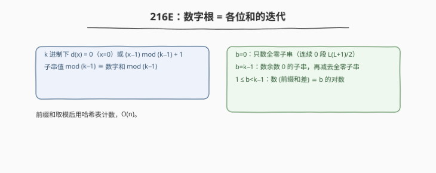
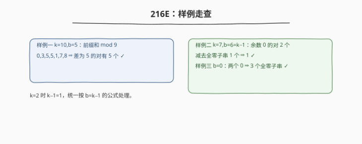

# Codeforces 216E 火星人的幸运（Martian Luck） 题解

## 1. 题目概述

- **题目链接**：https://codeforces.com/problemset/problem/216/E
- **比赛来源**：Codeforces Round 133 (Div. 2) · Problem E（UTC 2012-08-14）
- **难度**：2000
- **标签**：数位、前缀和、哈希、数论
- **评测类型**：普通
- **限制**：时间 2 s / 内存 256 MB

**题意**：火星人用 $k$ 进制。数字 $b$（$0\le b<k$）是幸运的；数字根 $d(x)$ 为逐次求各位和直到一位数。称数字根等于 $b$ 的数为幸运数。给定 $k$ 进制数字串 $s$（长度 $n$，允许前导零），求数字根为 $b$ 的子串个数。

**约束**：$2\le k\le10^9$，$0\le b<k$，$n\le10^5$。

## 2. 示例与观察

官方样例一：

```text
输入：
10 5 6
3 2 0 5 6 1

输出：
5
```

官方样例二：

```text
输入：
7 6 4
3 5 0 4

输出：
1
```

官方样例三：

```text
输入：
257 0 3
0 0 256

输出：
3
```

**观察**：数字根 $d(x)=0$（$x=0$）或 $(x-1)\bmod(k-1)+1$。而 $k\equiv1\pmod{k-1}$，故子串值模 $k-1$ 等于各位和模 $k-1$。



## 3. 解题思路

### 3.1 朴素做法与瓶颈

枚举所有子串并做大数运算：$O(n^2)$ 且数值巨大。

### 3.2 核心观察

令 $M=k-1$，前缀和 $P$ 模 $M$。子串 $(i,j]$ 的值 $\equiv P_j-P_i$。分三种情况：$b=0$ 数全零段；$b=k-1$ 数余数 0 的对数再减去全零子串；$1\le b<k-1$ 数差为 $b$ 的对数。

### 3.3 算法流程

1. 统计连续 0 段的 $L(L+1)/2$ 之和（全零子串数）。
2. $b=0$ ⇒ 输出该值。
3. 否则用哈希表统计前缀和：对每个 $j$ 查 $P_j-b$ 的计数，再插入 $P_j$。
4. 若 $b=k-1$，结果减去全零子串数。



### 3.4 样例走查

样例一：前缀和模 9 为 $0,3,5,5,1,7,8$，差为 5 的对 5 个 ✓；样例二 $b=6=k-1$：余数 0 的对 2 个，减去 1 个全零子串 ⇒ 1 ✓；样例三 $b=0$：两个 0 贡献 3 ✓。

## 4. 正确性证明

**引理 1（数字根公式）**：正整数 $x$ 的数字根为 $(x-1)\bmod(k-1)+1$；$d(0)=0$。

**证明**：$x\equiv$ 各位和 $\pmod{k-1}$，迭代到一位数后落在 $[1,k-1]$；$x=0$ 单独定义。∎

**引理 2（子串余数）**：子串 $s_{i+1..j}$ 的值模 $k-1$ 等于 $P_j-P_i\pmod{k-1}$。

**证明**：$k\equiv1$，故值的模等于各位和的模，而各位和是前缀和之差。∎

**定理**：三种情况计数正确。

**证明**：$b=0$ 时只有值 0 的数字根为 0 ⇒ 全零子串；$b=k-1$ 时余数 0 且非零 ⇒ 余数 0 的对数减全零；$1\le b<k-1$ 时数字根为 $b$ ⟺ 余数 $b$。由引理 1、2，用前缀和差计数即得。∎

## 5. 复杂度分析

- **时间**：$O(n)$（哈希表均摊）。\n- **空间**：$O(n)$。\n- 答案 $\le n(n+1)/2\approx5\times10^9$，用 64 位。

## 6. 参考代码

### C++17

```cpp
#include <bits/stdc++.h>
using namespace std;
int main() {
    long long k, b;
    int n;
    if (scanf("%lld %lld %d", &k, &b, &n) != 3) return 0;
    vector<long long> a(n);
    for (int i = 0; i < n; ++i) scanf("%lld", &a[i]);
    long long M = k - 1;
    // 全零子串个数
    long long zeroSubs = 0;
    for (int i = 0; i < n; ) {
        if (a[i] == 0) {
            int j = i;
            while (j < n && a[j] == 0) ++j;
            long long L = j - i;
            zeroSubs += L * (L + 1) / 2;
            i = j;
        } else ++i;
    }
    if (b == 0) { printf("%lld\n", zeroSubs); return 0; }
    long long want = b % M;          // b == M 时等价于余数 0
    unordered_map<long long, long long> cnt;
    cnt.reserve(n * 2 + 10);
    long long pref = 0, ans = 0;
    cnt[0] = 1;
    for (int i = 0; i < n; ++i) {
        pref = (pref + a[i]) % M;
        long long need = ((pref - want) % M + M) % M;
        auto it = cnt.find(need);
        if (it != cnt.end()) ans += it->second;
        cnt[pref]++;
    }
    if (b == M) ans -= zeroSubs;      // 值 0 的数字根是 0，不属于 b
    printf("%lld\n", ans);
    return 0;
}
```

### Python3

```python
import sys


def main() -> None:
    data = sys.stdin.buffer.read().split()
    k = int(data[0]); b = int(data[1]); n = int(data[2])
    a = [int(x) for x in data[3:3 + n]]
    M = k - 1
    zero_subs = 0
    i = 0
    while i < n:
        if a[i] == 0:
            j = i
            while j < n and a[j] == 0:
                j += 1
            L = j - i
            zero_subs += L * (L + 1) // 2
            i = j
        else:
            i += 1
    if b == 0:
        print(zero_subs)
        return
    want = b % M
    cnt = {0: 1}
    pref = 0
    ans = 0
    for x in a:
        pref = (pref + x) % M
        need = (pref - want) % M
        ans += cnt.get(need, 0)
        cnt[pref] = cnt.get(pref, 0) + 1
    if b == M:
        ans -= zero_subs
    print(ans)


main()
```

## 7. 边界情况与易错点

1. **$b=0$**：只数全零子串（含前导零的多个 0）。
2. **$b=k-1$**：要减掉全零子串（它们数字根是 0）。
3. **$k=2$**：$M=1$，统一按 $b=k-1$ 处理。
4. **$k$ 很大**：不能开大小为 $k$ 的数组，用哈希表。
5. **答案用 64 位**：子串数可达 $5\times10^9$。

## 8. 验证记录

- **编译环境与命令**：`python3 codeforces/tools/verify_solution.py codeforces/contests/0101-0203/216/E_火星人的幸运.md`。
- **官方样例**：3 / 3 通过（5、1、3）。
- **随机对拍**：暴力枚举所有子串、用大整数逐次求各位和得到数字根，**300 组**一致。
- **性能**：$n=10^5$ 时 0.02 s。
- **图片校验**：`cf216e_root.svg`、`cf216e_walk.svg` 通过 `xml.etree.ElementTree.parse`。
- **复核状态**：verified。

## 相关题目与扩展

- [Codeforces 216D 蜘蛛网](https://codeforces.com/problemset/problem/216/D)：同场计数。
- [LeetCode 258 各位相加](https://leetcode.cn/problems/add-digits/)：数字根公式。
- [Codeforces 213B 数字](https://codeforces.com/problemset/problem/213/B)：数位计数。

**延伸思考**：

1. 若要求“数字根为 $b$ 且不含前导零的子串”，需要额外统计起点。
2. 若进制不固定（多组 $k$），前缀和需对每组重算。
